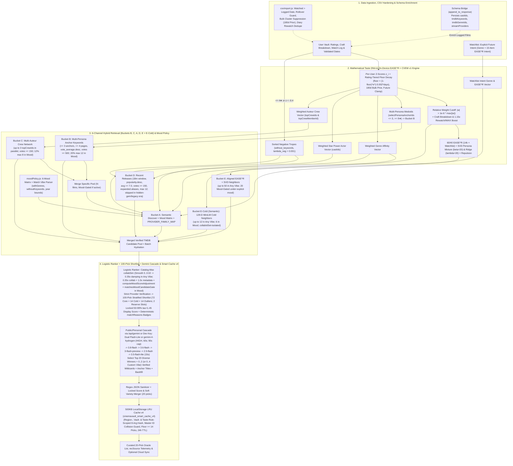

# 🏛️ CinemaVault: Technical Architecture & Mathematics Specification (v6.2)

**CinemaVault** is an open-source, local-first cinema logging, analytics, research, and hybrid recommendation platform with optional opt-in Supabase cloud sync.

Rather than prompting an LLM to invent movie lists from scratch, CinemaVault separates **on-device mathematical taste modeling, multi-bucket catalog retrieval, and deterministic logistic ranking** from **bounded LLM diversity selection and natural-language explanations**:
- **On-Device EASE^R + SVD Collaborative Engine, Neural Cold-Start & Behavioral Signals (`v6.2`):** Per-user z-scored rating normalization with rating-tiered recency decay (`scoringUtils.js`), an **Exact Full-Rank Sparse EASE^R** item-item graph (`14,000` films × `64` outgoing neighbors, `3.47 MB` `CVEA v1`, `< 1 ms` scoring, `easeService.js`, incl. `0.25×` Watchlist forward-intent across up to `15` recent unwatched items) blended **`60/40`** with the `25,000`-film × `64`-D IEEE-754 `float16` SVD index (`CVEM v1`, `embeddingService.js`), **`11,119 × 128-D` neural semantic cold-start embeddings** (`content_embeddings_f16.bin`, `2.76 MB`, `coldOnly: true`, `+26.7%*` cold-start `NDCG@10` on `2024–2026` releases) with `rating >= 7` positive guard + `"Bucket E-Cold (Semantic)"` retrieval (`collabIdSet`-isolated in Web Worker mode), Rating Studio Craft Breakdown (`direction`/`visuals` -> crew, `acting` -> cast) + `1.15×` `>= 8★` rewatch/IMAX/physical boost, pacing-dismissal filtering (`/too\s*slow|pacing/i` in `onlineLearningService.js`), vault-relative weight cutoffs (`1e-6 * maxAbsWeight`), mass-weighted Spherical K-Means multi-persona mixtures (`beta = 20`), `64×64` Ridge fold-in (`lambda = 20`), and quadratic disliked-film repulsion (`+49.7%*` warm `NDCG@10` / `+46.3%*` `NDCG@20` / `+9.7%` Long-Tail Hits@20 on 300 unseen MovieLens 32M users).
- **6-Channel Verified Retrieval (`A–E` + `E-Cold`) & Logistic Ranker:** Parallel TMDB + EASE^R/SVD + Cold-Semantic candidate harvesting (`tmdbService.js`: multi-persona Bucket `B` up to 3 anchors, multi-auteur Bucket `C` up to 3 `topCrewIds`, expanded `PROVIDER_FAMILY_MAP` aliases across Bucket `D` as well as `A–C`, up to `50` aligned Bucket `E` neighbors in `"any"` mode, and up to `12` `"Bucket E-Cold (Semantic)"` neighbors) with batched `/api/tmdb-batch` metadata hydration and 30-day IndexedDB caching (`tmdbCacheService.js`), scored by a 12-feature logistic ranker (`rankerService.js`) with pool-independent `catalog-max` normalization, smoothstep `[0, 0.02]` → `0.35x` metadata damping, canonical mood/vibe policy (`moodPolicy.js`), steerable Prefer/Avoid taste rules (`tasteRulesService.js`), and an order-preserving `tau = 1.45` display score transform (`[50, 99]`).
- **Stratified `100 → 20` Gemini Curation, Score Lock & Resilient Cascade:** Unbiased **`20`-pick** curation over a **`100`-candidate stratified shortlist** (`72` core + `14` cold `2024–2026` + `14` diverse outliers via `buildDiversifiedGeminiShortlist`), adaptive prompt budgeting (`20,000–34,000` chars), grounded 2-sentence editorial pitches, optional `0–2` (or `0–4` on custom free-text vibes) TMDB-verified `wildcardPicks` (`verifyAndScoreWildcardPicks`), soft director/franchise variety caps (`selectWithSoftVarietyCaps`), Wave-3 `Explore For You` score lock (`exploreForYouService.js`), and an error-classified Gemini cascade (`geminiService.js`, `60s` Hydrogen / `90s` cascade ceiling) with deterministic ranker fallback and `cinemavault_smart_cache_v4` (`MIN_VALID_CACHE_COUNT = 14`).
- **Research Hub, 10-Star Rating Studio & Cloud Sync:** Ascending 10-bar rating stage (`StarRatingStage.jsx`, `ratingStudioService.js`) with live Vault percentile calibration, 4-aspect Craft Breakdown, and Watch Log metadata; spoiler-safe `"Discuss This Film"` contextual AI chat (`filmChatService.js`); URL-synced `/explore` Deep Filter Workbench (`exploreService.js`); chronological franchise timelines & hybrid `CVEM v1` + TMDB similar-film strips (`rabbitHoleService.js`); 2–3 film Side-by-Side Comparison Matrix (`/compare`, `compareService.js`); serverless `/api/*` credential proxies (`api/_security.js`); and opt-in Supabase Auth + Postgres 15+ RLS sync (`vaultSyncService.js`).

> For a plain-English walkthrough of the local models and health checks, see **[LOCAL_MODEL_GUIDE.md](./LOCAL_MODEL_GUIDE.md)**. For our living experiment logbook tracking every benchmark, pitfall caught, and accuracy lift over time, see **[MODEL_REFINEMENT_LOG.md](./MODEL_REFINEMENT_LOG.md)**. Historical design specs and implementation plans are preserved under [docs/superpowers/](./docs/superpowers).

---

## Implementation Status (Updated Nov 24, 2026)

| Area | Implemented Behavior on Current Branch (`v6.2`) | Primary Modules |
| :--- | :--- | :--- |
| **Stage 1 Collaborative Embeddings** | `14,000`-film × `64` Exact Sparse EASE^R (`item_ease_k64.cvea`, `3.47 MB`, `CVEA v1`) with light `0.25×` Watchlist forward-intent (`15` most-recent unwatched items) blended `60/40` with `25,000`-film × `64`-D float16 SVD (`/models/item_embeddings_f16.bin`, `3,300,016` B, `CVEM v1`) trained on MovieLens 32M with zero holdout leakage, repulsion-aligned Bucket `E` neighbor retrieval (`retrieveAlignedEmbeddingNeighbors`, capped at `20` aligned neighbors during explicit mood vs `50` under `"any"` out of `topK: 100`), Web Worker `collabIds`/`collabIdSet` propagation, & SPA `text/html` fallback rejection | [easeService.js](./src/services/easeService.js), [embeddingService.js](./src/services/embeddingService.js), [embeddingWorker.js](./src/workers/embeddingWorker.js), [embeddingWorkerClient.js](./src/services/embeddingWorkerClient.js), [train_sparse_ease.py](./scripts/experiments/train_sparse_ease.py) |
| **Stage 2 Content Embeddings & CDNA** | Active `11,119 × 128-D` neural semantic binary (`/models/content_embeddings_f16.bin`, `2.76 MB`, `CVEM v1`, `all-MiniLM-L6-v2` PCA incl. `1,499` `2024–2026` releases) via `buildContentSimMap` with `minPositiveRating = 7` guard, `needsFallback` short-circuit, & strict `coldOnly: true` warm-item isolation + **`"Bucket E-Cold (Semantic)"`** (`retrieveColdContentNeighbors`, `topK: 15`, max `12` in Any / `6` in Mood, excluding `collabIndex`, `collabIdSet`, `collabSimMap`, & `excludeIds`) + structured TF-IDF fallback for unindexed films; optional 8-bit `CDNA` axis scorer (`loadDefaultDnaIndex`, `buildDnaSimMap`) gated at `dnaSim: 0` | [contentSimService.js](./src/services/contentSimService.js), [dnaService.js](./src/services/dnaService.js), [build_local_content_embeddings.py](./scripts/experiments/build_local_content_embeddings.py) |
| **Persona Mixture, Ridge Fold-In & Relative Cutoff** | Mass-weighted Spherical K-Means mixture (`computePersonaDetails`, `K` in `[1, 4]`, `personaBeta = 20`) blended (`0.75 / 0.25`) with `64×64` L2-regularized Ridge fold-in (`computeUserRidgeEmbedding`, `lambda = 20`, `ridgeMinItems = 10`, scale-invariant `normW`), disliked repulsion (`repulsion: -1.5`), and vault-relative weight cutoff (`1e-6 * maxAbsWeight`) supporting multi-decade vaults (`ml-user-263`, `ml-user-409`) | [embeddingService.js](./src/services/embeddingService.js), [scoringUtils.js](./src/services/scoringUtils.js) |
| **Canonical Mood Policy & Match Vibe** | Shared 6-mood matrix (`MOOD_OPTIONS`), free-text constraint normalizer (`normalizeMoodFilters`), deterministic keyword/decade/era offline parser (`parseFreeTextMoodFallback`), Gemini fast-cascade parser (`parseFreeTextMoodWithGemini`), hard candidate gate (`matchesMoodCandidateGate`), and cache segment builder (`buildMoodFilterHashSegment`) | [moodPolicy.js](./src/services/moodPolicy.js), [oracleViewHelpers.js](./src/services/oracleViewHelpers.js) |
| **5-Bucket + Cold Semantic Retrieval, Moods & Provider Families** | Buckets `B` (`selectPersonaAnchorIds` selecting up to `3` K-Means `>= 8★` medoids or distinct-genre `>= 9★` fallbacks across `<= 4` interleaved TMDB pages; scaled `20%` max `12` in explicit mood), `C` (multi-auteur fan-out across `topCrewIds.slice(0, 3)` in parallel, max `3` TMDB calls; scaled `12%` max `8` in explicit mood), `A` (Semantic/Mood Discover dropping `with_cast` lock under explicit moods, supporting year/exclude/page params, unqualified `avoidGenreIds` from `tasteRules`, & `with_watch_monetization_types: "flatrate\|free\|ads"`), `D` (Recent Releases `18m`, skipped for `hidden-gem` or `maxYear < currentYear - 2`, unified with `applyProviderAndRegionParams(..., { expandAliases: true })`), `E` & **`E-Cold (Semantic)`** (`sourceBucket` + `avoidRules` filtering in `fetchEmbeddingCandidates`), strict `PROVIDER_FAMILY_MAP` (13 alias groups) + `matchesWatchProviders`, batch metadata hydration (`enrichCandidatePoolMetadata` incl. `collectionId`/`collectionName`), plus Rating Studio Craft Breakdown (`direction`/`visuals` -> crew, `acting` -> cast) & `1.15×` `>= 8★` rewatch/IMAX/physical boost in `extractTasteProfile` | [tmdbService.js](./src/services/tmdbService.js), [moodPolicy.js](./src/services/moodPolicy.js), [tasteRulesService.js](./src/services/tasteRulesService.js) |
| **Logistic Ranker & Online Learning** | 12-feature (11 active weighted features + optional `dnaSim` gated at `0`) logistic ranker (`collabSim: 6.4`, `genreOverlap: 0.6`, `keywordOverlap: 0.45`, `bayesianRatingNorm: 1.8`, `noveltyBonus: 0.05`, softened `negativeKeywordPenalty: -0.5`), pool-independent `catalog-max` normalization (`minCatalogSize = 50` with `poolMax` fallback for tiny maps), smoothstep `[0, 0.02]` → `0.35x` metadata damping & order-preserving `tau = 1.45` display score scaling (`[50, 99]`) under `"any"` (or `collabSim * 0.35`, `1.0x` metadata, `computeMoodScoreAdjustment`, & strict `matchesMoodCandidateGate` partition under explicit moods), steerable `tasteRules` logit tuning (`+0.6` prefer / `-3.5` avoid; `0` delta when empty), strict provider-verified pool enforcement, `RECENT_RELEASE_RESERVE_COUNT = 2` (disabled under explicit mood), & feedback-driven bounded weight updates (`derivePersonalizedRankerWeights`, `minEvents: 10`, `minPositives: 3`, `minNegatives: 3`, `l2: 0.55`, skipping `already_seen` & `/too\s*slow|pacing/i` dismissals) | [rankerService.js](./src/services/rankerService.js), [onlineLearningService.js](./src/services/onlineLearningService.js), [feedbackService.js](./src/services/feedbackService.js), [tasteRulesService.js](./src/services/tasteRulesService.js) |
| **20-Pick Curation, Wildcards, Collection Guard & Taste Rules** | `DEFAULT_RECOMMENDATION_COUNT = 20` over a **100-pick stratified shortlist** (`buildDiversifiedGeminiShortlist`: `72` core + `14` cold `2024–2026` + `14` outliers, strictly `gatePassed` + `candidateMatchesAvoidRule` guard on Slices 2/3 & top-up with single `onDiagnostics`), unbiased `"Curate openly"` prompt (`PROMPT_CHAR_LIMIT = Math.min(34000, 20000 + max(0, N - 45) * 240)` chars; `Match: XX%` & `#1–#15` bias removed) + `USER'S STEERABLE TASTE RULES` (never trimmed under compaction) + `Franchise rule:` + `Collection:` metadata + optional `0–2` (`CUSTOM_VIBE_MAX_WILDCARD_PICKS = 4` on custom vibe queries) TMDB/vault/provider/mood/avoid-rule-verified `wildcardPicks` (`verifyAndScoreWildcardPicks` via `fetchBatchFormattedDetailsMap` & `collabCatalogMax`), two-pass soft `selectWithSoftVarietyCaps` (`maxPerDirector: 2`, `maxPerCollection: 1`) & auto-backfill, nested `{ movie, weight, zScore }` relative-dislike lookup + `<=10` non-series mood-stratified anchors + `6–7★` `NEAR MISSES` + `<=5` disliked/dismissed (`already_seen`-exempt) + `<=8` `USER'S WATCHLIST` + `ADDITIONAL TOP FAVORITES` (`11–25`) + `LOVED SERIES / ANIME` + deduplicated `ADDITIONAL VIEWER NOTES` (all remaining `userNote`s) + `userStats`/`topDirectors` in `buildGeminiReRankPrompt`, `recSource` conversion provenance (`vaultStats.js`) & `"Already seen"` -> `QuickRateModal`, `SMART_CACHE_KEY = "cinemavault_smart_cache_v4"` with `MIN_VALID_CACHE_COUNT = 14` & note-aware 8-arg region/vault/taste-rule-scoped `generateProfileHash`, `null`-safe `normalizeMatchScore` fallback, `hydrationCoverage` + `moodShortfall` telemetry, session refresh `excludeIds` rotation (`120`-ID cap, TMDB pages `1..5`) + exhaustion guard, drawer close auto-refresh (`shouldAutoRefreshOnDrawerClose`), anchor film resolver (`resolveRecommendationAnchors`), jargon-free `sanitizeOracleReason`, Oracle `"Taste Rules"` drawer (`cinemavault_taste_rules_v1`), `sendChatMessage(..., tasteRules)`, plus `PUBLIC_CURATION_CASCADE` / `CURATION_MODEL_CASCADE` (`HYDROGEN_TIMEOUT_MS = 60,000 ms`, `90s` cascade ceiling) & `FAST_INTERACTIVE_CASCADE` (`15s` Flash timeouts) | [geminiService.js](./src/services/geminiService.js), [tasteRulesService.js](./src/services/tasteRulesService.js), [rankerService.js](./src/services/rankerService.js), [oracleViewHelpers.js](./src/services/oracleViewHelpers.js), [vaultStats.js](./src/services/vaultStats.js), [geminiChatService.js](./src/services/geminiChatService.js), [geminiExplanationService.js](./src/services/geminiExplanationService.js), [MovieRecommendations.jsx](./src/components/MovieRecommendations.jsx), [AIChat.jsx](./src/components/AIChat.jsx) |
| **Serverless `/api/*` Proxies & Search** | Key-isolating Vercel Functions (`api/gemini.js`, `api/tmdb.js`, `api/tmdb-batch.js`, `api/omdb.js`) with explicit model/path allowlists (incl. `/3/search/(movie\|person\|keyword)`, `/3/person/:id[/movie_credits]`, `/3/collection/:id`, & `/3/movie/:id/(recommendations\|similar)`), 40-ID TMDB batching (`concurrency = 6`, single `"tmdb"` rate-limit hit, `s-maxage=86400`), client 30-day IndexedDB detail cache (`getMovieDetailsBatch`), cross-origin blocking (`403`), per-IP sliding-window rate limits (`api/_security.js`), `maxDuration: 60` (`vercel.json`), upstream error secret redaction, automatic direct-vs-proxy client router (`apiTransport.js`), and `AbortController`-guarded dual-engine search (`searchService.js`, `SearchModal.jsx`) | [api/_security.js](./api/_security.js), [api/gemini.js](./api/gemini.js), [api/tmdb.js](./api/tmdb.js), [api/tmdb-batch.js](./api/tmdb-batch.js), [api/omdb.js](./api/omdb.js), [apiTransport.js](./src/services/apiTransport.js), [searchService.js](./src/services/searchService.js) |
| **Discover Hub, Taste Deck, Backfill & Portability** | Multi-page unwatched TMDB carousels + filterable mosaic grid (`dashboardService.js`, `DashboardPage.jsx`, `HomePosterGrid.jsx`), 30-film interleaved onboarding (`TasteDeckModal.jsx`, `tasteDeckService.js`), 10-tier `QuickRateModal` (`ratingTiers.js`) + shared praise/critique chips (`quickReviewTags.js`, `maxLength = 200` / `MovieDetails.jsx`), canonical cross-ID resolver (`movieIdentity.js`), lazy series-guarded TMDB vault backfill (`backfillMissingTmdbIds`, `isSeriesVaultItem`, `mergeBackfilledMovieMetadata` & `bridgeTmdbToOmdb` preserving `cast`, `writers`, `tagline`, `originCountry`, `spokenLanguages`, `mpaaRating`, `runtimeMinutes`, `keywordNames`, `keywordItems`, `collectionId`/`collectionName`, & overview fallback) + non-blocking `addWatched` hydration, 1–10 vault histogram & recommendation conversion hit-rate (`vaultStats.js`), Letterboxd CSV hardening (`csvImport.js`), & Schema v2 duplicate-safe JSON/CSV diff portability (`vaultPortability.js`, incl. `preferences.tasteRules`) | [dashboardService.js](./src/services/dashboardService.js), [tasteDeckService.js](./src/services/tasteDeckService.js), [ratingTiers.js](./src/services/ratingTiers.js), [quickReviewTags.js](./src/services/quickReviewTags.js), [movieIdentity.js](./src/services/movieIdentity.js), [tmdbService.js](./src/services/tmdbService.js), [vaultPortability.js](./src/services/vaultPortability.js), [vaultStats.js](./src/services/vaultStats.js), [csvImport.js](./src/services/csvImport.js) |
| **Rating Studio 2.0 (10-Star Rating Stage), Contextual Film Chat, Deep Explore, Rabbit Hole & Compare** | Reusable `StarRatingStage` (`computeStarStageMetrics` wave-cascade motion, `--tier-color` light track, no emoji icons) + live Vault percentile & same-score/nearest benchmark calibration (`computeVaultCalibration`), optional 4-aspect `1–5` Craft Breakdown (`CRAFT_ASPECTS`, `computeCraftAverage`) & Watch Log (`WATCH_FORMATS`, `rewatchCount`, `containsSpoilers`) with null-tombstone clearing (`buildWatchedRatingPayload`), `"Discuss This Film"` deep-link (`/ai?tab=chat&movie=...`) + injection-safe `serializeFilmDossierForPrompt` & spoiler-safe toggle (`filmChatService.js`), URL-synced `/explore` multi-facet TMDB discover workbench (`exploreService.js`, `ExplorePage.jsx`), chronological `CollectionTimeline` + hybrid 64-D `CVEM v1` + TMDB `SimilarFilmsStrip` (`rabbitHoleService.js`), & 2–3 film Side-by-Side Comparison Matrix (`/compare`, `CompareDock`, `CompareModal`, `CompareWorkbench`, `compareService.js`) | [StarRatingStage.jsx](./src/components/StarRatingStage.jsx), [ratingStudioService.js](./src/services/ratingStudioService.js), [filmChatService.js](./src/services/filmChatService.js), [exploreService.js](./src/services/exploreService.js), [rabbitHoleService.js](./src/services/rabbitHoleService.js), [compareService.js](./src/services/compareService.js), [ExplorePage.jsx](./src/pages/ExplorePage.jsx), [ComparePage.jsx](./src/pages/ComparePage.jsx), [CompareWorkbench.jsx](./src/components/CompareWorkbench.jsx) |
| **Opt-In Supabase Cloud Sync & RLS** | Local-first guest experience with optional Supabase Auth (Email OTP / Magic Link), Postgres 15+ `profiles`, `user_vault_items`, & `user_explore_picks` schemas with `(select auth.uid())` RLS policies and `public`/`anon` revocations, `storageEviction.js` deterministic quota purging (`cinemavault_home_feeds_v2::*` sweep) + 2-stage `compactVaultListForStorage`, sample vault sync exclusion (`isSample`), & lossless timestamped two-way sync (`mergeLocalAndCloudVault`, preserving `recSource` in `metadata` JSONB, honoring cleared `ratingBreakdown`/`watchMeta` tombstones, and preventing multi-device delete resurrection via `deletedKeys` & `lastSyncedAt`) | [supabaseClient.js](./src/services/supabaseClient.js), [vaultSyncService.js](./src/services/vaultSyncService.js), [storageEviction.js](./src/services/storageEviction.js), [CloudSyncModal.jsx](./src/components/CloudSyncModal.jsx), [20261114000000_init_cinemavault_schema.sql](./supabase/migrations/20261114000000_init_cinemavault_schema.sql), [20261120000000_explore_for_you_cache.sql](./supabase/migrations/20261120000000_explore_for_you_cache.sql) |
| **v5.3 Public Launch, Dual Flash-Lite & 250-Film Explore "Movies You'll Like"** | Dual Flash-Lite cascade (`gemini-3.5-flash-lite` + `gemini-3.1-flash-lite`, up to 1,000 free req/day, `MINIMAL` thinking, `25s` batch timeout) + Public/Personal editions (`debugFlags.js`) + BYOK (`cv_user_gemini_key`) + optional Upstash Redis daily caps (`api/_rateStore.js`); **~250-film** math-powered Explore `"Movies You'll Like"` (`?mode=for-you`, `exploreForYouService.js`, `exploreForYouCache.js`) combining `CVEM v1` + Content + DNA + personalized logistic ranker + `onPreliminaryReady` instant render + 1 single-shot Flash-Lite pass over top 100 flagship picks + 7-day IndexedDB (`cinemavault_explore_for_you_v1`) & optional Supabase `user_explore_picks` cache + 48-card pagination + instant client-side Deep Filtering + quality-weighted Shuffle; opt-in smooth horizontal row wheel scrolling (`scrollHelpers.js`, `useHorizontalWheelScroll.js`); editorial portaled dark `<Select>` primitive (`Select.jsx`, `selectHelpers.js`, zero OS-native `<select>` remaining); decluttered 2-tier Film Oracle Command Bar + unified `OraclePreferencesPopover.jsx`; Discover release-date ceiling (`primary_release_date.lte: todayIso`, `releaseGuardVersion: 2`) + bounded 3-lane retry; and Framer Motion GPU poster entrance replacing legacy imperative `posterFlight.js` DOM ghost | [exploreForYouService.js](./src/services/exploreForYouService.js), [exploreForYouCache.js](./src/services/exploreForYouCache.js), [Select.jsx](./src/components/ui/Select.jsx), [selectHelpers.js](./src/services/selectHelpers.js), [scrollHelpers.js](./src/services/scrollHelpers.js), [useHorizontalWheelScroll.js](./src/hooks/useHorizontalWheelScroll.js), [OraclePreferencesPopover.jsx](./src/components/OraclePreferencesPopover.jsx), [ScrollRevealSection.jsx](./src/components/ScrollRevealSection.jsx), [debugFlags.js](./src/services/debugFlags.js), [api/_rateStore.js](./api/_rateStore.js) |
| **Evaluation & Verification** | Rolling temporal cross-validation (`evaluateRankerRolling`), `NegHit@20` / `Unique@30` / `NDCG@10` / `withinUserAuc` CLI harness `scripts/run_eval.mjs` (incl. `popularity`, `item_knn`, `toy`, & `random` baselines), ablation harness `scripts/experiments/run_ablation.mjs`, vault cold-share analyzer `scripts/experiments/vault_cold_share.mjs` (`--exclude-series`), & automated `node --test` suites covering the service and API layers | [evalHarness.js](./src/services/evalHarness.js), [run_ablation.mjs](./scripts/experiments/run_ablation.mjs), [vault_cold_share.mjs](./scripts/experiments/vault_cold_share.mjs), [tests/](./tests) |

---

## Table of Contents

1. [Executive Summary & Core Philosophy](#1-executive-summary--core-philosophy)
2. [Why Pure LLM Recommenders Fall Short](#2-why-pure-llm-recommenders-fall-short)
3. [Mathematical Taste Vector & Local Model Formulation](#3-mathematical-taste-vector--local-model-formulation)
   - [3.1 Per-User Z-Scored Rating Normalization ($z_i$)](#31-per-user-z-scored-rating-normalization-z_i)
   - [3.2 Bulk-Import-Safe Rating-Tiered Recency Time-Decay ($w_i$)](#32-bulk-import-safe-rating-tiered-recency-time-decay-w_i)
   - [3.3 Float16 Embeddings (`CVEM` v1), Relative Weight Cutoff, Personas & Repulsion](#33-float16-embeddings-cvem-v1-relative-weight-cutoff-personas--repulsion)
   - [3.4 Temporally-Weighted Anchor Film Selection](#34-temporally-weighted-anchor-film-selection)
   - [3.5 Granular Negative Trope Extraction (`without_keywords`) & Ranker Softening](#35-granular-negative-trope-extraction-without_keywords--ranker-softening)
   - [3.6 Star-Power, Auteur Crew, Craft Breakdown, Rewatch/IMAX Boost & Watchlist Intent Vectoring](#36-star-power-auteur-crew-craft-breakdown-rewatchimax-boost--watchlist-intent-vectoring)
   - [3.7 Logistic Ranker, Normalization, Metadata Damping & Display Match Scores](#37-logistic-ranker-normalization-metadata-damping--display-match-scores)
   - [3.8 Verified Benchmark Milestones, Leakage Audit & Tuning Results](#38-verified-benchmark-milestones-leakage-audit--tuning-results)
4. [The 5-Bucket + Cold Semantic Hybrid Retrieval & Recent-Release Reserve Pipeline](#4-the-5-bucket--cold-semantic-hybrid-retrieval--recent-release-reserve-pipeline)
   - [4.1 Bucket B: Multi-Persona Keyword Spiritual Successors (`selectPersonaAnchorIds` & `fetchBucketB`)](#41-bucket-b-multi-persona-keyword-spiritual-successors-selectpersonaanchorids--fetchbucketb)
   - [4.2 Bucket C: Multi-Auteur & Star Power Network (`fetchBucketC`)](#42-bucket-c-multi-auteur--star-power-network-fetchbucketc)
   - [4.3 Bucket A: Semantic Discover Engine & Mood Calibration Matrix (`fetchBucketA`)](#43-bucket-a-semantic-discover-engine--mood-calibration-matrix-fetchbucketa)
   - [4.4 Bucket D: Recent-Release Lane (`fetchBucketD`)](#44-bucket-d-recent-release-lane-fetchbucketd)
   - [4.5 Bucket E & Bucket E-Cold: Collaborative & Cold Semantic Neighbor Injection (`fetchEmbeddingCandidates`)](#45-bucket-e--bucket-e-cold-collaborative--cold-semantic-neighbor-injection-fetchembeddingcandidates)
   - [4.6 Dynamic Waterfall Sizing, Cold-Start Bypass & Recent-Release Reserve Selection](#46-dynamic-waterfall-sizing-cold-start-bypass--recent-release-reserve-selection)
5. [TMDB API Query Grammar & Syntax Rules](#5-tmdb-api-query-grammar--syntax-rules)
6. [Schema Bridge & Enriched Cinema Extraction (`bridgeTmdbToOmdb` & `fetchTmdbMovieDetails`)](#6-schema-bridge--enriched-cinema-extraction-bridgetmdbtoomdb--fetchtmdbmoviedetails)
7. [Stage 3 Calibrated Ranker, Stratified 100-Pick Open Curation, Wildcards & H1 Cascade](#7-stage-3-calibrated-ranker-stratified-100-pick-open-curation-wildcards--h1-cascade)
   - [7.1 Stratified 100-Pick Shortlist, Unbiased Prompting, Verified Wildcards & Schema (`buildDiversifiedGeminiShortlist` / `buildGeminiReRankPrompt` / `reRankCandidatesWithGemini`)](#71-stratified-100-pick-shortlist-unbiased-prompting-verified-wildcards--schema-builddiversifiedgeminishortlist--buildgeminirerankprompt--rerankcandidateswithgemini)
   - [7.2 Wildcard Verification (`verifyAndScoreWildcardPicks`), Score Locking (`mergeGeminiExplanationsWithRanker`) & `normalizeMatchScore`](#72-wildcard-verification-verifyandscorewildcardpicks-score-locking-mergegeminiexplanationswithranker--normalizematchscore)
   - [7.3 Regex Code-Fence Sanitizer (`sanitizeAndParseJSON`)](#73-regex-code-fence-sanitizer-sanitizeandparsejson)
   - [7.4 H1 Resilient Cascade Architecture, Thinking Config, Timeouts, Cooldowns & Fallbacks](#74-h1-resilient-cascade-architecture-thinking-config-timeouts-cooldowns--fallbacks)
8. [Smart LRU Cache, Collision Guard & Tiered Quota Recovery](#8-smart-lru-cache-collision-guard--tiered-quota-recovery)
   - [8.1 Profile-Based Sliding Window Hash (`generateProfileHash`)](#81-profile-based-sliding-window-hash-generateprofilehash)
   - [8.2 Master ID Cross-Referencing Collision Guard (`getSmartCache`)](#82-master-id-cross-referencing-collision-guard-getsmartcache)
   - [8.3 500KB LRU Eviction Policy & Tiered LocalStorage Quota Protection](#83-500kb-lru-eviction-policy--tiered-localstorage-quota-protection)
9. [Universal Streaming Access & Multi-Region Matrix](#9-universal-streaming-access--multi-region-matrix)
10. [Official Trailer Resolution & Playback Architecture](#10-official-trailer-resolution--playback-architecture)
11. [Telemetry Analytics & Statistical Algorithms](#11-telemetry-analytics--statistical-algorithms)
12. [Hardened Letterboxd Portability & Pure CSV Import Engine (`csvImport.js`)](#12-hardened-letterboxd-portability--pure-csv-import-engine-csvimportjs)
13. [Dual-Engine Search & Strict Env Enforcement](#13-dual-engine-search--strict-env-enforcement)
14. [Reference Implementations & Test Coverage Matrix](#14-reference-implementations--test-coverage-matrix)
15. [10-Star Rating Stage & Rating Studio 2.0 (`StarRatingStage.jsx` & `ratingStudioService.js`)](#15-10-star-rating-stage--rating-studio-20-starratingstagejsx--ratingstudioservicejs)
16. [Canonical Mood Policy, Custom Vibe Parser & Mood-Rebalanced Ranker (`moodPolicy.js`)](#16-canonical-mood-policy-custom-vibe-parser--mood-rebalanced-ranker-moodpolicyjs)
17. [Session Refresh Rotation, Exhaustion Guard & Oracle View Helpers (`oracleViewHelpers.js`)](#17-session-refresh-rotation-exhaustion-guard--oracle-view-helpers-oracleviewhelpersjs)
18. [Serverless `/api/*` Proxy Isolation, Origin & Rate-Limit Hardening (`api/*.js` & `apiTransport.js`)](#18-serverless-api-proxy-isolation-origin--rate-limit-hardening-apijs--apitransportjs)
19. [Editorial Discover Hub, Cross-ID Identity, Taste Deck & Lossless v2 Portability](#19-editorial-discover-hub-cross-id-identity-taste-deck--lossless-v2-portability)
20. [Opt-In Multi-User Supabase Cloud Sync, Postgres RLS Schema & Merge Engine](#20-opt-in-multi-user-supabase-cloud-sync-postgres-rls-schema--merge-engine)
21. [v5.1 Franchise Collection Guard & Steerable Taste Rules (`tasteRulesService.js`)](#21-v51-franchise-collection-guard--steerable-taste-rules-tasterulesservicejs)
22. [v5.2 Research Hub: Rating Studio 2.0, Contextual Film Chat, Deep Explore Workbench (`/explore`), Rabbit Hole Discovery & Side-by-Side Film Comparison (`/compare`)](#22-v52-research-hub-rating-studio-20-contextual-film-chat-deep-explore-workbench-explore-rabbit-hole-discovery--side-by-side-film-comparison-compare)
23. [v5.3 Public Launch Polish, Dual Flash-Lite Cascade, 250-Film Explore "Movies You'll Like", Opt-In Row Scroll, Editorial `<Select>` & Decluttered Film Oracle](#23-v53-public-launch-polish-dual-flash-lite-cascade-250-film-explore-movies-youll-like-opt-in-row-scroll-editorial-select--decluttered-film-oracle)
24. [v5.4 Full Email Auth (`/auth`, `/account`), 3-Wave Progressive Explore Streaming, Web Worker ML & Bundle/Security Hardening](#24-v54-full-email-auth-auth-account-3-wave-progressive-explore-streaming-web-worker-ml--bundlesecurity-hardening)
25. [v5.5 Universal Taste Match, Flagship Film Oracle Concierge, Background Curation & Opt-In Community Layer](#25-v55-universal-taste-match-flagship-film-oracle-concierge-background-curation--opt-in-community-layer)
26. [v5.6 Ascending 10-Bar Rating Fader, Explore Search & Visual Polish](#26-v56-ascending-10-bar-rating-fader-explore-search--visual-polish)
27. [v6.0 Exact Full-Rank Sparse EASE^R (`CVEA v1`), `100 → 20` Curation & 2-Column Editorial Oracle](#27-v60-exact-full-rank-sparse-easer-cvea-v1-100--20-curation--2-column-editorial-oracle)
28. [v6.2 Cold Semantic Retrieval, Multi-Persona Discovery, Explore Score Lock & Behavioral Signals](#28-v62-cold-semantic-retrieval-multi-persona-discovery-explore-score-lock--behavioral-signals)
29. [GameVault (Phase 2) — Unified `Movies ⇄ Games` Engine & IGDB Architecture](#29-gamevault-phase-2--unified-movies--games-engine--igdb-architecture)

---

## 1. Executive Summary & Core Philosophy

Most AI movie tools operate as **unconstrained text generators**: they prompt an LLM with a list of favorite movies and ask it to invent 10 recommendations. This leads to catalog hallucinations (invented release years, false cast members, nonexistent films), stale echo chambers (recommending the same 10 mainstream titles like *Inception* or *Interstellar*), arbitrary uncalibrated match percentages, and broken UI states.

CinemaVault separates **local mathematical taste modeling + multi-bucket verified catalog harvesting + calibrated logistic ranking** from **bounded contextual LLM diversity selection & natural-language explanations**:



---

## 2. Why Pure LLM Recommenders Fall Short

1. **The Hallucination Trap**: Pure LLMs hallucinate release years, sequels that never existed, and mismatched directors. CinemaVault avoids unverified titles because Gemini selects **`20`** (`DEFAULT_RECOMMENDATION_COUNT = 20`) winners from a pre-verified **100-candidate stratified shortlist** (`72` top ranker + `14` cold `2024–2026` + `14` outliers via `buildDiversifiedGeminiShortlist`; `!ai` fallback inside `reRankCandidatesWithGemini` uses `shortlistLimit = 40` -> `20` picks, while standalone `rankCandidatePool` defaults to `topK = 30`). Any optional `0–2` (`0–4` on custom free-text vibe queries) outside `wildcardPicks` must pass live TMDB title/year, TV-series, vault-collision, streaming-provider, mood-gate, and avoid-rule verification (`verifyAndScoreWildcardPicks`) before appearing.
2. **The Echo Chamber Trap**: Simple prompts repeat ubiquitous blockbusters (*The Dark Knight*, *Pulp Fiction*). CinemaVault breaks the echo chamber across six distinct retrieval channels (multi-persona keyword successors, multi-auteur crew networks, mood-calibrated discovery, 18-month recent acclaim, 64-D MovieLens 32M EASE^R+SVD nearest neighbors, and 128-D MiniLM cold-semantic neighbors).
3. **The TMDB `/recommendations` Endpoint Trap**: TMDB's native `/movie/{id}/recommendations` endpoint is a single-seed heuristic based on generic user list co-occurrence. For whole-vault Oracle discovery, CinemaVault combines deep keyword graph discovery (`with_keywords`) sorted by critical acclaim (`vote_average.desc`, `vote_count.gte=500`) with 64-D collaborative persona vectors (while using a norm-safe `CVEM v1` + TMDB `/recommendations` hybrid for single-film *"Movies Like This"* strips on `MovieDetails`).
4. **The Broad Genre Blacklist Trap**: Banning an entire genre like "Action" because a user hated a superhero movie blocks masterpieces like *Seven Samurai* or *Heat*. CinemaVault instead extracts sorted micro-keywords (*"superhero"*, *"slapstick"*, *"parody"*) from disliked films (`<= 4★` or `zScore < -0.4`), applies surgical `without_keywords` filters, softens keyword penalty weights to `-0.5`, and applies localized collaborative repulsion around disliked neighborhoods.
5. **The Temporal & Cold-Start Blindspots**:
   - **Temporal Drift & Decade Decay**: Pure zero-floor exponential decay ($\lambda = 0.002$) shrinks 5-year-old 10/10 masterpieces to $2.6\%$ weight below casual recent 8/10s. CinemaVault solves this with a **rating-tiered asymptotic floor** (`DEFAULT_DECAY_TIER_FLOORS`: `0.45` for `>= 9.5★` or `rewatchCount >= 2` with `>= 8★`, `0.30` for `9★`, `0.20` for `8★`, `0.25` for `<= 4★`, and `0.10` for mid-tier films) so recent obsessions surface first while all-time favorites stay permanent anchors — *and* users whose entire logs span 1999–2005 remain protected by the vault-relative cutoff (`1e-6 * maxAbsWeight`).
   - **Historical Embedding Cutoff**: Collaborative matrices trained on MovieLens 32M cut off around late 2023, giving every 2024–2026 movie `collabSim = 0`. Without **Bucket D**, **128-D Neural Semantic Cold-Start Embeddings** (`content_embeddings_f16.bin` + **`Bucket E-Cold (Semantic)`**), **Cold-Gated Structured Fallback** (`enableStructuredFallback: true, coldOnly: true`), **Reserve Slot Selection**, and the **14-slot cold `2024–2026` shortlist slice**, high-scoring classics push every new release out of the Top 100 shortlist (or Top 20 deterministic fallback).
   - **Free-Tier Quota Fragility**: Relying on a single unguarded Gemini model (such as `gemini-4-argon` with `0` free-tier limit or hanging `gemini-3.8-flash` calls) causes hard UI failures. Our error-classified cascade (`PUBLIC_CURATION_CASCADE` / `CURATION_MODEL_CASCADE`) with `60s` Hydrogen / `15s` Flash timeouts (`90s` Hydrogen cascade cap), cooldown backoff, and deterministic math fallback keeps discovery working offline or under quota exhaustion.

---

## 3. Mathematical Taste Vector & Local Model Formulation

To convert static `1–10` star logs into meaningful preference signals across both harsh critics and generous viewers, `extractTasteProfile` (`src/services/tmdbService.js`) delegates rating weight computation to `computeZScoredWeights` (`src/services/scoringUtils.js`) and feeds `embeddingService.js` + `rankerService.js`.

### 3.1 Per-User Z-Scored Rating Normalization ($z_i$)
To eliminate harsh-vs-generous rater bias and ensure mediocre ratings ($4-5\star$) exert appropriate negative pull when a user's personal mean is $\approx 7.0$, CinemaVault normalizes every rating against the user's personal distribution (`src/services/scoringUtils.js`):

$$\mu = \frac{1}{N}\sum_{i=1}^{N} r_i, \quad \sigma_{\text{eff}} = \max\left(\sqrt{\frac{1}{N}\sum_{i=1}^{N}(r_i - \mu)^2},\; 0.5\right), \quad z_i = \frac{r_i - \mu}{\sigma_{\text{eff}}}$$

- **Zero-Variance Guard:** If all rated films have identical scores ($\sigma_{\text{raw}} = 0$), $z_i$ defaults safely to $+0.5$ (when $r_i \ge 7$), $-0.5$ (when $r_i \le 4$), or $0.0$ without division by zero.
- **Cold-Start Fallback ($N < 3$):** Uses centered linear scaling $z_i = (r_i - 5.5) / 2.0$.

### 3.2 Bulk-Import-Safe Rating-Tiered Recency Time-Decay ($w_i$)
Every film's z-score is modulated by a bulk-import-safe exponential time-decay with a rating-tiered asymptotic floor (`computeTimeDecay` & `resolveDecayFloor` in `src/services/scoringUtils.js`):

$$d_i(f_i, \Delta_i) = f_i + (1 - f_i) \cdot e^{-\lambda \cdot \Delta_i}, \qquad w_i = z_i \cdot d_i(f_i, \Delta_i), \qquad \lambda = 0.002 \text{ days}^{-1}$$

Where:
- $\Delta_i = \max\left(0, \frac{t_{\text{now}} - t_i}{86,400,000}\right)$ (elapsed time in days, clamped to $\ge 0$ so clock skew never yields decay $> 1.0$).
- $\lambda = 0.002$ ($\text{Half-life} = \frac{\ln(2)}{0.002} \approx 346.5\text{ days} \approx 11.5\text{ months}$ for the decaying $(1 - f_i)$ component).
- **Rating-Tiered Floor $f_i$ (`DEFAULT_DECAY_TIER_FLOORS`):**
  - **Masterpiece / Rewatch Anchor (`0.45`):** `rating >= 9.5★` or (`watchMeta.rewatchCount >= 2` and `rating >= 8★`). At 5 years ($\Delta = 1,825$ d), $d_i \approx 0.464$ — a 5-year-old 10/10 retains ~46% weight and continues to outweigh a casual recent 8/10 while trailing recent 9–10/10 obsessions.
  - **Exceptional (`0.30`):** `rating >= 9★`.
  - **Great (`0.20`):** `rating >= 8★`.
  - **Strong Dislike (`0.25`):** `rating <= 4★` (persistent dealbreakers do not vanish over time).
  - **Mid-Tier / Casual (`0.10`):** `4.5★ .. 7.5★` (fades smoothly to 10%).
  - *(Explicit overrides `decayMode: "legacy"` for $f_i = 0$, `decayMode: "uniform"` with `decayFloor`, and `dualClock: true` remain supported for ablation parity.)*
- **Bulk-Import & Undated Prior ($\Delta_{\text{prior}} = 180\text{ days}$):** Films imported in bulk (`isBulkImported: true`, including clustered Letterboxd `Date` dumps detected by `csvImport.js`) or logged without `dateWatched` are assigned $\Delta_i = 180$ days instead of `Date.now()` ($\Delta_i = 0$), preventing undated backlog imports from overpowering genuinely recent watches.

#### Recency Decay Table ($\lambda = 0.002$):
- **Day 0 (Today)**: $1.000$ across all tiers (100% of z-score weight)
- **Day 180 (6 Months / Bulk Prior)**: `0.834` (10★ masterpiece) · `0.789` (9★) · `0.758` (8★) · `0.728` (mid-tier)
- **Day 346 (~Half-Life / 11.5 Months)**: `0.725` (10★ masterpiece) · `0.650` (9★) · `0.600` (8★) · `0.550` (mid-tier)
- **Day 1,825 (5 Years)**: `0.464` (10★ masterpiece) · `0.318` (9★) · `0.221` (8★) · `0.123` (mid-tier) · `0.270` (`<= 4★` dislike)

### 3.3 Float16 Embeddings (`CVEM` v1), Relative Weight Cutoff, Personas & Repulsion
CinemaVault ships a zero-dependency IEEE-754 half-precision (`float16`) binary codec (`src/services/embeddingService.js`) backed by an offline MovieLens 32M Truncated SVD trainer (`scripts/colab_train_embeddings.py`, `25,000` items × `64` dimensions, shrinkage `0.5`).

#### Binary File Layout (`/models/item_embeddings_f16.bin`, `3,300,016` Bytes)
- **Dataset Attribution & Research License Note:** The pre-computed collaborative vectors in `/models/item_embeddings_f16.bin` are derived from the **MovieLens 32M** dataset curated by [GroupLens Research](https://grouplens.org/datasets/movielens/32m/) at the University of Minnesota and are distributed for non-commercial research and educational evaluation in accordance with the MovieLens license terms. CinemaVault's application source code is MIT-licensed.
- **16-byte Little-Endian Header:** `magic = "CVEM"` (4 B), `version = 1` (`uint32`), `count = 25000` (`uint32`), `dim = 64` (`uint32`).
- **Packed Item Records ($25,000 \times 132 = 3,300,000$ B):** `[uint32 tmdbId][64 × uint16 IEEE-754 float16]`.
- **SPA Fallback & Structural Validation (`parseEmbeddingBinary` / `loadDefaultEmbeddingIndex`):** Rejects `text/html` MIME responses (e.g., Vite/SPA 404 fallback), validates `"CVEM"` magic header, dimension bounds (`1..1024`), and exact `byteLength === 16 + count * (4 + dim * 2)`. Returns `null` gracefully if absent.

#### Vault-Relative Weight Cutoff (`getRelativeWeightCutoff`)
Previously, a fixed threshold `|w| <= 1e-6` silently dropped every film for users whose watches occurred in 1999–2005 (`e^{-0.002 * ~9000} \approx 10^{-8}`). Now (`src/services/embeddingService.js:181-238`), both `computeUserEmbedding` and `computeUserPersonas` compute:

$$\text{maxAbsW} = \max_{i} |w_i|, \qquad \text{cutoff} = 10^{-6} \cdot \text{maxAbsW}$$

Items are skipped only when $|w_i| \le \text{cutoff}$ (returning empty/`null` when $\text{maxAbsW} = 0$). Scaling every weight uniformly by $10^{-8}$ produces identical personas and cosine rankings.

#### Single-Vector Baseline, Mass-Weighted Persona Mixture, 64-D Ridge Fold-In & Repulsion
- **Single-Vector Weighted Mean (`computeUserEmbedding`):**
  $$u = \frac{\sum_{i: |w_i| > \text{cutoff}} w_i e_i}{\sum_{i: |w_i| > \text{cutoff}} |w_i|}$$
  L2-normalized before retrieval.
- **Mass-Weighted Multi-Persona Clustering (`computePersonaDetails` / `computeUserPersonas`):** Clusters positively weighted liked films into $K \in [1, 4]$ L2-normalized centroids via deterministic Spherical K-Means (`maxIterations = 12`, `splitThreshold = 0.05`) and returns both `{ centroids, masses }` (with `masses` tracking each cluster's normalized positive weight share; `computeUserPersonas` preserves backward compatibility by returning `.centroids`).
- **Log-Sum-Exp Persona Mixture + Top-3 Blend (`buildCollabSimMapFromIndex`):** Instead of hard winner-take-all `max_k`, aggregates across multi-persona clusters using temperature-scaled log-sum-exp mixture (`personaBeta = 20`):
  $$\text{personaSim}(c) = \frac{1}{\beta} \log \sum_{k=1}^{K} \exp\left(\beta \, (p_k \cdot e_c) + \ln m_k\right), \quad \text{clusterScore}(c) = \text{blend} \cdot \text{personaSim}(c) + (1 - \text{blend}) \cdot \text{top3LovedWeightedMean}(c)$$
  with default `personaBlend = 0.70` when $K > 1$ (and `1.0` when $K = 1$).
- **On-Device `64×64` Ridge Fold-In (`computeUserRidgeEmbedding`):** Across users with $\ge 10$ indexed ratings (`ridgeMinItems = 10`, $\lambda = 20$), solves $(E^\top C E + \lambda I) u = E^\top C z$ via Gaussian elimination with partial pivoting over *all* positive, neutral, and disliked ratings:
  - Targets $z_i = \text{clip}\left(\frac{r_i - \min(\mu_r, 7.5)}{\max(\sigma_r, 1.0)},\; -2.5,\; 2.5\right)$ (or scaled `(weight / maxAbsWeight) * 2.0` when explicit star ratings are absent), ensuring generous raters still discriminate between `>= 9★` masterpieces and `<= 7★` watches.
  - Scale-invariant sample confidence $c_i = \text{clip}(0.75 + 0.5 \cdot (|w_i| / \max_j |w_j|),\; 0.5,\; 2.0)$.
  - L2-normalizes $u$ and blends directly into collaborative similarity with `ridgeBlend = 0.25`:
    $$\text{collabSim}_{\text{raw}}(c) = (1 - \alpha_{\text{ridge}}) \cdot \text{clusterScore}(c) + \alpha_{\text{ridge}} \cdot (u_{\text{ridge}} \cdot e_c), \quad \alpha_{\text{ridge}} = 0.25$$
- **Negative Repulsion (`buildRepulsionMapFromIndex` / `computeRepulsion`):** Tracks negatively weighted films ($w_i < 0$) and emits quadratic repulsion when candidate similarity to disliked centroids exceeds `0.35`, multiplied by `repulsion: -1.5` in the ranker.
- **Stage 2 Content Blending (`blendEmbeddings` / `contentSimService.js`):** Loads optional `/models/content_embeddings_f16.bin` (built by `scripts/build_content_embeddings.mjs`) via `loadDefaultContentIndex` and scores plot/tagline vectors in `buildContentSimMap` (with optional aligned `blendEmbeddings` and opt-in overview bigram fallback).
- **Optional Cinematic DNA (`CDNA`):** Loads optional `/models/cinematic_dna_u8.bin` via `loadDefaultDnaIndex` and scores mean-centred rubric axes in `buildDnaSimMap` (`dnaSim` feature, default weight `0` until validated).

### 3.4 Temporally-Weighted Anchor Film Selection
Bucket B requires a high-affinity anchor film to extract thematic keywords. CinemaVault sorts all rated films by $w_i$ (`finalWeight`) descending and filters for top-rated films ($\text{Rating} \ge 9$, configurable `anchorCutoff`) (`src/services/tmdbService.js`):

$$\text{AnchorMovie} = \arg\max_{m \in \text{Rated}, \text{Rating}(m) \ge 9} w_i(m)$$

If the anchor movie only has an `imdbID` (e.g., logged before TMDB schema enrichment), `findTmdbByImdbId` resolves its canonical `tmdbId` on the fly. If no film is rated $\ge 9$, `anchorTmdbId` resolves to `null` and Bucket B's candidate slots are dynamically reallocated to Bucket A.

### 3.5 Granular Negative Trope Extraction (`without_keywords`) & Ranker Softening
Instead of excluding broad genres, the profiler iterates over movies with $\text{Rating} \le 4$ or $z_i < -0.4$ and accumulates z-magnitude time-decayed trope penalties at half the decay rate ($\lambda_{\text{neg}} = \frac{\lambda}{2} = 0.001$) with the film's resolved decay floor $f_i$ (`0.25` for $\le 4\star$ dislikes) (`src/services/tmdbService.js`):

$$\text{HatedKeywords}[k] = \sum_{m \in \text{Rated},\; r_m \le 4 \text{ or } z_m < -0.4,\; k \in m.\text{tmdbKeywords}} \max(1, |z_m|) \cdot \left(f_m + (1 - f_m) \cdot e^{-\frac{\lambda}{2} \cdot \Delta t_m}\right)$$

Keywords are **sorted descending by accumulated penalty** (fixing an earlier insertion-order bug in `236e0f8`), and the top 5 keyword IDs are passed to TMDB using pipe OR syntax (`without_keywords=9715|10402`), excluding candidates containing *either* hated trope without banning entire genres. In `DEFAULT_RANKER_WEIGHTS`, `negativeKeywordPenalty` was tuned from `-2.0` to **`-0.5`** (`332c21c`) because common tags like *"independent film"* frequently appear across both loved and disliked watches.

### 3.6 Star-Power, Auteur Crew, Craft Breakdown, Rewatch/IMAX Boost & Watchlist Intent Vectoring
High-rated films ($\text{Rating} \ge 8$ with $w_i > 0$) contribute their creative personnel and keywords to weighted affinity maps (`src/services/tmdbService.js`):
- **Star-Power Actors (`topCastIds`):** The top 3 billed cast IDs (`castIds[0..2]`) accumulate $w_i$; the top 2 actors (`topCastIds`) are injected into Bucket A discover queries.
- **Auteur Directors & Crew (`topCrewIds` / `topCrewMemberId`):** Directors, Cinematographers, Original Music Composers, and Screenwriters accumulate $w_i$ (prioritizing Director during Schema Bridge extraction). The top 3 crew IDs (`topCrewIds.slice(0, 3)`) are tracked for ranker `crewMatch` and multi-auteur Bucket C fan-out, with `topCrewMemberId` (`topCrewIds[0]`) preserved as the primary creator.
- **Craft Breakdown (`ratingBreakdown` -> Person Affinities, `v6.2`):** When a rated movie carries finite `1..5` Rating Studio sub-scores (`direction`, `visuals`, `acting`), `resolveCraftPersonSignals` computes `crewSignal = ((crewScore - 3) / 2) * timeDecay` (averaging `direction` and `visuals` when both exist) and `castSignal = ((acting - 3) / 2) * timeDecay` (with `1 / (1 + 0.2 * idx)` billing decay). Thus praising direction/visuals (`5/5`) on a `5★` script still yields positive creator affinity instead of penalizing the filmmaker, falling back to overall `weight` whenever sub-ratings are unset.
- **Rewatch & Format Engagement Boost (`resolveEngagementMultiplier`, `v6.2`):** Films rated `>= 8★` with `rewatchCount >= 2` or `watchMeta.format` in `{"imax", "physical"}` receive a `1.15×` positive weight multiplier inside `extractTasteProfile` (across genres, cast, crew, keywords, and `weightedRatings`) while leaving `computeZScoredWeights` untouched.
- **Loved Micro-Keywords (`lovedKeywordIds`):** Top 5 positive keyword IDs (plus normalized `keywordAffinities`) feed the ranker's `keywordOverlap` feature even for Bucket E/A/D candidates.
- **Watchlist Intent Vectoring (`watchlistGenreIds` & Watchlist EASE^R Intent):** Unwatched films saved in the user's `watchlist` contribute their top 3 recurring TMDB genre IDs (`watchlistGenreIds`) blended with `lovedGenreIds` inside Bucket A (`buildBucketAParams`), **and** up to `15` most-recent unwatched indexed watchlist items inject light `0.25×` forward-intent directly into `buildEaseSimMapFromIndex` (`easeService.js`) across both Oracle and Explore For You.

### 3.7 Logistic Ranker, Normalization, Metadata Damping & Display Match Scores
Rather than allowing the LLM to invent match percentages, `rankCandidatePool` (`src/services/rankerService.js`) extracts **12 normalized features** (`11` active weighted features + optional `dnaSim`) across all merged candidates (`DEFAULT_RECOMMENDATION_COUNT = 20`, with `buildDiversifiedGeminiShortlist` composing a stratified shortlist of up to **100** candidates for Gemini — `72` core + `14` cold `2024–2026` + `14` outliers — or `topK = 30` on the deterministic `rankCandidatePool` default) and computes deterministic ranking logits and order-preserving display scores (see [Section 16](#16-canonical-mood-policy-custom-vibe-parser--mood-rebalanced-ranker-moodpolicyjs) for explicit-mood weight rebalancing and hard candidate gating):

#### Active `DEFAULT_RANKER_WEIGHTS` (`src/services/rankerService.js:23-37` & `public/models/ranker_weights.json`)
| Feature | Live Weight | Range / Extraction Rule |
| :--- | :---: | :--- |
| `bias` | **`-1.1`** | Logistic intercept |
| `collabSim` | **`+6.4`** | Positive similarities (`0.60 * EASE^R(14k×64, incl. Watchlist intent) + 0.40 * SVD(0.75 * mixture(beta=20) + 0.25 * ridge(lambda=20))`) scaled by pool-independent `catalog-max` (`minCatalogSize = 50`, fallback `poolMax`) -> `[0, 1]` |
| `contentSim` | **`+1.4`** | Cold-gated (`coldOnly: true`, `minPositiveRating = 7` guard) cosine similarity from `/models/content_embeddings_f16.bin` (`11,119 × 128-D` MiniLM PCA), or cold-gated structured (`genres/keywords/cast/crew` + overview TF-IDF) cosine similarity when unindexed (`enableStructuredFallback: true, coldOnly: true`) |
| `genreOverlap` | **`+0.6`** | Fraction of top 4 loved genres matched (`min(3, lovedGenreIds.length)` denominator, smoothstep-damped `[0, 0.02]` → `0.35x`) |
| `keywordOverlap` | **`+0.45`** | Continuous affinity-weighted overlap with top 15 IDF-damped, net-positive `keywordAffinities` (with `lovedKeywordIds` fallback or `0.6` proxy for Bucket B) |
| `crewMatch` | **`+0.7`** | Continuous `[0, 1]` Bayesian-shrunk `crewAffinities[crewPersonId]` (or binary fallback + `0.5` Bucket C proxy) |
| `castMatch` | **`+0.5`** | Billing-decayed continuous `[0, 1]` Bayesian-shrunk `castAffinities` across candidate `castIds` (or `topCastIds` binary fallback) |
| `bayesianRatingNorm` | **`+1.8`** | Normalized TMDB Bayesian score `(B - 5.0)/4.5` with `m=500, C=7.0` *(smoothstep-damped `[0, 0.02]` → `0.35x`)* |
| `noveltyBonus` | **`+0.05`** | `0.5` if `100 <= vote_count <= 4000`, else `0.1` *(zeroed in `computeReserveQualityScore`)* |
| `negativeKeywordPenalty` | **`-0.5`** | Clamped `[0, 1]` hit indicator against disjoint net-negative `hatedKeywordIds` *(meta IDs suppressed)* |
| `repulsion` | **`-1.5`** | Quadratic repulsion penalty from disliked embedding neighbors (`cos > 0.35`) |
| `providerMatch` | **`+0.25`** | `1.0` if `providerMatchedByQuery` or provider intersection, `0.5` if no filter, else `0` |
| `dnaSim` | **`0`** | Mean-centred `CDNA` axis cosine from `/models/cinematic_dna_u8.bin` *(gated at `0` until validated)* |

#### Pool-Independent `catalog-max` Collaborative Normalization
Because Bayesian shrinkage ($\frac{\vec{v}}{\|\vec{v}\| + 0.5}$) compresses latent vector norms to prevent low-support items from causing false cosine spikes, raw dot products typically span $[0.05, 0.35]$. Previously, normalizing by `maxPoolCollab` made scores fluctuate whenever an atypical outlier entered or exited the candidate pool. Now (`rankCandidatePool`, `collabNormalization = "catalog-max"`), CinemaVault reads the catalog-wide positive maximum via `getCollabCatalogMax(collabSimMap, minCatalogSize = 50)` (cached via a `WeakMap` over sorted `Float64Array` positives; falling back to `poolMax` only for small `< 50` synthetic unit-test maps) while preserving unscaled similarity in `features.rawCollabSim`:

$$\text{collabScale} = \max\left(\max_{c \in \text{catalog}} \text{collabSim}(c),\; 0.05\right), \quad \text{collabSim}_{\text{norm}} = \begin{cases} \min\left(1.0, \frac{\text{collabSim}}{\text{collabScale}}\right) & \text{if } \text{collabSim} > 0 \\ \text{collabSim} & \text{otherwise} \end{cases}$$

#### Smoothstep Metadata Gating & `0.35x` Damping (`dampingRampMax = 0.02`)
In a standard linear combination, coarse metadata features like `genreOverlap` and global popularity `bayesianRatingNorm` can overpower collaborative signals, pushing niche 9/10 taste-twins into ranks `#11–#20`. Rather than jumping discontinuously at `0.001`, `scoreCandidate` applies a smoothstep ramp over `rawCollabMag = |rawCollabSim ?? collabSim|` across `[0, 0.02]` (`DEFAULT_METADATA_DAMPING_FACTOR = 0.35`):

$$t = \min\left(1,\; \frac{|\text{rawCollabSim}|}{0.02}\right), \quad s = t^2 (3 - 2t), \quad \text{effectiveDamping} = 1.0 + s \cdot (0.35 - 1.0)$$
$$\text{logit}_{\text{genre}} = w_{\text{genre}} \cdot x_{\text{genre}} \cdot \text{effectiveDamping}, \qquad \text{logit}_{\text{rating}} = w_{\text{rating}} \cdot x_{\text{rating}} \cdot \text{effectiveDamping}$$

For cold-start or 2024–2026 unindexed releases ($\text{rawCollabSim} = 0$), $\text{effectiveDamping} = 1.0$, so metadata operates at full $1.0\times$ strength alongside cold-gated structured similarity (`contentSim`), easing smoothly into $0.35\times$ collaborative dominance as collaborative signal enters.

#### Order-Preserving Display Score Transform ($\tau = 1.45$) & Deterministic Match Reason Badges
Ranking order is determined strictly by the unscaled logit (`probability = sigmoid(logit)`), while displayed match scores (`computeDisplayMatchScore`) apply a monotonic temperature-scaled sigmoid transform **`DEFAULT_DISPLAY_TEMPERATURE = 1.45`** mapped into $[50, 99]$ so top picks distribute cleanly without saturating at 99% while preserving exact rank order. Note that `matchScore` is an order-preserving UI relevance score rather than a frequentist probability. Empirical `>= 8★` and `>= 9★` conversion rates are tracked separately via `computeRecommendationHitRate` in `vaultStats.js`.

$$p_{\text{disp}, i} = \frac{1}{1 + e^{-\text{logit}_i / \tau}}, \quad \text{matchScore}_i = \min\left(99,\; \max\left(50,\; \text{round}(50 + 49 \cdot p_{\text{disp}, i})\right)\right) \in [50, 99]$$

`generateMatchReasons(features)` emits up to 3 human-readable badges in priority order:
- `collabSim >= 0.28`: `🧬 High Taste-Twin Match` *(else if `>= 0.15`: `🤝 Collaborative Taste Pick`)*
- `crewMatch > 0`: `🎬 Favorite Filmmaker` *(else if `castMatch > 0`: `🎭 Top Cast Match`)*
- `keywordOverlap >= 0.33`: `🎯 Core Theme Match`
- `collabSim >= 0.16 && noveltyBonus >= 0.35`: `💎 Personal Cult Pick`
- `genreOverlap >= 0.66`: `🎪 Genre Bullseye`
- `bayesianRatingNorm >= 0.72`: `⭐ Critical Acclaim`
- Fallback if empty: `🔍 Hidden Discovery` (`novelty >= 0.35`) or `✨ Curated Selection`

*(Online bounded pairwise weight learning from logged user actions runs via `derivePersonalizedRankerWeights` in `onlineLearningService.js` over `fitRankerWeights` in `rankerService.js`, requiring defaults `minEvents = 10`, `minPositives = 3`, `minNegatives = 3`, and regularization `l2 = 0.55` before adapting from `DEFAULT_RANKER_WEIGHTS`, while skipping `already_seen` and pacing dismissals matching `/too\s*slow|pacing/i`.)*

### 3.8 Verified Benchmark Milestones, Leakage Audit & Tuning Results

Evaluated via `evaluateRankerRolling` (`src/services/evalHarness.js`) and paired-bootstrap scripts over 4 human MovieLens vaults (556-film TMDB catalog) plus 328 & 300 user MovieLens cohorts enriched with 9,620 real TMDB records:

| Milestone / Audit | Scope | Key Verified Outcome |
| :--- | :--- | :--- |
| **0. Popularity Baseline (`pop`)** | 328 MovieLens users (global acclaim/popularity ordering) | `NDCG@10 = 0.0392`, `Recall@20 = 0.0671` (external non-personalized baseline; full ranker achieves `+111% NDCG@10` and `+80% Recall@20` on the same 328-user split) |
| **1. Original Baseline (`ml-latest-small`)** | 4 human vaults, 9.6k films (2018 cutoff) | `NDCG@10 = 0.062`, `Recall@20 = 0.083`, `Novelty = 1.48` |
| **2. Initial 32M (Unnormalized)** | 4 human vaults, 25k × 64 index | `NDCG@10 = 0.078`, `Recall@20 = 0.171`, `Novelty = 1.82` |
| **3. Pool-Normalized + `0.20x` Damped 32M** | 4 human vaults (`Nov 11` → pre-Step 2/3B) | Nov 11: `NDCG@10 = 0.143 (+131%)`, `Recall@20 = 0.242 (+192%)`, `Novelty = 2.24 (+51%)`; current live 4-vault mean (`item_embeddings_f16.bin`): **`NDCG@10 = 0.178`**, **`Recall@20 = 0.250`**, **`Novelty = 2.206`** |
| **4. Zero-Leakage Colab Verification** | 328 MovieLens users comparing Colab binary vs scrubbed 32M retrain | `clean_ranker` `NDCG@10 = 0.0826` vs `leaky_ranker = 0.0828` (`Δ = +0.00023`, 95% CI `[-0.00197, +0.00236]`, `isSignificant: false`, `ΔRecall@20 = 0`) |
| **5. `negativeKeywordPenalty = -0.5` vs `-2.0`** | Real `rankCandidatePool` on Orig `328` & Validation `300` users | **Orig 328:** `NDCG +0.0103 [+0.0042, +0.0169]`, `Recall +0.0110 [+0.0052, +0.0177]` (both sig); **Fresh 300:** `Recall +0.0143 [+0.0077, +0.0207]` (sig), `NDCG +0.0058 [-0.000011, +0.0124]` |
| **6. Relative Cutoff Parity & Rescue** | `328` user top-20 parity + 4 benchmark vaults | `0 / 328` mismatches on normal vaults; rescued `ml-user-263` (`0 -> 4` personas, `0 -> 25,000` scored films) & `ml-user-409` (`0 -> 2` personas, `0 -> 25,000` scored films) |
| **7. Phase 2 Ablations & v5.0 Offline Tuning (`run_ablation.mjs`, `clean2`)** | `328` primary + `fresh_300` validation cohorts + `4` benchmark vaults (`>= 8★` & `>= 9★`, cold `null` embeddings) | **Exp 1 (Polarity+IDF Keywords):** `328` `>=8★` `NDCG 0.0824` (`>=9★ 0.0974`), Bench `>=8★ NDCG 0.1786`; **Exp 2 (Shrunk Cast/Crew):** `328 >=9★ NDCG 0.1023 (+0.0074 *)`, `P@10 0.0822 (+0.0066 *)`, Bench `>=9★ NDCG 0.2058`; **Exp 3 (Cold Structured Fallback):** Zero regression on `clean2`, `328 null >=9★ NDCG 0.0485 (+0.0136 *)`, `Rec@20 0.0536 (+0.0187 *)`; **Exp 4 (Tuned `DEFAULT_RANKER_WEIGHTS` + `0.35x` Damping):** `328 >=8★ NDCG 0.0849 / Rec@20 0.1241 (+0.0070 *) / Neg@20 0.0024 (-0.0009 *)`, `328 >=9★ NDCG 0.1053 (+0.0104 *) / Rec@20 0.1369 (+0.0095 *) / P@10 0.0875 (+0.0118 *)`, **`fresh_300 >=8★ Rec@20 0.1270 (+0.0107 *)`**, **`fresh_300 >=9★ NDCG 0.1156 (+0.0114 *) / Rec@20 0.1505 (+0.0151 *)`**, **`328 null >=8★ NDCG 0.0415 (+0.0175 *) / Rec@20 0.0576 (+0.0296 *)`**, **`328 null >=9★ NDCG 0.0681 (+0.0331 *) / Rec@20 0.0785 (+0.0436 *)`**, Bench `>=8★ NDCG 0.1611 / Rec@20 0.2542` & `>=9★ Rec@20 0.3833` |
| **8. Prompt 2 Final Ablation: `catalog-max` + Smooth `[0, 0.02]` Damping + `0.75 * Mixture(beta=20) + 0.25 * Ridge(lambda=20)` (`eval_final.json`, `clean2`)** | `328` primary + `fresh_300` secondary validation cohort + `4` benchmark vaults (`withinUserAuc` + ranking IR vs `post_fixes`) | **`328 >= 8★` (`n=328`):** `NDCG@10 = 0.0909 (+0.0061 *)`, `Rec@20 = 0.1256`, `P@10 = 0.0805`, `Neg@20 = 0.0018`, **`AUC(>=9v<=7) = 0.7335 (+0.0285 *)`**, **`AUC(>=8v<=7) = 0.6994 (+0.0240 *)`**; **`328 >= 9★` (`n=304`):** **`NDCG@10 = 0.1145 (+0.0095 *)`**, **`Rec@20 = 0.1448 (+0.0082 *)`**, **`P@10 = 0.0947 (+0.0076 *)`**, **`AUC(>=9v<=7) = 0.7458 (+0.0301 *)`**; **`fresh_300 >= 8★` (`n=300`):** **`Neg@20 = 0.0032 (-0.0018 *)`**, **`AUC(>=9v<=7) = 0.7218 (+0.0338 *)`**, **`AUC(>=8v<=7) = 0.6788 (+0.0256 *)`**; **`fresh_300 >= 9★` (`n=284`):** **`NDCG@10 = 0.1227 (+0.0067 *)`**, **`Rec@20 = 0.1581`**, **`P@10 = 0.0986 (+0.0077 *)`**, **`AUC(>=9v<=7) = 0.7407 (+0.0302 *)`**; **4 Bench:** `>= 8★ NDCG 0.1776 (+0.0160)` (`ml-user-409 AUC9v7 = 0.9583`), `>= 9★ NDCG 0.2258 (+0.0345)`, `AUC9v7 = 0.6817 (+0.0938)`. *(Step 4 `eraMatch` skipped: near-zero separation `0.0005` vs `-0.0018`.)* |
| **9. Rating-Tiered Decay Floor (`DEFAULT_DECAY_TIER_FLOORS`: `0.45 / 0.30 / 0.20 / 0.25 / 0.10`, `eval_tiered_mild_*.json`, `clean2`)** | `328` primary + `fresh_300` validation cohorts + `4` benchmark vaults (`ablate_decay_floor.mjs` + `eval_tiered_candidate.mjs` vs zero-floor `legacy`) | Replaced zero-floor decay (which shrank 5-year-old 10★ favorites to `2.6%`) after 8-variant ablation showed heavier floors (`0.65–0.85`) hurt session holdouts while `0.45 / 0.30 / 0.20 / 0.25 / 0.10` lifts within-user preference AUC across cohorts: **`328 >= 8★`:** `NDCG@10 = 0.0900`, `Rec@20 = 0.1244`, `Neg@20 = 0.0017`; **`328 >= 9★`:** `Rec@20 = 0.1458 (+0.0010)`, `AUC(>=9v<=7) = 0.7475 (+0.0017)`, `AUC(>=8v<=7) = 0.6988 (+0.0017)`; **`fresh_300 >= 8★`:** `Neg@20 = 0.0032`, `AUC(>=9v<=7) = 0.7234 (+0.0016)`, `AUC(>=8v<=7) = 0.6809 (+0.0021)`; **`fresh_300 >= 9★`:** `AUC(>=9v<=7) = 0.7411 (+0.0004)`; **4 Bench:** `>= 8★ Rec@20 = 0.2500`, **`AUC(>=9v<=7) = 0.7428 (+0.0163)`**, **`AUC(>=8v<=7) = 0.6573 (+0.0151)`**; `>= 9★ NDCG = 0.2144`, `AUC(>=9v<=7) = 0.6877 (+0.0060)`. |

> **Evaluation Scope & Statistical Caveats:**
> - **Stage-3 Ranker vs. Stage-4 LLM Scope:** The offline IR metrics above (`NDCG@10`, `Recall@20`, `P@10`, `NegHit@20`, `withinUserAuc`) benchmark the **deterministic Stage 3 ranker** (`rankCandidatePool` / `pipeline: "ranker-fallback"`). When Gemini is active (`pipeline: "gemini"`), it selects `20` (`DEFAULT_RECOMMENDATION_COUNT = 20`) diverse titles from the ranker's `100`-pick stratified shortlist. Post-selection conversion quality is tracked online via `recSource` telemetry (`computeRecommendationHitRate` in `vaultStats.js`).
> - **Definition of `*` & Validation Split Reuse:** In rows 7–8, `*` denotes a paired 1,000-resample bootstrap 95% confidence interval on the per-user delta that excludes zero (unadjusted for multiple comparisons across ablation rows). Because `fresh_300` was inspected across Phase 2 / Step 2–3B milestones, it should be interpreted as a **secondary validation cohort** rather than a single-use blind test split.
> - **Temporal Domain Note:** MovieLens timestamps reflect *rating submission time* (which can occur in backlog sessions), whereas Letterboxd exports record either *watch date* (`Watched Date`) or *diary log date* (`Date`, guarded by `suppressBulkClusteredLoggedDates` in `csvImport.js`).

---

## 4. The 5-Bucket + Cold Semantic Hybrid Retrieval & Recent-Release Reserve Pipeline

`fetchCandidatePool` (`src/services/tmdbService.js`) coordinates TMDB Buckets `B`, `C`, `A`, and `D`, while `getMovieRecommendations` (`src/services/geminiService.js`) appends `Bucket E` (`fetchEmbeddingCandidates` with `retrieveAlignedEmbeddingNeighbors`) and **`Bucket E-Cold (Semantic)`** (`retrieveColdContentNeighbors`):

### 4.1 Bucket B: Multi-Persona Keyword Spiritual Successors (`selectPersonaAnchorIds` & `fetchBucketB`)
- **Objective**: Discover high-acclaim films that share core micro-keywords across up to **3 distinct taste personas** rather than collapsing onto a single anchor movie.
- **Methodology**: `selectPersonaAnchorIds(weightedRatings, embeddingIndex, maxAnchors = 3)` selects the highest-weight `>= 8★` medoid film per Spherical K-Means persona ordered by cluster `mass` descending (using `{ k: Math.max(1, limit) }` when `< 12` indexed positive films exist), falling back to up to `3` distinct-genre `>= 9★` anchors when `embeddingIndex` is unavailable. `fetchBucketB` resolves keywords in parallel via `fetchMovieKeywordsAndCrew` (top 3 keywords per anchor), distributes **`<= 4` total `/3/discover/movie` pages** across active anchors (`vote_average.desc`, `vote_average.gte=7.0`, `vote_count.gte=500`, unified `applyProviderAndRegionParams`), and round-robin interleaves candidates via `interleaveTmdbStreams` (remaining 100% backward compatible with single numeric anchor IDs).
- **Target Harvest**: Scales dynamically (`min(40, max(8, floor(targetPoolSize * 0.35)))`; scaled `20%` max `12` in explicit mood).

### 4.2 Bucket C: Multi-Auteur & Star Power Network (`fetchBucketC`)
- **Objective**: Harvest acclaimed films across up to **3 top-weighted creative voices** (`profile.topCrewIds.slice(0, 3)`).
- **Methodology**: Queries `/3/discover/movie` in parallel (`with_crew`, `sort_by=vote_average.desc`, `vote_count.gte=150`, max **`3` total TMDB calls** interleaved via `interleaveTmdbStreams`, falling back to up-to-3-page single-auteur pagination on `[profile.topCrewMemberId]` when only `1` crew ID exists), executed concurrently with Bucket B via `Promise.all`.
- **Target Harvest**: Scales dynamically (`min(20, max(4, floor(targetPoolSize * 0.20)))`; scaled `12%` max `8` in explicit mood).

### 4.3 Bucket A: Semantic Discover Engine & Mood Calibration Matrix (`fetchBucketA`)
- **Objective**: Broad discovery combining weighted genre affinities (`lovedGenreIds`), watchlist intent (`watchlistGenreIds`), active mood vectors, star-power cast (`with_cast`), surgical trope exclusions (`without_keywords`), and regional streaming filters (`with_watch_providers`).
- **Mood Calibration Matrix (`src/services/moodPolicy.js` -> `MOOD_OPTIONS` consumed identically by `tmdbService.js`, `rankerService.js`, `geminiService.js`, and `MovieRecommendations.jsx`)**:

| Mood ID | TMDB `sort_by` | `vote_count.gte` / `.lte` | `vote_average.gte` | `preferredGenreIds` / `requiredAnyGenreIds` | `withoutGenreIds` (TMDB Exclude) |
| :--- | :--- | :---: | :---: | :--- | :--- |
| **`mind-bending`** | `vote_average.desc` | `250` / `—` | `7.5` | Pref: `9648, 878` • Req: `9648, 878, 53` | `10751, 35, 10749` (Family, Comedy, Romance) |
| **`dark-thriller`** | `popularity.desc` | `120` / `—` | `6.8` | Pref: `80, 53, 9648` • Req: `80, 53, 9648, 27` | `10751, 35, 16, 10402, 12, 878, 14` |
| **`fun-popcorn`** | `popularity.desc` | `250` / `—` | `6.5` | Pref: `28, 12, 35, 16` • Req: `28, 12, 35, 16` | `99, 27, 10752, 36` |
| **`comfort-watch`** | `vote_average.desc` | `180` / `—` | `7.2` | Pref: `35, 10751, 10749, 16` • Req: `35, 10751, 10749, 16` | `27, 53, 80, 10752` |
| **`hidden-gem`** | `vote_average.desc` | `50` / **`2000`** | `7.0` | *(Relies on user taste vector)* | `—` |
| **`any` (Default)** | `vote_average.desc` *(Bucket A `"any"` uses `popularity.desc`, `150` votes)* | `200` (`150` in Bucket A) / `—` | `6.8` | *(Relies on user taste vector)* | `—` |

When an explicit mood or custom vibe filter (`isExplicitMoodActive`) is active, `buildBucketAParams` also applies `without_genres`, optional `vote_count.lte`, `primary_release_date.gte` / `.lte` from `minYear`/`maxYear`, pagination `page`, `with_watch_monetization_types=flatrate|free|ads`, and **drops the `with_cast` lock** so vault actor affinity never crowds out tone-appropriate films. If `hidden-gem` is selected or `maxYear < currentYear - 2`, `fetchCandidatePool` skips **Bucket D** (`fetchBucketD`) so mainstream recent releases cannot pollute obscure or pre-era queries, scales Buckets B (`20%`, max `12`) and C (`12%`, max `8`) down, and filters Buckets B, C, D, and E through `matchesMoodCandidateGate`.

### 4.4 Bucket D: Recent-Release Lane (`fetchBucketD`)
- **Objective**: Address the late-2023 MovieLens training cutoff by guaranteeing fresh acclaimed releases from the last 18 months enter the candidate pool without shrinking Buckets A, B, or C.
- **Query Construction (`buildBucketDParams`, `src/services/tmdbService.js:664-684`)**:
  - `primary_release_date.gte`: `getRecentReleaseDateFloor(18, now)` (18 months before `now`)
  - `sort_by`: `"popularity.desc"`
  - `vote_average.gte`: `"7.0"` (raised quality floor)
  - `vote_count.gte`: `"150"` (raised acclaim floor)
  - `with_genres`: `profile.lovedGenreIds.slice(0, 3).join("|")`
  - `without_keywords`: `profile.hatedKeywordIds.join("|")`
  - **No `with_cast` lock-in**, honors expanded `PROVIDER_FAMILY_MAP` watch providers & region via `applyProviderAndRegionParams(params, userRegion, userProviders)` (`buildProviderFilter(..., { expandAliases: true })`, matching Buckets `A`, `B`, and `C`).
- **Budget & Isolation**: Fetches up to **2 pages**, capped at **`12` unique candidates** tagged `sourceBucket: "D"` after collision filtering, and appends *after* `basePool` (Buckets B + C + A).

### 4.5 Bucket E & Bucket E-Cold: Collaborative & Cold Semantic Neighbor Injection (`fetchEmbeddingCandidates`)
- **Objective**: Retrieve collaborative taste-twins directly from the on-device `14k` EASE^R + `25k` SVD index **and** unindexed cold `2024–2026` / rare semantic neighbors from `content_embeddings_f16.bin` regardless of TMDB discover popularity ordering.
- **Methodology (Warm `Bucket E`):** Before excluding seen/existing IDs, `geminiService.js` starts `loadDefaultEmbeddingIndex()` concurrently with `extractTasteProfile`, computes catalog-wide `catalogMax = getCollabCatalogMax(collabSimMap)` (`0.05` floor inside `retrieveAlignedEmbeddingNeighbors`) and `repulsionWeight = Math.abs(DEFAULT_RANKER_WEIGHTS.repulsion) / DEFAULT_RANKER_WEIGHTS.collabSim` (`1.5 / 6.4`), and calls `retrieveAlignedEmbeddingNeighbors(profile.weightedRatings, embeddingIndex, excludeIds, { collabSimMap, repulsionMap, catalogMax, repulsionWeight, topK: 100 })`. It hydrates batched `/movie/{id}` details via `getMovieDetailsBatch` (`/api/tmdb-batch` + 30-day IndexedDB cache, enforcing `userRegion`, `userProviders`, `mood`, `moodFilters`, and `tasteRules` `avoidRules`) and injects up to **`50`** unseen items under `"any"` vibe or **`20`** mood-gated neighbors when `isExplicitMoodActive(mood, moodFilters)` is true (`sourceBucket: "Bucket E (Embedding)"`).
- **Methodology (Cold `"Bucket E-Cold (Semantic)"` — `v6.2`):** When `contentIndex` is loaded and TMDB hydration is available (`canHydrateColdNeighbors` && `options.injectColdNeighbors !== false`), both Oracle (`geminiService.js`) and Explore For You Wave 2 (`exploreForYouService.js`) invoke `retrieveColdContentNeighbors(profile.weightedRatings, contentIndex, coldExcludeIds, { collabIndex, collabIdSet, collabSimMap, repulsionMap, repulsionWeight, topK: 15 })`. It scores cold films via `buildContentSimMap` (`minPositiveRating = 7`), strictly skipping every film in `collabIndex.idToIndex`, `collabIdSet` (passed from `embeddingWorker.js` so Web Worker mode preserves zero-leakage exclusion), `collabSimMap`, or `excludeIds`, then fetches up to **`12`** cold semantic neighbors in `"any"` mode (`6` under explicit mood, `maxScan: 15`, `sourceBucket: "Bucket E-Cold (Semantic)"`) through `fetchEmbeddingCandidates` (preserving `contentSim` and enforcing `avoidRules` + mood/provider gates).
- **Hydration & Asset Loaders:** `enrichCandidatePoolMetadata` then hydrates all merged Buckets `A–D` (`maxEnrich = candidates.length` via `getMovieDetailsBatch`) and tracks `hydrationCoverage` (`hydrated / total` ratio) into `modelInfo` before Stage 3 ranking. Optional binary asset loaders in `contentSimService.js` (`loadDefaultContentIndex`) and `dnaService.js` (`loadDefaultDnaIndex`) share `createSessionBinaryIndexLoader` (`embeddingService.js`), negative-caching 404 or HTML/invalid-binary responses for the session while clearing cached promises on transient network/abort/`>= 500` errors.

### 4.6 Dynamic Waterfall Sizing, Cold-Start Bypass & Recent-Release Reserve Selection
1. **Dynamic Slot Calculation**: `fetchCandidatePool` defaults to `targetPoolSize = 60` (clamped `[20, 500]`). If Buckets B & C return $N$ combined unique candidates (`specificPool.length`), Bucket A scales to `max(targetPoolSize - N, 12)`. Under explicit moods, Bucket B targets `min(12, max(2, floor(targetPoolSize * 0.20)))` and Bucket C targets `min(8, max(2, floor(targetPoolSize * 0.12)))`, and Buckets B, C, and D pass through `matchesMoodCandidateGate`.
2. **Cinephile Critical Fallback**: If a veteran user has already logged most popular titles in a genre (`candidates.length < min(targetCount, 5)` while `sort_by === "popularity.desc"`), Bucket A pivots to `sort_by=vote_average.desc` and `vote_count.gte=500`, scanning additional pages of critically acclaimed cinema without dropping active mood filters.
3. **Cold-Start Bypass Engine**: For accounts with $< 3$ rated films (`(watchedMovies || []).length < 3`), specific keyword and crew graphs lack statistical significance. CinemaVault bypasses Buckets B & C and routes to Bucket A (`basePool`) + Bucket D recent releases (skipping Bucket D when `hidden-gem` or `maxYear < currentYear - 2`, and gating Bucket D under explicit moods).
4. **Recent-Release Reserve Selection (`selectWithReserve` & `computeReserveQualityScore`, `src/services/rankerService.js`)**:
   - Invoked by `geminiService.js` when ranking `shortlistLimit` (`100` via `buildDiversifiedGeminiShortlist`, `coreLimit: 72`, `targetCount = 20`) candidates for Gemini in **`"any"` vibe** (`RECENT_RELEASE_RESERVE_COUNT = 2`, `RECENT_RELEASE_RESERVE_MONTHS = 18`, `RECENT_RELEASE_MIN_PROB_PERCENTILE = 0.5`). Under an **explicit mood or custom vibe** (`isExplicitMoodActive`), `reRankCandidatesWithGemini` sets `reserveConfig = null` unless explicitly overridden so recent releases cannot override tone or era constraints.
   - **Step 1 (Head Selection):** Takes the top `headCount = topK - count` candidates strictly by `rankerProbability`.
   - **Step 2 (Eligibility Gate):** Evaluates remaining recent candidates (`release_date >= minReleaseDate`) that clear `probFloor = max(percentile50(nonCollab), 0.54)`. If the user has `lovedGenreIds`, restricts to `genreOverlap > 0` candidates whenever any exist.
   - **Step 3 (Aligned Reserve Quality Scorer):** Ranks qualifying recent candidates using `computeReserveQualityScore`:
     ```javascript
     export function computeReserveQualityScore(candidate, weights = DEFAULT_RANKER_WEIGHTS, options = {}) {
       const f = candidate?.features || {};
       return scoreCandidate({ ...f, noveltyBonus: 0 }, weights || DEFAULT_RANKER_WEIGHTS, options).logit;
     }
     ```
     Zeroing only `noveltyBonus` keeps all feature weights (`crewMatch`, `keywordOverlap`, `genreOverlap`, `bayesianRatingNorm`, `negativeKeywordPenalty`) identical to the main ranker while preventing `> 4,000`-vote acclaimed releases from losing to obscure titles, and `count = 2` prevents displacing `98%` classics for lower-ranked reserves.
   - **Step 4 (Final Sort):** Fills up to `2` reserve slots (or falls back by ranker order if `< 2` qualify) and sorts the combined shortlist descending by `rankerProbability`.

---

## 5. TMDB API Query Grammar & Syntax Rules

The TMDB `/discover/movie` API enforces specific boolean logic conventions across parameter types:

| Parameter Type | Parameter Name | Delimiter | Boolean Logic | TMDB Example |
| :--- | :--- | :---: | :---: | :--- |
| **Genres** | `with_genres` | `\|` (Pipe) | **OR** | `with_genres=28\|878` (Action OR Sci-Fi) |
| **Keywords** | `with_keywords` | `\|` (Pipe) | **OR** | `with_keywords=9715\|10402` |
| **Excluded Keywords** | `without_keywords`| `\|` (Pipe) | **OR** | `without_keywords=9715\|10402` |
| **Cast / Actors** | `with_cast` | `\|` (Pipe) | **OR** | `with_cast=67890\|11122` (Actor A OR Actor B) |
| **Crew Members** | `with_crew` | N/A | Single ID | `with_crew=12345` (Christopher Nolan) |
| **Watch Providers** | `with_watch_providers` | `\|` (Pipe) | **OR** | `with_watch_providers=8\|9\|337` (Netflix OR Prime OR Disney+) |

> [!IMPORTANT]
> - **Conditional Genre Guard**: `with_genres` is only appended when `combinedLoved.length > 0` to prevent malformed empty parameters.
> - **Excluded Keywords (`without_keywords`)** uses pipe `|` to exclude films containing ANY of the specified trope tags.
> - **People (`with_cast`)** in TMDB treat comma `,` as **AND** and pipe `|` as **OR** (just like Genres & Keywords). CinemaVault uses `with_cast=A|B` so Bucket A never starves, and omits `with_cast` from Bucket D so recent releases aren't locked to legacy cast lists.
> - **Watch Providers** take integer provider IDs (`8|9`), NOT monetization strings like `flatrate`. Any discover item returned under an active `with_watch_providers` query is stamped `providerMatchedByQuery: true` so `rankerService.js` awards `providerMatch = 1`.
> - When `with_watch_providers` is passed, TMDB requires a valid 2-letter ISO `watch_region` code. If `userRegion === "GLOBAL"`, it defaults `watch_region` to `US` when provider filters are active.

---

## 6. Schema Bridge & Enriched Cinema Extraction (`bridgeTmdbToOmdb` & `fetchTmdbMovieDetails`)

CinemaVault enriches every saved or inspected movie record by executing a single-roundtrip TMDB request with `append_to_response=external_ids,credits,videos,keywords,watch/providers` (`src/services/tmdbService.js`), extracting high-resolution assets and structured graph IDs:

```javascript
/**
* Resolves the optimal official trailer YouTube key using hierarchical ranking:
* 1. Official English Trailer
* 2. Main / Theatrical Trailer by title match
* 3. General Trailer
* 4. Teaser Clip
* 5. First available YouTube video
*/
export function extractOfficialTrailerKey(videos = []) {
  if (!videos || !Array.isArray(videos) || videos.length === 0) return null;
  const youtubeVideos = videos.filter((v) => v.site === "YouTube" && v.key);
  if (youtubeVideos.length === 0) return null;

  const officialTrailer = youtubeVideos.find(
    (v) => v.type === "Trailer" && v.official === true && (v.iso_639_1 === "en" || !v.iso_639_1)
  );
  if (officialTrailer) return officialTrailer.key;

  const mainTrailer = youtubeVideos.find((v) => {
    const name = (v.name || "").toLowerCase();
    return v.type === "Trailer" && (name.includes("official") || name.includes("main") || name.includes("theatrical"));
  });
  if (mainTrailer) return mainTrailer.key;

  const anyTrailer = youtubeVideos.find((v) => v.type === "Trailer");
  if (anyTrailer) return anyTrailer.key;

  const anyTeaser = youtubeVideos.find((v) => v.type === "Teaser");
  if (anyTeaser) return anyTeaser.key;

  return youtubeVideos[0].key;
}
```

### Persisted Schema Fields (`bridgeTmdbToOmdb`)
When a user adds a film from recommendations or details to their Vault or Watchlist, `bridgeTmdbToOmdb` persists:
- `imdbID`: Canonical IMDb ID (`tt...`) or `tmdb_${id}` fallback
- `tmdbId`: Integer TMDB ID
- `tmdbGenreIds`: Array of TMDB genre integers (`[28, 878]`)
- `tmdbKeywords`: Top 10 keyword integer IDs (`data.keywords.keywords.slice(0, 10)`)
- `castIds`: Top 5 billed actor integer IDs (`data.credits.cast.slice(0, 5)`)
- `crewPersonId`: Primary Director ID (or fallback Cinematographer / Composer / Screenwriter ID)
- `streamProviders`: Regional flatrate streaming provider objects (`{ id, name, logo }`)
- `trailerKey`: Ranked YouTube video key

---

## 7. Stage 3 Calibrated Ranker, Stratified 100-Pick Open Curation, Wildcards & H1 Cascade

### 7.1 Stratified 100-Pick Shortlist, Unbiased Prompting, Verified Wildcards & Schema (`buildDiversifiedGeminiShortlist` / `buildGeminiReRankPrompt` / `reRankCandidatesWithGemini`)
Before invoking Gemini (`ai` present), `buildDiversifiedGeminiShortlist` (`src/services/rankerService.js`, `DEFAULT_SHORTLIST_DIVERSITY_CONFIG`: `coreLimit: 72`, `coldLimit: 14`, `outlierLimit: 14`, `shortlistLimit: 100`) scores the candidate pool via `rankCandidatePool` (with `{ ...options, onDiagnostics: undefined }` on the unlimited full pass so `onDiagnostics.moodShortfall` fires at most once, keeping `gateRejected` items strictly excluded) and composes a stratified shortlist of up to **100** candidates: top `72` ranker picks + up to `14` cold `2024–2026` releases (`vote_average >= 6.4`, `vote_count >= 40`) + up to `14` greedy director/genre/decade outliers. Pure standalone `rankCandidatePool` ordering (`topK = 30` default) is unchanged, while the deterministic `!ai` fallback inside `reRankCandidatesWithGemini` uses `shortlistLimit = 40` (emitting `targetCount = 20` picks). Gemini (`src/services/geminiService.js`) is constrained via `responseMimeType: "application/json"` and `responseSchema` to select **`20`** (`DEFAULT_RECOMMENDATION_COUNT = 20`) diverse winners plus **0–2 optional `wildcardPicks`** (`CUSTOM_VIBE_MAX_WILDCARD_PICKS = 4` when a custom free-text vibe query is active, omitted from `required`) and write plain-language personal explanations with explicit vault anchor titles.

`buildGeminiReRankPrompt` builds signal sections under an adaptive prompt budget (`PROMPT_CHAR_LIMIT = Math.min(34000, 20000 + Math.max(0, topCandidates.length - 45) * 240)`, `PROMPT_CHAR_BUDGET = PROMPT_CHAR_LIMIT - 800`, preserving `<= 20,000` chars at `<= 45` candidates and scaling cleanly up to `34,000` chars for `100` candidates — progressively dropping taglines, tightening plot limits, and binary-searching extra notes before trimming extended sections if needed, while always preserving `USER'S STEERABLE TASTE RULES`):
1. **`USER TASTE PROFILE`**: Top loved genres (`lovedGenreNames`), top directors (`topDirectors` `string[]` / `{ name }`), statistical rating baseline (`userStats || ratingStats` mean and count, instructing Gemini to treat `<= 5/10` as strong dislikes when the user averages generous scores), selected mood label & `promptDirective`, and any normalized custom vibe constraints (`query`, `withGenres`, `withoutKeywords`, release year bounds). Followed immediately by **`USER'S STEERABLE TASTE RULES (Follow strictly)`** (when active Prefer/Avoid rules exist in `tasteRules`).
2. **`USER'S FAVORITE ANCHOR FILMS` (up to `10` non-series `>= 8★` films, mood-stratified + deterministic backfill)**: Prioritizes non-series `>= 8★` films whose genres intersect the active mood's `preferredGenreIds` / custom `withGenreIds`, then backfills remaining slots up to 10 with the highest-weighted overall `>= 8★` anchors (`weighted?.weight ?? weighted?.finalWeight`, `userRating`, recency, title), appending optional `userNote` strings (`<= 180` chars).
3. **`USER'S DISLIKED / DISMISSED FILMS (Avoid similar tone)` (up to `5` films)**: Compact negative tonal guardrails sourced from recent `"dismissed"` events in `feedbackLog` plus watched films rated `<= 4★` or negatively z-scored (`rating < 7 && zScore < -0.4`, unpacking nested `weightedRatings` `{ movie, weight, zScore }` entries via `buildMovieIdentityLookup`), including `[Series]` tags and `userNote` reasons (`<= 180` chars) while excluding any `>= 8★` anchors.
4. **`RECENT WATCH STREAK`** (up to `3` recent `>= 6★` watches with `[Series]` tags and `<= 120`-char notes), **`NEAR MISSES`** (up to `4` `6–7★` entries with `[Series]` + `<= 180`-char notes), and **`USER'S WATCHLIST`** (up to `8` planned unseen titles marked excluded from candidates).
5. **Extended Vault Context (`buildExtendedVaultContextSections`)**: Emits **`ADDITIONAL TOP FAVORITES`** (favorites ranks `11–25` non-series `>= 8★`), **`LOVED SERIES / ANIME`** (top `>= 8★` series identified via `isSeriesVaultItem` with notes up to `180` chars), and **`ADDITIONAL VIEWER NOTES`** (all remaining watched films carrying `userNote`, deduplicated against anchors, dislikes, streak, near-misses, additional favorites, and series via `isSameMovie`). Empty sections are omitted.
6. **`PRE-RANKED CANDIDATE MOVIES (Top <N>)`**: Formatted via `formatCandidatePromptBlock` carrying TMDB ID, title, year, director (`Dir:`), genres, TMDB score/votes, match badges, `[Specs]` (`runtimeMinutes` + up to 2 `spokenLanguages`, falling back to `originCountry` only when languages are absent), top `3` `Cast`, top `5` `Themes`, `Tagline` (`<= 70`), optional `Collection` (`belongs_to_collection` name `<= 60` when `plotLimit >= 80`), and `Plot` (`<= 250`, defaulting to `160` with `taglineLimit = 0` when `topCandidates.length > 65`). The block intentionally **omits** `Match: XX%` and `#1–#15` rank-anchoring text under the equal-footing `"Curate openly"` instruction, alongside the explicit **`Franchise rule:`** sequel/collection diversity directive, so Gemini evaluates plot, themes, and voice across all 100 candidates and optionally proposes `0..2` (`0..4` on custom vibes) outside `wildcardPicks`:

```json
{
  "tasteProfile": {
    "favoriteGenres": ["Crime", "Thriller", "Drama"],
    "preferredEra": "1990s - Present",
    "ratingStyle": "High appreciation for character-driven dialogue and visual pacing."
  },
  "recommendations": [
    {
      "tmdbId": 680,
      "title": "Pulp Fiction",
      "year": "1994",
      "anchorTitles": ["Reservoir Dogs", "No Country for Old Men"],
      "reason": "Non-linear neo-noir storytelling and sharp auteur dialogue that mirrors your highest-rated crime thrillers."
    }
  ],
  "wildcardPicks": [
    {
      "title": "Decision to Leave",
      "year": "2022",
      "anchorTitles": ["No Country for Old Men"],
      "reason": "Hitchcockian detective obsession and deliberate editing rhythm aligned with your dark thriller favorites."
    }
  ]
}
```

### 7.2 Wildcard Verification (`verifyAndScoreWildcardPicks`), Score Locking (`mergeGeminiExplanationsWithRanker`) & `normalizeMatchScore`
When Gemini returns optional `wildcardPicks`, `verifyAndScoreWildcardPicks` (`MAX_WILDCARD_PICKS = 2` or `CUSTOM_VIBE_MAX_WILDCARD_PICKS = 4` via `resolveMaxWildcardPicks(moodFilters)`, search budget up to `maxWildcards * 2`) validates each outside title against strict TMDB `findTmdbByTitleAndYear` matching + `fetchBatchFormattedDetailsMap` (`tmdbService.js`, including watch providers, `collectionId`/`collectionName`, & `429` safety). It rejects watched/watchlist/pool collisions (`isSameMovie`), TV series, unsupported streaming providers, explicit mood gate mismatches (`matchesMoodCandidateGate`), or active `"avoid"` taste rules (`candidateMatchesAvoidRule`). It scores survivors individually through `rankCandidatePool` using the shared pool's `collabCatalogMax`, active `rankerWeights`, and `tasteRules` (preventing 1-item `collabSim` stretching) while preserving Gemini's sanitized `reason` and resolved `anchorTitles`.

In `mergeGeminiExplanationsWithRanker`, calibrated `matchScore` (`[50, 99]`) and `matchReasons` stay locked to deterministic ranker values so the LLM cannot invent scores. Verified wildcards reserve slots ahead of trailing shortlist picks inside two-pass `selectWithSoftVarietyCaps` (`maxPerDirector = 2`, `maxPerCollection = 1`, unified across `mergeGeminiExplanationsWithRanker` and `buildRankerFallbackResponse`), sorted by calibrated `matchScore`. It also:
- **Preserves `anchorTitles` & Plain-Language Prose**: Strips leaked internal label strings (e.g., `"95% Taste-Twin Match"`, `"Core Theme Match"`, `"Genre Bullseye"`, `"Cult Classic Overlap"`) via `sanitizeReasonText` before storing `reason`, and passes through 1–3 verbatim `anchorTitles` resolved against the user's vault (`resolveRecommendationAnchors` in `oracleViewHelpers.js`).
- **Deterministic Top-Up Backfill (`effectiveTarget = 20`)**: If Gemini returns fewer than `targetCount` (`20`) valid recommendations, or wildcards are rejected during TMDB verification, remaining slots auto-backfill without duplicates up to `Math.min(effectiveTarget, topCandidates.length)` from the highest-ranked unused shortlist candidates.

`normalizeMatchScore` is retained strictly as a fallback for the OMDb-only generative pipeline when TMDB is unconfigured. It returns `null` instead of fabricating placeholder percentages when a score is missing, `<= 0`, or a legacy `1–5` number:

```javascript
export const normalizeMatchScore = (val) => {
  if (val === null || val === undefined || val === "") return null;
  const n = typeof val === "number" ? val : parseFloat(val);
  if (!Number.isFinite(n) || n <= 0) return null;
  if (n <= 1.0) {
    const scaled = n <= 0.1 ? n * 1000 : n * 100;
    return Math.min(99, Math.max(50, Math.round(scaled)));
  }
  if (n <= 5) return null;
  return Math.min(99, Math.max(50, Math.round(n)));
};
```

### 7.3 Regex Code-Fence Sanitizer (`sanitizeAndParseJSON`)
Strips optional markdown code fences (` ```json ... ``` `) before `JSON.parse` (`src/services/geminiService.js:481-489`):

```javascript
export function sanitizeAndParseJSON(rawText) {
  if (!rawText) throw new Error("Empty response from AI engine");
  let cleaned = String(rawText).trim();
  const jsonMatch = cleaned.match(/```(?:json)?\s*([\s\S]*?)\s*```/);
  if (jsonMatch) {
    cleaned = jsonMatch[1].trim();
  }
  return JSON.parse(cleaned);
}
```

### 7.4 H1 Resilient Cascade Architecture, Thinking Config, Timeouts, Cooldowns & Fallbacks
Following free-tier testing (where `gemini-4-argon` returned `HTTP 429` with `limit: 0` and `gemini-3.8-flash` timed out on expanded JSON payloads under short budgets), CinemaVault runs an **H1 Resilient Cascade** in `executeCascade` (`src/services/geminiService.js`, shared by `geminiChatService.js` and `geminiExplanationService.js`):

1. **Edition- & Intent-Aware Cascades (`src/services/geminiService.js:64-107`)**:
   - **`PUBLIC_CURATION_CASCADE`** (default Public Edition, `getCurationCascade({ personal: false })`):
     `["gemini-3.5-flash-lite", "gemini-3.1-flash-lite", "gemini-3.8-flash", "gemini-3.6-flash", "gemini-3-flash-preview", "gemini-2.5-flash", "gemini-4-hydrogen"]`
   - **`CURATION_MODEL_CASCADE`** (Personal/Debug Edition, `getCurationCascade({ personal: true })`):
     `["gemini-4-hydrogen", "gemini-3.8-flash", "gemini-3.6-flash", "gemini-3-flash-preview", "gemini-2.5-flash", "gemini-3.5-flash-lite"]`
   - **`FAST_INTERACTIVE_CASCADE`** (concierge chat & mood query parsing):
     `["gemini-3.5-flash-lite", "gemini-3.1-flash-lite", "gemini-4-hydrogen", "gemini-3.6-flash", "gemini-3-flash-preview", "gemini-2.5-flash", "gemini-3.8-flash"]`
   - **`EXPLORE_FOR_YOU_CASCADE`** (Explore `"Movies You'll Like"` Wave-3 batch curation):
     `["gemini-3.5-flash-lite", "gemini-3.1-flash-lite", "gemini-3.6-flash", "gemini-3-flash-preview", "gemini-2.5-flash"]`

2. **Model-Aware `thinkingConfig` & Request Sanitization (`getModelThinkingConfig`)**:
   - `gemini-4-hydrogen`: `{ thinkingLevel: "HIGH" }` in curation mode and `{ thinkingLevel: "MEDIUM" }` in fast mode (**never `LOW`**), and deletes `temperature`, `frequencyPenalty`, `presencePenalty`, and multi-candidate fields that cause HTTP 400 errors.
   - `gemini-3-flash-preview` / `gemini-3.1-flash-lite`: `{ thinkingLevel: "LOW" }` in curation mode (`8,532 ms` observed on 15-movie JSON schema) and `{ thinkingLevel: "MINIMAL" }` in fast mode (`2,116 ms` observed).
   - `gemini-3.8-flash` / `gemini-3.6-flash` / `gemini-3.5-flash-lite` / `gemini-3.5-flash`: `{ thinkingLevel: "LOW" }` (`3.5-flash-lite` rejects `thinkingBudget: 0`; `3.6-flash` completed the 15-movie schema in `3,057 ms`).
   - `gemini-2.5-flash`: `{ thinkingBudget: 0 }`.

3. **AbortController Timeouts, Cascade Latency Cap & Client Alignment (`HYDROGEN_TIMEOUT_MS = 60000`, `maxCascadeDurationMs = 90000 / 45000`)**:
   - SDK client initialized via shared factory `createGeminiClient` with `httpOptions: { timeout: HYDROGEN_TIMEOUT_MS }` (`60,000 ms`) when direct `VITE_GEMINI_KEY` is configured in local dev, OR routed through `createProxyGeminiClient` (`/api/gemini`) in browser production builds where no client keys exist (`src/services/apiTransport.js`, shared across `geminiService.js`, `geminiChatService.js`, and `geminiExplanationService.js`).
   - Per-attempt `AbortController` timers (`getDefaultAttemptTimeoutMs` in `src/services/geminiService.js`) enforce **`60,000 ms`** for `gemini-4-hydrogen` (paired with `"functions": { "api/*.js": { "maxDuration": 60 } }` in `vercel.json`) and **`15,000 ms`** across Flash curation models (`gemini-3.5-flash-lite`, `gemini-3.1-flash-lite`, `gemini-2.5-flash`, `gemini-3.6-flash`, `gemini-3.8-flash`, `gemini-3-flash-preview`) to accommodate 100-candidate / 20-pick + optional wildcard JSON output without premature aborts (and `25,000 ms` on Explore For You batch curation).
   - `executeCascade` additionally enforces a caller-side latency cap `maxCascadeDurationMs` (default **`90,000 ms`** when `gemini-4-hydrogen` is in the cascade, or **`45,000 ms`** otherwise; overridable via `options.maxCascadeDurationMs`). Each attempt's timeout is clamped to `Math.min(requestedTimeout, remainingBudgetMs)`, remaining models are skipped if `< 3,000 ms` remains (`null` returned immediately so deterministic ranker fallback executes), and any timeout caused by the deadline clamp (`err.isCascadeDeadlineClamp`) aborts and returns `null` without penalizing that model in `modelCooldowns`.

4. **H1 Error Taxonomy & Cooldown Backoff (`classifyGeminiError` + `modelCooldowns`)**:
   Instead of permanently banning a model for an entire session on one error, failures enter temporary cooldown windows. Proxy-layer rate limits abort the cascade cleanly without poisoning upstream model availability:

   | Error Class (`classifyGeminiError`) | Matching Signals | Cooldown Duration |
   | :--- | :--- | :---: |
   | `"proxy_rate_limit"` | `err.errorCode === "PROXY_RATE_LIMIT"` (proxy sliding-window `429`) | **No `modelCooldowns` entry**; records `proxyRateLimitedUntilMs` from `Retry-After` and aborts cascade -> `null` |
   | `"quota"` | HTTP `429`, `RESOURCE_EXHAUSTED`, `"quota"` (upstream Gemini) | Parsed server `retryDelay` if present, else **`600,000 ms`** (10m daily RPD / `limit: 0`) or **`120,000 ms`** (2m RPM) |
   | `"transient"` | HTTP `503` / `504`, `timeout`, `AbortError`, network failures | **`30,000 ms`** (30s) |
   | `"invalid_config"` | HTTP `400`, `INVALID_ARGUMENT` | **`1,800,000 ms`** (30m) |
   | `"auth_fatal"` | HTTP `401` / `403` / `404`, `UNAUTHENTICATED`, `NOT_FOUND` | **`1,800,000 ms`** (30m) |

5. **Working-Model Persistence & Soonest-Expiry Fallback**:
   - Successful responses clear any cooldown and persist the winning model in `localStorage` (`cinemavault_working_model_curation_v1` / `cinemavault_working_model_fast_v1`) with a `30 min` TTL (`WORKING_MODEL_TTL_MS = 1800000`). Both `getPreferredCascadeModel` and `executeCascade` read the same persisted active model so UI progress indicators match runtime dispatch.
   - If *every* model in the cascade is inside a cooldown window, `executeCascade` attempts only the single model whose cooldown expires soonest.

6. **Deterministic Ranker Fallback & Secondary OMDb Pipeline**:
   - If Gemini is unconfigured (keyless / no proxy), returns malformed JSON, or every cloud model in `executeCascade` fails during TMDB curation (`response === null`), `reRankCandidatesWithGemini` returns the **top `20` (`targetCount`) calibrated ranker candidates** (`buildRankerFallbackResponse`, `topCandidates.slice(0, limit)`) with locked `matchScore` and `matchReasons` badges and valid `modelInfo` (`pipeline: "ranker-fallback"`), and does not fall back to `generateWithOmdbFallback` unnecessarily.
   - If TMDB is unavailable or `fetchCandidatePool` cannot harvest 6+ candidates, `getMovieRecommendations` falls back to `generateWithOmdbFallback` (requesting `targetCount = 20` picks), verifying Gemini picks against OMDb (`fetchRealOMDBData` via `apiTransport.js`) with an in-memory session cache (`omdbMemoryCache`).

7. **UI Active-Model Telemetry (`buildCascadeModelInfo` / `formatRecBadgeSummary` / `ModelUsageBadge`)**:
   - `executeCascade`, `reRankCandidatesWithGemini`, and `generateWithOmdbFallback` attach structured `modelInfo` (`model`, `displayName`, `pipeline`, `isFallback`, `cooldownModels`, `seq`, `usageMetadata`), persisted alongside cached picks (`cinemavault_recs_model_v1` in `AppContext.jsx`).
   - `MovieRecommendations.jsx` renders an expandable `"About these picks"` inspector powered by `formatRecBadgeSummary` (`oracleViewHelpers.js`), alongside the toolbar status and `.chat-model-bar` / `.bubble-model-tag` pills in `AIChat.jsx`.

---

## 8. Smart LRU Cache, Collision Guard & Tiered Quota Recovery

### 8.1 Profile-Based Sliding Window Hash (`generateProfileHash`)
Cache keys are deterministically generated without mutating profile arrays in place, and include `anchorTmdbId`, `topCrewMemberId`, `topCastIds`, optional custom vibe constraints (`buildMoodFilterHashSegment(moodFilters)`), streaming region (`userRegion`, suffix `_reg_<REGION>`), optional vault rating + `userNote` checksum (`buildWatchedHashSegment(watched)` using `hashStringFnv1a`, suffix `_vlt_<count>_<fnv1a36>[:<noteHash>]`), and active taste rules (`buildTasteRulesHashSegment(tasteRules)`, suffix `_tr_<fnv1a36>`). Logging or editing a rating, note, vibe constraint, taste rule, or streaming country immediately invalidates stale cache entries, while empty-note and empty-rule hashes stay byte-identical (`src/services/geminiService.js`):

```javascript
export const generateProfileHash = (profile, watchlistGenres = [], mood = "any", providers = [], moodFilters = null, userRegion = "", watched = [], tasteRules = []) => {
  const lovedStr = [...(profile?.lovedGenreIds || [])].sort((a, b) => a - b).join("-");
  const hatedStr = [...(profile?.hatedKeywordIds || [])].sort((a, b) => a - b).join("-");
  const watchStr = [...(watchlistGenres || [])].slice(0, 3).sort((a, b) => a - b).join("-");
  const provStr = [...(providers || [])].sort((a, b) => String(a).localeCompare(String(b))).join("-");
  const anchorStr = String(profile?.anchorTmdbId || "none");
  const crewStr = String(profile?.topCrewMemberId || "none");
  const castStr = [...(profile?.topCastIds || [])].sort((a, b) => a - b).join("-");
  const cleanMood = (typeof mood === "string" ? mood : mood?.id || "any").toLowerCase().trim() || "any";
  const base = `v4_${lovedStr}_${hatedStr}_${watchStr}_${provStr}_${anchorStr}_${crewStr}_${castStr}_${cleanMood}`;
  const filterSegment = buildMoodFilterHashSegment(moodFilters);
  const withFilter = filterSegment ? `${base}_${filterSegment}` : base;
  const cleanRegion = typeof userRegion === "string" ? userRegion.trim().toUpperCase() : "";
  const withRegion = cleanRegion ? `${withFilter}_reg_${cleanRegion}` : withFilter;
  const vaultSegment = buildWatchedHashSegment(watched);
  const withVault = vaultSegment ? `${withRegion}_${vaultSegment}` : withRegion;
  const rulesSegment = buildTasteRulesHashSegment(tasteRules);
  return rulesSegment ? `${withVault}_${rulesSegment}` : withVault;
};
```

*(Calling `generateProfileHash(profile, watchlistGenres, mood, providers)` with 4 arguments produces the exact same base `v4_...` string for backward compatibility. Passing the 7th `watched` and 8th `tasteRules` arguments makes `cinemavault_smart_cache_v4` responsive to every added, updated, toggled, or deleted vault rating and taste rule without disturbing empty-rule hashes.)*

### 8.2 Master ID Cross-Referencing Collision Guard (`getSmartCache`)
`getSmartCache` reads from `SMART_CACHE_KEY = 'cinemavault_smart_cache_v4'` (migrating away from legacy 6-pick `cinemavault_smart_cache_v3` entries; `AppContext.jsx` also discards stored `cinemavault_recs_v1` sessions with `< 7` items at startup). It validates the 24-hour TTL against all known identifiers (`imdbID`, `tmdbId`, `id`) across both `watched` and `watchlist` arrays, and requires at least **`MIN_VALID_CACHE_COUNT = 14`** valid uncollided recommendations (`src/services/geminiService.js:795-832`):

```javascript
export function getSmartCache(hash, watched = [], watchlist = []) {
  try {
    const cache = JSON.parse(localStorage.getItem(SMART_CACHE_KEY) || '{}');
    const entry = cache[hash];
    if (!entry || !entry.data || (Date.now() - (entry.ts || 0) > 24 * 60 * 60 * 1000)) {
      return null;
    }

    const currentIds = new Set([
      ...watched.flatMap(m => [
        m.imdbID ? String(m.imdbID).toLowerCase() : null,
        m.tmdbId ? String(m.tmdbId).toLowerCase() : null,
        m.id ? String(m.id).toLowerCase() : null
      ]).filter(Boolean),
      ...watchlist.flatMap(m => [
        m.imdbID ? String(m.imdbID).toLowerCase() : null,
        m.tmdbId ? String(m.tmdbId).toLowerCase() : null,
        m.id ? String(m.id).toLowerCase() : null
      ]).filter(Boolean)
    ]);

    const validRecs = (entry.data.recommendations || []).map(rec => ({
      ...rec,
      matchScore: normalizeMatchScore(rec.matchScore)
    })).filter(rec => {
      const recIds = [
        rec.imdbID ? String(rec.imdbID).toLowerCase() : null,
        rec.tmdbId ? String(rec.tmdbId).toLowerCase() : null,
        rec.id ? String(rec.id).toLowerCase() : null
      ].filter(Boolean);

      return !recIds.some(id => currentIds.has(id));
    });

    if (validRecs.length >= MIN_VALID_CACHE_COUNT) {
      return { ...entry.data, recommendations: validRecs };
    }
  } catch (e) {
    console.warn("SmartCache read failed:", e);
  }
  return null;
}
```

### 8.3 500KB LRU Eviction Policy & Tiered LocalStorage Quota Protection
1. **500KB Cache Cap (`setSmartCache` on `cinemavault_smart_cache_v4`)**: Sorts cache keys by timestamp (`ts`) ascending and evicts the oldest entries in a single pass whenever `serialized.length * 2 > 500 * 1024`.
2. **Tiered Quota Recovery (`safeSetItem` in `src/context/AppContext.jsx`)**: Wraps all `localStorage` writes. If `QuotaExceededError` (code `22` / `1014`) is thrown, `safeSetItem` purges non-critical derivative caches in priority order to protect user vault data:
   1. `cinemavault_smart_cache_v4`
   2. `cinemavault_smart_cache_v3`
   3. `cinemavault_explanations_v1`
   4. `cinemavault_recs_model_v1`
   5. `cinemavault_recs_v1`
   6. `cinemavault_recs_hash_v1`
   7. `cinemavault_feedback_v1`
3. **Working-Model Cache Keys**: `cinemavault_working_model_curation_v1` & `cinemavault_working_model_fast_v1` (`30 min` TTL, invalidated automatically on model failure).
4. **Storage Envelope & IndexedDB Split (`tmdbCacheService.js`)**: Heavy 30-day TMDB batch enrichment payloads live in IndexedDB (`cinemavault_tmdb_cache_db`), while the primary guest vault (`cinemavault_watched`, `cinemavault_watchlist`) resides in synchronous `localStorage` (`~5 MB` browser origin limit, comfortably supporting typical `500–2,500`-film vaults once derivative caches are evicted; larger hydrated vaults beyond `~5 MB` require cloud sync or a future IndexedDB vault migration).

---

## 9. Universal Streaming Access & Multi-Region Matrix

### Supported Streaming Providers & Alias Family Expansion (`POPULAR_WATCH_PROVIDERS` / `PROVIDER_FAMILY_MAP`)
TMDB splits several subscription catalogs across ad tiers, kids tiers, and Amazon/Apple/Roku/Showtime channel IDs (e.g., Netflix Standard with Ads `1796`, Amazon Channel Max `1825`, Paramount+ Showtime `2616`). `expandProviderIds` and `buildProviderFilter(..., { expandAliases: true })` expand user selections across `PROVIDER_FAMILY_MAP`, while `matchesWatchProviders(candidate, selectedProviders)` verifies `streamProviders` / `freeProviders` against both expanded provider IDs and lowercase `PROVIDER_NAME_TOKENS`:

| Provider | Canonical ID | Key | Expanded TMDB Family IDs (`PROVIDER_FAMILY_MAP`) |
| :--- | :---: | :---: | :--- |
| **Netflix** | `8` | `netflix` | `[8, 1796, 175]` *(Main, Standard with Ads, Kids)* |
| **Amazon Prime Video** | `9` | `prime` | `[9, 10, 119, 2100]` |
| **Disney+** | `337` | `disney` | `[337, 390]` |
| **Max (HBO)** | `1899` | `max` | `[1899, 384, 1825, 29, 31]` *(Max, HBO Max, Max Amazon Channel, HBO Go/Now)* |
| **Apple TV+** | `350` | `apple` | `[350, 2, 2243]` |
| **Hulu** | `15` | `hulu` | `[15]` |
| **Paramount+** | `531` | `paramount` | `[531, 1853, 2303, 2616, 582]` *(Paramount+, Amazon/Apple/Showtime/Roku channels)* |
| **Peacock** | `386` | `peacock` | `[386, 387]` |
| **Criterion Channel** | `258` | `criterion` | `[258]` |
| **Tubi (Free)** | `73` | `tubi` | `[73]` |
| **Pluto TV (Free)** | `300` | `pluto` | `[300]` |
| **Freevee (Free)** | `573` | `freevee` | `[573, 613, 546]` *(+ `613` alias -> `[613, 546, 573]`)* |

*(Strict Ranker Provider Gate: When `userProviders` is non-empty, `rankCandidatePool` inspects `matchesWatchProviders` on hydrated candidates. It uses the verified subset alone when `providerVerified.length >= Math.min(6, topK)`, or puts verified items first followed by unhydrated `providerMatchedByQuery` items when fewer verified items exist.)*

### Supported Regions (`AVAILABLE_REGIONS`)
`GLOBAL` (Worldwide), `US`, `GB`, `CA`, `AU`, `JP`, `KR`, `FR`, `DE`, `ES`, `IT`, `IN`, `BR`, `MX`, `SE`.

---

## 10. Official Trailer Resolution & Playback Architecture

Major movie studios frequently enforce origin-embedding restrictions on official trailers (resulting in iframe `Error 153: Video unavailable`). CinemaVault combines **hierarchical official trailer ranking** with both modal and direct playback options:

1. **Hierarchy Strategy (`extractOfficialTrailerKey`)**:
   - `type === "Trailer" && official === true && (iso_639_1 === "en" || !iso_639_1)`
   - `type === "Trailer" && name matches ("official" | "main" | "theatrical")`
   - `type === "Trailer"`
   - `type === "Teaser"`
   - First available YouTube clip (`youtubeVideos[0].key`)
2. **Playback & Fallback**:
   - Launches either in `TrailerModal.jsx` (portaled to `document.body`) or directly via canonical YouTube watch URL (`https://www.youtube.com/watch?v=${trailerKey}`).
   - If a film has no TMDB video records, falls back to a pre-encoded YouTube search query: `https://www.youtube.com/results?search_query=${encodeURIComponent(title + ' ' + year + ' official trailer')}`.

---

## 11. Telemetry Analytics & Statistical Algorithms

### 1. Rating Delta Histogram (`VaultBanner.jsx` / `vaultStats.js`)
Calculates the user's mean deviation from global IMDb baselines (`VaultBanner.jsx` renders `+X.Y vs IMDb` / `-X.Y vs IMDb` alongside exact `1★–10★` histogram bins from `buildRatingHistogramBins`):

$$\Delta(m) = \text{UserRating}(m) - \text{ImdbRating}(m)$$

When partitioning $\Delta$ into 5 contiguous behavioral bands covering $(-\infty, +\infty)$:
- **Critical Contrariness** ($\Delta \le -1.5$)
- **Mild Skepticism** ($-1.5 < \Delta \le -0.5$)
- **Consensus Neutral** ($-0.5 < \Delta < +0.5$)
- **Generous Affinity** ($+0.5 \le \Delta < +1.5$)
- **Strong Favorite** ($\Delta \ge +1.5$)

### 2. Watch Time Aggregator
$$\text{TotalMinutes} = \sum_{m \in \text{Watched}} \text{parseRuntimeMinutes}(m.\text{runtime})$$

Converted into Days, Hours, and Minutes counters.

---

## 12. Hardened Letterboxd Portability & Pure CSV Import Engine (`csvImport.js`)

To eliminate browser/UI coupling and fix timestamp distortion on large vault migrations, all CSV parsing, date validation, bulk cluster suppression, and diary rewatch deduplication were extracted into [src/services/csvImport.js](./src/services/csvImport.js) (tested directly via `node --test`) and wired into `BackupManagerModal.jsx`, `MovieCard.jsx`, and `VaultPage.jsx`:

- **Export Formats ([`BackupManagerModal.jsx`](./src/components/BackupManagerModal.jsx) & [`vaultPortability.js`](./src/services/vaultPortability.js))**:
  - **Full JSON Archive (Schema v2)**: Complete `{ schemaVersion: 2, app: "CinemaVault", exportedAt, watched, watchlist, preferences: { userRegion, userWatchProviders } }` state snapshot (`cinemavault_backup.json`).
  - **Standardized Letterboxd CSV**: `Title,Year,Rating10,WatchedDate,Review`.
  - **General Vault CSV**: `Title,Year,Type,UserRating,Note,IMDb ID,TMDB ID,Watched Date,Director,Genres,Runtime,IMDb Rating,Poster`.
- **Import Engine (`parseCSVImport`, `parseRating`, `BATCH_SIZE = 4`)**:
  - Parses both numeric ratings (`1–5` scaled to `2–10`, or native `1–10`) and Unicode star strings (`★★★★½` → `9`).
  - Chunks CSV imports into asynchronous batches (`BATCH_SIZE = 4`) to prevent browser and API rate-limit throttling while enriching records with OMDb/TMDB metadata and posters.
  - **Header-Aware Column Resolution:** Reads Letterboxd headers so column 3 (`Letterboxd URI`) never leaks into `note` when a `Description`/`Review`/`Notes` header is absent (while preserving positional fallback for headerless CSVs).
- **Date Source Priority & Strict Calendar Validation (`parseImportDate`)**:
  - Prioritizes **`Watched Date`** (`dateSource: "watched"`) over **`Date`** (`dateSource: "logged"`), leaving `dateWatched` and `dateSource` unset when missing, empty, or invalid.
  - Validates calendar dates strictly (`isValidCalendarYMD`), rejecting impossible rollovers like `2026-02-30` (rather than rolling into March) and rejecting timestamps past `now + 86,400,000 ms` (24-hour timezone tolerance). Accepts injected `now` for deterministic unit testing.
- **Clustered Logged-Date Suppression Heuristic (`suppressBulkClusteredLoggedDates`)**:
  - Named heuristic constants exported from `csvImport.js`: `MIN_CLUSTER_CHECK_ROWS = 10`, `CLUSTER_TOP3_SHARE = 0.30`, `MIN_ORGANIC_SPAN_DAYS = 14`.
  - When a CSV contains `>= 10` parseable `Date` (`"logged"`) rows, if either the top 3 calendar dates cover `>= 30%` of those rows OR the newest-to-oldest span is `< 14` days, the `Date` column is treated as an artificial bulk backlog export. The importer deletes `dateWatched` & `dateSource`, sets `isBulkImported: true` (propagated onto the final record via `buildWatchedRecordFromImport`) so `bulkPriorDays = 180` applies in `scoringUtils.js`. Genuine `"Watched Date"` values are always trusted.
- **Diary Rewatch Deduplication (`deduplicateDiaryRows`)**:
  - Collapses duplicate rows matching normalized `title + year` down to one entry per film using the newest valid `Watched Date` (falling back to later row order when undated).
  - If the newest rewatch row has no rating (`blank`), retains the **most recent non-empty rating** among that film's earlier diary entries instead of erasing the user's score.
- **Quick-Add & Bulk-Move Stamping (`buildQuickAddWatchedMovie` & `buildBulkMoveWatchedItem`)**:
  - Ensures direct quick-add ratings (`userRating > 0`) and watchlist-to-watched bulk moves receive valid ISO `dateWatched` timestamps when absent.
- **Import Modes (with Pre-Apply Diff Preview via `summarizeImportDiff`)**:
  - **Merge & Update (`merge_update`)**: Appends unseen titles and updates existing entries only when incoming explicit ratings change, preserving notes and explicit metadata.
  - **Add New Only (`add_new`)**: Preserves all existing vault scores untouched and appends only unseen films.
  - **Replace Vault (`replace`)**: Replaces local vault state with the imported snapshot (`mergeLocalAndCloudVault` pushes updated state if signed into Supabase).

---

## 13. Dual-Engine Search & Strict Env Enforcement

### 13.1 Credential Isolation & Server-First Env Enforcement (`apiTransport.js`)
In production Vercel deployments, third-party API secrets (`GEMINI_API_KEY`, `TMDB_API_KEY`, `OMDB_API_KEY`) live exclusively inside server environment variables and are **never embedded into Vite's browser bundle (`build/assets/*.js`)**. `src/services/apiTransport.js` routes every request automatically: if an optional local-dev `VITE_*` key exists (`VITE_GEMINI_KEY`, `VITE_TMDB_KEY`, `VITE_OMDB_KEY`), local calls talk directly to Google/TMDB/OMDb; otherwise, browser calls route through `/api/gemini`, `/api/tmdb`, and `/api/omdb` serverless proxies (`api/*.js`). Public browser variables are restricted to Supabase publishable credentials (`VITE_SUPABASE_URL` and `VITE_SUPABASE_PUBLISHABLE_KEY`, protected by Postgres RLS). See [Section 18](#18-serverless-api-proxy-isolation-origin--rate-limit-hardening-apijs--apitransportjs).

### 13.2 Dual-Engine Search Waterfall & Race-Safe Deduplication (`searchService.js` & `SearchModal.jsx`)
Triggered via `Cmd + K` / `Ctrl + K` or `/` outside editable fields (`App.jsx`), with debounced input, `AbortController` cancellation, and stale request-sequence guards inside `SearchModal.jsx` + pure search logic in `src/services/searchService.js`:
1. **Local Vault Instant Hit + Dual Catalog Query**: Matches local `watched` and `watchlist` entries with normalized ID status flags via `movieIdentity.js` (`imdbID`, `tmdbId`, normalized `title::year`).
2. **Parallel OMDb & TMDB Engines via `apiTransport.js`**: Queries OMDb (`fetchOmdbJson`) and TMDB `/3/search/movie` (`fetchTmdbJson`), deduplicating cross-engine hits and mapping TMDB entries into the unified UI schema (`imdbID: "tmdb_${id}"`, `tmdbId`, `Title`, `Year`, `Poster`) with in-modal Quick Rate actions (`QuickRateModal.jsx`).

---

## 14. Reference Implementations & Test Coverage Matrix

### `extractTasteProfile` (v5.0 Net-Polarity Keywords & Shrunk Person Affinities, `src/services/tmdbService.js`)
In v5.0, `extractTasteProfile(watched = [], watchlist = [], options = {})` delegates normalization & decay to `computeZScoredWeights` (`src/services/scoringUtils.js`), computes vault-level keyword document-frequency IDF, enforces disjoint net-polarity keyword sets, and applies Bayesian support shrinkage across cast & crew:

```javascript
export async function extractTasteProfile(watched = [], watchlist = [], options = {}) {
  const {
    now = Date.now(),
    decayRate = 0.002,
    anchorCutoff = 9,
    personShrinkageK = 2
  } = options;
  // 1. computeZScoredWeights(watched, { lambda: decayRate, decayMode: "tiered", bulkPriorDays: options.bulkPriorDays ?? 180 })
  //    produces { movie, rating, zScore, daysSince, timeDecay, weight } using DEFAULT_DECAY_TIER_FLOORS
  // 2. positiveWeight = Math.max(0, weight) accumulates genreScores (top 4 lovedGenreIds -> normalized genreAffinities),
  //    plus legacy >=8★ topCastIds (2) & topCrewMemberId/topCrewIds for Bucket A/C compatibility
  // 3. Keywords suppress GENERIC_META_KEYWORD_IDS (818, 9663, 179430, 179431, 187056), apply IDF 1/log2(2+df),
  //    and resolve disjoint netPolarity = pos - neg -> lovedKeywordIds (top 8), keywordAffinities (top 15), hatedKeywordIds (top 5)
  // 4. Cast (billing decay 1/(1+0.2*idx)) and Crew accumulate net signed weights shrunk by 1/(posCount + k)
  //    -> crewAffinities (top 15) & castAffinities (top 20)
  // 5. Return full profile including weightedRatings, affinities, anchors, hatedKeywordIds, watchlistGenreIds, ratingStats
}
```

### `executeCascade` Resiliency Core (`src/services/geminiService.js`)
Key `v6.2` guarantees inside `executeCascade(ai, cascade, requestParams, options)`:
- Filters out cooling-down models (`isModelInCooldown`), prioritizing `sessionCurationModel` / `sessionFastModel` -> persisted `localStorage` model (`30 min` TTL) -> remaining healthy models (`PUBLIC_CURATION_CASCADE` vs Personal `CURATION_MODEL_CASCADE`). If all are cooling down, it probes only the soonest-expiring model.
- Applies `getModelThinkingConfig` (`HIGH`/`MEDIUM` on Hydrogen, `MINIMAL`/`LOW` on 3-flash & 3.1-flash-lite, `LOW` on 3.8/3.6/3.5, `thinkingBudget: 0` on 2.5) and strips `temperature` / `frequencyPenalty` / `presencePenalty` safely.
- Races `ai.models.generateContent` against an `AbortController` timeout (`60,000 ms` Hydrogen with `90,000 ms` cascade cap, `15,000 ms` Flash curation models), records token telemetry via `spendTracker.record`, and logs H1 error-class cooldowns on failure before returning `null` for clean deterministic fallback.

### Test Coverage Matrix
> **Test Scope Note:** Automated Node test runner suites (`node --test`, currently **479 / 479** passing assertions across 60 test files) below verify deterministic service-layer, ranking, storage, sync, and serverless API proxy logic (`src/services/*.js`, `api/*.js`). React UI views and interactive flows (`src/components/*.jsx`, `src/pages/*.jsx`) are verified via production Vite builds (`npm run build`) and browser testing rather than JSDOM component unit tests.

| Test Suite (`tests/*.test.js`) | Verified Coverage |
| :--- | :--- |
| `tests/aiSpendTracker.test.js` | Gemini token & spend accounting (`canUseArgon()` gate, `record()`, quota budgets) |
| `tests/apiProxy.test.js` | Serverless `/api/gemini`, `/api/tmdb` (incl. `/3/collection/:id`, `/3/search/keyword`, & `/3/movie/:id/(recommendations\|similar)` allowlist + traversal blocking), `/api/tmdb-batch`, `/api/omdb` allowlists & 40-ID batching (`<= 6` concurrency, single rate-limit hit, `Cache-Control` + `Vary: Origin`, error redaction), cross-origin `403` blocking & strict production `Origin` / `Sec-Fetch-Site: same-origin` guard without overriding `ALLOWED_ORIGIN` (`api/_security.js`), sliding-window per-IP `429` limits (`20/min` Gemini, `60/min` TMDB/OMDb) emitting `errorCode: "PROXY_RATE_LIMIT"` + `X-RateLimit-Source: proxy`, & `apiTransport.js` direct-vs-proxy + `errorCode`/`retryAfter` forwarding + 30-day IndexedDB batch caching |
| `tests/compareService.test.js` | `toCompareStub`, `toggleCompareItem` (`COMPARE_MAX_ITEMS = 3`), `parseCurrencyUsd`/`formatCompactUsd`/`parseRuntimeMins`, `computeCompareOverlap` (shared cast/crew with `personId`, genres, `#keywords`, & pairwise 64-D `CVEM v1` cosine similarity), `buildCompareMatrix` (`0%` RT & `0` Metascore preservation, shortest runtime, revenue/ROI winners, Vault scores, & 64-D `vaultMatchPct`), `buildCompareUrl`/`parseCompareUrlIds`, `resolveExploreGenreId`, `dedupeHydratedMovies`, `addUrlCompareSlot`, `removeUrlCompareSlot` (handling `_notFound` stubs & cross-scheme `tt... <-> tmdb_...` removals), & `hydrateCompareMovieSlot` |
| `tests/contentSim.test.js` & `tests/contentSimService.test.js` | Stage 2 `content_embeddings_f16.bin` (`CVEM v1`) parsing, `buildContentSimMap`, `minPositiveRating = 7` centroid guard, strict `coldOnly: true` warm-item skip on `contentIndex` (zero EASE^R+SVD dilution), `retrieveColdContentNeighbors` (`Bucket E-Cold (Semantic)`) excluding `collabIndex`, `collabIdSet`, & near-zero `collabSimMap` entries, bigram fallback, session negative-caching of missing/non-binary `.bin` (retrying after transient network/abort failures), & cold-gated structured fallback (`enableStructuredFallback`, `coldOnly: true`, `needsFallback` short-circuit) |
| `tests/csvImport.test.js` | `Watched Date` > `Date`, calendar rollover rejection, `+24h` clamp, bulk cluster suppression, diary rewatch rating preservation |
| `tests/dashboardService.test.js` | Discover Hero spotlights & carousels, zero-seen collision filtering (`watched` + `watchlist`), cross-row dedupe, `collectCatalogMosaic` |
| `tests/dnaService.test.js` | Optional 8-bit `cinematic_dna_u8.bin` feature extraction, graceful missing-binary fallback, & session negative-caching of 404/non-binary `.bin` (retrying after transient network/abort failures) |
| `tests/easeService.test.js` | `CVEA v1` encode/parse validation, sub-millisecond `buildEaseSimMapFromIndex` rating weighting + light `0.25×` watchlist forward-intent (`15` most-recent unwatched items, skipping watched IDs), & `60/40` `blendEaseAndCollabSimMaps` with SVD fallback |
| `tests/embeddingService.test.js` | `float16` codec roundtrip, SPA HTML rejection, `getRelativeWeightCutoff` `1e-6 * maxW` invariance, Spherical K-Means personas, repulsion, & aligned `catalogMax`-normalized + `repulsionWeight = 1.5/6.4` Bucket E neighbor survival |
| `tests/embeddingStep3.test.js` | `computePersonaDetails` fractional cluster masses, log-sum-exp mixture boost (`beta`), & `computeUserRidgeEmbedding` `64×64` separation |
| `tests/embeddingWorkerClient.test.js` | Main-thread fallback, worker error recovery, `watchlistItems` EASE^R pass-through, & `collabIdSet` preservation across both main-thread and Web Worker execution paths |
| `tests/evalHarness.test.js` | Temporal holdout splits (`temporalHoldoutSplit`), `Recall@20`, `NDCG@10`, `ILD`, `Novelty`, `NegHit@20`, `Unique@30`, deterministic candidate-side masking (`selectMaskedTmdbIds`, `buildMaskedCandidateMapsForEval`, `coldOnly` fallback routing, warm/cold split), isolated `evaluateBucketECohort` recall metrics, & `analyzeVaultColdShare` (`--exclude-series`) |
| `tests/evalRanker.test.js` | End-to-end calibrated ranker vs baseline evaluation |
| `tests/exploreForYouService.test.js`, `tests/exploreForYouCache.test.js`, & `tests/exploreForYouStreaming.test.js` | 3-wave progressive ~250-film pool generation, Wave 2 `Bucket E-Cold (Semantic)` + `collabIdSet` worker exclusion, `buildExploreForYouBatchPrompt` schema without `"s"`, Wave-3 `forYouScore`/`matchScore` lock & `rankIdxById` tie-break preservation, 7-day IndexedDB + Supabase caching, Deep Filter client filtering, & weighted shuffle |
| `tests/exploreService.test.js` | `parseExploreSearchParams` / `buildExploreSearchParams` / `buildExploreRoute` (single-encoding `#keyword` chips without `%2520`), `mergeYearDraftIntoFilters`, `deriveExploreViewState` (no stale grid on filter switches, auto-advance up to page `3` when `hideWatched` empties page `1`, & preserved grid on Load-More errors), `buildTmdbDiscoverParams` (`>= 150` vote floor on `vote_average.desc` & `GLOBAL -> US` provider region fallback), `filterExploreResults`, & `getActiveFilterChips` |
| `tests/feedbackLogging.test.js` | Preference feedback logging (`added_watchlist`, `dismissed`), feature snapshot sanitation, & quota-safe persistence |
| `tests/filmChatService.test.js` | `buildFilmChatRoute` & `parseAiPageParams` deep-link parsing, `serializeFilmDossierForPrompt` (prompt-injection sanitization, `SPOILER-SAFE MODE ACTIVE` vs spoilers allowed, Craft Breakdown & Watch Log formatting), `buildMovieChatStarterPrompts`, `saveFilmFocusCache` / `loadFilmFocusCache`, & `buildChatPromptPayload` `FOCUSED FILM DOSSIER` injection |
| `tests/geminiDualEngine.test.js` | `PUBLIC_CURATION_CASCADE` / `CURATION_MODEL_CASCADE` & `FAST_INTERACTIVE_CASCADE`, thinking config, `60s` Hydrogen (`90s` cascade cap) & `15s` Flash timeouts, `maxCascadeDurationMs` deadline clamp & `< 3000ms` skip without cooldown, nested `weightedRatings` relative-dislike lookup + mood-stratified anchors + `6–7★` `NEAR MISSES` + disliked/dismissed (`already_seen`-exempt) + real `userStats` / `topDirectors` / `USER'S WATCHLIST` / `ADDITIONAL TOP FAVORITES` (11–25) / `LOVED SERIES / ANIME` / deduplicated `ADDITIONAL VIEWER NOTES` (all remaining notes) + `USER'S STEERABLE TASTE RULES` (retained after extreme budget trimming & injected in `generateWithOmdbFallback`) + `Collection:` & `Franchise rule:` + unbiased candidate formatting (zero `Match: XX%` or `#1–#15` rank bias, `"Curate openly"`, `Specs`, top `3` `Cast`, top `5` `Themes`, `Tagline`, `Collection`, `Plot`, `20,000–34,000`-char adaptive ceiling) in `buildGeminiReRankPrompt`, optional `wildcardPicks` `responseSchema` typing (`2` default / `4` custom vibe) + `verifyAndScoreWildcardPicks` (strict TMDB/TV/vault/provider/mood/`avoidRules` gates, `collectionId`/`collectionName` propagation, 1-item `collabCatalogMax` invariance, `429` safety & 20/20 backfill), two-pass soft `selectWithSoftVarietyCaps` (`maxPerDirector = 2` & `maxPerCollection = 1` + backfill in `mergeGeminiExplanationsWithRanker` & `buildRankerFallbackResponse`), H1 error classification (`PROXY_RATE_LIMIT` immediate abort without cooldown + session `Retry-After` gate), cooldown backoff, soonest retry, `lastError` safe fallback, `formatModelDisplayName` & `getLastModelInfo` |
| `tests/moodPolicy.test.js` | 6-mood `MOOD_OPTIONS` invariants, `normalizeMoodFilters`, deterministic `parseFreeTextMoodFallback`, `matchesMoodCandidateGate`, `buildMoodFilterHashSegment` |
| `tests/moodRanker.test.js` | Mood-rebalanced ranker (`collabSim * 0.35`, `1.0x` metadata, `computeMoodScoreAdjustment`), strict `matchesMoodCandidateGate` + `avoidRules` gate exclusion without `gateRejected` padding + `onDiagnostics.moodShortfall`, Bucket A/B/C/D mood gating, strict `PROVIDER_FAMILY_MAP` & `matchesWatchProviders`, `tasteRules` `+0.6`/`-3.5` logit adjustments & empty-rule zero-delta parity, `buildDiversifiedGeminiShortlist` Slice 2/3/top-up avoid guard, `buildBucketAParams` unqualified `without_genres` merge, & zero `"any"` regression |
| `tests/movieIdentity.test.js` | Canonical `imdb:`, `tmdb:`, `rawid:`, `ty:` key builders (`buildMovieKeys`), `isSameMovie` cross-ID collision protection, `upsertMovieEntry` & `removeMovieEntries` |
| `tests/navHelpers.test.js` | Platform search shortcut hints (`⌘K` vs `Ctrl K`), tabular nav counts, and `getCloudSyncBadgeLabel` states |
| `tests/oracleViewHelpers.test.js` | Streaming summary formatting, `formatRecBadgeSummary` (incl. `Metadata` hydration label), `resolveRecommendationAnchors`, `sanitizeOracleReason`, `formatActiveVibeNote`, `nextRefreshExcludeState` (`120` cap, pages `1..5`), `shouldAutoRefreshOnDrawerClose` |
| `tests/personService.test.js` | Structured crew ID extraction (`formatTmdbMovieDetails`), OMDb fallback `id: null` safety (`extractMovieCreditPeople`), cast+crew merging & `"Self"` filtering (`normalizePersonCredits`), Vault identity matching (`annotateCreditsWithVaultState`, `computePersonVaultStats`), department/status filtering & rating-safe sorting (`filterAndSortPersonCredits`, `resolvePersonDefaultDepartment`), `/3/search/person` resolution + session caching + `AbortSignal`/`429` handling (`fetchPersonProfileAndCredits`), & `buildPersonProfileRoute` / `shouldCloseMovieDetailOnEscape` guards |
| `tests/pipelineBugs.test.js` | Sorted `hatedKeywordIds`, `with_cast` pipe syntax, generous-rater `>= 7★` negative-suppression safeguard, note- & taste-rule-aware 8-arg `generateProfileHash` immutability + empty-note/empty-rule hash preservation + region/filter/vault/`_tr_` suffixing, `belongs_to_collection` -> `collectionId`/`collectionName` extraction & persistence across `formatTmdbMovieDetails`/`bridgeTmdbToOmdb`/`applyDetailsToCandidate`/`mergeBackfilledMovieMetadata`, `normalizeMatchScore -> null` fallback, full-pool hydration (`hydrated` preservation & `hydrationCoverage`), **20-pick** target + backfill, multi-persona `selectPersonaAnchorIds` + `fetchBucketB` (`<= 4` pages), multi-auteur `fetchBucketC` (`topCrewIds.slice(0, 3)`), `applyProviderAndRegionParams` Bucket D alias expansion, `fetchBatchFormattedDetailsMap` + `verifyAndScoreWildcardPicks` batch TMDB lookup & TV/remake rejection, `cinemavault_smart_cache_v4` (`MIN_VALID_CACHE_COUNT = 14`), provider matching, refresh exclusion + exhaustion fallback, & lazy `backfillMissingTmdbIds` (IMDb + strict `±1`-year fallback, `isSeriesVaultItem` + `/3/find` `tv_results` skip, `"N/A"` poster guard, `alreadyChecked` cache, `maxLookups` budget, & HTTP `429` stop) |
| `tests/quickReviewTags.test.js` | Shared praise & constructive critique `QUICK_REVIEW_TAGS`, whitespace-boundary `hasQuickTagInNote`, contextual `getContextualQuickTags` (<7 critique vs >=7 praise priority), & length-bounded `toggleQuickTagInNote` (`<= 200` in QuickRateModal) |
| `tests/rabbitHoleService.test.js` | `normalizeCollectionTimeline` (chronological release sorting, `TBA` placement, `isCurrent` & `watchedCount`/`totalCount`), norm-safe `findEmbeddingNeighborsForMovie` (`normA * normB` cosine for sub-unit shrunk vectors), `shouldLoadRabbitHoleForMovie`, & `buildHybridSimilarFilms` (`hybrid`/`vault-vector`/`tmdb` tagging, real `tt...` IMDb ID preservation, & same-collection sequel demotion) |
| `tests/rankerService.test.js` | 12-feature logistic scoring, net-polarity IDF keywords + shrunk cast/crew affinities, collab normalization, `0.35x` metadata damping, `tau = 1.45` display calibration, `ranker_weights.json` parity, `-0.5` neg keyword penalty, `generateMatchReasons`, `fitRankerWeights`, `buildDiversifiedGeminiShortlist` (`72+14+14=100`, `gateRejected` isolation, & single-invocation `onDiagnostics`), & hardened `derivePersonalizedRankerWeights` (`minEvents: 10`, `minPositives: 3`, `minNegatives: 3`, `l2: 0.55`, skipping `already_seen` & `/too\s*slow|pacing/i` dismissals) |
| `tests/rankerStep2.test.js` | `[0, 0.02]` smoothstep damping continuity, pool-outlier invariance under `catalog-max`, & `poolMax` fallback for `< 50` maps |
| `tests/ratingStudioService.test.js` | `computeVaultCalibration` (exact-score vs nearest-score benchmarks & percentile wording), `computeStarStageMetrics` (10-star wave-cascade scale/lift physics, fill ratio & tier tone resolution), `normalizeRatingBreakdown` (`1..5` clamping), `computeCraftAverage`, `normalizeWatchMeta` (`WATCH_FORMATS`), `buildWatchedRatingPayload` (`markCleared: true` null-tombstone propagation across `upsertMovieEntry`), & `extractTasteProfile` Craft Breakdown (`direction`/`visuals`/`acting`) + `1.15×` rewatch/IMAX engagement boost |
| `tests/ratingTiers.test.js` | 10-tier `RATING_TIERS` map (`shortLabel` & `tone` metadata), `prepareQuickRatePayload` & `prepareWatchlistPayload` without fabricated ratings |
| `tests/recentReleaseSlots.test.js` | `buildBucketDParams`, `fetchBucketD` quality/vote floors & `<= 12` cap, `selectWithReserve` (`count = 2`), `computeReserveQualityScore` (`noveltyBonus = 0`) |
| `tests/scoringUtils.test.js` | Z-score zero-variance & cold-start guards, `bulkPriorDays = 180`, future timestamp clamp, Bayesian acclaim score |
| `tests/searchService.test.js` | Dual-engine OMDb + TMDB search normalization, local Vault overlay flags, cross-engine deduplication |
| `tests/tasteDeckService.test.js` | Interleaved 30-film `CORE_TASTE_DECK`, live pool top-up, zero-seen exclusions, `shouldAutoShowTasteOnboarding` (`< 3` rated & not dismissed) |
| `tests/tasteRulesService.test.js` | Static zero-circular-import verification (`tasteRulesService.js`), unqualified vs. qualified genre negation blacklist guard (`"No slow-burn period dramas"` excludes Drama `18` from `avoidGenreIds` vs `"No horror"` includes `27`), `\bwar\b` vs `"Star Wars"`/`"award"` word-boundary matching, `MAX_TASTE_RULES` capping & deterministic `buildTasteRulesHashSegment`, & offline fallback / mock Gemini auto-drafting preserving pinned rules |
| `tests/tmdbRabbitHoleHelpers.test.js` | `formatTmdbMovieDetails` `keywordItems` (`[{ id, name }]`) extraction, `normalizeTmdbItem` `imdbRating` preservation (`"7.8"` vs `"N/A"`), & `AbortError` warning suppression across `fetchCollectionTimeline`, `fetchTmdbMovieRecommendations`, & `searchTmdbKeywords` |
| `tests/vaultPortability.test.js` | Schema v2 JSON backup payload (`buildBackupJsonPayload`, incl. `preferences.tasteRules` serialization & legacy backup compatibility), Letterboxd/full CSV serializer (`buildRatingsCsv`), diff summary (`summarizeImportDiff` incl. `tmdb_...`/`tt...` duplicate collapsing without losing `dateWatched` or TMDB metadata), & `resolveCsvRowFallbackRecord` zero fake ratings |
| `tests/vaultStats.test.js` | Exact 1–10 `buildRatingHistogramBins` tallying, `attachRecSourceToRecommendations`, `resolveMovieRecSource` watchlist-to-watched provenance, & `computeRecommendationHitRate` (`>= 8★` / `>= 9★` / `meanRating` + `byPipeline: { gemini, rankerFallback }` split) |
| `tests/vaultSyncService.test.js` | `getCanonicalMovieKey`, Postgres row <-> local mapping (`mapLocalMovieToDbRow`, `mapDbRowToLocalMovie`), timestamp sanitization, keyset-paginated `fetchAllVaultRows` (`2,300` rows) & `pullAndSyncCloudVault` page-error abort guard, lossless `mergeLocalAndCloudVault` (incl. null-tombstone clearing, multi-device delete tombstones via `deletedKeys` & `lastSyncedAt`), `compactVaultMovieForStorage` / `compactVaultListForStorage` 2-stage quota compaction, & `recSource` `metadata` JSONB preservation |

---

## 15. 10-Star Rating Stage & Rating Studio 2.0 (`StarRatingStage.jsx` & `ratingStudioService.js`)

### 15.1 Taste Anchor Tiers (`ratingTiers.js`, `StarRatingStage.jsx`, `MovieDetails.jsx`)
Ratings drive a 10-star rating stage (`StarRatingStage.jsx`) with no emoji icons. It pairs a tabular numeric readout (`09 / 10`), a semantic tier pill (`shortLabel`), and a reactive `--tier-color` accent that shows how each score feeds the taste engine:

| Rating | Tier Title (`label`) | Pill Badge (`shortLabel`) | Tone (`tone`) | Taste Engine Mechanism | Visual Accent (`color`) |
| :---: | :--- | :---: | :---: | :--- | :--- |
| **10** | **Masterpiece (Anchor Film)** | `CANON` | `canon` | Sets primary anchor for Bucket B keyword harvest | Brass Gold (`#e2b13c`) |
| **9** | **Exceptional Cinema** | `ELITE` | `acclaim` | Eligible elite anchor; strong positive genre boost | Amber Gold (`#f59e0b`) |
| **8** | **Great Film** | `GREAT` | `positive` | Accumulates actor (`castIds`) & crew vectors | Emerald (`#10b981`) |
| **7** | **Good Watch** | `SOLID` | `warm` | Solid craft, baseline enjoyment & director count | Cyan (`#06b6d4`) |
| **6** | **Decent Baseline** | `DECENT` | `balanced` | Watchable with balanced qualities | Purple (`#8b5cf6`) |
| **5** | **Mediocre** | `MIXED` | `neutral` | Neutral boundary (`0.00` base z-score pull when at user mean) | Slate (`#94a3b8`) |
| **4** | **Flawed** | `FLAWED` | `caution` | Below average; enters negative trope extraction | Orange (`#f97316`) |
| **3** | **Disliked** | `WEAK` | `negative` | Trope penalty applied to negative keyword vector & repulsion map | Crimson (`#ef4444`) |
| **2** | **Poor Experience** | `POOR` | `harsh` | AI engine suppresses matching motifs | Dark Red (`#dc2626`) |
| **1** | **Severe Dislike** | `AVOID` | `reject` | Strict negative weight applied to keywords & repulsion map | Deep Ruby (`#b91c1c`) |

### 15.2 Wave-Cascade Star Motion & Synchronized Light Rail (`computeStarStageMetrics`)
- **Faceted 10-Star SVG Stage (`StarRatingStage.jsx`)**: Replaces emoji banners and split number grids with 10 faceted SVG stars (`role="radiogroup"`, `ArrowLeft`/`ArrowRight`/`Home`/`End` and `1–9`/`0` keyboard support) shared across `MovieDetails.jsx` and `QuickRateModal.jsx` (`compact` mode).
- **Wave-Cascade Hover Motion (`computeStarStageMetrics`)**: Hovering or selecting star $k$ raises the active star (`scale: 1.26`, `liftPx: -4.5`), applies a smaller lift to neighbors $k \pm 1$ (`scale: 1.12`, `liftPx: -2`), and slightly lifts filled predecessors (`scale: 1.03`, `liftPx: -0.75`) under a spring curve (`cubic-bezier(0.22, 1, 0.36, 1)`).
- **Synchronized Light Rail**: A continuous horizontal rail tracks `fillRatio = activeScore / 10` (`10%–100%`) directly beneath the 10 star columns, lit in the active tier's `--tier-color`.
- **Floating Toast Pill (`ToastNotification.jsx`)**: Top-center floating pill notification with an `Undo` action for vault and watchlist deletions.

### 15.3 Rating Studio 2.0: Live Vault Calibration, Craft Breakdown & Watch Session Metadata (`ratingStudioService.js`)
- **Live Personal Vault Calibration (`computeVaultCalibration`)**: While hovering or selecting `1★–10★`, computes the user's personal Vault percentile (`topPercentile` when `< 50%` rated higher, or `higherOrEqualPct`) and selects up to **2 personal benchmark films** at the exact same score (`exactRateMatch: true`, `"Alongside in your Vault:"`) or nearest rated neighbors (`"Closest rated in your Vault:"`).
- **4-Aspect Craft Breakdown (`CRAFT_ASPECTS` & `normalizeRatingBreakdown`)**: Optional `1–5` sub-ratings across `story` (Story & Script), `direction` (Direction & Pacing), `acting` (Performances), and `visuals` (Visuals & Sound), with mean computed via `computeCraftAverage`.
- **Watch Session Metadata (`WATCH_FORMATS` & `normalizeWatchMeta`)**: Optional watch format (`streaming`, `theater`, `imax`, `physical`), `rewatch` toggle, and `watchedDate` (`YYYY-MM-DD`, validated via `parseImportDate`).
- **Tombstone Clearing (`buildWatchedRatingPayload({ markCleared: true })`)**: Emits explicit `null` tombstones for cleared `ratingBreakdown` / `watchMeta`, which `upsertMovieEntry` (`movieIdentity.js`) strips into clean keys and `mergeLocalAndCloudVault` (`vaultSyncService.js`) honors when `localIsNewer`, so cleared sub-ratings are never resurrected from older cloud rows.

---

## 16. Canonical Mood Policy, Custom Vibe Parser & Mood-Rebalanced Ranker (`moodPolicy.js`)

Until v5.0, mood behavior lived solely inside Bucket A TMDB parameters, while Buckets B, C, D, Bucket E embeddings, and `rankCandidatePool` scored purely from global vault taste. This allowed high `collabSim` or `bayesianRatingNorm` classics to dominate mood queries regardless of tone. CinemaVault now routes every layer through a single source of truth in **[src/services/moodPolicy.js](./src/services/moodPolicy.js)**:

### 16.1 Single-Source Mood & Vibe Contracts
- **Canonical Output & Cache Thresholds**: `DEFAULT_RECOMMENDATION_COUNT = 20` and `MIN_VALID_CACHE_COUNT = 14`.
- **Activation Guard (`isExplicitMoodActive(mood, moodFilters)`)**: Returns `true` strictly when `mood !== "any"` OR `normalizeMoodFilters(moodFilters)` resolves non-empty `moodId` (`!== "any"`), `withGenreIds`, `withoutKeywords`, `minYear`, `maxYear`, or free-text `query`. When `false`, every ranker, reserve-slot, and retrieval heuristic preserves the benchmarked `"any"` pipeline bit-for-bit.
- **Deterministic Offline Free-Text Parser (`parseFreeTextMoodFallback(query)`)**: When Gemini is offline or keyless, parses plain-English queries via curated token/synonym maps (`GENRE_NAME_TO_ID`, mood phrases like `"feel-good"`, `"cozy"`, `"dark"`, `"twist"`, `"underrated"`, `"pre-2000"`, `"1990s"`, `"80s"`, and negation phrases like `"not horror"`, `"no gore"`, `"avoid romance"`) into canonical `{ moodId, withGenres, withGenreIds, withoutKeywords, minYear, maxYear, query }`. Live browser requests first try `parseFreeTextMoodWithGemini(aiClient, query)` on `FAST_INTERACTIVE_CASCADE` and fall back to `parseFreeTextMoodFallback`.
- **Hard Candidate Gate (`matchesMoodCandidateGate`)**:
  1. Excludes any candidate containing preset `withoutGenreIds` (when preset active), custom `minYear`/`maxYear` violations, or `withoutKeywords` haystack matches.
  2. When custom `withGenreIds` exist (or preset has `requiredAnyGenreIds`), requires at least one matching genre ID (`candGenreSet`).
  3. Under `"hidden-gem"`, caps `voteCount` at `voteCountLte` (`2000`) once positive vote metadata is present (`> 0`).

### 16.2 Mood-Rebalanced Ranker (`computeMoodScoreAdjustment` + `rankCandidatePool`)
When `isExplicitMoodActive` is true (`src/services/rankerService.js:567-715`), `rankCandidatePool`:
1. **Rebalances Collab vs. Metadata Weights**: Scales `effectiveWeights.collabSim = weights.collabSim * 0.35` and sets `metadataDampingFactor = 1.0` so genre fit and tone outweigh generic vault inertia.
2. **Applies `computeMoodScoreAdjustment`**:
   - Rewards intersection with preset `preferredGenreIds` / custom `withGenreIds` (`+1.6` first match + `+0.6` additional matches, capped `+2.4`), and penalizes missing requested genres (`-2.5`).
   - Penalizes `discouragedGenreIds` (`-1.4`, capped `-2.6`), applies preset-specific structural checks (e.g., `hidden-gem` awards `+2.6` for `50–1200` votes at `>= 7.2`, `+2.0` up to `2000`, `-3.5` above `2000`), and penalizes custom year violations (`-3.0`) or `withoutKeywords` matches (`-2.5`).
   - Prepends `🎭 ${preset.label} Fit` badge when `moodAdjustment >= 1.2` and `reasons.length < 3`.
3. **Strict Hard Gate Partition**: Partitions scored candidates into `gatePassed` and `gateRejected` using `matchesMoodCandidateGate` + `avoidRules`, returning strictly `gatePassed` sorted by `rankerProbability` without `gateRejected` padding (and emitting `onDiagnostics.moodShortfall` when `gatePassed.length < topK`).

---

## 17. Session Refresh Rotation, Exhaustion Guard & Oracle View Helpers (`oracleViewHelpers.js`)

**[src/services/oracleViewHelpers.js](./src/services/oracleViewHelpers.js)** isolates pure Oracle presentation, anchor resolution, and refresh pagination from React state in **[src/components/MovieRecommendations.jsx](./src/components/MovieRecommendations.jsx)**:

- **Refresh Pagination & Exclusion History (`nextRefreshExcludeState`)**: When refreshing within the same mood/vibe key (`forceRefresh = true`), appends shown card IDs (`tmdbId`, `id`, `imdbID`) into a deduplicated rolling `seenIds` buffer capped at **`120` IDs** and cycles TMDB discover pagination sequentially across pages **`1 -> 2 -> 3 -> 4 -> 5 -> 1`**. Switching mood presets or clicking **"Start over"** resets `{ key, seenIds: [], page: 1 }`.
- **Exhaustion Guard (`reRankCandidatesWithGemini` & `getMovieRecommendations`)**: If session exclusions shrink the ranked pool below `Math.min(targetCount, candidates.length)`, unseen items stay at the front while remaining slots pad from the unexcluded ranked pool, so clicking Refresh never produces a blank or truncated page.
- **Filter Drawer Auto-Refresh (`shouldAutoRefreshOnDrawerClose`)**: Closing the `"Mood & Streaming"` drawer triggers automatic re-querying whenever `currentHash !== aiRecommendationsHash && !isLoading`, and skips the call if nothing changed.
- **Anchor Chip Verification & AI Jargon Stripping**: `resolveRecommendationAnchors(rec, watched, 3)` matches `rec.anchorIds` and verbatim `rec.anchorTitles` strictly against the user's actual watched library (rendering thumbnail + title + personal star rating under `"Because you rated"`), while `sanitizeOracleReason` strips internal ranking jargon before rendering card copy.
- **Legacy 6-Pick Session Discard Guard (`AppContext.jsx`)**: On mount, `AppProvider` discards restored `cinemavault_recs_v1` arrays containing `< 7` items (`parsed.length >= 7`) alongside `cinemavault_smart_cache_v3`, migrating upgraded users onto `cinemavault_smart_cache_v4` (`DEFAULT_RECOMMENDATION_COUNT = 20`, `MIN_VALID_CACHE_COUNT = 14`).

---

## 18. Serverless `/api/*` Proxy Isolation, Origin & Rate-Limit Hardening (`api/*.js` & `apiTransport.js`)

In production, all third-party credentials reside on Vercel Serverless Functions, while the browser calls same-origin `/api/*` routes via **[src/services/apiTransport.js](./src/services/apiTransport.js)**. All handlers delegate cross-origin enforcement to **[api/_security.js](./api/_security.js)**:
- `isRequestOriginAllowed` returns `403 Forbidden` when an `Origin` header is present and does not match `host` / `x-forwarded-host`, `localhost` / `127.0.0.1`, Vercel deploy host variables, or `ALLOWED_ORIGIN`.
- When `Origin` is absent, `Sec-Fetch-Site: same-origin` / `same-site` is allowed while `cross-site` / `none` is rejected. Headerless requests such as `curl` are rejected in production/Vercel runtimes and remain allowed in local `node --test` unit runs.
- In-memory per-IP sliding-window rate limiting (`checkSlidingWindowRateLimit`) returns `429 Too Many Requests` with `Retry-After`, header `X-RateLimit-Source: proxy`, and JSON `errorCode: "PROXY_RATE_LIMIT"`, which `createProxyGeminiClient` forwards onto thrown client errors.

| Endpoint / Module | Allowed Requests & Security Guardrails | Env Secret (Server) vs. Dev Fallback |
| :--- | :--- | :--- |
| **[`api/_security.js`](./api/_security.js)** | Shared `enforceApiSecurity` guard: browser `Origin` mismatch, non-same-origin `Sec-Fetch-Site`, or headerless `curl` in production returns `403` (never overriding `ALLOWED_ORIGIN`); sliding 60s window enforces `20 req/min` on Gemini and `60 req/min` on TMDB/OMDb per client IP (`429` + `Retry-After` + `X-RateLimit-Source: proxy` + `errorCode: "PROXY_RATE_LIMIT"`) | `ALLOWED_ORIGIN` *(optional CSV allowlist)* |
| **`POST` [`api/gemini.js`](./api/gemini.js)** | Origin + **`20 req/min`** per-IP guard; explicit `ALLOWED_GEMINI_MODELS` allowlist (`gemini-4-hydrogen`, `gemini-4-argon`, `gemini-3.5-flash-lite`, `gemini-3.1-flash-lite`, `gemini-3.5-flash`, `gemini-3.6-flash`, `gemini-3.7-flash`, `gemini-3.8-flash`, `gemini-3-flash-preview`, `gemini-2.5-flash`); `argon` blocked (`403`) unless `ENABLE_ARGON === "true"`; upstream error messages redact `apiKey` | `GEMINI_API_KEY` *(dev fallback `VITE_GEMINI_KEY`)* |
| **`GET` [`api/tmdb.js`](./api/tmdb.js)** | Origin + **`60 req/min`** per-IP guard; strict `ALLOWED_TMDB_PATH_RE` allowlist (`/3/discover/movie`, `/3/search/(movie\|person\|keyword)`, `/3/trending/movie/(day\|week)`, `/3/collection/<id>`, `/3/movie/<id>[/keywords\|credits\|watch/providers\|videos\|release_dates\|external_ids\|recommendations\|similar]`, `/3/person/<id>[/movie_credits]`, `/3/find/<id>`); rejects `..` traversal (`400`), strips client-supplied `api_key`, redacts upstream secrets | `TMDB_API_KEY` *(dev fallback `VITE_TMDB_KEY`)* |
| **`GET` [`api/omdb.js`](./api/omdb.js)** | Origin + **`60 req/min`** per-IP guard; requires lookup param (`i`, `t`, or `s`), strips client `apikey`, redacts server secret on failure | `OMDB_API_KEY` *(dev fallback `VITE_OMDB_KEY`)* |
| **[`apiTransport.js`](./src/services/apiTransport.js)** | Inspects `resolveTmdbKey()` / `resolveOmdbKey()` / `resolveGeminiKey()`. Calls external APIs directly ONLY when explicit local `VITE_*` dev keys are set; otherwise wraps requests via `fetchTmdbJson`, `fetchOmdbJson`, `getMovieDetailsBatch` (40-ID chunking + `429` short-circuit + `options.onHttpError`), and `createProxyGeminiClient()` (`AbortSignal`-aware) | Zero secrets in Vite production bundle (`build/assets/*.js`) |
| **[`vercel.json`](./vercel.json)** | Sets `"functions": { "api/*.js": { "maxDuration": 60 } }` so `gemini-4-hydrogen` (12–25s latency) is not killed at Vercel's 10s default timeout; SPA rewrite `/((?!api/\|models/).*) -> /index.html` keeps `/api/*` functions and `/models/*.bin` float16 binaries unintercepted with `immutable` 1-year `Cache-Control` headers | Vercel Serverless `maxDuration: 60s` + immutable edge caching |

> **Serverless Proxy Scope & Operational Trade-offs:**
> - **Per-Isolate In-Memory Rate Limiting:** `RATE_LIMIT_BUCKETS` in `api/_security.js` is an in-memory `Map` scoped to each warm Vercel Serverless isolate. It protects against burst loops from a single client without requiring external Redis/Upstash infrastructure, though counters reset across cold starts or horizontal isolate scaling.
> - **Production Strict Origin / Sec-Fetch-Site Mode (`isStrictOriginMode`):** In production/Vercel deployments (`NODE_ENV === "production"` or `VERCEL*` env vars), requests lacking both a matching `Origin` and `Sec-Fetch-Site: same-origin` / `same-site` (such as `curl` or automated scripts) are rejected with `403 Forbidden`. Local non-production test runners (`node --test`) may omit both headers.
> - **Client-Side Spend Telemetry:** `spendTracker` (`src/services/aiSpendTracker.js`) tracks per-browser daily token/spend budgets (`localStorage`) for UI telemetry and optional Argon gating. Server-side protection relies on `ALLOWED_GEMINI_MODELS`, `ENABLE_ARGON`, and per-IP sliding-window rate limits.

---

## 19. Editorial Discover Hub, Cross-ID Identity, Taste Deck & Lossless v2 Portability

- **Editorial Home Discovery Hub ([`dashboardService.js`](./src/services/dashboardService.js), [`DashboardPage.jsx`](./src/pages/DashboardPage.jsx), [`HeroBillboard.jsx`](./src/components/HeroBillboard.jsx), [`HomePosterGrid.jsx`](./src/components/HomePosterGrid.jsx))**:
  - `loadHomeDiscoveryFeeds` aggregates unwatched Hero spotlight slides (`buildHeroSlides`) and multiple curated TMDB discovery rows (falling back to disjoint curated `FALLBACK_ROWS` when offline or keyless).
  - Enforces `buildSeenCollisionSet` & `excludeSeenAndPlaced` filtering so films already in `watched` or `watchlist` (by IMDb, TMDB ID, or normalized `title::year`) never repeat across rows or appear as unseen Hero recommendations. It pairs with `HomePosterGrid`'s genre-filterable `"All Films"` mosaic (`collectCatalogMosaic`, paged by 24).
- **Canonical Cross-ID Identity Resolver ([`movieIdentity.js`](./src/services/movieIdentity.js))**:
  - Normalizes across OMDb (`tt...`), TMDB (`tmdb_<id>` or numeric ID), `selectedId`, and normalized `ty:<title>::<year>`.
  - `isSameMovie(a, b)` prevents same-year title collisions whenever both records carry conflicting explicit `imdbID` or `tmdbId` values, while `upsertMovieEntry` and `removeMovieEntries` keep `AppContext` mutations duplicate-free across mixed ID formats.
- **First-Visit Taste Deck, 10-Tier Quick Rating & Quick Review Tags ([`tasteDeckService.js`](./src/services/tasteDeckService.js), [`TasteDeckModal.jsx`](./src/components/TasteDeckModal.jsx), [`ratingTiers.js`](./src/services/ratingTiers.js), [`quickReviewTags.js`](./src/services/quickReviewTags.js), [`QuickRateModal.jsx`](./src/components/QuickRateModal.jsx))**:
  - Auto-launches once for new visitors (`shouldAutoShowTasteOnboarding`: `watched.length < 3 && localStorage.getItem("cinemavault_taste_onboarding_dismissed_v1") !== "true"`) and stays available on demand from the `NavBar` utility menu and `AIPage` / `DashboardPage` as `"Taste Calibration (30)"`.
  - Builds a 30-film multi-genre interleaved deck (`CORE_TASTE_DECK` + optional live pool) excluding watched items, with Flashcards and Multi-Genre Grid views, backed by shared `RATING_TIERS` and no fabricated ratings (`prepareQuickRatePayload` / `prepareWatchlistPayload`).
  - `quickReviewTags.js` shares 1-click praise and constructive critique `#tag` chips (`QUICK_REVIEW_TAGS`, `getContextualQuickTags`, `hasQuickTagInNote`, `toggleQuickTagInNote`) across `QuickRateModal` (`maxLength = 200`, AI-note placeholder) and `MovieDetails.jsx` without duplicating tag state logic.
- **Schema v2 Lossless Portability & `1★–10★` Stats ([`vaultPortability.js`](./src/services/vaultPortability.js), [`vaultStats.js`](./src/services/vaultStats.js), [`BackupManagerModal.jsx`](./src/components/BackupManagerModal.jsx))**:
  - Exports **Schema v2 JSON backups** (`buildBackupJsonPayload`: `{ schemaVersion: 2, app: "CinemaVault", exportedAt, watched, watchlist, preferences: { userRegion, userWatchProviders } }`) alongside full CinemaVault CSV (`Title,Year,Type,UserRating,Note,IMDb ID,TMDB ID,...`) and Letterboxd 10-scale CSV (`buildRatingsCsv`).
  - `summarizeImportDiff` uses `findSameMovieIndex` + `mergeDuplicateMovieRecord` across `Merge & Update`, `Add New Only`, and `Replace Vault` modes to collapse `tmdb_<id>` / `tt...` duplicates losslessly. It retains `dateWatched`, notes, `recSource`, and TMDB arrays/credits while preferring canonical `tt...` IMDb IDs. `resolveCsvRowFallbackRecord` keeps unrated CSV rows at `userRating: 0`, routing unrated/watchlist rows cleanly without fabricating `5★` or `7★` scores.
  - `buildRatingHistogramBins` (`vaultStats.js`) tallies exact rounded scores `10★..1★` without clamping `< 6★` rows, preserving visibility into negative repulsion signals. `attachRecSourceToRecommendations`, `resolveMovieRecSource`, and `computeRecommendationHitRate` track recommendation-to-rating provenance (`recSource` synced in `vault_items.metadata` JSONB) and real-world `>= 8★` / `>= 9★` conversion rates split by `byPipeline: { gemini, rankerFallback }`.
- **Lazy Series-Guarded Vault TMDB Backfill & `addWatched` Hydration ([`tmdbService.js`](./src/services/tmdbService.js), [`AppContext.jsx`](./src/context/AppContext.jsx), [`MovieDetails.jsx`](./src/components/MovieDetails.jsx))**:
  - `isSeriesVaultItem` detects TV series/episodes (`Type` or `SERIES_YEAR_RANGE_RE`). `lookupTmdbByImdbInternal` inspects TMDB `/3/find/{imdbId}` `tv_results`, `tv_episode_results`, and `tv_season_results` so legacy TV shows are tagged `Type: "series"` without ever attaching movie TMDB IDs. `findTmdbByTitleAndYear(..., { strict: true })` enforces normalized exact title + `±1`-year bounds.
  - `backfillMissingTmdbIds(watched, watchlist, options)` (defaults `maxItems = 40`, `maxLookups = maxItems`, `lookupConcurrency` clamped `[1, 4]` defaulting to `3`) skips already-complete entries (`hasCompleteTmdbMetadata`) and cached keys (`getVaultBackfillItemKey`). It batch-hydrates `tmdbGenreIds`, `tmdbKeywords`, `castIds`, and `crewPersonId` alongside `cast`, `writers`, `tagline`, `originCountry`, `spokenLanguages`, `mpaaRating`, `runtimeMinutes`, `keywordNames`, and overview fallbacks (`applyDetailsToCandidate` / `mergeBackfilledMovieMetadata`) via `getMovieDetailsBatch`. It preserves existing `userNote` values and the `"N/A"` poster convention, and stops immediately on HTTP `429` (`onHttpError`) without poison-caching rate-limited items.
  - On mount in `AppContext.jsx` (`800ms` deferred, `maxItems: 40`, `maxLookups: 15`, checked keys persisted up to `500` in `cinemavault_tmdb_backfill_checked_v1`), backfilled records merge into live state (collapsing duplicates and queueing Supabase key transitions). `addWatched` triggers non-blocking `fetchTmdbMovieDetails` hydration whenever a newly rated movie lacks complete TMDB metadata. `MovieDetails.jsx` gates fallback `findTmdbByTitleAndYear(..., { strict: true })` behind `!isSeriesVaultItem(omdbData) && !isSeriesVaultItem(watchedItem)` and persists `Type`. (`scripts/experiments/vault_cold_share.mjs --exclude-series` reuses `isSeriesVaultItem` to compute movie-only cold share.)

---

## 20. Opt-In Multi-User Supabase Cloud Sync, Postgres RLS Schema & Merge Engine

CinemaVault operates **guest-first in `localStorage`** and enables multi-device / multi-user synchronization only when `VITE_SUPABASE_URL` and `VITE_SUPABASE_PUBLISHABLE_KEY` (or legacy `VITE_SUPABASE_ANON_KEY`) are configured (`hasSupabaseConfig()` in **[`supabaseClient.js`](./src/services/supabaseClient.js)**, UI via **[`CloudSyncModal.jsx`](./src/components/CloudSyncModal.jsx)**):

### 20.1 Postgres 15+ Schema & RLS ([`20261114000000_init_cinemavault_schema.sql`](./supabase/migrations/20261114000000_init_cinemavault_schema.sql), [`20261120000000_explore_for_you_cache.sql`](./supabase/migrations/20261120000000_explore_for_you_cache.sql), & [`20261120121725_profile_prefs_and_for_you_cap.sql`](./supabase/migrations/20261120121725_profile_prefs_and_for_you_cap.sql))
- **`public.profiles`**: `id uuid primary key references auth.users(id) on delete cascade`, `display_name`, `user_region text not null default 'GLOBAL'`, `preferred_providers integer[] not null default '{}'`, `taste_rules jsonb not null default '[]'::jsonb check (jsonb_array_length(taste_rules) <= 8)`, `updated_at`.
- **`public.user_vault_items`**: `id bigint generated always as identity primary key`, `user_id uuid not null references auth.users(id) on delete cascade`, `movie_key text not null`, `status check (status in ('watched', 'watchlist'))`, `tmdb_id`, `imdb_id`, `title`, `year`, `poster`, `genre`, `director`, `runtime integer`, `imdb_rating numeric(3,1)`, `user_rating smallint (0..10)`, `user_note`, `date_watched`, `is_bulk_imported`, `metadata jsonb`, `updated_at`, with `unique (user_id, movie_key)` and composite index `user_vault_items_user_status_idx (user_id, status, updated_at desc)`.
- **`public.user_explore_picks`**: `user_id uuid primary key references auth.users(id) on delete cascade`, `profile_hash text not null`, `items jsonb not null default '[]'::jsonb check (jsonb_typeof(items) = 'array' and jsonb_array_length(items) <= 260)`, `model_used text`, `generated_at timestamptz not null default now()`, `updated_at timestamptz not null default now()` with `(select auth.uid()) = user_id` per-operation RLS policies and `public`/`anon` revocations. Sample demo vaults (`hasSampleData`) strictly bypass cloud reads/writes.
- **Security & Performance Isolation**:
  - Trigger function `public.touch_updated_at()` sets `security invoker` and empty `search_path = ''`.
  - `revoke all ... from public, anon`; `grant select, insert, update, delete ... to authenticated` (plus identity sequence usage).
  - Explicit per-operation RLS policies (`for select`, `for insert`, `for update`, `for delete` `to authenticated`) wrapping `(select auth.uid()) = id` / `user_id` with `with check` clauses, so each signed-in user sees only their own vault rows (`auth.uid()` evaluated once per statement).

### 20.2 Two-Way Sync & Conflict Resolution ([`vaultSyncService.js`](./src/services/vaultSyncService.js) & [`AppContext.jsx`](./src/context/AppContext.jsx))
- **Deterministic Keying (`getCanonicalMovieKey`)**: Resolves `imdbID -> tmdb_<tmdbId> -> id -> local_<slug>_<year>`, packing all non-SQL fields (e.g., `tmdbKeywords`, `castIds`, `crewPersonId`, `tmdbGenreIds`, `trailerKey`, `streamProviders`, `dateSource`) into `metadata` JSONB (`mapLocalMovieToDbRow` / `mapDbRowToLocalMovie`) without loss.
- **Merge Precedence (`mergeLocalAndCloudVault`)**:
  1. `"watched"` beats `"watchlist"` across local and cloud copies, so logged ratings are never downgraded by another device's stale watchlist entry.
  2. Local guest films absent from cloud are queued in `toUpsertCloud` rather than overwritten on first sign-in. Local items older than `lastSyncedAt` (`cinemavault_last_synced_at_v1`) that are absent from `cloudRows` (deleted on another device) or present in `deletedKeys` (`cinemavault_deleted_keys_v1`) are dropped instead of resurrecting.
  3. Watched conflicts compare `updatedAt` / `dateWatched` timestamps (`parseTimestampMs`) and un-timestamped local explicit ratings, preserving orphaned `userNote` strings during merge.
- **Keyset-Paginated Cloud Pull & Abort Guard (`fetchAllVaultRows` & `pullAndSyncCloudVault`)**: Cloud pulls paginate `user_vault_items` sequentially via `.order("id", { ascending: true }).gt("id", lastId).limit(1000)` until an empty page is returned, preventing silent PostgREST `1,000`-row truncation on large vaults. If *any* page returns an error, `pullAndSyncCloudVault` throws immediately, so sync is marked failed and both `mergeLocalAndCloudVault` and all cloud upserts are skipped (never merging partial cloud snapshots over local ratings).
- **Debounced Background Flush, Multi-Device Delete Tombstones & 2-Stage Storage Compaction (`AppContext.jsx` & `vaultSyncService.js`)**: Incremental local edits and deletes enqueue into `pendingUpsertsRef` / `pendingDeletesRef` and record timestamps in `cinemavault_deleted_keys_v1` (`deletedKeysRef`). `pullAndSyncCloudVault` executes `.delete()` for `toDeleteCloud` and updates `cinemavault_last_synced_at_v1`, so cross-device deletions never resurrect. To keep 2,300+ film vaults well below browser `localStorage` (`~5 MB`) ceilings, `safeSetItem` runs `compactVaultListForStorage` (`Stage 1` stripping redundant prose and provider arrays cached in 30-day IndexedDB `tmdbCacheService.js`, plus `Stage 2` aggressive compaction on `QuotaExceededError`), while retaining all ranker (`tmdbKeywords`, `castIds`, `crewPersonId`, `tmdbGenreIds`) and Rating Studio (`ratingBreakdown`, `watchMeta`, `userNote`, `recSource`) fields.

---

## 21. v5.1 Franchise Collection Guard & Steerable Taste Rules (`tasteRulesService.js`)

### 21.1 Franchise Collection Guard & Vault Collection Persistence ([`tmdbService.js`](./src/services/tmdbService.js), [`AppContext.jsx`](./src/context/AppContext.jsx), [`geminiService.js`](./src/services/geminiService.js))
- **Full-Pipeline Collection Extraction:** `formatTmdbMovieDetails` extracts TMDB `belongs_to_collection` into numeric `collectionId` and `collectionName`, and propagates them across all `bridgeTmdbToOmdb` branches (incl. OMDb & synthetic fallbacks), `pickEnrichedDetails`, `applyDetailsToCandidate`, `mergeBackfilledMovieMetadata`, `AppContext.addWatched` async TMDB hydration, `buildRecommendationEntry`, and `verifyAndScoreWildcardPicks`.
- **Two-Pass Variety Capping (`selectWithSoftVarietyCaps`):** Replaces director-only capping in both `mergeGeminiExplanationsWithRanker` and `buildRankerFallbackResponse` (`buildPoolCapItem`, `normalizeDirectorCapKey`, `normalizeCollectionCapKey`), enforcing **`maxPerDirector = 2`** and **`maxPerCollection = 1`** on the primary pass. It overflows in calibrated priority order only when strict enforcement would leave slots unfilled below `desiredTotal`.
- **Prompt Collection Signals:** Candidate lines emit `Collection: <collectionName>` (`<= 60` chars when `plotLimit >= 80`), and `TASK` appends the explicit **`Franchise rule:`**, instructing Gemini to keep at most 1 film per franchise/collection and never recommend a numbered sequel or Part 2+ unless an earlier installment exists in the user's Vault.

### 21.2 Steerable Taste Rules Engine & UI Drawer ([`tasteRulesService.js`](./src/services/tasteRulesService.js), [`AppContext.jsx`](./src/context/AppContext.jsx), [`MovieRecommendations.jsx`](./src/components/MovieRecommendations.jsx), [`AIChat.jsx`](./src/components/AIChat.jsx))
- **Zero Circular Imports & Rule Limits:** [`tasteRulesService.js`](./src/services/tasteRulesService.js) keeps a pure dependency graph, importing **only** `moodPolicy.js` at top level (`draftTasteRulesWithGemini` accepts injected `geminiDeps` or dynamically imports `./geminiService.js`), and caps rules at **`MAX_TASTE_RULES = 8`** and **`MAX_RULE_TEXT_LENGTH = 140`**.
- **Broad Genre Blacklist Protection (`extractRuleSignals`):** Distinguishes unqualified from qualified genre negations. `"No horror"` / `"Avoid documentaries"` (with trailing sentence punctuation stripped by `stripClauseDirectives`) contribute TMDB `without_genres` (`27`, `99`). Qualified phrases such as `"No slow-burn period dramas"` or `"Avoid cheesy action"` extract specific phrase keywords into `keywords` and leave `avoidGenreIds` empty, so Bucket A never wipes out all Drama (`18`) or Action (`28`) titles on TMDB. Phrase checks use hyphen- and space-aware regex word boundaries (`buildPhraseRegex`, matching both `"slow-burn"` and `"slow burn"` while avoiding false hits for `\bwar\b` inside `"Star Wars"` or `"award"`).
- **Multi-Stage Recommendation, Ranker, Shortlist, Wildcard & Chat Wiring:**
  1. **Bucket A (`buildBucketAParams`):** Merges compiled unqualified `avoidGenreIds` with mood `withoutGenreIds` cleanly, respecting mood inclusions.
  2. **Calibrated Ranker & Explicit Mood Gate (`rankCandidatePool`):** Applies bounded logit shifts (**`+0.6`** on `candidateMatchesPreferRule`, **`-3.5`** on `candidateMatchesAvoidRule`, and strictly `0` change when `tasteRules` is empty), and routes explicit-mood `avoidRules` hits into `gateRejected` ahead of `gatePassed` ordering and `onDiagnostics.moodShortfall`.
  3. **Shortlist & Wildcard Gates (`buildDiversifiedGeminiShortlist`, `verifyAndScoreWildcardPicks`):** Slices 2 (`coldLimit`), 3 (`outlierLimit`), and overflow top-up inside the 100-pick shortlist, plus verified TMDB wildcards, all enforce `candidateMatchesAvoidRule` exclusion so avoided tropes cannot sneak past the core ranker.
  4. **Prompt, Fallback & Hash (`generateProfileHash`, `buildGeminiReRankPrompt`, `generateWithOmdbFallback`, `sendChatMessage`):** Appends deterministic `buildTasteRulesHashSegment` (`_tr_<fnv1a36>`) as the 8th optional arg to `generateProfileHash`, renders `USER'S STEERABLE TASTE RULES (Follow strictly)` inside both `buildGeminiReRankPrompt` (immune to `20,000–34,000`-char adaptive compaction) and `generateWithOmdbFallback`, and injects active `[Prefer]`/`[Avoid]` rules into `AIChat` via `sendChatMessage(..., tasteRules)`.
- **Auto-Drafting, Persistence, Backup & UI Drawer:** `draftTasteRulesWithGemini` (or deterministic `draftTasteRulesFallback` offline) drafts 4–6 actionable rules from liked notes, disliked notes, and dismissal reasons while keeping existing `pinned` rules intact. `AppContext.jsx` persists `cinemavault_taste_rules_v1` **outside** `safeSetItem`'s `purgeOrder`, alongside `addTasteRule` / `updateTasteRule` / `deleteTasteRule` / `toggleTasteRuleActive` / `toggleTasteRulePin`. `vaultPortability.js` serializes `preferences.tasteRules` (even when `[]`, supporting Replace-mode clearing without breaking legacy exports lacking `tasteRules`) in Schema v2 JSON backups. `MovieRecommendations.jsx` (`src/styles/oracle.css`) exposes a collapsible **"Taste Rules"** drawer for 1-click AI drafting, adding Prefer/Avoid rules, toggling, pinning, inline editing, and deleting.

### 21.3 Actor, Director & Crew Filmography (`personService.js`, `PersonFilmographyModal.jsx`, `PersonPage.jsx`)
- **Proxy & Structured Credit Extraction ([`api/tmdb.js`](./api/tmdb.js), [`tmdbService.js`](./src/services/tmdbService.js), [`personService.js`](./src/services/personService.js)):** `ALLOWED_TMDB_PATH_RE` permits `/3/search/person` and `/3/person/<id>[/movie_credits]` (while blocking path traversal and `trending/person/*`). `formatTmdbMovieDetails` preserves structured `directorDetails`, `writerDetails`, `cinematographerDetails`, and `composerDetails` arrays (`{ id, name, job, department }`). `extractMovieCreditPeople` normalizes TMDB credits alongside comma-separated OMDb fallbacks tagged with `id: null` (matched on demand via `/3/search/person`), and `MovieDetails.jsx` fixes the synthetic OMDb cast fallback index bug.
- **Filmography Normalization, Vault Matching & Session Caching (`personService.js`):** `normalizePersonCredits` deduplicates cast and crew entries per `tmdbId`, filters `"Self"`/talk-show noise unless documentary-only, annotates rows via `movieIdentity.js` (`annotateCreditsWithVaultState`, preventing same-year title collisions when `tmdbId` differs), computes personal Vault Affinity Stats (`computePersonVaultStats`), and filters and sorts (`filterAndSortPersonCredits` with `<50`-vote protection on `"top_rated"`). Resolved person payloads are cached in `personSessionCache`.
- **Overlay Modal & `/person/:id` Full Profile ([`PersonFilmographyModal.jsx`](./src/components/PersonFilmographyModal.jsx), [`PersonFilmographyExplorer.jsx`](./src/components/PersonFilmographyExplorer.jsx), [`PersonPage.jsx`](./src/pages/PersonPage.jsx), [`MovieDetails.jsx`](./src/components/MovieDetails.jsx), [`src/styles/person.css`](./src/styles/person.css)):** Clicking any Starring Cast card or Director/Writers/Cinematographer/Score button opens `PersonFilmographyModal` (`zIndex: 8500`, strictly below `QuickRateModal` at `9999`, guarded by `shouldCloseMovieDetailOnEscape` and nested-dialog checks) with active department detection (`resolvePersonDefaultDepartment`), inline Vault filters/sorting, `+ Save`, and `★ Rate`. `"View Full Profile →"` navigates to `/person/:id?dept=<tab>` (`buildPersonProfileRoute`).

---

## 22. v5.2 Research Hub: Rating Studio 2.0, Contextual Film Chat, Deep Explore Workbench (`/explore`), Rabbit Hole Discovery & Side-by-Side Film Comparison (`/compare`)

### 22.1 Rating Studio 2.0 & Contextual "Discuss This Film" AI Chat ([`ratingStudioService.js`](./src/services/ratingStudioService.js), [`filmChatService.js`](./src/services/filmChatService.js), [`geminiChatService.js`](./src/services/geminiChatService.js), [`MovieDetails.jsx`](./src/components/MovieDetails.jsx), [`AIChat.jsx`](./src/components/AIChat.jsx), [`AIPage.jsx`](./src/pages/AIPage.jsx))
- **Rating Studio 2.0 (`ratingStudioService.js`)**:
  - `computeVaultCalibration(watched, targetScore, currentMovie)` returns live personal Vault percentile context (`topPercentile`, `higherOrEqualPct`, `totalRated`) and up to 2 benchmark films at the exact same rating (`exactRateMatch: true`) or nearest rated neighbors.
  - `normalizeRatingBreakdown` and `computeCraftAverage` manage optional `1–5` Craft Breakdown scores (`story`, `direction`, `acting`, `visuals`). `normalizeWatchMeta` manages `format` (`streaming`, `theater`, `imax`, `physical`), the `rewatch` boolean, and `watchedDate` (`YYYY-MM-DD`).
  - `buildWatchedRatingPayload({ markCleared: true })` emits explicit `null` tombstones for cleared `ratingBreakdown` / `watchMeta`, stripped into clean keys by `upsertMovieEntry` (`movieIdentity.js`) and honored by `mergeLocalAndCloudVault` (`vaultSyncService.js`) when `localIsNewer`, so cleared sub-ratings are never resurrected from older cloud rows.
- **Contextual "Discuss This Film" AI Chat (`filmChatService.js` & `geminiChatService.js`)**:
  - Clicking **"Discuss This Film"** on `MovieDetails.jsx` saves a hydrated dossier in `sessionStorage` (`FILM_CHAT_CACHE_PREFIX = "cinemavault_film_chat_focus_v1:"`) and navigates to `/ai?tab=chat&movie=<imdbID>&tmdbId=<tmdbId>&title=<Title>` (`buildFilmChatRoute` / `parseAiPageParams`).
  - `serializeFilmDossierForPrompt(movie, vaultEntry, { allowSpoilers })` strips control characters and neutralizes prompt-injection markers (`###`, `SYSTEM:`, `USER:`, `ASSISTANT:`) via `sanitizeLine`. It includes full film metadata, Vault status, `ratingBreakdown`, `watchMeta`, and `userNote`, and enforces **`SPOILER-SAFE MODE ACTIVE`** by default for unwatched films until the user toggles **Spoilers Allowed** in the pinned `AIChat.jsx` Film Context Banner (`buildChatPromptPayload`).

### 22.2 Deep Filter Workbench (`/explore`, [`exploreService.js`](./src/services/exploreService.js), [`ExplorePage.jsx`](./src/pages/ExplorePage.jsx))
- **URL-Synced Multi-Facet Filter Engine (`exploreService.js`)**:
  - Supports multi-genre pills (`EXPLORE_GENRE_OPTIONS`), decade/year presets (`DECADE_PRESETS` + custom `yearMin`/`yearMax` range inputs, with `mergeYearDraftIntoFilters` flushing unblurred typed drafts before Apply/Reset), runtime bands (`RUNTIME_PRESETS`), minimum rating floor (`minRating`), TMDB sort modes (`EXPLORE_SORT_OPTIONS`, automatically raising `vote_count.gte` to **`>= 150`** on `vote_average.desc`), original language (`LANGUAGE_OPTIONS`), origin country (`COUNTRY_OPTIONS`), streaming provider chips (`useWatchProviders: true`, falling back `GLOBAL -> US` for `watch_region`), live TMDB `#keyword` autocomplete (`searchTmdbKeywords` via `/3/search/keyword`), and Vault state toggles (`hideWatched`, `hideWatchlist`).
  - `buildExploreRoute` delegates encoding to `URLSearchParams`, so multi-word `#keyword` chips on `MovieDetails.jsx` never double-encode spaces into `%2520`.
- **Race-Safe View-State & Auto-Pagination (`deriveExploreViewState` & `ExplorePage.jsx`)**:
  - `deriveExploreViewState` ensures filter switches render a clean loading skeleton instead of stale grids. It auto-advances up to **3 pages** (`autoAdvanceCap = 3`) when `hideWatched` filters out all 20 items on Page 1 before showing the empty state, and preserves already-loaded cards with an inline retry banner if a subsequent `"Load More"` page fails.

### 22.3 Rabbit Hole Discovery: Franchise Timelines & Hybrid Similar Strip ([`rabbitHoleService.js`](./src/services/rabbitHoleService.js), [`CollectionTimeline.jsx`](./src/components/CollectionTimeline.jsx), [`SimilarFilmsStrip.jsx`](./src/components/SimilarFilmsStrip.jsx))
- **Chronological Franchise Timeline (`normalizeCollectionTimeline` & `CollectionTimeline.jsx`)**:
  - Fetches `/3/collection/:id` (`fetchCollectionTimeline`), sorts installments chronologically by release date (`TBA` entries placed last), highlights the active film (`isCurrent`), annotates Vault state (`watched` / `watchlist` / `userRating`), and displays a live progress badge (`"{watchedCount} / {totalCount} watched"`).
- **Norm-Safe 64-D Vector Neighbors & Hybrid Merge (`findEmbeddingNeighborsForMovie` & `buildHybridSimilarFilms`)**:
  - Because `public/models/item_embeddings_f16.bin` stores Bayesian-shrunk vectors with L2 norms in `[0.30, 1.00]`, `findEmbeddingNeighborsForMovie` computes true cosine similarity $\frac{u \cdot v}{\|u\|\|v\|}$ (dividing by `normA * normB`) rather than raw dot products, so popular high-norm blockbusters cannot crowd out true stylistic neighbors.
  - `buildHybridSimilarFilms` merges local 64-D `CVEM v1` vector neighbors with TMDB `/recommendations` (falling back to `/similar` when `/recommendations` returns `< 4` items via `fetchTmdbMovieRecommendations`), tags each card with `matchOrigin: "hybrid" | "vault-vector" | "tmdb"`, preserves real `tt...` IMDb IDs over synthetic `tmdb_<id>` strings on overlap, and demotes same-collection sequels already shown in `CollectionTimeline`.

### 22.4 Side-by-Side Film Comparison Workbench (`/compare`, [`compareService.js`](./src/services/compareService.js), [`CompareDock.jsx`](./src/components/CompareDock.jsx), [`CompareModal.jsx`](./src/components/CompareModal.jsx), [`CompareWorkbench.jsx`](./src/components/CompareWorkbench.jsx), [`ComparePage.jsx`](./src/pages/ComparePage.jsx))
- **Global Tray, Floating Dock & Shareable URLs**:
  - `AppContext` persists up to **`COMPARE_MAX_ITEMS = 3`** films in `sessionStorage` (`cinemavault_compare_v1`) with `toggleCompareMovie`, `isInCompare`, `removeFromCompare`, and `clearCompare`.
  - Every `MovieCard.jsx` and `MovieDetails.jsx` action bar exposes a `⇄ Compare` toggle button. Once `>= 1` film is queued, `CompareDock.jsx` floats at the bottom of the viewport with a quick-open modal (`CompareModal.jsx`), shareable URL copy (`buildCompareUrl` -> `/compare?ids=...`), and direct `/compare` workbench navigation (`ComparePage.jsx`).
- **Winner Matrix, Overlap Signals & 64-D Taste Match (`buildCompareMatrix` & `computeCompareOverlap`)**:
  - `buildCompareMatrix` computes side-by-side rows and highlights column `leaders` (with tie support) across IMDb, Rotten Tomatoes (preserving `0%`), Metascore (preserving `0`), TMDB score, shortest runtime, box-office revenue, ROI multiple (`revenueUsd / budgetUsd`), personal Vault score & notes, and 64-D `CVEM v1` **Personal Taste Match %** (`vaultMatchPct`).
  - `computeCompareOverlap` extracts shared actors & directors/writers (`personId`-linked directly to `PersonFilmographyModal`), shared genres (routed via `resolveExploreGenreId` to `/explore?genres=<id>`), shared `#keyword` motifs (`/explore?kw=<id>:<name>`), and pairwise 64-D `CVEM v1` cosine similarity (`pairVectorSims`).
  - `addUrlCompareSlot`, `removeUrlCompareSlot`, `dedupeHydratedMovies`, and `hydrateCompareMovieSlot` handle URL-only `/compare?ids=...` sessions, `_notFound` error slots, and cross-scheme `tt... <-> tmdb_...` identity resolution.

---

## 23. v5.3 Public Launch Polish, Dual Flash-Lite Cascade, 250-Film Explore "Movies You'll Like", Opt-In Row Scroll, Editorial `<Select>` & Decluttered Film Oracle

### 23.1 Dual Flash-Lite Cascade, Public/Personal Editions & Shared Rate Guard ([`api/gemini.js`](./api/gemini.js), [`api/_rateStore.js`](./api/_rateStore.js), [`geminiService.js`](./src/services/geminiService.js), [`debugFlags.js`](./src/services/debugFlags.js))
- **Dual Flash-Lite Resilience (1,000 Free Req/Day):** Added live-verified `"gemini-3.1-flash-lite"` alongside `"gemini-3.5-flash-lite"` in `ALLOWED_GEMINI_MODELS`, `PUBLIC_CURATION_CASCADE`, `FAST_INTERACTIVE_CASCADE`, `EXPLORE_FOR_YOU_CASCADE`, and `MODEL_DISPLAY_NAMES`, using `thinkingLevel: "MINIMAL"` for fast/batch reliability and a `25s` timeout on Explore batch curation.
- **Public vs. Personal Editions (`debugFlags.js` & `geminiKeyStorage.js`):** Public Edition is the default build (`"AI Curated"` / `"On-Device Engine"` copy, `"Try a sample vault"` onboarding via `sampleVaultService.js`), while `?debug=1` (`?debug=0` to clear) or `VITE_APP_EDITION=personal` exposes model cascade badges and Hydrogen-primary curation. Visitors can optionally attach a browser-local Gemini key (`cv_user_gemini_key`, never sent to CinemaVault servers or Supabase), and `/api/gemini` supports optional Upstash Redis daily per-IP (`GEMINI_DAILY_PER_IP`) and global (`GEMINI_DAILY_GLOBAL`) caps via `api/_rateStore.js`.

### 23.2 250-Film Math-First Explore `"Movies You'll Like"` (`?mode=for-you`) ([`exploreForYouService.js`](./src/services/exploreForYouService.js), [`exploreForYouCache.js`](./src/services/exploreForYouCache.js), [`exploreService.js`](./src/services/exploreService.js), [`ExplorePage.jsx`](./src/pages/ExplorePage.jsx))
- **Expanded Full-Stack On-Device Math Pool (`EXPLORE_FOR_YOU_TARGET_COUNT = 250`, `EXPLORE_FOR_YOU_AI_BATCH_LIMIT = 100`, `EXPLORE_FOR_YOU_MIN_RATED = 3`):**
  - Loads all three on-device models in parallel (`loadDefaultEmbeddingIndex` 25k `CVEM v1`, `loadDefaultContentIndex` 25k content vectors, and `loadDefaultDnaIndex` cinematic DNA) together with personalized online-learned ranker weights (`derivePersonalizedRankerWeights`), multi-persona + ridge fold-in user embeddings, quadratic negative repulsion, `200`-film multi-bucket TMDB retrieval, `160` aligned `CVEM v1` embedding neighbors, and `/api/tmdb-batch` metadata hydration.
  - Emits immediate ~250 math-ranked films via `onPreliminaryReady` with deterministic `buildMathVibeTag()` editorial tags (`"Sci-Fi Thriller"`, `"Neo-Noir Classic"`, `"Cult Mystery"`, etc.) so the grid renders immediately while a single Flash-Lite batch pass refines the top `100` flagship picks in the background and merges curated vibe tags + order without blocking.
- **Zero-Cost Deep Filtering, Weighted Shuffle & 60fps Pagination (`ExplorePage.jsx`):**
  - All Deep Filter facets (Genres, Exclude Genres, Decade/Years, Runtime, Min IMDb, Min Votes, Language, Country, Person, Keywords, Streaming Providers, Hide Watched) execute instantaneously client-side via `filterForYouPool` with `0` extra API requests.
  - `"Shuffle"` runs `shuffleForYouWeighted` (quality-weighted jitter around match scores and auto-resets `sortBy: "for_you"` so the reordered grid is immediately visible). Large pools render incrementally in **`48`-card pages** (`"Show More Matches (X remaining)"`) to preserve 60fps scroll performance.
  - Uses a dedicated 2-band zero-shift header (`.explore-mode-toolbar` left-anchored `[All Catalog | Movies You'll Like]`) so switching modes causes `0px` horizontal layout shift.
- **Two-Tier Cache & Sample Isolation (`exploreForYouCache.js`):**
  - IndexedDB (`cinemavault_explore_for_you_v1`) caches up to `MAX_LOCAL_CACHED_ITEMS = 300` ranked picks per `profileHash` (`explore_fy_v3_*`, 7-day TTL, LRU-capped at `5` snapshots).
  - Signed-in non-sample users optionally sync top `MAX_CLOUD_CACHED_ITEMS = 250` picks to Supabase `public.user_explore_picks` (satisfying the Postgres `jsonb_array_length(items) <= 260` constraint from migration `20261120121725_profile_prefs_and_for_you_cap.sql`); guests and `hasSampleData` sessions stay strictly local.

### 23.3 Opt-In Smooth Horizontal Row Wheel Scroll, Editorial `<Select>`, Decluttered Oracle & Dynamic Motion
- **Opt-In Smooth Horizontal Row Scroll ([`scrollHelpers.js`](./src/services/scrollHelpers.js), [`useHorizontalWheelScroll.js`](./src/hooks/useHorizontalWheelScroll.js)):**
  - Plain vertical wheel scrolling over `MovieCarouselRow`, `SimilarFilmsStrip`, and `CollectionTimeline` **always** scrolls the page vertically without hijacking.
  - Users opt in via the subtle `"Scroll row"` pill, clicking the row border/surface, or holding `Shift + Wheel` for damped `requestAnimationFrame` lerp gliding (`computeWheelTargetScrollLeft`, `stepSmoothScroll`). Active scroll engagement releases automatically on `pointerleave`, outside `pointerdown`, or `Escape`.
- **Editorial Dark `<Select>` Primitive ([`Select.jsx`](./src/components/ui/Select.jsx), [`selectHelpers.js`](./src/services/selectHelpers.js)):**
  - Portaled dark-glass listbox with full keyboard navigation (`ArrowUp`/`ArrowDown`/`Home`/`End`/`Enter`/`Space`/`Escape`), outside `pointerdown` dismiss, `maxWidth: calc(100vw - 24px)`, and post-mount viewport re-measurement (verified at `390px` mobile width). Replaced all 9 OS-native `<select>` controls across Explore, Vault, Oracle, Cloud Sync, and Person views (`0` native `<select>` remaining in `src/`).
- **Decluttered 2-Tier Film Oracle Studio ([`MovieRecommendations.jsx`](./src/components/MovieRecommendations.jsx), [`OraclePreferencesPopover.jsx`](./src/components/OraclePreferencesPopover.jsx), [`oracleViewHelpers.js`](./src/services/oracleViewHelpers.js)):**
  - Replaced stacked mood cards and inline accordion drawers with a compact single-row sliding Mood Pill Rail (`layoutId="oracle-mood-pill"`) and a unified Vibe Command Bar (`"Filters & Rules"` trigger + primary `"Find Picks"` CTA).
  - Consolidated Streaming Region/Platforms, Taste Rules + Auto-Draft, and Personal AI Key into a unified tabbed popover (`OraclePreferencesPopover.jsx`, switching to a mobile bottom sheet at `<= 640px`) with a compact live summary badge (`summarizeOraclePreferences`).
- **Dynamic GPU Motion, Broken Poster Flight Replacement & Reliability Fixes:**
  - Disabled legacy imperative `document.body` `posterFlight.js` ghost cloning (which stalled mid-viewport over loading/Metacritic cards and could leave `.netflix-modal-poster-wrap` stuck at `opacity: 0` under React 18 StrictMode) and replaced `<PosterArrival />` with a direct GPU Framer Motion entrance in `MovieDetails.jsx`.
  - Added reusable `ScrollRevealSection.jsx`, spring `layoutId` underline in `Tabs.jsx`, pause-aware Ken Burns ambient drift in `HeroBillboard.jsx`, GPU `scaleX`/`scaleY` Vault Insights bars, canonical `useDocumentTitle` on `ComparePage`/`MoviePage`/`PersonPage`, Discover unreleased-film ceiling (`primary_release_date.lte: todayIso`, `releaseGuardVersion: 2`) + bounded `3`-lane concurrency + single retry in `dashboardService.js`, and `storageEviction.js` (`STORAGE_PURGE_ORDER` sweeping prefixed `cinemavault_home_feeds_v2::*` cache keys).

---

## 24. v5.4 Full Email Auth (`/auth`, `/account`), 3-Wave Progressive Explore Streaming, Web Worker ML & Bundle/Security Hardening

### 24.1 Full Email+Password & Magic-Link Auth + Cloud Profile Preferences ([`authService.js`](./src/services/authService.js), [`AuthPage.jsx`](./src/pages/AuthPage.jsx), [`AccountPage.jsx`](./src/pages/AccountPage.jsx), [`20261120121725_profile_prefs_and_for_you_cap.sql`](./supabase/migrations/20261120121725_profile_prefs_and_for_you_cap.sql))
- **Guest-First Auth Studio:** Dedicated lazy-loaded `/auth` (`/login`, `/signup`) and `/account` routes supporting Email + Password sign-in/sign-up, Passwordless Magic Link, Forgot/Reset Password (with safe cancel escape hatch), editable Display Name, and explicit **"Sign Out (Keep Local Copy)"** vs **"Sign Out & Clear Browser Data"** options. Pure guests never download `@supabase/supabase-js` on first load (`getSupabaseClientAsync()` + `hasStoredSupabaseSession()`).
- **Bidirectional Profile & 250-Item Cache Sync:** Migration `20261120121725_profile_prefs_and_for_you_cap.sql` adds `profiles.taste_rules` (`jsonb <= 8`) and raises `user_explore_picks.items` check constraint from `120` to `260` (`MAX_CLOUD_CACHED_ITEMS = 250`). `mergeProfilePreferences` + `pullAndSyncProfilePreferences` sync `display_name`, `user_region`, `preferred_providers`, and `taste_rules` while respecting intentional local clears (`localPrefsUpdatedAt`) and monotonic `sessionEpochRef` guards against sign-out/sync races.

### 24.2 3-Wave Progressive Explore `"Movies You'll Like"` & Off-Main-Thread ML Web Worker ([`exploreForYouService.js`](./src/services/exploreForYouService.js), [`exploreForYouCache.js`](./src/services/exploreForYouCache.js), [`embeddingWorker.js`](./src/workers/embeddingWorker.js), [`embeddingWorkerClient.js`](./src/services/embeddingWorkerClient.js))
- **Instant Stale-While-Revalidate + 3-Wave Streaming:** `loadLatestLocalExploreForYouFallback` surfaces the newest non-expired local pool in ~50ms (filtered against current vault, watchlist, and Avoid taste rules) while fresh builds stream in 3 abort-safe waves: **Wave 1** (fast Discover page 1 + top 40 `CVEM v1` neighbors in parallel, no enrichment wall -> instant posters), **Wave 2** (TMDB page 2 + remaining 180 `CVEM v1` neighbors + `Bucket E-Cold (Semantic)` 128-D MiniLM neighbors + top-120 deep metadata enrichment cap, saved as `isPreliminary: true`), and **Wave 3** (background Flash-Lite top-100 tag/reason polish with locked `forYouScore` / `matchScore` persisted to IndexedDB + Supabase).
- **Web Worker CVEM + EASE^R Execution:** `embeddingWorker.js` decodes `item_embeddings_f16.bin` and `item_ease_k64.cvea`, scoring Vault ratings + up to `15` recent Watchlist items (`0.25×`), computing `collabIds` (`collabIdSet` for `Bucket E-Cold` warm-item isolation), `collabSimMap`, `repulsionMap`, `collabCatalogMax`, `collabUserVec` (passed to `buildContentSimMap` for full worker/main-thread parity), and `alignedNeighbors` off the main UI thread with automatic transparent fallback to `embeddingService.js` + `easeService.js`.

### 24.3 Vite Vendor Chunking, Route-Scoped CSS & `vercel.json` Hardening ([`vite.config.js`](./vite.config.js), [`vercel.json`](./vercel.json), [`index.html`](./index.html), [`public/manifest.json`](./public/manifest.json))
- Splits `vendor-react`, `vendor-motion`, `vendor-supabase`, `vendor-genai`, and `vendor-icons` via `manualChunks`, reducing the initial JS entry bundle from ~893 KB to ~394 KB uncompressed (zero >500 kB Vite chunk warnings) and scoping `oracle.css`, `explore.css`, `person.css`, and `auth.css` to their lazy routes.
- Adds `image.tmdb.org` preconnect + PWA `manifest.json` in `index.html`, excludes `assets/` & `og-image.png` from the SPA rewrite in `vercel.json`, sets HTTP security headers (`X-Content-Type-Options`, `X-Frame-Options`, `Referrer-Policy`, `Permissions-Policy`), and uses revalidating cache headers (`max-age=86400, stale-while-revalidate=604800`) for unhashed `/models/*.bin`.

---

## 25. v5.5 Universal Taste Match, Flagship Film Oracle Concierge, Background Curation & Opt-In Community Layer

### 25.1 Centered Film Companion Chat & Vault Card Partitioning ([`chatCardHelpers.js`](./src/services/chatCardHelpers.js), [`AIChat.jsx`](./src/components/AIChat.jsx), [`oracle.css`](./src/styles/oracle.css))
- Caps `.ai-chat-wrapper` cleanly at `max-width: 92rem` (`margin-inline: auto`) to eliminate wide-monitor horizontal void.
- `partitionChatMovieCards` separates already-watched Vault references into compact inline chips (`From your Vault: Inception · 9/10`) while reserving full poster recommendation cards strictly for unseen suggestions.

### 25.2 Universal On-Device `"Chance You'll Like"` Predictor & Real Personalized Discover Row ([`tasteMatchService.js`](./src/services/tasteMatchService.js), [`dashboardService.js`](./src/services/dashboardService.js), [`MovieDetails.jsx`](./src/components/MovieDetails.jsx), [`SearchModal.jsx`](./src/components/SearchModal.jsx), [`DashboardPage.jsx`](./src/pages/DashboardPage.jsx))
- `predictMovieMatch` runs in `< 5ms` on-device (`$0.00` API cost) combining `CVEM v1` 64-D persona + ridge alignment, quadratic disliked-film repulsion, taste rules, and metadata fallback for unindexed recent releases, calibrating a personal `Est. X.X/10` score onto the user's own rating distribution (`calibratePredictedRating`).
- Surfaced as a compact **"For You"** score tile on Movie Detail pages (with Match `%`, `Est. X.X/10`, and anchor summary) and as instant Match `%` pills on indexed unseen Search results.
- Discover's `"Picked For Your Taste"` row (`buildPersonalizedHomeRow`) directly mirrors the user's real `CVEM v1` `"Movies You'll Like"` pool with Match `%` badges and a `"See all →"` `/explore?mode=for-you` link.

### 25.3 Non-Blocking Background Curation & Flagship Film Oracle Tonight's Concierge ([`backgroundJobService.js`](./src/services/backgroundJobService.js), [`BackgroundJobBanner.jsx`](./src/components/BackgroundJobBanner.jsx), [`OracleTopPickSpotlight.jsx`](./src/components/OracleTopPickSpotlight.jsx), [`oracleViewHelpers.js`](./src/services/oracleViewHelpers.js), [`MovieRecommendations.jsx`](./src/components/MovieRecommendations.jsx))
- `AppContext` owns persistent background job state (`startForYouBackgroundJob`, `reportOracleJobProgress`, `forYouLivePool`), keeping Explore `"Movies You'll Like"` builds alive across route changes and surfacing a non-blocking corner status pill + clickable `"View →"` completion toast.
- Overhauls Film Oracle into **Tonight's Concierge** (keeping the 4-tab `Discover · Explore · Vault · Oracle` IA): 4 emoji-free Tonight Starter Cards (`ORACLE_TONIGHT_PRESETS`), an instant `$0.00` on-device **"Pick From My Watchlist"** ranker (`rankWatchlistForTonight`), full-bleed **`#1 Top Pick Tonight`** Spotlight hero (`OracleTopPickSpotlight.jsx`), and Personal/BYOK `gemini-4-hydrogen` (`thinkingLevel: "HIGH"`) priority while keeping Public shared quota on Dual Flash-Lite.

### 25.4 Privacy-First Opt-In Community Layer & 64-D Taste Twin % ([`communityService.js`](./src/services/communityService.js), [`PublicProfilePage.jsx`](./src/pages/PublicProfilePage.jsx), [`MovieCommunitySection.jsx`](./src/components/MovieCommunitySection.jsx), [`20261120140144_community_profiles_schema.sql`](./supabase/migrations/20261120140144_community_profiles_schema.sql), [`20261120140213_community_sync_triggers.sql`](./supabase/migrations/20261120140213_community_sync_triggers.sql), [`20261120140906_community_sync_spoiler_path.sql`](./supabase/migrations/20261120140906_community_sync_spoiler_path.sql), [`20261120142349_community_trigger_and_rls_hardening.sql`](./supabase/migrations/20261120142349_community_trigger_and_rls_hardening.sql))
- Adds opt-in `username`, `bio`, `is_public` (default `false`), `favorite_movie_keys`, and 64-D `taste_vector` to private `public.profiles`, synchronized exclusively via non-exposed `cv_internal` `security definer` triggers into RLS-protected read-only `public.public_profiles` and `public.community_ratings` (`is_visible = true` RLS — toggling `is_public = false` hides all public rows instantaneously; `auth.users.email` and `isSample` items are never published), plus `public.user_follows`.
- Lazy `/u/:username` profiles render Top 4 Showcase, rating distribution histogram, Follow/Unfollow, **64-D Taste Twin %** (`computeTasteTwinCompatibility`), *"Films They Loved You Haven't Seen"*, and spoiler-blurred Watch Diary reviews; `MovieCommunitySection` displays live CinemaVault Community averages and reviews on Movie Detail pages.

---

## 26. v5.6 Ascending 10-Bar Rating Fader, Explore Search & Visual Polish

- **Ascending 10-Bar Cinema Fader (`src/components/StarRatingStage.jsx`, `src/components/MovieDetails.jsx`):**
  - Renders 10 proportionally ascending equalizer bars (`1..10`) tinted via `getEditorialScorePalette(score)` with a rolling serif numeric readout and tier badge.
  - Separates ephemeral hover preview from committed `selectedScore` (`Select Rating (1–10)` disabled until a bar is clicked, then `Save X/10 to Vault` or `Update X/10 Entry`), keeping the calibration strip (`Same tier in Vault`) layout-stable via a fixed-height 2-column grid and folding Quick Review Tags, Craft Breakdown, Watch Log, and Note behind `+ Add tags, craft breakdown & note`.
- **Explore Title & Franchise Search (`src/services/exploreService.js`, `src/services/exploreForYouService.js`, `src/components/SearchModal.jsx`):**
  - `applyExploreQueryTransition` and `filterAndSortSearchResults` query TMDB `/search/movie` (`SEARCH_PAGES_PER_BATCH`) when `filters.query` is active in All Catalog mode, while `filterForYouCatalog` filters the ~250-film personalized pool in `"Movies You'll Like"` mode.
  - `SearchModal` includes a `"View all in Explore"` pill (`Shift+Enter`) that preserves the search query into `/explore?q=...`.
- **Cross-App Visual & Spacing Overhaul (`HeroBillboard.jsx`, `MovieCarouselRow.jsx`, `MovieCard.jsx`, `VaultBanner.jsx`, `OracleTopPickSpotlight.jsx`, `AIChat.jsx`, `BackupManagerModal.jsx`, `src/styles/community.css`):**
  - Refined transitions, card depth, `VaultBanner` rating-spread sparkline, CSV import guidance inside `BackupManagerModal` / `SampleVaultBanner`, and responsive container padding alignment on `MovieCommunitySection`.

---

## 27. v6.0 Exact Full-Rank Sparse EASE^R (`CVEA v1`), `100 → 20` Curation & 2-Column Editorial Oracle

### 27.1 Exact Full-Rank Sparse EASE^R + SVD-64 Hybrid ([`easeService.js`](./src/services/easeService.js), [`public/models/item_ease_k64.cvea`](./public/models/item_ease_k64.cvea), [`train_sparse_ease.py`](./scripts/experiments/train_sparse_ease.py))
- **Model & Binary Format (`CVEA v1`, `3,640,016` Bytes / `3.47 MB`):** Closed-form full-rank `14,000 × 14,000` Cholesky EASE^R (`G = X^T X`, `P = (G + 800 I)^-1`, `B = -P / diag(P)`, `diag(B) = 0`) trained on MovieLens 32M (`99.16%` positive-rating coverage) with light column popularity damping (`γ = 0.12`) baked in prior to top-64 outgoing neighbor pruning (`uint16` target index + `float16` weight).
- **Sub-Millisecond Scoring & `60/40` Hybrid Blending:** `buildEaseSimMapFromIndex` scores any vault in `O(|watched| * 64)` (`< 1 ms`) with continuous implicit+explicit rating weights (`7→0.85`, `8→1.00`, `9→1.15`, `10→1.30`, `6→0.25`, `<=4→-0.35`). `blendEaseAndCollabSimMaps` blends max-normalized `60%` EASE^R + `40%` `CVEM v1` SVD-64, preserving scaled SVD scores for ultra-rare films outside the 14k graph and falling back 100% to SVD if `item_ease_k64.cvea` is absent.
- **Wired Across Oracle & Explore/For You:** Loaded lazily in parallel via `loadDefaultEaseIndex` inside `geminiService.js` (Oracle + Bucket E neighbor alignment), `embeddingWorker.js`, and `embeddingWorkerClient.js` (Explore `"Movies You'll Like"`). Served with `Content-Type: application/octet-stream` and revalidating CDN cache headers in `vercel.json`.
- **Verified 300-User Leakage-Clean Lift (see [MODEL_REFINEMENT_LOG.md](./MODEL_REFINEMENT_LOG.md)):** `NDCG@10` `+47.6%*` (`0.0789 → 0.1164`), `NDCG@20` `+41.9%*` (`0.1039 → 0.1475`), `HR@1` `12.3% → 17.0%–18.0%`, `HR@20` `61.7% → 74.7%`, Long-Tail `Hits@20` `+7.1%` (`0.887 → 0.950`), and `HR@100` `96.7%` (`4.11` hits out of 10).

### 27.2 `100 → 20` Curation Pipeline, Grounded 2-Sentence Pitches & 2-Column Oracle Grid ([`rankerService.js`](./src/services/rankerService.js), [`moodPolicy.js`](./src/services/moodPolicy.js), [`geminiService.js`](./src/services/geminiService.js), [`oracleViewHelpers.js`](./src/services/oracleViewHelpers.js), [`MovieRecommendations.jsx`](./src/components/MovieRecommendations.jsx), [`OracleTopPickSpotlight.jsx`](./src/components/OracleTopPickSpotlight.jsx), [`oracle.css`](./src/styles/oracle.css))
- **Pipeline Scaling:** `DEFAULT_RECOMMENDATION_COUNT = 20`, `MIN_VALID_CACHE_COUNT = 14`, stratified shortlist widened to **`100`** (`72` core + `14` cold `2024–2026` + `14` diverse outliers), Bucket E live neighbor cap raised to `50` (`20` in explicit mood) out of top `100` aligned neighbors, adaptive prompt character ceiling scales smoothly up to `34,000` chars (`20,000` preserved for `<= 45` candidates), `HYDROGEN_TIMEOUT_MS = 60,000 ms` (`90s` cascade ceiling), `gemini-3.8-flash` prioritized after Hydrogen, and `CUSTOM_VIBE_MAX_WILDCARD_PICKS = 4` for free-text vibe queries.
- **2-Column Editorial Oracle UI & Rich Explanations:** `#01` remains the full-bleed `OracleTopPickSpotlight` hero while `#02–#20` render in a responsive 2-column glass-obsidian card grid (`grid-template-columns: repeat(2, minmax(0, 1fr))`, collapsing to 1 column at `<= 960px`) displaying director metadata, floating rank badge, `"Why this pick"` grounded 2-sentence editorial pitch (`buildDetailedOracleExplanation`, with verified TMDB overview fallback), compact anchor chips, and bottom-aligned actions.

### 27.3 v6.1 Cold-Start Neural Semantic Embeddings & Strict `coldOnly` Guard ([`contentSimService.js`](./src/services/contentSimService.js), [`public/models/content_embeddings_f16.bin`](./public/models/content_embeddings_f16.bin), [`build_local_content_embeddings.py`](./scripts/experiments/build_local_content_embeddings.py))
- **128-D Neural Semantic Model (`CVEM v1`, `2.76 MB`):** Encodes `title + tagline + overview` via local `sentence-transformers/all-MiniLM-L6-v2` projected through PCA (`79.6%` variance retained, L2-normalized `float16`) across **`11,119` films** — including **`1,499` `2024–2026` theatrical releases** outside MovieLens 32M's training window.
- **Verified Cold-Start Gain (Untouched `Holdout-150`, `100%` cold simulation):** Lifted `NDCG@10` by **`+26.7%*`** (`0.0465 → 0.0589`), `NDCG@20` by **`+22.1%*`** (`0.0586 → 0.0716`), `HR@20` from `40.0% → 46.7%`, and `HR@100` from `75.3% → 81.3%` over lexical TF-IDF.
- **Strict `coldOnly: true` Isolation:** `buildContentSimMap` enforces `hasCollaborativeCoverage(id, collabSimMap, collabIndex)` on the `contentIndex` branch (not just the TF-IDF fallback) so warm EASE^R+SVD scores experience zero dilution (covered by [tests/contentSimService.test.js](./tests/contentSimService.test.js)).
- **Documented Rejections in [MODEL_REFINEMENT_LOG.md](./MODEL_REFINEMENT_LOG.md):** Multi-scale / negative-edge / `K=96` EASE^R, adaptive vault-size `easeWeight`, 9-parameter ranker weight retuning, prompt-level LLM confidence tags, and wiring sparse EASE^R into point-lookup `predictMovieMatch` were all cleanly rejected after failing the untouched `Holdout-150` Hard Ship Gate.

---

## 28. v6.2 Cold Semantic Retrieval, Multi-Persona Discovery, Explore Score Lock & Behavioral Signals

- **`"Bucket E-Cold (Semantic)"` Retrieval & Web Worker `collabIdSet` Isolation ([`contentSimService.js`](./src/services/contentSimService.js), [`tmdbService.js`](./src/services/tmdbService.js), [`geminiService.js`](./src/services/geminiService.js), [`exploreForYouService.js`](./src/services/exploreForYouService.js), [`embeddingWorker.js`](./src/workers/embeddingWorker.js), [`embeddingWorkerClient.js`](./src/services/embeddingWorkerClient.js)):**
  - Enforced `minPositiveRating = 7` across `buildUserContentVector`, overview TF-IDF, and `buildUserStructuredVector` so harsh-rater `<= 5★` watches with positive z-scores never enter semantic centroids; short-circuited `computeCorpusTermDf` via `needsFallback`; and removed dead `64 === 128` `blendAligned` code.
  - Added `retrieveColdContentNeighbors(weightedRatings, contentIndex, excludeIds, options)` (`topK: 15`) and extended `fetchEmbeddingCandidates` with `options.sourceBucket`, `contentSim` preservation, and `avoidRules` filtering (`candidateMatchesAvoidRule`). Wired `"Bucket E-Cold (Semantic)"` into both Oracle (`maxNeighbors: explicitMoodActive ? 6 : 12`, `maxScan: 15`) and Explore For You Wave 2 (`maxNeighbors: 12`, `maxScan: 15`).
  - Exported `collabIds: embeddingIndex.ids` from `embeddingWorker.js` and `collabIdSet` (`Set<number> | null`) from `embeddingWorkerClient.js` so `retrieveColdContentNeighbors` strictly excludes warm indexed films (including omitted or near-zero `collabSimMap` entries) even when `embeddingIndex` stays inside the Web Worker.
- **Multi-Persona Bucket B, Multi-Auteur Bucket C & Bucket D Provider-Alias Expansion ([`tmdbService.js`](./src/services/tmdbService.js), [`geminiService.js`](./src/services/geminiService.js)):**
  - Added `selectPersonaAnchorIds(weightedRatings, embeddingIndex, maxAnchors = 3)` picking the highest-weight `>= 8★` medoid per Spherical K-Means persona ordered by cluster `mass` descending (with distinct-genre `>= 9★` fallback when `embeddingIndex` is absent), distributed `<= 4` interleaved TMDB pages across up to `3` anchors in `fetchBucketB`, fanned out `fetchBucketC` across `profile.topCrewIds.slice(0, 3)` in parallel (max `3` calls, keeping 3-page single-auteur pagination), unified `applyProviderAndRegionParams` with `{ expandAliases: true }` across Buckets `A–D`, and started `loadDefaultEmbeddingIndex()` concurrently with `extractTasteProfile` inside `getMovieRecommendations`.
- **`Explore For You` Wave-3 Math Score Lock ([`exploreForYouService.js`](./src/services/exploreForYouService.js)):**
  - Removed `"s"` from `buildExploreForYouBatchPrompt` and `generateExploreForYouPool`'s `responseSchema` (`required: ["id", "tag", "r"]`), locked `forYouScore` and `matchScore` strictly to the calibrated local ranker in `mergeExploreForYouResponse`, and added `rankIdxById` as secondary tie-breaker so tied rounded display scores never invert continuous math ordering.
- **Behavioral Vault Signals ([`easeService.js`](./src/services/easeService.js), [`tmdbService.js`](./src/services/tmdbService.js), [`onlineLearningService.js`](./src/services/onlineLearningService.js), [`geminiService.js`](./src/services/geminiService.js), [`exploreForYouService.js`](./src/services/exploreForYouService.js), [`embeddingWorkerClient.js`](./src/services/embeddingWorkerClient.js), [`embeddingWorker.js`](./src/workers/embeddingWorker.js)):**
  - **Watchlist EASE^R Forward Intent:** `buildEaseSimMapFromIndex` accepts `watchlistItems` and `watchlistWeight = 0.25`, skips watched `tmdbId`s, ranks unwatched indexed watchlist entries by recency (breaking ties by latest append order), deduplicates, and caps at `15` items across Oracle and Explore For You.
  - **Studio Craft Breakdown & `1.15×` Rewatch/Format Boost (`extractTasteProfile`):** Maps finite `1..5` `ratingBreakdown.direction`/`visuals` onto crew affinity and `acting` onto billing-decayed cast affinity centered around `3.0` (falling back to overall `weight` when absent), and applies `1.15×` positive weight magnification for `>= 8★` films with `rewatchCount >= 2` or `watchMeta.format` in `{"imax", "physical"}`.
  - **Reason-Typed Dismissal Filtering (`derivePersonalizedRankerWeights`):** Skips `action === "dismissed"` entries matching `/too\s*slow|pacing/i` so pacing rejections do not depress `collabSim` or `genreOverlap` weights.
- **Hard-Gated Offline ML Decisions ([MODEL_REFINEMENT_LOG.md](./MODEL_REFINEMENT_LOG.md)):** Client reverse-edge / z-curve EASE^R, session-kernel / forward-causal EASE^R trainer flags, support-gated bidirectional EASE^R in Taste Match, 5-fold OOF 64-D Ridge cold projector / mean-centering / spherical K-Means cold scoring, non-linear ranker terms (`popMatch` / `collabShrink` / `crewBoost`), and quota-blocked `n=9/50` Kernel MMR over-pitch logit fusion all scored `GATE: FAIL` and left production `easeService.js` weights, `item_ease_k64.cvea`, `tasteMatchService.js`, `contentSimService.js` scoring math, `rankerService.js`, and `public/models/ranker_weights.json` at exact `+0.0%` baseline parity.

---

## 29. GameVault (Phase 2 & v1.2 Polish) — Unified `Movies ⇄ Games` Engine, Rig-Aware UX & IGDB Architecture

CinemaVault is expanded into a unified dual-media workspace (`Movies | Games` switcher in `NavBar.jsx`) while keeping CinemaVault's movie binaries, ranker weights, IndexedDB stores, and tests isolated (`DEFAULT_RANKER_WEIGHTS` unchanged). Full standalone ML formulas, Colab training breakdown, and Movies-vs-Games comparisons live in **[GAMEVAULT_ML_GUIDE.md](./GAMEVAULT_ML_GUIDE.md)** (initial design spec in [2026-11-27-gamevault-phase2-design.md](./docs/superpowers/specs/2026-11-27-gamevault-phase2-design.md)).

- **Local Game ML Artifacts (`public/models/games/`, lazy-loaded only on `/games*` and `/game/:id` via [`gameModelService.js`](./src/games/services/gameModelService.js)):**
  - `game_ease_k80.cvea` (`4,748,560 B` / `4.53 MB`, `CVEA v1`): Full-rank `14,656 × K=80` Exact Sparse EASE^R solved with `lam = 5000.0`, asymmetric source damping `pop_alpha = 0.30` (`B.mul_(inv_pow.unsqueeze(1))`), and signed Steam playtime sentiment (`neg_w = -0.35`). Scores in `< 1 ms`; `500`-user Dev `NDCG@20 = 0.0915` and `500`-user Untouched Test `NDCG@20 = 0.0822` vs Popularity `0.0307`.
  - `game_embeddings_f16.bin` (`1,934,608 B` / `1.84 MB`, `CVEM v1`): `14,656 × 64-D` Spectral-EASE (`eigh`) collaborative index.
  - `game_content_f16.bin` (`6,354,156 B` / `6.06 MB`, `CVEM v1`): `24,439 × 128-D` Ridge-aligned [`BAAI/bge-large-en-v1.5`](https://huggingface.co/BAAI/bge-large-en-v1.5) embeddings trained with **Tag-Dropout Ridge** (`gamma = 3.0`, `w = 0.75`) over canonical IGDB + Steam metadata (`2,199` unseen cold-start games `+3.68% NDCG@20` / `+9.05% Recall@20`).
  - `game_tuner_axes.json` (`3,303 B`): Popularity-decorrelated `128-D` linear probes powering the `< 1 ms` Live Neural Taste Tuner (`Intensity` AUC `0.968`, `Tone` AUC `0.996`, `Era`, `Familiarity`, and `Break My Bubble`).
  - `game_steam_to_igdb.json` (`284,040 B`): `18,144` canonical Steam `app_id -> igdb_id` mappings (recursively resolving `version_parent` editions to base games).
  - `game_ranker_weights.json` (`2,578 B`): Exact Colab v1.1 blend (`ease: 0.6452`, `collab: 0.1075`, `content: 0.2151`, `popularityPrior: 0.0323`) & verification metrics.
- **Calibrated Hybrid Game Ranker & Quality Guards ([`gameRankerService.js`](./src/games/services/gameRankerService.js)):** Combines memoized full-catalog `EASE^R` + `Spectral-EASE` + `Tag-Dropout BGE-large` maps (`< 0.1 ms` reuse across route transitions) with warm/cold logit parity (`coldCap = 1.0` for `>= 8.2` acclaimed cold titles vs `0.78` below `8.2`), progressive mediocre (`< 7.5`), steep flop (`< 6.5`), redundant edition (`-0.65`), and unreleased future (`year > currentYear && votes < 15`, `-2.2`) penalties, sibling-edition deduplication (`normalizeGameBaseTitle`, `filterDuplicateGameEditions`), wider `τ = 1.85` Match `%` calibration, personal `Est. X.X/10` prediction, Backlog `Play Next?` ranking, and hybrid `Similar Games`.
- **Hardware Rig Onboarding & Performance-First Editorial UI ([`gameRigService.js`](./src/games/services/gameRigService.js), [`GameOnboardingModal.jsx`](./src/games/components/GameOnboardingModal.jsx), [`GameHeroBillboard.jsx`](./src/games/components/GameHeroBillboard.jsx), [`GameCard.jsx`](./src/games/components/GameCard.jsx), [`GameRatingModal.jsx`](./src/games/components/GameRatingModal.jsx), [`GameRouletteModal.jsx`](./src/games/components/GameRouletteModal.jsx)):** 3-step first-visit setup wizard (platforms + WebGL GPU tier `entry`/`mid`/`high` + 32 iconic starters), `My Rig` & `Hide Played` Explore chips, ascending 10-bar Game Rating Studio with dark `-`/`+` playtime stepper and portaled `<Select>` platform picker, collapsible long IGDB storylines, screenshot lightbox, Oracle `#01` Spotlight + Companion Chat, `React.memo` `GameCard` (`decoding="async"`), `content-visibility: auto` carousels, compact 7–8 card desktop rows, and zero per-scroll-frame parallax or per-card `backdrop-filter` blur bottlenecks.
- **Unified Serverless IGDB v4 Proxy & Popularity Floors ([`api/igdb.js`](./api/igdb.js), [`vite.config.js`](./vite.config.js), [`igdbService.js`](./src/games/services/igdbService.js)):** Reuses Twitch OAuth (`IGDB_CLIENT_ID`, `IGDB_CLIENT_SECRET`, **never** `VITE_*`) inside 1 Hobby function (`11 / 12` cap) enforcing `action` allowlists (`search`, `details`, `batch`, `discover`), `version_parent = null & game_type = (0,4,8,9,10)` filtering, strict `total_rating_count` popularity/quality floors (`>= 250` Popular, `>= 180` Top Rated, `>= 120` Critics' Choice, `>= 35` Recent Hits, `>= 15` Upcoming) to eliminate 10-vote shovelware, and 14-day IndexedDB caching (`gamevault_igdb_cache_v1`).
- **Isolated Storage, Imports & Supabase RLS ([`gameVaultStorage.js`](./src/games/services/gameVaultStorage.js), [`gameSyncService.js`](./src/games/services/gameSyncService.js), [`20261127000001_user_games_schema.sql`](./supabase/migrations/20261127000001_user_games_schema.sql)):** Stores played/backlog games locally in IndexedDB (`gamevault_vault_v1`) with JSON/CSV/Steam-AppID import/export, duplicate-edition cleanup, and optional per-user sync to RLS-protected `public.user_games`.

---