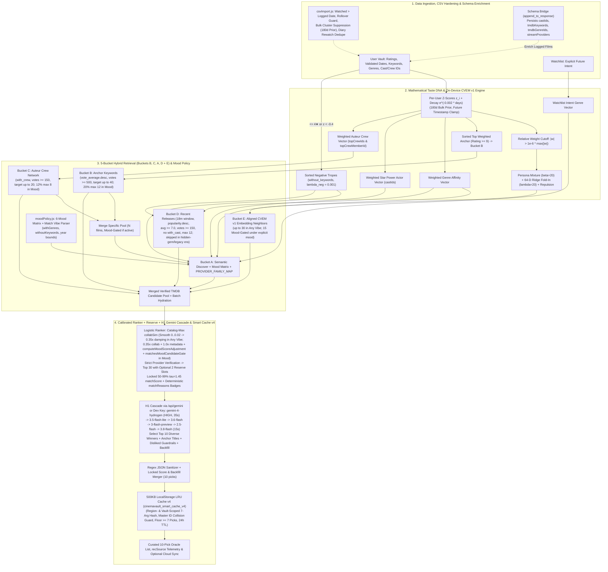

# 🏛️ CinemaVault — Comprehensive Architecture & Mathematics Specification (v5.0)

**CinemaVault** is an open-source, local-first cinema logging, analytics, and hybrid recommendation platform with optional opt-in Supabase cloud sync. This document serves as the **definitive technical specification** for CinemaVault v5.0 (`main`), preserving the full system design from v3.x–v4.2 while incorporating every production upgrade through v5.0: per-user z-scored mathematical taste formulations, IEEE-754 float16 collaborative & content embedding retrieval (`CVEM v1`, 25,000 films × 64-D), vault-relative weight cutoffs (`1e-6 * maxAbsWeight`), mass-weighted Spherical K-Means multi-persona mixture (`computePersonaDetails`, `beta = 20`) blended (`0.75 / 0.25`) with on-device `64×64` L2-regularized Ridge fold-in (`computeUserRidgeEmbedding`, `lambda = 20`, `ridgeMinItems = 10`, scale-invariant `normW`), negative repulsion + generous-rater `>= 7★` negative-suppression guards, disjoint net-polarity & IDF-weighted micro-keywords + Bayesian-shrunk continuous cast/crew affinities, calibrated 11-feature (+ optional `dnaSim`) logistic ranking (`collabSim: 6.4`, `bayesianRatingNorm: 1.8`, `noveltyBonus: 0.05`) with pool-independent `catalog-max` normalization (`minCatalogSize = 50`), smoothstep `[0, 0.02]` → `0.35x` metadata damping, and order-preserving `tau = 1.45` display calibration (dynamically switching to `collabSim * 0.35` and `1.0x` metadata strength with `computeMoodScoreAdjustment` + strict `matchesMoodCandidateGate` partitioning and UI shortfall banner under explicit moods), cold-gated structured + overview TF-IDF fallback (`contentSimService.js`), offline IR evaluation harness (`Recall@20`, `NDCG@10`, `Precision@10`, `ILD`, `Novelty`, `NegHit@20`, `Unique@30`, `withinUserAuc`), 5-bucket TMDB + Embedding retrieval (`A/B/C/D/E`) with batched full-pool metadata hydration (`/api/tmdb-batch` + 30-day IndexedDB cache), a 2-slot recent-release reserve lane and canonical `moodPolicy.js` + `PROVIDER_FAMILY_MAP` alias expansion, **10-pick** default curation (`DEFAULT_RECOMMENDATION_COUNT = 10`) with **`cinemavault_smart_cache_v4`** (cache floor `MIN_VALID_CACHE_COUNT = 7`), mood-stratified anchors + `6–7★` Near Misses + disliked/dismissed (`already_seen`-exempt) prompt guardrails, two-pass soft max-2-per-director diversity cap, `recSource` conversion telemetry (`computeRecommendationHitRate`) & `"Already seen"` -> `QuickRateModal` conversion, `null`-safe match-score fallback, hardened online learning (`minEvents = 10`, `l2 = 0.55`, skipping `already_seen`), region- & vault-scoped 7-arg profile hashing (`_reg_<REGION>_vlt_<count>_<fnv>`), session refresh rotation & exhaustion guard (`oracleViewHelpers.js`), hardened Letterboxd & Schema v2 portability (`csvImport.js`, `vaultPortability.js`), structured LLM diversity & anchor-film explanation passes via the H1 `gemini-4-hydrogen` resilient cascade (`35,000 ms` Hydrogen / `15,000 ms` Flash timeouts & error-class cooldowns), Origin-checked & rate-limited serverless `/api/*` credential isolation (`api/_security.js`, `api/tmdb-batch.js`, `vercel.json` `maxDuration: 60`), live TMDB Discover hub + Rapid Taste Deck onboarding (`dashboardService.js`, `tasteDeckService.js`, `movieIdentity.js`), optional multi-user Supabase Auth + Postgres RLS cloud sync (`vaultSyncService.js`), and the **229-test** `node --test` verification matrix across **28** test suites.

> For a plain-English walkthrough of the local model, provenance audits, verified benchmarks, errors resolved, and copy-paste health checks, see **[LOCAL_MODEL_GUIDE.md](./LOCAL_MODEL_GUIDE.md)**. Historical point-in-time design specs and implementation plans remain preserved under [docs/superpowers/](./docs/superpowers).

---

## Implementation Status (Updated Nov 15, 2026)

| Area | Implemented Behavior on Current Branch (`main`) | Primary Modules |
| :--- | :--- | :--- |
| **Stage 1 Collaborative Embeddings** | `25,000`-film, `64`-D float16 binary (`/models/item_embeddings_f16.bin`, `3,300,016` B, `CVEM v1`) trained on MovieLens 32M with verified zero holdout leakage, repulsion-aligned Bucket `E` neighbor retrieval (`retrieveAlignedEmbeddingNeighbors`, capped at `15` aligned neighbors during explicit mood vs `30` under `"any"`), & SPA `text/html` fallback rejection | [embeddingService.js](./src/services/embeddingService.js), [colab_train_embeddings.py](./scripts/colab_train_embeddings.py) |
| **Stage 2 Content Embeddings & CDNA** | Dedicated content embedding loader/scorer (`/models/content_embeddings_f16.bin`, `buildContentSimMap`, opt-in pure overview bigram fallback + `enableStructuredFallback` / `coldOnly: true` for unindexed items) + offline `build_content_embeddings.mjs`; optional 8-bit `CDNA` axis scorer (`loadDefaultDnaIndex`, `buildDnaSimMap`) wired to `dnaSim` feature (default weight `0` until validated) | [contentSimService.js](./src/services/contentSimService.js), [dnaService.js](./src/services/dnaService.js), [build_content_embeddings.mjs](./scripts/build_content_embeddings.mjs) |
| **Persona Mixture, Ridge Fold-In & Relative Cutoff** | Mass-weighted Spherical K-Means mixture (`computePersonaDetails`, `K` in `[1, 4]`, `personaBeta = 20`) blended (`0.75 / 0.25`) with `64×64` L2-regularized Ridge fold-in (`computeUserRidgeEmbedding`, `lambda = 20`, `ridgeMinItems = 10`, scale-invariant `normW`), disliked repulsion (`repulsion: -1.5`), and vault-relative weight cutoff (`1e-6 * maxAbsWeight`) supporting multi-decade vaults (`ml-user-263`, `ml-user-409`) | [embeddingService.js](./src/services/embeddingService.js), [scoringUtils.js](./src/services/scoringUtils.js) |
| **Canonical Mood Policy & Match Vibe** | Shared 6-mood matrix (`MOOD_OPTIONS`), free-text constraint normalizer (`normalizeMoodFilters`), deterministic keyword/decade/era offline parser (`parseFreeTextMoodFallback`), Gemini fast-cascade parser (`parseFreeTextMoodWithGemini`), hard candidate gate (`matchesMoodCandidateGate`), and cache segment builder (`buildMoodFilterHashSegment`) | [moodPolicy.js](./src/services/moodPolicy.js), [oracleViewHelpers.js](./src/services/oracleViewHelpers.js) |
| **5-Bucket Retrieval, Moods & Provider Families** | Buckets `B` (Anchor Keywords, scaled down `20%` max `12` in explicit mood), `C` (Auteur Crew, scaled down `12%` max `8` in explicit mood), `A` (Semantic/Mood Discover dropping `with_cast` lock under explicit moods, supporting year/exclude/page params & `with_watch_monetization_types: "flatrate\|free\|ads"`), `D` (Recent Releases `18m`, skipped for `hidden-gem` or `maxYear < currentYear - 2`), strict `PROVIDER_FAMILY_MAP` (13 alias groups) + `matchesWatchProviders`, batch metadata hydration (`enrichCandidatePoolMetadata`), & Bucket `E` mood gating | [tmdbService.js](./src/services/tmdbService.js), [moodPolicy.js](./src/services/moodPolicy.js) |
| **Calibrated Ranker & Online Learning** | Logistic ranker (`collabSim: 6.4`, `genreOverlap: 0.6`, `keywordOverlap: 0.45`, `bayesianRatingNorm: 1.8`, `noveltyBonus: 0.05`, softened `negativeKeywordPenalty: -0.5`), pool-independent `catalog-max` normalization (`minCatalogSize = 50` with `poolMax` fallback for tiny maps), smoothstep `[0, 0.02]` → `0.35x` metadata damping & `tau = 1.45` display calibration under `"any"` (or `collabSim * 0.35`, `1.0x` metadata, `computeMoodScoreAdjustment`, & `matchesMoodCandidateGate` partition under explicit moods), strict provider-verified pool enforcement, `RECENT_RELEASE_RESERVE_COUNT = 2` (disabled under explicit mood), `[50, 99]` score calibration, & feedback-driven bounded weight updates (`derivePersonalizedRankerWeights`, `minEvents: 10`, `minPositives: 3`, `minNegatives: 3`, `l2: 0.55`) | [rankerService.js](./src/services/rankerService.js), [onlineLearningService.js](./src/services/onlineLearningService.js), [feedbackService.js](./src/services/feedbackService.js) |
| **10-Pick Curation, Cascade & Rotation** | `DEFAULT_RECOMMENDATION_COUNT = 10` (shortlist `30` -> select `10` with two-pass soft max-2-per-director diversity cap & deterministic ranker backfill), mood-stratified `<=10` anchors + `6–7★` `NEAR MISSES` + `<=5` disliked/dismissed (`already_seen`-exempt) tonal guardrails in `buildGeminiReRankPrompt`, `recSource` conversion provenance (`vaultStats.js`) & `"Already seen"` -> `QuickRateModal`, `SMART_CACHE_KEY = "cinemavault_smart_cache_v4"` with `MIN_VALID_CACHE_COUNT = 7` & 7-arg region/vault-scoped `generateProfileHash`, `null`-safe `normalizeMatchScore` fallback, `hydrationCoverage` + `moodShortfall` telemetry, session refresh `excludeIds` rotation (`120`-ID cap, TMDB pages `1..5`) + exhaustion guard, drawer close auto-refresh (`shouldAutoRefreshOnDrawerClose`), anchor film resolver (`resolveRecommendationAnchors`) & jargon-free `sanitizeOracleReason`, plus H1 `CURATION_MODEL_CASCADE` & `FAST_INTERACTIVE_CASCADE` (`15s` Flash timeouts) | [geminiService.js](./src/services/geminiService.js), [oracleViewHelpers.js](./src/services/oracleViewHelpers.js), [vaultStats.js](./src/services/vaultStats.js), [geminiChatService.js](./src/services/geminiChatService.js), [geminiExplanationService.js](./src/services/geminiExplanationService.js), [MovieRecommendations.jsx](./src/components/MovieRecommendations.jsx), [AIChat.jsx](./src/components/AIChat.jsx) |
| **Serverless `/api/*` Proxies & Search** | Key-isolating Vercel Functions (`api/gemini.js`, `api/tmdb.js`, `api/tmdb-batch.js`, `api/omdb.js`) with explicit model/path allowlists, 40-ID TMDB batching (`concurrency = 6`, single `"tmdb"` rate-limit hit, `s-maxage=86400`), client 30-day IndexedDB detail cache (`getMovieDetailsBatch`), cross-origin blocking (`403`), per-IP sliding-window rate limits (`api/_security.js`), `maxDuration: 60` (`vercel.json`), upstream error secret redaction, automatic direct-vs-proxy client router (`apiTransport.js`), and race-safe `AbortController` dual-engine search (`searchService.js`, `SearchModal.jsx`) | [api/_security.js](./api/_security.js), [api/gemini.js](./api/gemini.js), [api/tmdb.js](./api/tmdb.js), [api/tmdb-batch.js](./api/tmdb-batch.js), [api/omdb.js](./api/omdb.js), [apiTransport.js](./src/services/apiTransport.js), [searchService.js](./src/services/searchService.js) |
| **Discover Hub, Taste Deck & Portability** | Multi-page unwatched TMDB carousels + filterable mosaic grid (`dashboardService.js`, `DashboardPage.jsx`, `HomePosterGrid.jsx`), 30-film interleaved onboarding (`TasteDeckModal.jsx`, `tasteDeckService.js`), 10-tier `QuickRateModal` (`ratingTiers.js`), canonical cross-ID resolver (`movieIdentity.js`), 1–10 vault histogram & recommendation conversion hit-rate (`vaultStats.js`), Letterboxd CSV hardening (`csvImport.js`), & Schema v2 lossless JSON/CSV diff portability (`vaultPortability.js`) | [dashboardService.js](./src/services/dashboardService.js), [tasteDeckService.js](./src/services/tasteDeckService.js), [ratingTiers.js](./src/services/ratingTiers.js), [movieIdentity.js](./src/services/movieIdentity.js), [vaultPortability.js](./src/services/vaultPortability.js), [vaultStats.js](./src/services/vaultStats.js), [csvImport.js](./src/services/csvImport.js) |
| **Opt-In Supabase Cloud Sync & RLS** | Local-first guest experience with optional Supabase Auth (Email OTP / Magic Link), Postgres `profiles` & `user_vault_items` schema with `(select auth.uid())` RLS policies and `public`/`anon` revocations, & lossless timestamped two-way sync (`mergeLocalAndCloudVault`, preserving `recSource` in `metadata` JSONB) | [supabaseClient.js](./src/services/supabaseClient.js), [vaultSyncService.js](./src/services/vaultSyncService.js), [CloudSyncModal.jsx](./src/components/CloudSyncModal.jsx), [20261114000000_init_cinemavault_schema.sql](./supabase/migrations/20261114000000_init_cinemavault_schema.sql) |
| **Evaluation & Verification** | Rolling temporal cross-validation (`evaluateRankerRolling`), `NegHit@20` / `Unique@30` / `NDCG@10` / `withinUserAuc` CLI harness `scripts/run_eval.mjs` + ablation harness `scripts/experiments/run_ablation.mjs`, & **28** automated `node --test` suites (**229 / 229 passing**) | [evalHarness.js](./src/services/evalHarness.js), [run_ablation.mjs](./scripts/experiments/run_ablation.mjs), [tests/](./tests) |

---

## Table of Contents

1. [Executive Summary & Core Philosophy](#1-executive-summary--core-philosophy)
2. [Why Pure LLM Recommenders Fail (The 5+ Fatal Flaws)](#2-why-pure-llm-recommenders-fail-the-5-fatal-flaws)
3. [Mathematical Taste Vector & Local Model Formulation](#3-mathematical-taste-vector--local-model-formulation)
   - [3.1 Per-User Z-Scored Rating Normalization ($z_i$)](#31-per-user-z-scored-rating-normalization-z_i)
   - [3.2 Bulk-Import-Safe Exponential Recency Time-Decay ($w_i$)](#32-bulk-import-safe-exponential-recency-time-decay-w_i)
   - [3.3 Float16 Embeddings (`CVEM` v1), Relative Weight Cutoff, Personas & Repulsion](#33-float16-embeddings-cvem-v1-relative-weight-cutoff-personas--repulsion)
   - [3.4 Temporally-Weighted Anchor Film Selection](#34-temporally-weighted-anchor-film-selection)
   - [3.5 Granular Negative Trope Extraction (`without_keywords`) & Ranker Softening](#35-granular-negative-trope-extraction-without_keywords--ranker-softening)
   - [3.6 Star-Power, Auteur Crew & Watchlist Intent Vectoring](#36-star-power-auteur-crew--watchlist-intent-vectoring)
   - [3.7 Calibrated Logistic Ranker, Normalization, Metadata Damping & Match Badges](#37-calibrated-logistic-ranker-normalization-metadata-damping--match-badges)
   - [3.8 Verified Benchmark Milestones, Leakage Audit & Tuning Results](#38-verified-benchmark-milestones-leakage-audit--tuning-results)
4. [The 5-Bucket Hybrid Retrieval & Recent-Release Reserve Pipeline](#4-the-5-bucket-hybrid-retrieval--recent-release-reserve-pipeline)
   - [4.1 Bucket B: Keyword Spiritual Successors (`fetchBucketB`)](#41-bucket-b-keyword-spiritual-successors-fetchbucketb)
   - [4.2 Bucket C: Auteur & Star Power Network (`fetchBucketC`)](#42-bucket-c-auteur--star-power-network-fetchbucketc)
   - [4.3 Bucket A: Semantic Discover Engine & Mood Calibration Matrix (`fetchBucketA`)](#43-bucket-a-semantic-discover-engine--mood-calibration-matrix-fetchbucketa)
   - [4.4 Bucket D: Recent-Release Lane (`fetchBucketD`)](#44-bucket-d-recent-release-lane-fetchbucketd)
   - [4.5 Bucket E: Collaborative Embedding Neighbor Injection (`fetchEmbeddingCandidates`)](#45-bucket-e-collaborative-embedding-neighbor-injection-fetchembeddingcandidates)
   - [4.6 Dynamic Waterfall Sizing, Cold-Start Bypass & Recent-Release Reserve Selection](#46-dynamic-waterfall-sizing-cold-start-bypass--recent-release-reserve-selection)
5. [TMDB API Query Grammar & Syntax Rules](#5-tmdb-api-query-grammar--syntax-rules)
6. [Schema Bridge & Enriched Cinema Extraction (`bridgeTmdbToOmdb` & `fetchTmdbMovieDetails`)](#6-schema-bridge--enriched-cinema-extraction-bridgetmdbtoomdb--fetchtmdbmoviedetails)
7. [Stage 3 Calibrated Ranker, Gemini Top-30 Diversity Pass & H1 Resilient Cascade](#7-stage-3-calibrated-ranker-gemini-top-30-diversity-pass--h1-resilient-cascade)
   - [7.1 Top-30 Diversity Selection & Explanation Schema (`reRankCandidatesWithGemini`)](#71-top-30-diversity-selection--explanation-schema-rerankcandidateswithgemini)
   - [7.2 Calibrated Score Locking (`mergeGeminiExplanationsWithRanker`) & `normalizeMatchScore`](#72-calibrated-score-locking-mergegeminiexplanationswithranker--normalizematchscore)
   - [7.3 Regex Code-Fence Sanitizer (`sanitizeAndParseJSON`)](#73-regex-code-fence-sanitizer-sanitizeandparsejson)
   - [7.4 H1 Resilient Cascade Architecture, Thinking Config, Timeouts, Cooldowns & Fallbacks](#74-h1-resilient-cascade-architecture-thinking-config-timeouts-cooldowns--fallbacks)
8. [Smart LRU Cache, Collision Guard & Tiered Quota Recovery](#8-smart-lru-cache-collision-guard--tiered-quota-recovery)
   - [8.1 Profile-Based Sliding Window Hash (`generateProfileHash`)](#81-profile-based-sliding-window-hash-generateprofilehash)
   - [8.2 Master ID Cross-Referencing Collision Guard (`getSmartCache`)](#82-master-id-cross-referencing-collision-guard-getsmartcache)
   - [8.3 500KB LRU Eviction Policy & Tiered LocalStorage Quota Protection](#83-500kb-lru-eviction-policy--tiered-localstorage-quota-protection)
9. [Universal Streaming Access & Multi-Region Matrix](#9-universal-streaming-access--multi-region-matrix)
10. [Official Trailer Resolution & Playback Architecture](#10-official-trailer-resolution--playback-architecture)
11. [Telemetry Analytics & Statistical Algorithms](#11-telemetry-analytics--statistical-algorithms)
12. [Hardened Letterboxd Portability & Pure CSV Import Engine (`csvImport.js`)](#12-hardened-letterboxd-portability--pure-csv-import-engine-csvimportjs)
13. [Dual-Engine Spotlight Search & Strict Env Enforcement](#13-dual-engine-spotlight-search--strict-env-enforcement)
14. [Complete Reference Implementations & Verification Test Matrix](#14-complete-reference-implementations--verification-test-matrix)
15. [Luxury Rating Deck & Interaction Architecture](#15-luxury-rating-deck--interaction-architecture)
16. [Canonical Mood Policy, Custom Vibe Parser & Mood-Rebalanced Ranker (`moodPolicy.js`)](#16-canonical-mood-policy-custom-vibe-parser--mood-rebalanced-ranker-moodpolicyjs)
17. [Session Refresh Rotation, Exhaustion Guard & Oracle View Helpers (`oracleViewHelpers.js`)](#17-session-refresh-rotation-exhaustion-guard--oracle-view-helpers-oracleviewhelpersjs)
18. [Serverless `/api/*` Proxy Isolation & Transport Layer (`api/*.js` & `apiTransport.js`)](#18-serverless-api-proxy-isolation--transport-layer-apijs--apitransportjs)
19. [Live Editorial Discover Hub, Cross-ID Identity, Rapid Taste Deck & Lossless v2 Portability](#19-live-editorial-discover-hub-cross-id-identity-rapid-taste-deck--lossless-v2-portability)
20. [Opt-In Multi-User Supabase Cloud Sync, Postgres RLS Schema & Merge Engine](#20-opt-in-multi-user-supabase-cloud-sync-postgres-rls-schema--merge-engine)

---

## 1. Executive Summary & Core Philosophy

Most AI movie tools operate as **unconstrained text generators**: they prompt an LLM with a list of favorite movies and ask it to invent 10 recommendations. This leads to catalog hallucinations (invented release years, false cast members, nonexistent films), stale echo chambers (recommending the same 10 mainstream titles like *Inception* or *Interstellar*), arbitrary uncalibrated match percentages, and broken UI states.

CinemaVault fundamentally separates **local mathematical taste modeling + multi-bucket verified catalog harvesting + calibrated logistic ranking** from **bounded contextual LLM diversity selection & natural-language explanations**:



---

## 2. Why Pure LLM Recommenders Fail (The 5+ Fatal Flaws)

1. **The Hallucination Trap**: Pure LLMs hallucinate release years, sequels that never existed, and mismatched directors. CinemaVault guarantees **0% hallucination** in its primary pipeline because Gemini is strictly forbidden from inventing titles — it selects **`10`** (`DEFAULT_RECOMMENDATION_COUNT = 10`) diverse winners from a pre-verified shortlist of up to **`30`** TMDB candidates scored and gated locally by `rankCandidatePool`.
2. **The Echo Chamber Trap**: Simple prompts repeat ubiquitous blockbusters (*The Dark Knight*, *Pulp Fiction*). CinemaVault breaks the echo chamber across five distinct retrieval channels (keyword successors, auteur crew networks, mood-calibrated discovery, 18-month recent acclaim, and 64-D MovieLens 32M nearest neighbors).
3. **The TMDB `/recommendations` Endpoint Trap**: TMDB's native `/movie/{id}/recommendations` endpoint is a simplistic heuristic based on generic user list overlap. CinemaVault instead uses deep keyword graph discovery (`with_keywords`) sorted by critical acclaim (`vote_average.desc`) with an acclaim floor (`vote_count.gte=500`), producing genuine spiritual successors.
4. **The Broad Genre Blacklist Trap**: Banning an entire genre like "Action" because a user hated a superhero movie blocks masterpieces like *Seven Samurai* or *Heat*. CinemaVault instead extracts sorted micro-keywords (*"superhero"*, *"slapstick"*, *"parody"*) from disliked films (`<= 4★` or `zScore < -0.4`), applies surgical `without_keywords` filters, softens keyword penalty weights to `-0.5`, and applies localized collaborative repulsion around disliked neighborhoods.
5. **The Temporal & Cold-Start Blindspots**:
   - **Temporal Drift & Decade Decay**: A favorite movie rated 10/10 four years ago shouldn't outweigh recent obsessions ($\lambda = 0.002$ half-life decay), *yet* users whose entire logs span 1999–2005 must not have all weights dropped to zero by a fixed `1e-6` threshold (solved by vault-relative cutoff `1e-6 * maxAbsWeight`).
   - **Historical Embedding Cutoff**: Collaborative matrices trained on MovieLens 32M cut off around late 2023, giving every 2024–2026 movie `collabSim = 0`. Without **Bucket D**, **Cold-Gated Structured Fallback** (`enableStructuredFallback: true, coldOnly: true`), and **Reserve Slot Selection**, high-scoring classics push every new release out of the Top 30.
   - **Free-Tier Quota Fragility**: Relying on a single unguarded Gemini model (such as `gemini-4-argon` with `0` free-tier limit or hanging `gemini-3.8-flash` calls) causes hard UI failures. Our H1 error-classified cascade with `35s` timeouts, cooldown backoff, and deterministic math fallback keeps discovery resilient offline or under quota exhaustion.

---

## 3. Mathematical Taste Vector & Local Model Formulation

To convert static `1–10` star logs into meaningful preference signals across both harsh critics and generous viewers, `extractTasteProfile` (`src/services/tmdbService.js`) delegates rating weight computation to `computeZScoredWeights` (`src/services/scoringUtils.js`) and feeds `embeddingService.js` + `rankerService.js`.

### 3.1 Per-User Z-Scored Rating Normalization ($z_i$)
To eliminate harsh-vs-generous rater bias and ensure mediocre ratings ($4-5\star$) exert appropriate negative pull when a user's personal mean is $\approx 7.0$, CinemaVault normalizes every rating against the user's personal distribution (`src/services/scoringUtils.js`):

$$\mu = \frac{1}{N}\sum_{i=1}^{N} r_i, \quad \sigma_{\text{eff}} = \max\left(\sqrt{\frac{1}{N}\sum_{i=1}^{N}(r_i - \mu)^2},\; 0.5\right), \quad z_i = \frac{r_i - \mu}{\sigma_{\text{eff}}}$$

- **Zero-Variance Guard:** If all rated films have identical scores ($\sigma_{\text{raw}} = 0$), $z_i$ defaults safely to $+0.5$ (when $r_i \ge 7$), $-0.5$ (when $r_i \le 4$), or $0.0$ without division by zero.
- **Cold-Start Fallback ($N < 3$):** Uses centered linear scaling $z_i = (r_i - 5.5) / 2.0$.

### 3.2 Bulk-Import-Safe Exponential Recency Time-Decay ($w_i$)
Every film's z-score is modulated by exponential time-decay (`src/services/scoringUtils.js`):

$$w_i = z_i \cdot e^{-\lambda \cdot \Delta_i}, \quad \lambda = 0.002 \text{ days}^{-1}$$

Where:
- $\Delta_i = \max\left(0, \frac{t_{\text{now}} - t_i}{86,400,000}\right)$ (elapsed time in days, clamped to $\ge 0$ so clock skew never yields decay $> 1.0$).
- $\lambda = 0.002$ ($\text{Half-life} = \frac{\ln(2)}{0.002} \approx 346.5\text{ days} \approx 11.5\text{ months}$).
- **Bulk-Import & Undated Prior ($\Delta_{\text{prior}} = 180\text{ days}$):** Films imported in bulk (`isBulkImported: true`, including clustered Letterboxd `Date` dumps detected by `csvImport.js`) or logged without `dateWatched` are assigned $\Delta_i = 180$ days instead of `Date.now()` ($\Delta_i = 0$), preventing undated backlog imports from overpowering genuinely recent watches.

#### Recency Decay Table ($\lambda = 0.002$):
- **Day 0 (Today)**: $e^{0} = 1.000$ (100% of z-score weight)
- **Day 60 (2 Months)**: $e^{-0.12} \approx 0.887$ (88.7% of z-score weight)
- **Day 180 (6 Months / Bulk Prior)**: $e^{-0.36} \approx 0.698$ (69.8% of z-score weight)
- **Day 346 (~Half-Life / 11.5 Months)**: $e^{-0.693} \approx 0.500$ (50.0% of z-score weight)
- **Day 730 (2 Years)**: $e^{-1.46} \approx 0.232$ (23.2% of z-score weight)

### 3.3 Float16 Embeddings (`CVEM` v1), Relative Weight Cutoff, Personas & Repulsion
CinemaVault ships a zero-dependency IEEE-754 half-precision (`float16`) binary codec (`src/services/embeddingService.js`) backed by an offline MovieLens 32M Truncated SVD trainer (`scripts/colab_train_embeddings.py`, `25,000` items × `64` dimensions, shrinkage `0.5`).

#### Binary File Layout (`/models/item_embeddings_f16.bin`, `3,300,016` Bytes)
- **16-byte Little-Endian Header:** `magic = "CVEM"` (4 B), `version = 1` (`uint32`), `count = 25000` (`uint32`), `dim = 64` (`uint32`).
- **Packed Item Records ($25,000 \times 132 = 3,300,000$ B):** `[uint32 tmdbId][64 × uint16 IEEE-754 float16]`.
- **SPA Fallback & Structural Validation (`parseEmbeddingBinary` / `loadDefaultEmbeddingIndex`):** Rejects `text/html` MIME responses (e.g., Vite/SPA 404 fallback), validates `"CVEM"` magic header, dimension bounds (`1..1024`), and exact `byteLength === 16 + count * (4 + dim * 2)`. Returns `null` gracefully if absent.

#### Vault-Relative Weight Cutoff (`getRelativeWeightCutoff`)
Previously, a fixed threshold `|w| <= 1e-6` silently dropped every film for users whose watches occurred in 1999–2005 (`e^{-0.002 * ~9000} \approx 10^{-8}`). Now (`src/services/embeddingService.js:181-238`), both `computeUserEmbedding` and `computeUserPersonas` compute:

$$\text{maxAbsW} = \max_{i} |w_i|, \qquad \text{cutoff} = 10^{-6} \cdot \text{maxAbsW}$$

Items are skipped only when $|w_i| \le \text{cutoff}$ (returning empty/`null` when $\text{maxAbsW} = 0$). Scaling every weight uniformly by $10^{-8}$ produces identical personas and cosine rankings.

#### Single-Vector Baseline, Mass-Weighted Persona Mixture, 64-D Ridge Fold-In & Repulsion
- **Single-Vector Weighted Mean (`computeUserEmbedding`):**
  $$u = \frac{\sum_{i: |w_i| > \text{cutoff}} w_i e_i}{\sum_{i: |w_i| > \text{cutoff}} |w_i|}$$
  L2-normalized before retrieval.
- **Mass-Weighted Multi-Persona Clustering (`computePersonaDetails` / `computeUserPersonas`):** Clusters positively weighted liked films into $K \in [1, 4]$ L2-normalized centroids via deterministic Spherical K-Means (`maxIterations = 12`, `splitThreshold = 0.05`) and returns both `{ centroids, masses }` (with `masses` tracking each cluster's normalized positive weight share; `computeUserPersonas` preserves backward compatibility by returning `.centroids`).
- **Log-Sum-Exp Persona Mixture + Top-3 Blend (`buildCollabSimMapFromIndex`):** Instead of hard winner-take-all `max_k`, aggregates across multi-persona clusters using temperature-scaled log-sum-exp mixture (`personaBeta = 20`):
  $$\text{personaSim}(c) = \frac{1}{\beta} \log \sum_{k=1}^{K} \exp\left(\beta \, (p_k \cdot e_c) + \ln m_k\right), \quad \text{clusterScore}(c) = \text{blend} \cdot \text{personaSim}(c) + (1 - \text{blend}) \cdot \text{top3LovedWeightedMean}(c)$$
  with default `personaBlend = 0.70` when $K > 1$ (and `1.0` when $K = 1$).
- **On-Device `64×64` Ridge Fold-In (`computeUserRidgeEmbedding`):** Across users with $\ge 10$ indexed ratings (`ridgeMinItems = 10`, $\lambda = 20$), solves $(E^\top C E + \lambda I) u = E^\top C z$ via Gaussian elimination with partial pivoting over *all* positive, neutral, and disliked ratings:
  - Targets $z_i = \text{clip}\left(\frac{r_i - \min(\mu_r, 7.5)}{\max(\sigma_r, 1.0)},\; -2.5,\; 2.5\right)$ (or scaled `(weight / maxAbsWeight) * 2.0` when explicit star ratings are absent), ensuring generous raters still discriminate between `>= 9★` masterpieces and `<= 7★` watches.
  - Scale-invariant sample confidence $c_i = \text{clip}(0.75 + 0.5 \cdot (|w_i| / \max_j |w_j|),\; 0.5,\; 2.0)$.
  - L2-normalizes $u$ and blends directly into collaborative similarity with `ridgeBlend = 0.25`:
    $$\text{collabSim}_{\text{raw}}(c) = (1 - \alpha_{\text{ridge}}) \cdot \text{clusterScore}(c) + \alpha_{\text{ridge}} \cdot (u_{\text{ridge}} \cdot e_c), \quad \alpha_{\text{ridge}} = 0.25$$
- **Negative Repulsion (`buildRepulsionMapFromIndex` / `computeRepulsion`):** Tracks negatively weighted films ($w_i < 0$) and emits quadratic repulsion when candidate similarity to disliked centroids exceeds `0.35`, multiplied by `repulsion: -1.5` in the ranker.
- **Stage 2 Content Blending (`blendEmbeddings` / `contentSimService.js`):** Loads optional `/models/content_embeddings_f16.bin` (built by `scripts/build_content_embeddings.mjs`) via `loadDefaultContentIndex` and scores plot/tagline vectors in `buildContentSimMap` (with optional aligned `blendEmbeddings` and opt-in overview bigram fallback).
- **Optional Cinematic DNA (`CDNA`):** Loads optional `/models/cinematic_dna_u8.bin` via `loadDefaultDnaIndex` and scores mean-centred rubric axes in `buildDnaSimMap` (`dnaSim` feature, default weight `0` until validated).

### 3.4 Temporally-Weighted Anchor Film Selection
Bucket B requires a high-affinity anchor film to extract thematic keywords. CinemaVault sorts all rated films by $w_i$ (`finalWeight`) descending and filters for elite masterpieces ($\text{Rating} \ge 9$, configurable `anchorCutoff`) (`src/services/tmdbService.js`):

$$\text{AnchorMovie} = \arg\max_{m \in \text{Rated}, \text{Rating}(m) \ge 9} w_i(m)$$

If the anchor movie only has an `imdbID` (e.g., logged before TMDB schema enrichment), `findTmdbByImdbId` resolves its canonical `tmdbId` on the fly. If no film is rated $\ge 9$, `anchorTmdbId` resolves to `null` and Bucket B's candidate slots are dynamically reallocated to Bucket A.

### 3.5 Granular Negative Trope Extraction (`without_keywords`) & Ranker Softening
Instead of excluding broad genres, the profiler iterates over movies with $\text{Rating} \le 4$ or $z_i < -0.4$ and accumulates z-magnitude time-decayed trope penalties at half the decay rate ($\lambda_{\text{neg}} = \frac{\lambda}{2} = 0.001$, recognizing that dislikes decay more slowly than passing interests) (`src/services/tmdbService.js`):

$$\text{HatedKeywords}[k] = \sum_{m \in \text{Rated},\; r_m \le 4 \text{ or } z_m < -0.4,\; k \in m.\text{tmdbKeywords}} \max(1, |z_m|) \cdot e^{-\frac{\lambda}{2} \cdot \Delta t_m}$$

Keywords are **sorted descending by accumulated penalty** (fixing an earlier insertion-order bug in `236e0f8`), and the top 5 keyword IDs are passed to TMDB using pipe OR syntax (`without_keywords=9715|10402`), surgically excluding candidates containing *either* hated trope without banning entire genres. In `DEFAULT_RANKER_WEIGHTS`, `negativeKeywordPenalty` was tuned from `-2.0` to **`-0.5`** (`332c21c`) because common tags like *"independent film"* frequently appear across both loved and disliked watches.

### 3.6 Star-Power, Auteur Crew & Watchlist Intent Vectoring
High-rated films ($\text{Rating} \ge 8$ with $w_i > 0$) contribute their creative personnel and keywords to weighted affinity maps (`src/services/tmdbService.js`):
- **Star-Power Actors (`topCastIds`):** The top 3 billed cast IDs (`castIds[0..2]`) accumulate $w_i$; the top 2 actors (`topCastIds`) are injected into Bucket A discover queries.
- **Auteur Directors & Crew (`topCrewIds` / `topCrewMemberId`):** Directors, Cinematographers, Original Music Composers, and Screenwriters accumulate $w_i$ (prioritizing Director during Schema Bridge extraction). The top 3 crew IDs are tracked for ranker `crewMatch`, and `topCrewMemberId` (`topCrewIds[0]`) is queried in Bucket C.
- **Loved Micro-Keywords (`lovedKeywordIds`):** Top 5 positive keyword IDs (plus normalized `keywordAffinities`) feed the ranker's `keywordOverlap` feature even for Bucket E/A/D candidates.
- **Watchlist Intent Vectoring (`watchlistGenreIds`):** Unwatched films saved in the user's `watchlist` contribute their top 3 recurring TMDB genre IDs (`watchlistGenreIds`), blending all 3 with `lovedGenreIds` inside Bucket A (`buildBucketAParams`).

### 3.7 Calibrated Logistic Ranker, Normalization, Metadata Damping & Match Badges
Rather than allowing the LLM to invent uncalibrated percentages, `rankCandidatePool` (`src/services/rankerService.js`) extracts **12 normalized features** (`11` active weighted features + optional `dnaSim`) across all merged candidates (`DEFAULT_RECOMMENDATION_COUNT = 10`, with `reRankCandidatesWithGemini` shortlisting up to `topK = 30` candidates to Gemini unless overridden) and computes calibrated match probabilities (see [Section 16](#16-canonical-mood-policy-custom-vibe-parser--mood-rebalanced-ranker-moodpolicyjs) for explicit-mood weight rebalancing and hard candidate gating):

#### Active `DEFAULT_RANKER_WEIGHTS` (`src/services/rankerService.js:18-31` & `public/models/ranker_weights.json`)
| Feature | Live Weight | Range / Extraction Rule |
| :--- | :---: | :--- |
| `bias` | **`-1.1`** | Logistic intercept |
| `collabSim` | **`+6.4`** | Positive similarities (`0.75 * mixture(beta=20) + 0.25 * ridge(lambda=20)`) scaled by pool-independent `catalog-max` (`minCatalogSize = 50`, fallback `poolMax`) -> `[0, 1]` |
| `contentSim` | **`+1.4`** | Cosine similarity from `/models/content_embeddings_f16.bin`, or cold-gated structured (`genres/keywords/cast/crew` + overview TF-IDF) cosine similarity when collaborative embeddings are missing (`enableStructuredFallback: true, coldOnly: true`) |
| `genreOverlap` | **`+0.6`** | Fraction of top 4 loved genres matched (`min(3, lovedGenreIds.length)` denominator, smoothstep-damped `[0, 0.02]` → `0.35x`) |
| `keywordOverlap` | **`+0.45`** | Continuous affinity-weighted overlap with top 15 IDF-damped, net-positive `keywordAffinities` (with `lovedKeywordIds` fallback or `0.6` proxy for Bucket B) |
| `crewMatch` | **`+0.7`** | Continuous `[0, 1]` Bayesian-shrunk `crewAffinities[crewPersonId]` (or binary fallback + `0.5` Bucket C proxy) |
| `castMatch` | **`+0.5`** | Billing-decayed continuous `[0, 1]` Bayesian-shrunk `castAffinities` across candidate `castIds` (or `topCastIds` binary fallback) |
| `bayesianRatingNorm` | **`+1.8`** | Normalized TMDB Bayesian score `(B - 5.0)/4.5` with `m=500, C=7.0` *(smoothstep-damped `[0, 0.02]` → `0.35x`)* |
| `noveltyBonus` | **`+0.05`** | `0.5` if `100 <= vote_count <= 4000`, else `0.1` *(zeroed in `computeReserveQualityScore`)* |
| `negativeKeywordPenalty` | **`-0.5`** | Clamped `[0, 1]` hit indicator against disjoint net-negative `hatedKeywordIds` *(meta IDs suppressed)* |
| `repulsion` | **`-1.5`** | Quadratic repulsion penalty from disliked embedding neighbors (`cos > 0.35`) |
| `providerMatch` | **`+0.25`** | `1.0` if `providerMatchedByQuery` or provider intersection, `0.5` if no filter, else `0` |
| `dnaSim` | **`0`** | Mean-centred `CDNA` axis cosine from `/models/cinematic_dna_u8.bin` *(gated at `0` until validated)* |

#### Pool-Independent `catalog-max` Collaborative Normalization
Because Bayesian shrinkage ($\frac{\vec{v}}{\|\vec{v}\| + 0.5}$) compresses latent vector norms to prevent low-support items from causing false cosine spikes, raw dot products typically span $[0.05, 0.35]$. Previously, normalizing by `maxPoolCollab` made scores fluctuate whenever an atypical outlier entered or exited the candidate pool. Now (`rankCandidatePool`, `collabNormalization = "catalog-max"`), CinemaVault reads the catalog-wide positive maximum via `getCollabCatalogMax(collabSimMap, minCatalogSize = 50)` (cached via a `WeakMap` over sorted `Float64Array` positives; falling back cleanly to `poolMax` only for small `< 50` synthetic unit-test maps) while preserving unscaled similarity in `features.rawCollabSim`:

$$\text{collabScale} = \max\left(\max_{c \in \text{catalog}} \text{collabSim}(c),\; 0.05\right), \quad \text{collabSim}_{\text{norm}} = \begin{cases} \min\left(1.0, \frac{\text{collabSim}}{\text{collabScale}}\right) & \text{if } \text{collabSim} > 0 \\ \text{collabSim} & \text{otherwise} \end{cases}$$

#### Smoothstep Metadata Gating & `0.35x` Damping (`dampingRampMax = 0.02`)
In a standard linear combination, coarse metadata features like `genreOverlap` and global popularity `bayesianRatingNorm` can overpower collaborative signals, pushing niche 9/10 taste-twins into ranks `#11–#20`. Rather than jumping discontinuously at `0.001`, `scoreCandidate` applies a smoothstep ramp over `rawCollabMag = |rawCollabSim ?? collabSim|` across `[0, 0.02]` (`DEFAULT_METADATA_DAMPING_FACTOR = 0.35`):

$$t = \min\left(1,\; \frac{|\text{rawCollabSim}|}{0.02}\right), \quad s = t^2 (3 - 2t), \quad \text{effectiveDamping} = 1.0 + s \cdot (0.35 - 1.0)$$
$$\text{logit}_{\text{genre}} = w_{\text{genre}} \cdot x_{\text{genre}} \cdot \text{effectiveDamping}, \qquad \text{logit}_{\text{rating}} = w_{\text{rating}} \cdot x_{\text{rating}} \cdot \text{effectiveDamping}$$

For cold-start or 2024–2026 unindexed releases ($\text{rawCollabSim} = 0$), $\text{effectiveDamping} = 1.0$, so metadata operates at full $1.0\times$ strength alongside cold-gated structured similarity (`contentSim`), rising smoothly into $0.35\times$ collaborative dominance as collaborative signal enters.

#### Calibrated Output ($\tau = 1.45$) & Deterministic Match Reason Badges
Ranking order is determined strictly by the unscaled logit (`probability = sigmoid(logit)`), while displayed match percentages (`computeDisplayMatchScore`) apply a monotonic temperature scale **`DEFAULT_DISPLAY_TEMPERATURE = 1.45`** so top picks distribute cleanly without saturating at 99% while preserving exact rank order:

$$p_{\text{disp}, i} = \frac{1}{1 + e^{-\text{logit}_i / \tau}}, \quad \text{matchScore}_i = \min\left(99,\; \max\left(50,\; \text{round}(50 + 49 \cdot p_{\text{disp}, i})\right)\right) \in [50, 99]$$

`generateMatchReasons(features)` emits up to 3 human-readable badges in priority order:
- `collabSim >= 0.28`: `🧬 High Taste-Twin Match` *(else if `>= 0.15`: `🤝 Collaborative Taste Pick`)*
- `crewMatch > 0`: `🎬 Favorite Filmmaker` *(else if `castMatch > 0`: `🎭 Top Cast Match`)*
- `keywordOverlap >= 0.33`: `🎯 Core Theme Match`
- `collabSim >= 0.16 && noveltyBonus >= 0.35`: `💎 Personal Cult Pick`
- `genreOverlap >= 0.66`: `🎪 Genre Bullseye`
- `bayesianRatingNorm >= 0.72`: `⭐ Critical Acclaim`
- Fallback if empty: `🔍 Hidden Discovery` (`novelty >= 0.35`) or `✨ Curated Selection`

*(Online bounded pairwise weight learning from logged user actions runs via `derivePersonalizedRankerWeights` in `onlineLearningService.js` over `fitRankerWeights` in `rankerService.js`, requiring defaults `minEvents = 10`, `minPositives = 3`, `minNegatives = 3`, and regularization `l2 = 0.55` before adapting from `DEFAULT_RANKER_WEIGHTS`.)*

### 3.8 Verified Benchmark Milestones, Leakage Audit & Tuning Results

Evaluated via `evaluateRankerRolling` (`src/services/evalHarness.js`) and paired-bootstrap scripts over 4 human MovieLens vaults (556-film TMDB catalog) plus 328 & 300 user MovieLens Small cohorts enriched with 9,620 real TMDB records:

| Milestone / Audit | Scope | Key Verified Outcome |
| :--- | :--- | :--- |
| **1. Original Baseline (`ml-latest-small`)** | 4 human vaults, 9.6k films (2018 cutoff) | `NDCG@10 = 0.062`, `Recall@20 = 0.083`, `Novelty = 1.48` |
| **2. Initial 32M (Unnormalized)** | 4 human vaults, 25k × 64 index | `NDCG@10 = 0.078`, `Recall@20 = 0.171`, `Novelty = 1.82` |
| **3. Pool-Normalized + `0.20x` Damped 32M** | 4 human vaults (`Nov 11` → pre-Step 2/3B) | Nov 11: `NDCG@10 = 0.143 (+131%)`, `Recall@20 = 0.242 (+192%)`, `Novelty = 2.24 (+51%)`; current live 4-vault mean (`item_embeddings_f16.bin`): **`NDCG@10 = 0.178`**, **`Recall@20 = 0.250`**, **`Novelty = 2.206`** |
| **4. Zero-Leakage Colab Verification** | 328 MovieLens users comparing Colab binary vs scrubbed 32M retrain | `clean_ranker` `NDCG@10 = 0.0826` vs `leaky_ranker = 0.0828` (`Δ = +0.00023`, 95% CI `[-0.00197, +0.00236]`, `isSignificant: false`, `ΔRecall@20 = 0`) |
| **5. `negativeKeywordPenalty = -0.5` vs `-2.0`** | Real `rankCandidatePool` on Orig `328` & Fresh `300` users | **Orig 328:** `NDCG +0.0103 [+0.0042, +0.0169]`, `Recall +0.0110 [+0.0052, +0.0177]` (both sig); **Fresh 300:** `Recall +0.0143 [+0.0077, +0.0207]` (sig), `NDCG +0.0058 [-0.000011, +0.0124]` |
| **6. Relative Cutoff Parity & Rescue** | `328` user top-20 parity + 4 benchmark vaults | `0 / 328` mismatches on normal vaults; rescued `ml-user-263` (`0 -> 4` personas, `0 -> 25,000` scored films) & `ml-user-409` (`0 -> 2` personas, `0 -> 25,000` scored films) |
| **7. Phase 2 Ablations & v5.0 Offline Tuning (`run_ablation.mjs`, `clean2`)** | `328` & held-out `fresh_300` cohorts + `4` benchmark vaults (`>= 8★` & `>= 9★`, cold `null` embeddings) | **Exp 1 (Polarity+IDF Keywords):** `328` `>=8★` `NDCG 0.0824` (`>=9★ 0.0974`), Bench `>=8★ NDCG 0.1786`; **Exp 2 (Shrunk Cast/Crew):** `328 >=9★ NDCG 0.1023 (+0.0074 *)`, `P@10 0.0822 (+0.0066 *)`, Bench `>=9★ NDCG 0.2058`; **Exp 3 (Cold Structured Fallback):** Zero regression on `clean2`, `328 null >=9★ NDCG 0.0485 (+0.0136 *)`, `Rec@20 0.0536 (+0.0187 *)`; **Exp 4 (Tuned `DEFAULT_RANKER_WEIGHTS` + `0.35x` Damping):** `328 >=8★ NDCG 0.0849 / Rec@20 0.1241 (+0.0070 *) / Neg@20 0.0024 (-0.0009 *)`, `328 >=9★ NDCG 0.1053 (+0.0104 *) / Rec@20 0.1369 (+0.0095 *) / P@10 0.0875 (+0.0118 *)`, **`fresh_300 >=8★ Rec@20 0.1270 (+0.0107 *)`**, **`fresh_300 >=9★ NDCG 0.1156 (+0.0114 *) / Rec@20 0.1505 (+0.0151 *)`**, **`328 null >=8★ NDCG 0.0415 (+0.0175 *) / Rec@20 0.0576 (+0.0296 *)`**, **`328 null >=9★ NDCG 0.0681 (+0.0331 *) / Rec@20 0.0785 (+0.0436 *)`**, Bench `>=8★ NDCG 0.1611 / Rec@20 0.2542` & `>=9★ Rec@20 0.3833` |
| **8. Prompt 2 Final Ablation: `catalog-max` + Smooth `[0, 0.02]` Damping + `0.75 * Mixture(beta=20) + 0.25 * Ridge(lambda=20)` (`eval_final.json`, `clean2`)** | `328` tune + strictly held-out `fresh_300` + `4` benchmark vaults (`withinUserAuc` + ranking IR vs `post_fixes`) | **`328 >= 8★` (`n=328`):** `NDCG@10 = 0.0909 (+0.0061 *)`, `Rec@20 = 0.1256`, `P@10 = 0.0805`, `Neg@20 = 0.0018`, **`AUC(>=9v<=7) = 0.7335 (+0.0285 *)`**, **`AUC(>=8v<=7) = 0.6994 (+0.0240 *)`**; **`328 >= 9★` (`n=304`):** **`NDCG@10 = 0.1145 (+0.0095 *)`**, **`Rec@20 = 0.1448 (+0.0082 *)`**, **`P@10 = 0.0947 (+0.0076 *)`**, **`AUC(>=9v<=7) = 0.7458 (+0.0301 *)`**; **`fresh_300 >= 8★` (`n=300`):** **`Neg@20 = 0.0032 (-0.0018 *)`**, **`AUC(>=9v<=7) = 0.7218 (+0.0338 *)`**, **`AUC(>=8v<=7) = 0.6788 (+0.0256 *)`**; **`fresh_300 >= 9★` (`n=284`):** **`NDCG@10 = 0.1227 (+0.0067 *)`**, **`Rec@20 = 0.1581`**, **`P@10 = 0.0986 (+0.0077 *)`**, **`AUC(>=9v<=7) = 0.7407 (+0.0302 *)`**; **4 Bench:** `>= 8★ NDCG 0.1776 (+0.0160)` (`ml-user-409 AUC9v7 = 0.9583`), `>= 9★ NDCG 0.2258 (+0.0345)`, `AUC9v7 = 0.6817 (+0.0938)`. *(Step 4 `eraMatch` skipped: near-zero separation `0.0005` vs `-0.0018`.)* |

---

## 4. The 5-Bucket Hybrid Retrieval & Recent-Release Reserve Pipeline

`fetchCandidatePool` (`src/services/tmdbService.js`) coordinates TMDB Buckets `B`, `C`, `A`, and `D`, while `getMovieRecommendations` (`src/services/geminiService.js`) appends `Bucket E` (`fetchEmbeddingCandidates`):

### 4.1 Bucket B: Keyword Spiritual Successors (`fetchBucketB`)
- **Objective**: Discover high-acclaim films that share core micro-keywords with the user's top $w_i$ anchor film.
- **Methodology**: Calls `fetchMovieKeywordsAndCrew(anchorTmdbId)` to retrieve the top 3 keyword IDs (`keywords.slice(0, 3).join("|")`) and queries TMDB `/discover/movie` with `sort_by=vote_average.desc`, `vote_average.gte=7.0`, and an acclaim floor of `vote_count.gte=500` across up to 4 pages.
- **Target Harvest**: Scales dynamically (`min(40, max(8, floor(targetPoolSize * 0.35)))`).

### 4.2 Bucket C: Auteur & Star Power Network (`fetchBucketC`)
- **Objective**: Harvest films from the user's top-weighted director, cinematographer, composer, or screenwriter.
- **Methodology**: Queries TMDB with `with_crew={topCrewMemberId}`, `sort_by=vote_average.desc`, and `vote_count.gte=150` across up to 3 pages (executed concurrently with Bucket B via `Promise.all`).
- **Target Harvest**: Scales dynamically (`min(20, max(4, floor(targetPoolSize * 0.20)))`).

### 4.3 Bucket A: Semantic Discover Engine & Mood Calibration Matrix (`fetchBucketA`)
- **Objective**: Broad discovery combining weighted genre affinities (`lovedGenreIds`), watchlist intent (`watchlistGenreIds`), active mood vectors, star-power cast (`with_cast`), surgical trope exclusions (`without_keywords`), and regional streaming filters (`with_watch_providers`).
- **Mood Calibration Matrix (`src/services/moodPolicy.js` -> `MOOD_OPTIONS` consumed identically by `tmdbService.js`, `rankerService.js`, `geminiService.js`, and `MovieRecommendations.jsx`)**:

| Mood ID | TMDB `sort_by` | `vote_count.gte` / `.lte` | `vote_average.gte` | `preferredGenreIds` / `requiredAnyGenreIds` | `withoutGenreIds` (TMDB Exclude) |
| :--- | :--- | :---: | :---: | :--- | :--- |
| **`mind-bending`** | `vote_average.desc` | `250` / `—` | `7.5` | Pref: `9648, 878` • Req: `9648, 878, 53` | `10751, 35, 10749` (Family, Comedy, Romance) |
| **`dark-thriller`** | `popularity.desc` | `120` / `—` | `6.8` | Pref: `80, 53, 9648` • Req: `80, 53, 9648, 27` | `10751, 35, 16, 10402, 12, 878, 14` |
| **`fun-popcorn`** | `popularity.desc` | `250` / `—` | `6.5` | Pref: `28, 12, 35, 16` • Req: `28, 12, 35, 16` | `99, 27, 10752, 36` |
| **`comfort-watch`** | `vote_average.desc` | `180` / `—` | `7.2` | Pref: `35, 10751, 10749, 16` • Req: `35, 10751, 10749, 16` | `27, 53, 80, 10752` |
| **`hidden-gem`** | `vote_average.desc` | `50` / **`2000`** | `7.0` | *(Relies on user taste vector)* | `—` |
| **`any` (Default)** | `vote_average.desc` *(Bucket A `"any"` uses `popularity.desc`, `150` votes)* | `200` (`150` in Bucket A) / `—` | `6.8` | *(Relies on user taste vector)* | `—` |

When an explicit mood or custom vibe filter (`isExplicitMoodActive`) is active, `buildBucketAParams` also applies `without_genres`, optional `vote_count.lte`, `primary_release_date.gte` / `.lte` from `minYear`/`maxYear`, pagination `page`, `with_watch_monetization_types=flatrate|free|ads`, and **drops `with_cast` star lock** so vault actor affinity never crowds out tone-appropriate films. If `hidden-gem` is selected or `maxYear < currentYear - 2`, `fetchCandidatePool` skips **Bucket D** (`fetchBucketD`) so mainstream recent releases cannot pollute obscure or pre-era queries, scales Buckets B (`20%`, max `12`) and C (`12%`, max `8`) down cleanly, and filters Buckets B, C, D, and E through `matchesMoodCandidateGate`.

### 4.4 Bucket D: Recent-Release Lane (`fetchBucketD`)
- **Objective**: Solve the late-2023 MovieLens training cutoff by guaranteeing fresh acclaimed releases from the last 18 months enter the candidate pool without shrinking Buckets A, B, or C.
- **Query Construction (`buildBucketDParams`, `src/services/tmdbService.js:664-684`)**:
  - `primary_release_date.gte`: `getRecentReleaseDateFloor(18, now)` (18 months before `now`)
  - `sort_by`: `"popularity.desc"`
  - `vote_average.gte`: `"7.0"` (raised quality floor)
  - `vote_count.gte`: `"150"` (raised acclaim floor)
  - `with_genres`: `profile.lovedGenreIds.slice(0, 3).join("|")`
  - `without_keywords`: `profile.hatedKeywordIds.join("|")`
  - **NO `with_cast` lock-in**, honors regional `with_watch_providers` / `watch_region`.
- **Budget & Isolation**: Fetches up to **2 pages**, capped at **`12` unique candidates** tagged `sourceBucket: "D"` after collision filtering, and appends *after* `basePool` (Buckets B + C + A).

### 4.5 Bucket E: Collaborative Embedding Neighbor Injection (`fetchEmbeddingCandidates`)
- **Objective**: Retrieve deep collaborative taste-twins directly from the on-device 25k `CVEM v1` matrix regardless of TMDB discover popularity ordering.
- **Methodology**: Before excluding seen/existing IDs, `geminiService.js` computes catalog-wide `catalogMax = getCollabCatalogMax(collabSimMap)` (`0.05` floor inside `retrieveAlignedEmbeddingNeighbors`) and `repulsionWeight = Math.abs(DEFAULT_RANKER_WEIGHTS.repulsion) / DEFAULT_RANKER_WEIGHTS.collabSim` (`1.5 / 6.4`), passing both via options to avoid circular imports while keeping neighbor scoring aligned with Stage 3 (`collabSim = min(1, rawCollabSim / catalogMax)` before subtracting `repulsionWeight * repulsion`). Calls `retrieveAlignedEmbeddingNeighbors(profile.weightedRatings, embeddingIndex, excludeIds, { collabSimMap, repulsionMap, catalogMax, repulsionWeight, topK: 80 })` (built atop Stage 1 `computeUserPersonas` + repulsion scoring) and fetches batched live TMDB `/movie/{id}` details via `getMovieDetailsBatch` (`/api/tmdb-batch` + 30-day IndexedDB cache, honoring `userRegion`, `userProviders`, and mood filters), injecting up to **`30`** unseen items under `"any"` vibe or capped at **`15`** mood-gated neighbors when `isExplicitMoodActive(mood, moodFilters)` is true (`sourceBucket: "Bucket E (Embedding)"`). Thereafter, `enrichCandidatePoolMetadata` hydrates all merged Buckets `A–D` (`maxEnrich = candidates.length` via `getMovieDetailsBatch`, skipping transient failures from cache) and tracks `hydrationCoverage` (`hydrated / total` ratio) into `modelInfo` before Stage 3 ranking. Note also that optional binary asset loaders in `contentSimService.js` (`loadDefaultContentIndex`) and `dnaService.js` (`loadDefaultDnaIndex`) share `createSessionBinaryIndexLoader` (`embeddingService.js`), negative-caching 404 or HTML/invalid-binary responses for the session while clearing cached promises on network errors, aborts, or `>= 500` responses so transient failures can retry, and leaving `contentIndex === null` cleanly routed to the documented `coldOnly` structured fallback for unindexed (`collabSim === 0`) post-2023 releases.

### 4.6 Dynamic Waterfall Sizing, Cold-Start Bypass & Recent-Release Reserve Selection
1. **Dynamic Slot Calculation**: `fetchCandidatePool` defaults to `targetPoolSize = 60` (clamped `[20, 500]`). If Buckets B & C return $N$ combined unique candidates (`specificPool.length`), Bucket A scales to `max(targetPoolSize - N, 12)`. Under explicit moods, Bucket B targets `min(12, max(2, floor(targetPoolSize * 0.20)))` and Bucket C targets `min(8, max(2, floor(targetPoolSize * 0.12)))`, and Buckets B, C, and D pass through `matchesMoodCandidateGate`.
2. **Cinephile Critical Fallback**: If a veteran user has already logged most popular titles in a genre (`candidates.length < min(targetCount, 5)` while `sort_by === "popularity.desc"`), Bucket A automatically pivots to `sort_by=vote_average.desc` and `vote_count.gte=500`, scanning additional pages of critically acclaimed cinema without dropping active mood filters.
3. **Cold-Start Bypass Engine**: For accounts with $< 3$ rated films (`(watchedMovies || []).length < 3`), specific keyword and crew graphs lack statistical significance. CinemaVault bypasses Buckets B & C and routes to Bucket A (`basePool`) + Bucket D recent releases (skipping Bucket D when `hidden-gem` or `maxYear < currentYear - 2`, and gating Bucket D under explicit moods).
4. **Recent-Release Reserve Selection (`selectWithReserve` & `computeReserveQualityScore`, `src/services/rankerService.js:227-312`)**:
   - Invoked by `geminiService.js` when ranking `shortlistLimit` (`options.topK || 30`, minimum `targetCount = 10`) candidates for Gemini in **`"any"` vibe** (`RECENT_RELEASE_RESERVE_COUNT = 2`, `RECENT_RELEASE_RESERVE_MONTHS = 18`, `RECENT_RELEASE_MIN_PROB_PERCENTILE = 0.5`). Under an **explicit mood or custom vibe** (`isExplicitMoodActive`), `reRankCandidatesWithGemini` sets `reserveConfig = null` unless explicitly overridden so recent releases cannot override tone/era constraints.
   - **Step 1 (Head Selection):** Takes the top `headCount = topK - count` candidates strictly by `rankerProbability`.
   - **Step 2 (Eligibility Gate):** Evaluates remaining recent candidates (`release_date >= minReleaseDate`) that clear `probFloor = max(percentile50(nonCollab), 0.54)`. If the user has `lovedGenreIds`, restricts to `genreOverlap > 0` candidates whenever any exist.
   - **Step 3 (Aligned Reserve Quality Scorer):** Ranks qualifying recent candidates using `computeReserveQualityScore`:
     ```javascript
     export function computeReserveQualityScore(candidate, weights = DEFAULT_RANKER_WEIGHTS, options = {}) {
       const f = candidate?.features || {};
       return scoreCandidate({ ...f, noveltyBonus: 0 }, weights || DEFAULT_RANKER_WEIGHTS, options).logit;
     }
     ```
     Zeroing only `noveltyBonus` keeps all feature weights (`crewMatch`, `keywordOverlap`, `genreOverlap`, `bayesianRatingNorm`, `negativeKeywordPenalty`) identical to the main ranker while preventing `> 4,000`-vote acclaimed releases from losing to obscure titles, and `count = 2` prevents displacing `98%` classics for lower-ranked reserves.
   - **Step 4 (Final Sort):** Fills up to `2` reserve slots (or falls back by ranker order if `< 2` qualify) and sorts the combined shortlist descending by `rankerProbability`.

---

## 5. TMDB API Query Grammar & Syntax Rules

The TMDB `/discover/movie` API enforces specific boolean logic conventions across parameter types:

| Parameter Type | Parameter Name | Delimiter | Boolean Logic | TMDB Example |
| :--- | :--- | :---: | :---: | :--- |
| **Genres** | `with_genres` | `\|` (Pipe) | **OR** | `with_genres=28\|878` (Action OR Sci-Fi) |
| **Keywords** | `with_keywords` | `\|` (Pipe) | **OR** | `with_keywords=9715\|10402` |
| **Excluded Keywords** | `without_keywords`| `\|` (Pipe) | **OR** | `without_keywords=9715\|10402` |
| **Cast / Actors** | `with_cast` | `\|` (Pipe) | **OR** | `with_cast=67890\|11122` (Actor A OR Actor B) |
| **Crew Members** | `with_crew` | N/A | Single ID | `with_crew=12345` (Christopher Nolan) |
| **Watch Providers** | `with_watch_providers` | `\|` (Pipe) | **OR** | `with_watch_providers=8\|9\|337` (Netflix OR Prime OR Disney+) |

> [!IMPORTANT]
> - **Conditional Genre Guard**: `with_genres` is only appended when `combinedLoved.length > 0` to prevent malformed empty parameters.
> - **Excluded Keywords (`without_keywords`)** uses pipe `|` to exclude films containing ANY of the specified trope tags.
> - **People (`with_cast`)** in TMDB treat comma `,` as **AND** and pipe `|` as **OR** (just like Genres & Keywords). CinemaVault uses `with_cast=A|B` so Bucket A never starves, and omits `with_cast` from Bucket D so recent releases aren't locked to legacy cast lists.
> - **Watch Providers** take integer provider IDs (`8|9`), NOT monetization strings like `flatrate`. Any discover item returned under an active `with_watch_providers` query is stamped `providerMatchedByQuery: true` so `rankerService.js` awards `providerMatch = 1`.
> - When `with_watch_providers` is passed, TMDB requires a valid 2-letter ISO `watch_region` code. If `userRegion === "GLOBAL"`, it defaults `watch_region` to `US` when provider filters are active.

---

## 6. Schema Bridge & Enriched Cinema Extraction (`bridgeTmdbToOmdb` & `fetchTmdbMovieDetails`)

CinemaVault enriches every saved or inspected movie record by executing a single-roundtrip TMDB request with `append_to_response=external_ids,credits,videos,keywords,watch/providers` (`src/services/tmdbService.js`), extracting high-resolution assets and structured graph IDs:

```javascript
/**
 * Resolves the optimal official trailer YouTube key using hierarchical ranking:
 * 1. Official English Trailer
 * 2. Main / Theatrical Trailer by title match
 * 3. General Trailer
 * 4. Teaser Clip
 * 5. First available YouTube video
 */
export function extractOfficialTrailerKey(videos = []) {
  if (!videos || !Array.isArray(videos) || videos.length === 0) return null;
  const youtubeVideos = videos.filter((v) => v.site === "YouTube" && v.key);
  if (youtubeVideos.length === 0) return null;

  const officialTrailer = youtubeVideos.find(
    (v) => v.type === "Trailer" && v.official === true && (v.iso_639_1 === "en" || !v.iso_639_1)
  );
  if (officialTrailer) return officialTrailer.key;

  const mainTrailer = youtubeVideos.find((v) => {
    const name = (v.name || "").toLowerCase();
    return v.type === "Trailer" && (name.includes("official") || name.includes("main") || name.includes("theatrical"));
  });
  if (mainTrailer) return mainTrailer.key;

  const anyTrailer = youtubeVideos.find((v) => v.type === "Trailer");
  if (anyTrailer) return anyTrailer.key;

  const anyTeaser = youtubeVideos.find((v) => v.type === "Teaser");
  if (anyTeaser) return anyTeaser.key;

  return youtubeVideos[0].key;
}
```

### Persisted Schema Fields (`bridgeTmdbToOmdb`)
When a user adds a film from recommendations or details to their Vault or Watchlist, `bridgeTmdbToOmdb` persists:
- `imdbID`: Canonical IMDb ID (`tt...`) or `tmdb_${id}` fallback
- `tmdbId`: Integer TMDB ID
- `tmdbGenreIds`: Array of TMDB genre integers (`[28, 878]`)
- `tmdbKeywords`: Top 10 keyword integer IDs (`data.keywords.keywords.slice(0, 10)`)
- `castIds`: Top 5 billed actor integer IDs (`data.credits.cast.slice(0, 5)`)
- `crewPersonId`: Primary Director ID (or fallback Cinematographer / Composer / Screenwriter ID)
- `streamProviders`: Regional flatrate streaming provider objects (`{ id, name, logo }`)
- `trailerKey`: Ranked YouTube video key

---

## 7. Stage 3 Calibrated Ranker, Gemini Top-30 Diversity Pass & H1 Resilient Cascade

### 7.1 Top-30 Diversity Selection, Prompt Guardrails & Explanation Schema (`buildGeminiReRankPrompt` / `reRankCandidatesWithGemini`)
Before invoking Gemini, `rankCandidatePool` (`src/services/rankerService.js`) scores the merged candidate pool (with Bucket D recent-release reserve slots enabled under `"any"` vibe: `count = 2`; disabled under explicit mood/vibe filters) and passes a shortlisted slice (`shortlistLimit = Math.max(targetCount, options.topK || 30)`, up to **Top 30** candidates) to Gemini (`src/services/geminiService.js`) constrained via `responseMimeType: "application/json"` and `responseSchema` to select **`10`** (`DEFAULT_RECOMMENDATION_COUNT = 10`) diverse winners and generate bespoke jargon-free personal explanations with explicit vault anchor titles.

`buildGeminiReRankPrompt` structures the prompt payload into:
1. **`USER TASTE PROFILE`**: Top loved genres (`lovedGenreNames`), selected mood label & `promptDirective`, and any normalized custom vibe constraints (`query`, `withGenres`, `withoutKeywords`, release year bounds).
2. **`USER'S FAVORITE ANCHOR FILMS` (up to `10` `>= 8★` films, mood-stratified + deterministic backfill)**: Prioritizes `>= 8★` films whose genres intersect the active mood's `preferredGenreIds` / custom `withGenreIds`, then backfills remaining slots up to 10 with the highest-weighted overall `>= 8★` anchors (`finalWeight`, `userRating`, recency, title), including optional user notes (`userNote`).
3. **`USER'S DISLIKED / DISMISSED FILMS (Avoid similar tone)` (up to `5` films)**: Compact negative tonal guardrails sourced from recent `"dismissed"` events in `feedbackLog` plus watched films rated `<= 4★` or negatively z-scored (`rating < 7 && zScore < -0.4`), explicitly excluding any `>= 8★` anchors.
4. **`RECENT WATCH STREAK`**: Up to `3` most recently logged positively rated films (`>= 6★`).
5. **`PRE-RANKED CANDIDATE MOVIES (Top 30)`**: Formatted candidate lines carrying TMDB ID, title, year, director, calibrated `matchScore`, genres, TMDB score/votes, match badges, and 140-char overview snippet:

```json
{
  "tasteProfile": {
    "favoriteGenres": ["Crime", "Thriller", "Drama"],
    "preferredEra": "1990s - Present",
    "ratingStyle": "High appreciation for character-driven dialogue and visual pacing."
  },
  "recommendations": [
    {
      "tmdbId": 680,
      "title": "Pulp Fiction",
      "year": "1994",
      "anchorTitles": ["Reservoir Dogs", "No Country for Old Men"],
      "reason": "Non-linear neo-noir storytelling and sharp auteur dialogue that mirrors your highest-rated crime thrillers."
    }
  ]
}
```

### 7.2 Calibrated Score Locking (`mergeGeminiExplanationsWithRanker`) & `normalizeMatchScore`
In v4.0–v5.0, `mergeGeminiExplanationsWithRanker` locks each recommendation's `matchScore` and `matchReasons` to the deterministic calibrated ranker outputs (`candidate.matchScore` in `[50, 99]`, `candidate.matchReasons`), preventing LLM score invention. Additionally, `mergeGeminiExplanationsWithRanker`:
- **Preserves `anchorTitles` & Jargon-Free Prose**: Strips leaked internal label strings (e.g., `"95% Taste-Twin Match"`, `"Core Theme Match"`, `"Genre Bullseye"`, `"Cult Classic Overlap"`) via `sanitizeReasonText` before storing `reason`, and passes through 1–3 verbatim `anchorTitles` resolved against the user's vault (`resolveRecommendationAnchors` in `oracleViewHelpers.js`).
- **Deterministic Top-Up Backfill (`effectiveTarget = 10`)**: If Gemini returns fewer than `targetCount` (`10`) valid recommendations (e.g., only `6` items), remaining slots are deterministically backfilled without duplicates up to `Math.min(effectiveTarget, topCandidates.length)` from the highest-ranked unused candidates in the shortlist.

`normalizeMatchScore` is retained strictly as a fallback for the OMDb-only generative pipeline when TMDB is unconfigured (returning `null` instead of fabricating placeholder percentages when a score is missing, `<= 0`, or a legacy `1–5` number):

```javascript
export const normalizeMatchScore = (val) => {
  if (val === null || val === undefined || val === "") return null;
  const n = typeof val === "number" ? val : parseFloat(val);
  if (!Number.isFinite(n) || n <= 0) return null;
  if (n <= 1.0) {
    const scaled = n <= 0.1 ? n * 1000 : n * 100;
    return Math.min(99, Math.max(50, Math.round(scaled)));
  }
  if (n <= 5) return null;
  return Math.min(99, Math.max(50, Math.round(n)));
};
```

### 7.3 Regex Code-Fence Sanitizer (`sanitizeAndParseJSON`)
Strips optional markdown code fences (` ```json ... ``` `) before `JSON.parse` (`src/services/geminiService.js:481-489`):

```javascript
export function sanitizeAndParseJSON(rawText) {
  if (!rawText) throw new Error("Empty response from AI engine");
  let cleaned = String(rawText).trim();
  const jsonMatch = cleaned.match(/```(?:json)?\s*([\s\S]*?)\s*```/);
  if (jsonMatch) {
    cleaned = jsonMatch[1].trim();
  }
  return JSON.parse(cleaned);
}
```

### 7.4 H1 Resilient Cascade Architecture, Thinking Config, Timeouts, Cooldowns & Fallbacks
Following empirical free-tier testing (where `gemini-4-argon` returned `HTTP 429` with `limit: 0` and `gemini-3.8-flash` timed out on expanded 10-pick JSON payloads under short budgets), CinemaVault v5.0 runs an **H1 Resilient Cascade** in `executeCascade` (`src/services/geminiService.js`, shared by `geminiChatService.js` and `geminiExplanationService.js`):

1. **Dual-Intent Cascades (`src/services/geminiService.js:20-34`)**:
   - **`CURATION_MODEL_CASCADE`** (re-ranking & deep explanations):
     `["gemini-4-hydrogen", "gemini-3.5-flash-lite", "gemini-3.6-flash", "gemini-3-flash-preview", "gemini-2.5-flash", "gemini-3.8-flash"]`
   - **`FAST_INTERACTIVE_CASCADE`** (concierge chat & mood query parsing):
     `["gemini-3.5-flash-lite", "gemini-4-hydrogen", "gemini-3.6-flash", "gemini-3-flash-preview", "gemini-2.5-flash", "gemini-3.8-flash"]`

2. **Model-Aware `thinkingConfig` & Request Sanitization (`getModelThinkingConfig`)**:
   - `gemini-4-hydrogen`: `{ thinkingLevel: "HIGH" }` in curation mode and `{ thinkingLevel: "MEDIUM" }` in fast mode (**never `LOW`**), and deletes `temperature`, `frequencyPenalty`, `presencePenalty`, and multi-candidate fields that cause HTTP 400 errors.
   - `gemini-3-flash-preview`: `{ thinkingLevel: "LOW" }` in curation mode (`8,532 ms` observed on 15-movie JSON schema) and `{ thinkingLevel: "MINIMAL" }` in fast mode (`2,116 ms` observed).
   - `gemini-3.6-flash` / `gemini-3.8-flash` / `gemini-3.5-flash-lite` / `gemini-3.5-flash`: `{ thinkingLevel: "LOW" }` (`3.5-flash-lite` rejects `thinkingBudget: 0`; `3.6-flash` completed 15-movie schema in `3,057 ms`).
   - `gemini-2.5-flash`: `{ thinkingBudget: 0 }`.

3. **AbortController Timeouts, Cascade Latency Cap & Client Alignment (`HYDROGEN_TIMEOUT_MS = 35000`, `maxCascadeDurationMs = 45000`)**:
   - SDK client initialized cleanly via shared factory `createGeminiClient` with `httpOptions: { timeout: 35000 }` when direct `VITE_GEMINI_KEY` is configured in local dev, OR routed transparently through `createProxyGeminiClient` (`/api/gemini`) in browser production builds where zero client keys exist (`src/services/apiTransport.js`, shared across `geminiService.js`, `geminiChatService.js`, and `geminiExplanationService.js`).
   - Per-attempt `AbortController` timers (`getDefaultAttemptTimeoutMs` in `src/services/geminiService.js`) enforce **`35,000 ms`** for `gemini-4-hydrogen` (paired with `"functions": { "api/*.js": { "maxDuration": 60 } }` in `vercel.json` so Vercel does not kill Hydrogen calls at the 10s default) and **`15,000 ms`** across Flash curation models (`gemini-3.5-flash-lite`, `gemini-2.5-flash`, `gemini-3.6-flash`, `gemini-3.8-flash`, `gemini-3-flash-preview`) to accommodate 30-candidate / 10-pick JSON output without premature aborts.
   - `executeCascade` additionally enforces a caller-side UX latency cap `maxCascadeDurationMs` (default **`45,000 ms`**, overridable via `options.maxCascadeDurationMs`, distinct from Vercel's `60s` per-invocation limit): each attempt's timeout is clamped to `Math.min(requestedTimeout, remainingBudgetMs)`, remaining models are skipped if `< 3,000 ms` remains (`null` returned immediately so deterministic ranker fallback executes), and any timeout caused by the deadline clamp (`err.isCascadeDeadlineClamp`) aborts and returns `null` without penalizing that model in `modelCooldowns`.

4. **H1 Error Taxonomy & Cooldown Backoff (`classifyGeminiError` + `modelCooldowns`)**:
   Instead of permanently banning a model for an entire session on one error, failures enter temporary cooldown windows (while proxy-layer rate limits abort the cascade cleanly without poisoning upstream model availability):

   | Error Class (`classifyGeminiError`) | Matching Signals | Cooldown Duration |
   | :--- | :--- | :---: |
   | `"proxy_rate_limit"` | `err.errorCode === "PROXY_RATE_LIMIT"` (proxy sliding-window `429`) | **No `modelCooldowns` entry**; records `proxyRateLimitedUntilMs` from `Retry-After` and aborts cascade -> `null` |
   | `"quota"` | HTTP `429`, `RESOURCE_EXHAUSTED`, `"quota"` (upstream Gemini) | Parsed server `retryDelay` if present, else **`600,000 ms`** (10m daily RPD / `limit: 0`) or **`120,000 ms`** (2m RPM) |
   | `"transient"` | HTTP `503` / `504`, `timeout`, `AbortError`, network failures | **`30,000 ms`** (30s) |
   | `"invalid_config"` | HTTP `400`, `INVALID_ARGUMENT` | **`1,800,000 ms`** (30m) |
   | `"auth_fatal"` | HTTP `401` / `403` / `404`, `UNAUTHENTICATED`, `NOT_FOUND` | **`1,800,000 ms`** (30m) |

5. **Working-Model Persistence & Soonest-Expiry Fallback**:
   - Successful responses clear any cooldown and persist the winning model in `localStorage` (`cinemavault_working_model_curation_v1` / `cinemavault_working_model_fast_v1`) with a `30 min` TTL (`WORKING_MODEL_TTL_MS = 1800000`). Both `getPreferredCascadeModel` and `executeCascade` read the same persisted active model so UI progress indicators match runtime dispatch.
   - If *every* model in the cascade is inside a cooldown window, `executeCascade` attempts only the single model whose cooldown expires soonest.

6. **Deterministic Ranker Fallback & Secondary OMDb Pipeline**:
   - If Gemini is unconfigured (keyless / no proxy), returns malformed JSON, or every cloud model in `executeCascade` fails during TMDB curation (`response === null`), `reRankCandidatesWithGemini` automatically returns the **top `10` (`targetCount`) calibrated mathematical ranker candidates** (`buildRankerFallbackResponse`, `topCandidates.slice(0, limit)`) with locked `matchScore` and `matchReasons` badges and valid `modelInfo` (`pipeline: "ranker-fallback"`), never falling back unnecessarily to `generateWithOmdbFallback`.
   - If TMDB is unavailable or `fetchCandidatePool` cannot harvest 6+ candidates, `getMovieRecommendations` falls back to `generateWithOmdbFallback` (requesting `targetCount = 10` picks), verifying Gemini picks against OMDb (`fetchRealOMDBData` via `apiTransport.js`) with an in-memory session cache (`omdbMemoryCache`).

7. **UI Active-Model Telemetry (`buildCascadeModelInfo` / `formatRecBadgeSummary` / `ModelUsageBadge`)**:
   - `executeCascade`, `reRankCandidatesWithGemini`, and `generateWithOmdbFallback` attach structured `modelInfo` (`model`, `displayName`, `pipeline`, `isFallback`, `cooldownModels`, `seq`, `usageMetadata`), persisted cleanly alongside cached picks (`cinemavault_recs_model_v1` in `AppContext.jsx`).
   - `MovieRecommendations.jsx` renders an expandable `"About these picks"` inspector powered by `formatRecBadgeSummary` (`oracleViewHelpers.js`) alongside the toolbar status and `.chat-model-bar` / `.bubble-model-tag` pills in `AIChat.jsx`.

---

## 8. Smart LRU Cache, Collision Guard & Tiered Quota Recovery

### 8.1 Profile-Based Sliding Window Hash (`generateProfileHash`)
Cache keys are deterministically generated without mutating profile arrays in place, and include `anchorTmdbId`, `topCrewMemberId`, `topCastIds`, optional custom vibe constraints (`buildMoodFilterHashSegment(moodFilters)`), streaming region (`userRegion`, suffix `_reg_<REGION>`), and optional vault rating checksum (`buildWatchedHashSegment(watched)`, suffix `_vlt_<count>_<fnv1a36>`) so logging any rating—including neutral/mid-range ratings like `7★`—or changing vibe constraints or switching streaming country immediately invalidates stale cache entries (`src/services/geminiService.js`):

```javascript
export const generateProfileHash = (profile, watchlistGenres = [], mood = "any", providers = [], moodFilters = null, userRegion = "", watched = []) => {
  const lovedStr = [...(profile?.lovedGenreIds || [])].sort((a, b) => a - b).join("-");
  const hatedStr = [...(profile?.hatedKeywordIds || [])].sort((a, b) => a - b).join("-");
  const watchStr = [...(watchlistGenres || [])].slice(0, 3).sort((a, b) => a - b).join("-");
  const provStr = [...(providers || [])].sort((a, b) => String(a).localeCompare(String(b))).join("-");
  const anchorStr = String(profile?.anchorTmdbId || "none");
  const crewStr = String(profile?.topCrewMemberId || "none");
  const castStr = [...(profile?.topCastIds || [])].sort((a, b) => a - b).join("-");
  const cleanMood = (typeof mood === "string" ? mood : mood?.id || "any").toLowerCase().trim() || "any";
  const base = `v4_${lovedStr}_${hatedStr}_${watchStr}_${provStr}_${anchorStr}_${crewStr}_${castStr}_${cleanMood}`;
  const filterSegment = buildMoodFilterHashSegment(moodFilters);
  const withFilter = filterSegment ? `${base}_${filterSegment}` : base;
  const cleanRegion = typeof userRegion === "string" ? userRegion.trim().toUpperCase() : "";
  const withRegion = cleanRegion ? `${withFilter}_reg_${cleanRegion}` : withFilter;
  const vaultSegment = buildWatchedHashSegment(watched);
  return vaultSegment ? `${withRegion}_${vaultSegment}` : withRegion;
};
```

*(Calling `generateProfileHash(profile, watchlistGenres, mood, providers)` with 4 arguments produces the exact same base `v4_...` string for backward compatibility, while passing the 7th `watched` argument makes `cinemavault_smart_cache_v4` responsive to every added, updated, or deleted vault rating.)*

### 8.2 Master ID Cross-Referencing Collision Guard (`getSmartCache`)
`getSmartCache` reads from `SMART_CACHE_KEY = 'cinemavault_smart_cache_v4'` (migrating cleanly away from legacy 6-pick `cinemavault_smart_cache_v3` entries; `AppContext.jsx` also discards stored `cinemavault_recs_v1` sessions with `< 7` items at startup), validates 24-hour TTL against all known identifiers (`imdbID`, `tmdbId`, `id`) across both `watched` and `watchlist` arrays, and requires at least **`MIN_VALID_CACHE_COUNT = 7`** valid uncollided recommendations (`src/services/geminiService.js:664-706`):

```javascript
export function getSmartCache(hash, watched = [], watchlist = []) {
  try {
    const cache = JSON.parse(localStorage.getItem(SMART_CACHE_KEY) || '{}');
    const entry = cache[hash];
    if (!entry || !entry.data || (Date.now() - (entry.ts || 0) > 24 * 60 * 60 * 1000)) {
      return null;
    }

    const currentIds = new Set([
      ...watched.flatMap(m => [
        m.imdbID ? String(m.imdbID).toLowerCase() : null,
        m.tmdbId ? String(m.tmdbId).toLowerCase() : null,
        m.id ? String(m.id).toLowerCase() : null
      ]).filter(Boolean),
      ...watchlist.flatMap(m => [
        m.imdbID ? String(m.imdbID).toLowerCase() : null,
        m.tmdbId ? String(m.tmdbId).toLowerCase() : null,
        m.id ? String(m.id).toLowerCase() : null
      ]).filter(Boolean)
    ]);

    const validRecs = (entry.data.recommendations || []).map(rec => ({
      ...rec,
      matchScore: normalizeMatchScore(rec.matchScore)
    })).filter(rec => {
      const recIds = [
        rec.imdbID ? String(rec.imdbID).toLowerCase() : null,
        rec.tmdbId ? String(rec.tmdbId).toLowerCase() : null,
        rec.id ? String(rec.id).toLowerCase() : null
      ].filter(Boolean);

      return !recIds.some(id => currentIds.has(id));
    });

    if (validRecs.length >= MIN_VALID_CACHE_COUNT) {
      return { ...entry.data, recommendations: validRecs };
    }
  } catch (e) {
    console.warn("SmartCache read failed:", e);
  }
  return null;
}
```

### 8.3 500KB LRU Eviction Policy & Tiered LocalStorage Quota Protection
1. **500KB Cache Cap (`setSmartCache` on `cinemavault_smart_cache_v4`)**: Sorts cache keys by timestamp (`ts`) ascending and evicts the oldest entries in a single pass whenever `serialized.length * 2 > 500 * 1024`.
2. **Tiered Quota Recovery (`safeSetItem` in `src/context/AppContext.jsx`)**: Wraps all `localStorage` writes. If `QuotaExceededError` (code `22` / `1014`) is thrown, `safeSetItem` automatically purges non-critical derivative caches in priority order to protect user vault data:
   1. `cinemavault_smart_cache_v4`
   2. `cinemavault_smart_cache_v3`
   3. `cinemavault_explanations_v1`
   4. `cinemavault_recs_model_v1`
   5. `cinemavault_recs_v1`
   6. `cinemavault_recs_hash_v1`
   7. `cinemavault_feedback_v1`
3. **Working-Model Cache Keys**: `cinemavault_working_model_curation_v1` & `cinemavault_working_model_fast_v1` (`30 min` TTL, invalidated automatically on model failure).

---

## 9. Universal Streaming Access & Multi-Region Matrix

### Supported Streaming Providers & Alias Family Expansion (`POPULAR_WATCH_PROVIDERS` / `PROVIDER_FAMILY_MAP`)
TMDB splits several subscription catalogs across ad tiers, kids tiers, and Amazon/Apple/Roku/Showtime channel IDs (e.g., Netflix Standard with Ads `1796`, Amazon Channel Max `1825`, Paramount+ Showtime `2616`). `expandProviderIds` and `buildProviderFilter(..., { expandAliases: true })` expand user selections across `PROVIDER_FAMILY_MAP`, while `matchesWatchProviders(candidate, selectedProviders)` verifies `streamProviders` / `freeProviders` against both expanded provider IDs and lowercase `PROVIDER_NAME_TOKENS`:

| Provider | Canonical ID | Key | Expanded TMDB Family IDs (`PROVIDER_FAMILY_MAP`) |
| :--- | :---: | :---: | :--- |
| **Netflix** | `8` | `netflix` | `[8, 1796, 175]` *(Main, Standard with Ads, Kids)* |
| **Amazon Prime Video** | `9` | `prime` | `[9, 10, 119, 2100]` |
| **Disney+** | `337` | `disney` | `[337, 390]` |
| **Max (HBO)** | `1899` | `max` | `[1899, 384, 1825, 29, 31]` *(Max, HBO Max, Max Amazon Channel, HBO Go/Now)* |
| **Apple TV+** | `350` | `apple` | `[350, 2, 2243]` |
| **Hulu** | `15` | `hulu` | `[15]` |
| **Paramount+** | `531` | `paramount` | `[531, 1853, 2303, 2616, 582]` *(Paramount+, Amazon/Apple/Showtime/Roku channels)* |
| **Peacock** | `386` | `peacock` | `[386, 387]` |
| **Criterion Channel** | `258` | `criterion` | `[258]` |
| **Tubi (Free)** | `73` | `tubi` | `[73]` |
| **Pluto TV (Free)** | `300` | `pluto` | `[300]` |
| **Freevee (Free)** | `573` | `freevee` | `[573, 613, 546]` *(+ `613` alias -> `[613, 546, 573]`)* |

*(Strict Ranker Provider Gate: When `userProviders` is non-empty, `rankCandidatePool` inspects `matchesWatchProviders` on hydrated candidates — using the verified subset alone when `providerVerified.length >= Math.min(6, topK)`, or putting verified items first followed by unhydrated `providerMatchedByQuery` items when fewer verified items exist.)*

### Supported Regions (`AVAILABLE_REGIONS`)
`GLOBAL` (Worldwide), `US`, `GB`, `CA`, `AU`, `JP`, `KR`, `FR`, `DE`, `ES`, `IT`, `IN`, `BR`, `MX`, `SE`.

---

## 10. Official Trailer Resolution & Playback Architecture

Major movie studios frequently enforce origin-embedding restrictions on official trailers (resulting in iframe `Error 153: Video unavailable`). CinemaVault combines **hierarchical official trailer ranking** with both modal and direct playback options:

1. **Hierarchy Strategy (`extractOfficialTrailerKey`)**:
   - `type === "Trailer" && official === true && (iso_639_1 === "en" || !iso_639_1)`
   - `type === "Trailer" && name matches ("official" | "main" | "theatrical")`
   - `type === "Trailer"`
   - `type === "Teaser"`
   - First available YouTube clip (`youtubeVideos[0].key`)
2. **Playback & Fallback**:
   - Launches either in `TrailerModal.jsx` (portaled to `document.body`) or directly via canonical YouTube watch URL (`https://www.youtube.com/watch?v=${trailerKey}`).
   - If a film has no TMDB video records, falls back to a pre-encoded YouTube search query: `https://www.youtube.com/results?search_query=${encodeURIComponent(title + ' ' + year + ' official trailer')}`.

---

## 11. Telemetry Analytics & Statistical Algorithms

### 1. Rating Delta Histogram (`VaultBanner.jsx` / `vaultStats.js`)
Calculates the user's mean deviation from global IMDb baselines (`VaultBanner.jsx` renders `+X.Y vs IMDb` / `-X.Y vs IMDb` alongside exact `1★–10★` histogram bins from `buildRatingHistogramBins`):

$$\Delta(m) = \text{UserRating}(m) - \text{ImdbRating}(m)$$

When partitioning $\Delta$ conceptually into 5 contiguous behavioral bands covering $(-\infty, +\infty)$:
- **Critical Contrariness** ($\Delta \le -1.5$)
- **Mild Skepticism** ($-1.5 < \Delta \le -0.5$)
- **Consensus Neutral** ($-0.5 < \Delta < +0.5$)
- **Generous Affinity** ($+0.5 \le \Delta < +1.5$)
- **Passionate Champion** ($\Delta \ge +1.5$)

### 2. Watch Time Aggregator
$$\text{TotalMinutes} = \sum_{m \in \text{Watched}} \text{parseRuntimeMinutes}(m.\text{runtime})$$

Converted into Days, Hours, and Minutes telemetry counters.

---

## 12. Hardened Letterboxd Portability & Pure CSV Import Engine (`csvImport.js`)

To eliminate browser/UI coupling and fix timestamp distortion on large vault migrations, all CSV parsing, date validation, bulk cluster suppression, and diary rewatch deduplication were extracted into [src/services/csvImport.js](./src/services/csvImport.js) (tested directly via `node --test`) and wired into `BackupManagerModal.jsx`, `MovieCard.jsx`, and `VaultPage.jsx`:

- **Export Formats ([`BackupManagerModal.jsx`](./src/components/BackupManagerModal.jsx) & [`vaultPortability.js`](./src/services/vaultPortability.js))**:
  - **Full JSON Archive (Schema v2)**: Complete `{ schemaVersion: 2, app: "CinemaVault", exportedAt, watched, watchlist, preferences: { userRegion, userWatchProviders } }` state snapshot (`cinemavault_backup.json`).
  - **Standardized Letterboxd CSV**: `Title,Year,Rating10,WatchedDate,Review`.
  - **General Vault CSV**: `Title,Year,Type,UserRating,Note,IMDb ID,TMDB ID,Watched Date,Director,Genres,Runtime,IMDb Rating,Poster`.
- **Import Engine (`parseCSVImport`, `parseRating`, `BATCH_SIZE = 4`)**:
  - Automatically parses both numeric ratings (`1–5` scaled to `2–10`, or native `1–10`) and Unicode star strings (`★★★★½` $\rightarrow$ `9`).
  - Chunks CSV imports into asynchronous batches (`BATCH_SIZE = 4`) to prevent browser and API rate-limit throttling while enriching records with OMDb/TMDB metadata and posters.
  - **Header-Aware Column Resolution:** Reads Letterboxd headers cleanly so column 3 (`Letterboxd URI`) never leaks into `note` when a `Description`/`Review`/`Notes` header is absent (while preserving positional fallback for headerless CSVs).
- **Date Source Priority & Strict Calendar Validation (`parseImportDate`)**:
  - Prioritizes **`Watched Date`** (`dateSource: "watched"`) over **`Date`** (`dateSource: "logged"`), leaving `dateWatched` and `dateSource` unset when missing, empty, or invalid.
  - Validates calendar dates strictly (`isValidCalendarYMD`), rejecting impossible rollovers like `2026-02-30` (rather than rolling into March) and rejecting timestamps past `now + 86,400,000 ms` (24-hour timezone tolerance). Accepts injected `now` for deterministic unit testing.
- **Clustered Logged-Date Suppression Heuristic (`suppressBulkClusteredLoggedDates`)**:
  - Named heuristic constants exported from `csvImport.js`: `MIN_CLUSTER_CHECK_ROWS = 10`, `CLUSTER_TOP3_SHARE = 0.30`, `MIN_ORGANIC_SPAN_DAYS = 14`.
  - When a CSV contains `>= 10` parseable `Date` (`"logged"`) rows, if either the top 3 calendar dates cover `>= 30%` of those rows OR the newest-to-oldest span is `< 14` days, treats the `Date` column as an artificial bulk backlog export: deletes `dateWatched` & `dateSource` and sets `isBulkImported: true` (propagated onto the final record via `buildWatchedRecordFromImport`) so `bulkPriorDays = 180` applies in `scoringUtils.js`. Genuine `"Watched Date"` values are always trusted.
- **Diary Rewatch Deduplication (`deduplicateDiaryRows`)**:
  - Collapses duplicate rows matching normalized `title + year` down to one entry per film using the newest valid `Watched Date` (falling back to later row order when undated).
  - If the newest rewatch row has no rating (`blank`), retains the **most recent non-empty rating** among that film's earlier diary entries instead of erasing the user's score.
- **Quick-Add & Bulk-Move Stamping (`buildQuickAddWatchedMovie` & `buildBulkMoveWatchedItem`)**:
  - Ensures direct quick-add ratings (`userRating > 0`) and watchlist-to-watched bulk moves receive valid ISO `dateWatched` timestamps when absent.
- **Import Modes (with Pre-Apply Diff Preview via `summarizeImportDiff`)**:
  - **Merge & Update (`merge_update`)**: Appends unseen titles and updates existing entries only when incoming explicit ratings change, preserving notes and explicit metadata.
  - **Add New Only (`add_new`)**: Preserves all existing vault scores untouched and appends only unseen films.
  - **Replace Vault (`replace`)**: Replaces local vault state with the imported snapshot (`mergeLocalAndCloudVault` pushes updated state if signed into Supabase).

---

## 13. Dual-Engine Spotlight Search & Strict Env Enforcement

### 13.1 Credential Isolation & Server-First Env Enforcement (`apiTransport.js`)
In production Vercel deployments, third-party API secrets (`GEMINI_API_KEY`, `TMDB_API_KEY`, `OMDB_API_KEY`) live exclusively inside server environment variables and are **never embedded into Vite's browser bundle (`build/assets/*.js`)**. `src/services/apiTransport.js` routes every request automatically: if an optional local-dev `VITE_*` key exists (`VITE_GEMINI_KEY`, `VITE_TMDB_KEY`, `VITE_OMDB_KEY`), local calls talk directly to Google/TMDB/OMDb; otherwise, browser calls route seamlessly through `/api/gemini`, `/api/tmdb`, and `/api/omdb` serverless proxies (`api/*.js`). Public browser variables are restricted strictly to Supabase publishable credentials (`VITE_SUPABASE_URL` and `VITE_SUPABASE_PUBLISHABLE_KEY`, protected by Postgres RLS). See [Section 18](#18-serverless-api-proxy-isolation--transport-layer-apijs--apitransportjs).

### 13.2 Dual-Engine Search Waterfall & Race-Safe Deduplication (`searchService.js` & `SearchModal.jsx`)
Triggered via `Cmd + K` / `Ctrl + K` or `/` outside editable fields (`App.jsx`), with debounced input, `AbortController` cancellation, and stale request-sequence guards inside `SearchModal.jsx` + pure search logic in `src/services/searchService.js`:
1. **Local Vault Instant Hit + Dual Catalog Query**: Matches local `watched` and `watchlist` entries cleanly with normalized ID status flags via `movieIdentity.js` (`imdbID`, `tmdbId`, normalized `title::year`).
2. **Primary / Parallel OMDb & TMDB Engines via `apiTransport.js`**: Queries OMDb (`fetchOmdbJson`) and TMDB `/3/search/movie` (`fetchTmdbJson`), deduplicating cross-engine hits and mapping TMDB entries into the unified UI schema (`imdbID: "tmdb_${id}"`, `tmdbId`, `Title`, `Year`, `Poster`) with in-modal Quick Rate actions (`QuickRateModal.jsx`).

---

## 14. Complete Reference Implementations & Verification Test Matrix

### `extractTasteProfile` (v5.0 Net-Polarity Keywords & Shrunk Person Affinities, `src/services/tmdbService.js`)
In v5.0, `extractTasteProfile(watched = [], watchlist = [], options = {})` delegates normalization & decay to `computeZScoredWeights` (`src/services/scoringUtils.js`), computes vault-level keyword document-frequency IDF, enforces disjoint net-polarity keyword sets, and applies Bayesian support shrinkage across cast & crew:
```javascript
export async function extractTasteProfile(watched = [], watchlist = [], options = {}) {
  const {
    now = Date.now(),
    decayRate = 0.002,
    anchorCutoff = 9,
    personShrinkageK = 2
  } = options;
  // 1. computeZScoredWeights(watched, { lambda: decayRate, bulkPriorDays: options.bulkPriorDays ?? 180 })
  //    produces { movie, rating, zScore, daysSince, timeDecay, weight }
  // 2. positiveWeight = Math.max(0, weight) accumulates genreScores (top 4 lovedGenreIds -> normalized genreAffinities),
  //    plus legacy >=8★ topCastIds (2) & topCrewMemberId/topCrewIds for Bucket A/C compatibility
  // 3. Keywords suppress GENERIC_META_KEYWORD_IDS (818, 9663, 179430, 179431, 187056), apply IDF 1/log2(2+df),
  //    and resolve disjoint netPolarity = pos - neg -> lovedKeywordIds (top 8), keywordAffinities (top 15), hatedKeywordIds (top 5)
  // 4. Cast (billing decay 1/(1+0.2*idx)) and Crew accumulate net signed weights shrunk by 1/(posCount + k)
  //    -> crewAffinities (top 15) & castAffinities (top 20)
  // 5. Return full profile including weightedRatings, affinities, anchors, hatedKeywordIds, watchlistGenreIds, ratingStats
}
```

### `executeCascade` Resiliency Core (`src/services/geminiService.js`)
Key v5.0 guarantees inside `executeCascade(ai, cascade, requestParams, options)`:
- Filters out cooling-down models (`isModelInCooldown`), prioritizing `sessionCurationModel` / `sessionFastModel` -> persisted `localStorage` model (`30 min` TTL) -> remaining healthy models; if all are cooling down, probes only the soonest-expiring model.
- Applies `getModelThinkingConfig` (`HIGH`/`MEDIUM` on Hydrogen, `MINIMAL`/`LOW` on 3-flash, `LOW` on 3.8/3.6/3.5, `thinkingBudget: 0` on 2.5) and strips `temperature` / `frequencyPenalty` / `presencePenalty` safely.
- Races `ai.models.generateContent` against an `AbortController` timeout (`35,000 ms` Hydrogen, `15,000 ms` Flash models), records token telemetry via `spendTracker.record`, and logs H1 error-class cooldowns on failure before returning `null` for clean deterministic fallback.

### Unit & Integration Test Verification Matrix (`npm test` -> `229 / 229` Passing across `28` Suites)
| Test Suite (`tests/*.test.js`) | Verified Coverage |
| :--- | :--- |
| `tests/aiSpendTracker.test.js` | Gemini token & spend accounting (`canUseArgon()` gate, `record()`, quota budgets) |
| `tests/apiProxy.test.js` | Serverless `/api/gemini`, `/api/tmdb`, `/api/tmdb-batch`, `/api/omdb` allowlists & 40-ID batching (`<= 6` concurrency, single rate-limit hit, `Cache-Control` + `Vary: Origin`, error redaction), cross-origin `403` blocking & `Sec-Fetch-Site: cross-site` guard without overriding `ALLOWED_ORIGIN` (`api/_security.js`), sliding-window per-IP `429` limits (`20/min` Gemini, `60/min` TMDB/OMDb) emitting `errorCode: "PROXY_RATE_LIMIT"` + `X-RateLimit-Source: proxy`, & `apiTransport.js` direct-vs-proxy + `errorCode`/`retryAfter` forwarding + 30-day IndexedDB batch caching |
| `tests/contentSim.test.js` | Stage 2 `content_embeddings_f16.bin` parsing, `buildContentSimMap`, aligned `blendEmbeddings`, bigram fallback, session negative-caching of missing/non-binary `.bin` (retrying after transient network/abort failures), & cold-gated structured fallback (`enableStructuredFallback`, `coldOnly: true`, verified active when `contentIndex === null`) |
| `tests/csvImport.test.js` | `Watched Date` > `Date`, calendar rollover rejection, `+24h` clamp, bulk cluster suppression, diary rewatch rating preservation |
| `tests/dashboardService.test.js` | Discover Hero spotlights & carousels, zero-seen collision filtering (`watched` + `watchlist`), cross-row dedupe, `collectCatalogMosaic` |
| `tests/dnaService.test.js` | Optional 8-bit `cinematic_dna_u8.bin` feature extraction, graceful missing-binary fallback, & session negative-caching of 404/non-binary `.bin` (retrying after transient network/abort failures) |
| `tests/embeddingService.test.js` | `float16` codec roundtrip, SPA HTML rejection, `getRelativeWeightCutoff` `1e-6 * maxW` invariance, Spherical K-Means personas, repulsion, & aligned `catalogMax`-normalized + `repulsionWeight = 1.5/6.4` Bucket E neighbor survival |
| `tests/embeddingStep3.test.js` | `computePersonaDetails` fractional cluster masses, log-sum-exp mixture boost (`beta`), & `computeUserRidgeEmbedding` `64×64` separation |
| `tests/evalHarness.test.js` | Temporal holdout splits (`temporalHoldoutSplit`), `Recall@20`, `NDCG@10`, `ILD`, `Novelty`, `NegHit@20`, `Unique@30`, deterministic candidate-side masking (`selectMaskedTmdbIds`, `buildMaskedCandidateMapsForEval`, `coldOnly` fallback routing, warm/cold split), and isolated `evaluateBucketECohort` recall metrics |
| `tests/evalRanker.test.js` | End-to-end calibrated ranker vs baseline evaluation |
| `tests/feedbackLogging.test.js` | Preference feedback logging (`added_watchlist`, `dismissed`), feature snapshot sanitation, & quota-safe persistence |
| `tests/geminiDualEngine.test.js` | `CURATION_MODEL_CASCADE` & `FAST_INTERACTIVE_CASCADE`, thinking config, `35s` Hydrogen & `15s` Flash timeouts, `maxCascadeDurationMs` deadline clamp & `< 3000ms` skip without cooldown, mood-stratified anchors + `6–7★` `NEAR MISSES` + disliked/dismissed (`already_seen`-exempt) guardrails in `buildGeminiReRankPrompt`, two-pass soft max-2-per-director cap in `mergeGeminiExplanationsWithRanker`, H1 error classification (`PROXY_RATE_LIMIT` immediate abort without cooldown + session `Retry-After` gate), cooldown backoff, soonest retry, `lastError` safe fallback, `formatModelDisplayName` & `getLastModelInfo` |
| `tests/moodPolicy.test.js` | 6-mood `MOOD_OPTIONS` invariants, `normalizeMoodFilters`, deterministic `parseFreeTextMoodFallback`, `matchesMoodCandidateGate`, `buildMoodFilterHashSegment` |
| `tests/moodRanker.test.js` | Mood-rebalanced ranker (`collabSim * 0.35`, `1.0x` metadata, `computeMoodScoreAdjustment`), strict `matchesMoodCandidateGate` without `gateRejected` padding + `onDiagnostics.moodShortfall`, Bucket A/B/C/D mood gating, strict `PROVIDER_FAMILY_MAP` & `matchesWatchProviders`, zero `"any"` regression |
| `tests/movieIdentity.test.js` | Canonical `imdb:`, `tmdb:`, `rawid:`, `ty:` key builders (`buildMovieKeys`), `isSameMovie` cross-ID collision protection, `upsertMovieEntry` & `removeMovieEntries` |
| `tests/navHelpers.test.js` | Platform search shortcut hints (`⌘K` vs `Ctrl K`), tabular nav counts, and `getCloudSyncBadgeLabel` states |
| `tests/oracleViewHelpers.test.js` | Streaming summary formatting, `formatRecBadgeSummary` (incl. `Metadata` hydration label), `resolveRecommendationAnchors`, `sanitizeOracleReason`, `formatActiveVibeNote`, `nextRefreshExcludeState` (`120` cap, pages `1..5`), `shouldAutoRefreshOnDrawerClose` |
| `tests/pipelineBugs.test.js` | Sorted `hatedKeywordIds`, `with_cast` pipe syntax, generous-rater `>= 7★` negative-suppression safeguard, 7-arg `generateProfileHash` immutability + region/filter/vault suffixing, `normalizeMatchScore -> null` fallback, full-pool hydration (`hydrated` preservation & `hydrationCoverage`), **10-pick** target + backfill, `cinemavault_smart_cache_v4` (`>= 7` floor), provider matching, refresh exclusion + exhaustion fallback |
| `tests/rankerService.test.js` | 12-feature logistic scoring, net-polarity IDF keywords + shrunk cast/crew affinities, collab normalization, `0.35x` metadata damping, `tau = 1.45` display calibration, `ranker_weights.json` parity, `-0.5` neg keyword penalty, `generateMatchReasons`, `fitRankerWeights`, & hardened `derivePersonalizedRankerWeights` (`minEvents: 10`, `minPositives: 3`, `minNegatives: 3`, `l2: 0.55`, skipping `already_seen`) |
| `tests/rankerStep2.test.js` | `[0, 0.02]` smoothstep damping continuity, pool-outlier invariance under `catalog-max`, & `poolMax` fallback for `< 50` maps |
| `tests/ratingTiers.test.js` | 10-tier `RATING_TIERS` map, `prepareQuickRatePayload` & `prepareWatchlistPayload` without fabricated ratings |
| `tests/recentReleaseSlots.test.js` | `buildBucketDParams`, `fetchBucketD` quality/vote floors & `<= 12` cap, `selectWithReserve` (`count = 2`), `computeReserveQualityScore` (`noveltyBonus = 0`) |
| `tests/scoringUtils.test.js` | Z-score zero-variance & cold-start guards, `bulkPriorDays = 180`, future timestamp clamp, Bayesian acclaim score |
| `tests/searchService.test.js` | Dual-engine OMDb + TMDB search normalization, local Vault overlay flags, cross-engine deduplication |
| `tests/tasteDeckService.test.js` | Interleaved 30-film `CORE_TASTE_DECK`, live pool top-up, zero-seen exclusions, `shouldAutoShowTasteOnboarding` (`< 3` rated & not dismissed) |
| `tests/vaultPortability.test.js` | Schema v2 JSON backup payload (`buildBackupJsonPayload`), Letterboxd/full CSV serializer (`buildRatingsCsv`), diff summary (`summarizeImportDiff`), & `resolveCsvRowFallbackRecord` zero fake ratings |
| `tests/vaultStats.test.js` | Exact 1–10 `buildRatingHistogramBins` tallying, `attachRecSourceToRecommendations`, `resolveMovieRecSource` watchlist-to-watched provenance, & `computeRecommendationHitRate` (`>= 8★` / `>= 9★` / `meanRating`) |
| `tests/vaultSyncService.test.js` | `getCanonicalMovieKey`, Postgres row <-> local mapping (`mapLocalMovieToDbRow`, `mapDbRowToLocalMovie`), timestamp sanitization, keyset-paginated `fetchAllVaultRows` (`2,300` rows) & `pullAndSyncCloudVault` page-error abort guard, lossless `mergeLocalAndCloudVault`, & `recSource` `metadata` JSONB preservation |

---

## 15. Luxury Rating Deck & Interaction Architecture

### 15.1 Dynamic Taste Anchor Tiers (`MovieDetails.jsx`)
Ratings trigger reactive metadata banners that articulate the film's mathematical role in the user's taste engine:

| Rating | Tier Title | Icon | Taste Engine Mechanism | Visual Accent |
| :---: | :--- | :---: | :--- | :--- |
| **10** | **Masterpiece (Anchor Film)** | 🏆 | Sets primary anchor for Bucket B keyword harvest | Brass Gold (`#e2b13c`) |
| **9** | **Exceptional Cinema** | ✨ | Eligible elite anchor; strong positive genre boost | Amber Gold (`#f59e0b`) |
| **8** | **Great Film** | 🍿 | Accumulates actor (`castIds`) & crew vectors | Emerald (`#10b981`) |
| **7** | **Good Watch** | 👍 | Solid craft, baseline enjoyment & director count | Cyan (`#06b6d4`) |
| **6** | **Decent Baseline** | 😐 | Watchable with balanced qualities | Purple (`#8b5cf6`) |
| **5** | **Mediocre** | 📉 | Neutral boundary (`0.00` base z-score pull when at user mean) | Slate (`#94a3b8`) |
| **4** | **Flawed** | ⚠️ | Below average; enters negative trope extraction | Orange (`#f97316`) |
| **3** | **Disliked** | 🚫 | Trope penalty applied to negative keyword vector & repulsion map | Crimson (`#ef4444`) |
| **2** | **Poor Experience** | ⛔ | AI engine suppresses matching motifs | Dark Red (`#dc2626`) |
| **1** | **Severe Dislike** | 💀 | Strict negative weight applied to keywords & repulsion map | Deep Ruby (`#b91c1c`) |

### 15.2 Synchronized Flex Distribution & Layout Guardrails
- **Dual Column Alignment**: `.glowing-stars-bar` and `.rating-numeric-dial` share identical CSS flex layouts (`width: 100%`, `gap: 0.4rem`), where each child `.star-touch-btn` and `.dial-pill` utilizes `flex: 1; min-width: 0;`.
- **Zero-Layout Shift**: The `.rating-tier-banner` enforces a fixed min-height (`5.8rem`) with smooth CSS transitions (`background`, `border-color`, `box-shadow`) so text changes never displace the interactive star buttons or dial.
- **Hitbox Boundary Isolation**: Star scaling on hover (`transform: scale(1.18)`) is isolated to the non-interactive inner SVG icon (`pointer-events: none`), preventing pointer-boundary flicker.
- **Floating Cinema Toast Pill (`ToastNotification.jsx`)**: Top-center luxury floating pill notification with quick `Undo` recovery for vault and watchlist deletions.

---

## 16. Canonical Mood Policy, Custom Vibe Parser & Mood-Rebalanced Ranker (`moodPolicy.js`)

Until v5.0, mood behavior lived solely inside Bucket A TMDB parameters while Buckets B, C, D, Bucket E embeddings, and `rankCandidatePool` scored purely from global vault taste — allowing high `collabSim` or `bayesianRatingNorm` classics to dominate mood queries regardless of tone. CinemaVault now routes every layer through a single source of truth in **[src/services/moodPolicy.js](./src/services/moodPolicy.js)**:

### 16.1 Single-Source Mood & Vibe Contracts
- **Canonical Output & Cache Thresholds**: `DEFAULT_RECOMMENDATION_COUNT = 10` and `MIN_VALID_CACHE_COUNT = 7`.
- **Activation Guard (`isExplicitMoodActive(mood, moodFilters)`)**: Returns `true` strictly when `mood !== "any"` OR `normalizeMoodFilters(moodFilters)` resolves non-empty `moodId` (`!== "any"`), `withGenreIds`, `withoutKeywords`, `minYear`, `maxYear`, or free-text `query`. When `false`, every ranker, reserve-slot, and retrieval heuristic preserves the benchmarked `"any"` pipeline bit-for-bit.
- **Deterministic Offline Free-Text Parser (`parseFreeTextMoodFallback(query)`)**: When Gemini is offline or keyless, parses plain-English queries via curated token/synonym maps (`GENRE_NAME_TO_ID`, mood phrases like `"feel-good"`, `"cozy"`, `"dark"`, `"twist"`, `"underrated"`, `"pre-2000"`, `"1990s"`, `"80s"`, and negation phrases like `"not horror"`, `"no gore"`, `"avoid romance"`) into canonical `{ moodId, withGenres, withGenreIds, withoutKeywords, minYear, maxYear, query }`. Live browser requests first try `parseFreeTextMoodWithGemini(aiClient, query)` on `FAST_INTERACTIVE_CASCADE` and fall back cleanly to `parseFreeTextMoodFallback`.
- **Hard Candidate Gate (`matchesMoodCandidateGate`)**:
  1. Excludes any candidate containing preset `withoutGenreIds` (when preset active) or custom `minYear`/`maxYear` violations or `withoutKeywords` haystack matches.
  2. When custom `withGenreIds` exist (or preset has `requiredAnyGenreIds`), requires at least one matching genre ID (`candGenreSet`).
  3. Under `"hidden-gem"`, caps `voteCount` at `voteCountLte` (`2000`) once positive vote metadata is present (`> 0`).

### 16.2 Mood-Rebalanced Ranker (`computeMoodScoreAdjustment` + `rankCandidatePool`)
When `isExplicitMoodActive` is true (`src/services/rankerService.js:480-564`), `rankCandidatePool`:
1. **Rebalances Collab vs. Metadata Weights**: Scales `effectiveWeights.collabSim = weights.collabSim * 0.35` and sets `metadataDampingFactor = 1.0` so genre fit and tone outweigh generic vault inertia.
2. **Applies `computeMoodScoreAdjustment`**:
   - Rewards intersection with preset `preferredGenreIds` / custom `withGenreIds` (`+1.6` first match + `+0.6` additional matches, capped `+2.4`), and penalizes missing requested genres (`-2.5`).
   - Penalizes `discouragedGenreIds` (`-1.4`, capped `-2.6`), applies preset-specific structural checks (e.g., `hidden-gem` awards `+2.6` for `50–1200` votes at `>= 7.2`, `+2.0` up to `2000`, `-3.5` above `2000`), and penalizes custom year violations (`-3.0`) or `withoutKeywords` matches (`-2.5`).
   - Prepends `🎭 ${preset.label} Fit` badge when `moodAdjustment >= 1.2` and `reasons.length < 3`.
3. **Hard Gate Partition**: Partitions scored candidates into `gatePassed` and `gateRejected` using `matchesMoodCandidateGate`, returning strictly `gatePassed` whenever `gatePassed.length >= Math.min(10, topK)` (falling back to `[...gatePassed, ...gateRejected]` only when a narrow filter yields fewer than 10 matches).

---

## 17. Session Refresh Rotation, Exhaustion Guard & Oracle View Helpers (`oracleViewHelpers.js`)

**[src/services/oracleViewHelpers.js](./src/services/oracleViewHelpers.js)** isolates pure Oracle presentation, anchor resolution, and refresh pagination from React state in **[src/components/MovieRecommendations.jsx](./src/components/MovieRecommendations.jsx)**:

- **Refresh Pagination & Exclusion History (`nextRefreshExcludeState`)**: When refreshing within the same mood/vibe key (`forceRefresh = true`), appends shown card IDs (`tmdbId`, `id`, `imdbID`) into a deduplicated rolling `seenIds` buffer capped at **`120` IDs** and cycles TMDB discover pagination sequentially across pages **`1 -> 2 -> 3 -> 4 -> 5 -> 1`**. Switching mood presets or clicking **"Start over"** resets `{ key, seenIds: [], page: 1 }`.
- **Exhaustion Guard (`reRankCandidatesWithGemini` & `getMovieRecommendations`)**: If aggressive session exclusions shrink the ranked pool below `Math.min(targetCount, candidates.length)`, unseen items remain sorted at the front while remaining slots pad cleanly from the unexcluded ranked pool so clicking Refresh never produces a blank or truncated page.
- **Filter Drawer Auto-Refresh (`shouldAutoRefreshOnDrawerClose`)**: Closing the `"Mood & Streaming"` drawer triggers automatic re-querying whenever `currentHash !== aiRecommendationsHash && !isLoading`, while skipping automatic calls if nothing changed.
- **Anchor Chip Verification & AI Jargon Stripping**: `resolveRecommendationAnchors(rec, watched, 3)` matches `rec.anchorIds` and verbatim `rec.anchorTitles` strictly against the user's actual watched library (rendering thumbnail + title + personal star rating under `"Because you rated"`), while `sanitizeOracleReason` strips internal ranking jargon before rendering card copy.
- **Legacy 6-Pick Session Discard Guard (`AppContext.jsx`)**: On mount, `AppProvider` discards restored `cinemavault_recs_v1` arrays containing `< 7` items (`parsed.length >= 7`) alongside `cinemavault_smart_cache_v3`, ensuring upgraded users seamlessly migrate onto 10-pick sessions (`cinemavault_smart_cache_v4`).

---

## 18. Serverless `/api/*` Proxy Isolation, Origin & Rate-Limit Hardening (`api/*.js` & `apiTransport.js`)

In production, all third-party credentials reside strictly on Vercel Serverless Functions while the browser calls same-origin `/api/*` routes via **[src/services/apiTransport.js](./src/services/apiTransport.js)**. All handlers delegate cross-origin enforcement (`isRequestOriginAllowed` -> `403 Forbidden` when an `Origin` header is present and does not match `host` / `x-forwarded-host`, `localhost` / `127.0.0.1`, Vercel deploy host vars, or `ALLOWED_ORIGIN`; when `Origin` is absent, `Sec-Fetch-Site: cross-site` is rejected without overriding any allowlisted `Origin`, while requests omitting both headers pass through for server-side/test callers) and in-memory per-IP sliding-window rate limiting (`checkSlidingWindowRateLimit` -> `429 Too Many Requests` with `Retry-After`, header `X-RateLimit-Source: proxy`, and JSON `errorCode: "PROXY_RATE_LIMIT"`, forwarded onto thrown client errors by `createProxyGeminiClient`) to **[api/_security.js](./api/_security.js)**:

| Endpoint / Module | Allowed Requests & Security Guardrails | Env Secret (Server) vs. Dev Fallback |
| :--- | :--- | :--- |
| **[`api/_security.js`](./api/_security.js)** | Shared `enforceApiSecurity` guard: browser `Origin` mismatch or `Origin`-less `Sec-Fetch-Site: cross-site` returns `403` (never overriding `ALLOWED_ORIGIN`); sliding 60s window enforces `20 req/min` on Gemini and `60 req/min` on TMDB/OMDb per client IP (`429` + `Retry-After` + `X-RateLimit-Source: proxy` + `errorCode: "PROXY_RATE_LIMIT"`) | `ALLOWED_ORIGIN` *(optional CSV allowlist)* |
| **`POST` [`api/gemini.js`](./api/gemini.js)** | Origin + **`20 req/min`** per-IP guard; explicit `ALLOWED_GEMINI_MODELS` allowlist (`gemini-4-hydrogen`, `gemini-4-argon`, `gemini-3.5-flash-lite`, `gemini-3.5-flash`, `gemini-3.6-flash`, `gemini-3.7-flash`, `gemini-3.8-flash`, `gemini-3-flash-preview`, `gemini-2.5-flash`); `argon` blocked (`403`) unless `ENABLE_ARGON === "true"`; upstream error messages redact `apiKey` | `GEMINI_API_KEY` *(dev fallback `VITE_GEMINI_KEY`)* |
| **`GET` [`api/tmdb.js`](./api/tmdb.js)** | Origin + **`60 req/min`** per-IP guard; strict `ALLOWED_TMDB_PATH_RE` allowlist (`/3/discover/movie`, `/3/search/movie`, `/3/trending/movie/(day\|week)`, `/3/movie/<id>[/keywords\|credits\|watch/providers\|videos\|release_dates\|external_ids]`, `/3/find/<id>`); rejects `..` traversal (`400`), strips client-supplied `api_key`, redacts upstream secrets | `TMDB_API_KEY` *(dev fallback `VITE_TMDB_KEY`)* |
| **`GET` [`api/omdb.js`](./api/omdb.js)** | Origin + **`60 req/min`** per-IP guard; requires lookup param (`i`, `t`, or `s`), strips client `apikey`, redacts server secret on failure | `OMDB_API_KEY` *(dev fallback `VITE_OMDB_KEY`)* |
| **[`apiTransport.js`](./src/services/apiTransport.js)** | Inspects `resolveTmdbKey()` / `resolveOmdbKey()` / `resolveGeminiKey()`. Calls external APIs directly ONLY when explicit local `VITE_*` dev keys are set; otherwise wraps requests cleanly via `fetchTmdbJson`, `fetchOmdbJson`, and `createProxyGeminiClient()` (`AbortSignal`-aware) | Zero secrets in Vite production bundle (`build/assets/*.js`) |
| **[`vercel.json`](./vercel.json)** | Sets `"functions": { "api/*.js": { "maxDuration": 60 } }` so `gemini-4-hydrogen` (12–25s latency) is not killed at Vercel's 10s default timeout; SPA rewrite `/((?!api/\|models/).*) -> /index.html` keeps `/api/*` functions and `/models/*.bin` float16 binaries unintercepted with `immutable` 1-year `Cache-Control` headers | Vercel Serverless `maxDuration: 60s` + immutable edge caching |

---

## 19. Live Editorial Discover Hub, Cross-ID Identity, Rapid Taste Deck & Lossless v2 Portability

- **Editorial Home Discovery Hub ([`dashboardService.js`](./src/services/dashboardService.js), [`DashboardPage.jsx`](./src/pages/DashboardPage.jsx), [`HeroBillboard.jsx`](./src/components/HeroBillboard.jsx), [`HomePosterGrid.jsx`](./src/components/HomePosterGrid.jsx))**:
  - `loadHomeDiscoveryFeeds` aggregates unwatched Hero spotlight slides (`buildHeroSlides`) and multiple curated TMDB discovery rows (falling back gracefully to disjoint curated `FALLBACK_ROWS` when offline/keyless).
  - Enforces strict `buildSeenCollisionSet` & `excludeSeenAndPlaced` filtering so films already in `watched` or `watchlist` (by IMDb, TMDB ID, or normalized `title::year`) never repeat across rows or appear as unseen Hero recommendations, and pairs with `HomePosterGrid`'s genre-filterable `"All Films"` mosaic (`collectCatalogMosaic`, paged by 24).
- **Canonical Cross-ID Identity Resolver ([`movieIdentity.js`](./src/services/movieIdentity.js))**:
  - Normalizes across OMDb (`tt...`), TMDB (`tmdb_<id>` or numeric ID), `selectedId`, and normalized `ty:<title>::<year>`.
  - `isSameMovie(a, b)` prevents same-year title collisions whenever both records carry conflicting explicit `imdbID` or `tmdbId` values, while `upsertMovieEntry` and `removeMovieEntries` keep `AppContext` mutations duplicate-free across mixed ID formats.
- **First-Visit Rapid Taste Deck & 10-Tier Quick Rating ([`tasteDeckService.js`](./src/services/tasteDeckService.js), [`TasteDeckModal.jsx`](./src/components/TasteDeckModal.jsx), [`ratingTiers.js`](./src/services/ratingTiers.js), [`QuickRateModal.jsx`](./src/components/QuickRateModal.jsx))**:
  - Auto-launches once for new visitors (`shouldAutoShowTasteOnboarding`: `watched.length < 3 && localStorage.getItem("cinemavault_taste_onboarding_dismissed_v1") !== "true"`) and remains on-demand from `NavBar` utility menu & `AIPage` / `DashboardPage` as `"Taste Calibration (30)"`.
  - Builds a 30-film multi-genre interleaved deck (`CORE_TASTE_DECK` + optional live pool) excluding watched items, with Flashcards and Multi-Genre Grid views, backed by shared `RATING_TIERS` and zero silent fake-rating fabrication (`prepareQuickRatePayload` / `prepareWatchlistPayload`).
- **Schema v2 Lossless Portability & True `1★–10★` Stats ([`vaultPortability.js`](./src/services/vaultPortability.js), [`vaultStats.js`](./src/services/vaultStats.js), [`BackupManagerModal.jsx`](./src/components/BackupManagerModal.jsx))**:
  - Exports **Schema v2 JSON backups** (`buildBackupJsonPayload`: `{ schemaVersion: 2, app: "CinemaVault", exportedAt, watched, watchlist, preferences: { userRegion, userWatchProviders } }`) alongside full CinemaVault CSV (`Title,Year,Type,UserRating,Note,IMDb ID,TMDB ID,...`) and Letterboxd 10-scale CSV (`buildRatingsCsv`).
  - `summarizeImportDiff` previews new watched additions, rating updates, new watchlist additions, and skipped duplicates across `Merge & Update`, `Add New Only`, and `Replace Vault` modes; `resolveCsvRowFallbackRecord` keeps unrated CSV rows at `userRating: 0` (routing unrated/watchlist rows cleanly without ever fabricating `5★` or `7★` scores).
  - `buildRatingHistogramBins` (`vaultStats.js`) tallies exact rounded scores `10★..1★` without clamping `< 6★` rows, preserving visibility into negative repulsion signals, while `attachRecSourceToRecommendations`, `resolveMovieRecSource`, and `computeRecommendationHitRate` track recommendation-to-rating provenance (`recSource` synced in `vault_items.metadata` JSONB) and real-world `>= 8★` / `>= 9★` conversion hit rates.

---

## 20. Opt-In Multi-User Supabase Cloud Sync, Postgres RLS Schema & Merge Engine

CinemaVault operates **100% guest-first in `localStorage`** and enables multi-device / multi-user synchronization only when `VITE_SUPABASE_URL` and `VITE_SUPABASE_PUBLISHABLE_KEY` (or legacy `VITE_SUPABASE_ANON_KEY`) are configured (`hasSupabaseConfig()` in **[`supabaseClient.js`](./src/services/supabaseClient.js)**, UI via **[`CloudSyncModal.jsx`](./src/components/CloudSyncModal.jsx)**):

### 20.1 Postgres 15+ Schema & Hardened RLS ([`supabase/migrations/20261114000000_init_cinemavault_schema.sql`](./supabase/migrations/20261114000000_init_cinemavault_schema.sql))
- **`public.profiles`**: `id uuid primary key references auth.users(id) on delete cascade`, `display_name`, `user_region text not null default 'GLOBAL'`, `preferred_providers integer[] not null default '{}'`, `updated_at`.
- **`public.user_vault_items`**: `id bigint generated always as identity primary key`, `user_id uuid not null references auth.users(id) on delete cascade`, `movie_key text not null`, `status check (status in ('watched', 'watchlist'))`, `tmdb_id`, `imdb_id`, `title`, `year`, `poster`, `genre`, `director`, `runtime integer`, `imdb_rating numeric(3,1)`, `user_rating smallint (0..10)`, `user_note`, `date_watched`, `is_bulk_imported`, `metadata jsonb`, `updated_at`, with `unique (user_id, movie_key)` and composite index `user_vault_items_user_status_idx (user_id, status, updated_at desc)`.
- **Security & Performance Isolation**:
  - Trigger function `public.touch_updated_at()` sets `security invoker` and empty `search_path = ''`.
  - `revoke all ... from public, anon`; `grant select, insert, update, delete ... to authenticated` (+ identity sequence usage).
  - Explicit per-operation RLS policies (`for select`, `for insert`, `for update`, `for delete` `to authenticated`) wrapping `(select auth.uid()) = id` / `user_id` with `with check` clauses so every signed-in user sees strictly their own vault rows (`auth.uid()` evaluated once per statement).

### 20.2 Lossless Two-Way Sync & Conflict Resolution ([`vaultSyncService.js`](./src/services/vaultSyncService.js) & [`AppContext.jsx`](./src/context/AppContext.jsx))
- **Deterministic Keying (`getCanonicalMovieKey`)**: Resolves `imdbID -> tmdb_<tmdbId> -> id -> local_<slug>_<year>`, packing all non-SQL fields (e.g., `tmdbKeywords`, `castIds`, `crewPersonId`, `tmdbGenreIds`, `trailerKey`, `streamProviders`, `dateSource`) losslessly into `metadata` JSONB (`mapLocalMovieToDbRow` / `mapDbRowToLocalMovie`).
- **Merge Precedence (`mergeLocalAndCloudVault`)**:
  1. `"watched"` strictly beats `"watchlist"` across local and cloud copies so logged ratings are never downgraded by another device's stale watchlist entry.
  2. Local guest films absent from cloud are queued in `toUpsertCloud` rather than overwritten on first sign-in.
  3. Watched conflicts compare `updatedAt` / `dateWatched` timestamps (`parseTimestampMs`) and un-timestamped local explicit ratings, preserving orphaned `userNote` strings cleanly during merge.
- **Keyset-Paginated Cloud Pull & Atomic Abort Guard (`fetchAllVaultRows` & `pullAndSyncCloudVault`)**: Cloud pulls paginate `user_vault_items` sequentially via `.order("id", { ascending: true }).gt("id", lastId).limit(1000)` until an empty page is returned, preventing silent PostgREST `1,000`-row truncation on large vaults. If *any* page returns an error, `pullAndSyncCloudVault` throws immediately so sync is marked failed and both `mergeLocalAndCloudVault` and all cloud upserts are skipped (never merging partial cloud snapshots over local ratings).
- **Debounced Background Flush (`AppContext.jsx`)**: Incremental local edits/deletes enqueue into `pendingUpsertsRef` / `pendingDeletesRef` and sync cleanly to Supabase when `cloudUser` is authenticated, while `signOutCloud` keeps all local titles intact in browser storage.

---

*Authored by **[Khuzaima](https://github.com/khuzaima175)** for the CinemaVault Project.*
