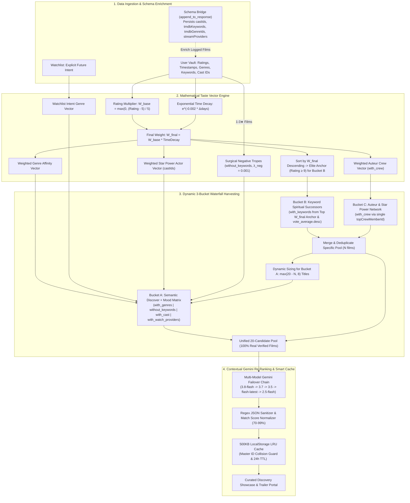

# 🏛️ CinemaVault — Comprehensive Architecture & Mathematics Specification (v4.0)

**CinemaVault** is an open-source, client-side cinema logging, analytics, and hybrid recommendation platform. This document serves as the **definitive technical specification** for CinemaVault v4.0, covering the z-scored mathematical taste formulations, IEEE-754 float16 collaborative & content embedding retrieval (`CVEM` v1), calibrated logistic candidate ranking, offline IR evaluation harness (Recall@20, NDCG@10, ILD, Novelty), TMDB API grammar rules, structured LLM diversity & explanation passes, multi-model failover chains, and client-side caching strategies.

---

## Table of Contents

1. [Executive Summary & Core Philosophy](#1-executive-summary--core-philosophy)
2. [Why Pure LLM Recommenders Fail (The 5 Fatal Flaws)](#2-why-pure-llm-recommenders-fail-the-5-fatal-flaws)
3. [Mathematical Taste Vector Formulation](#3-mathematical-taste-vector-formulation)
   - [3.1 Continuous Rating Weights ($W_{\text{base}}$)](#31-continuous-rating-weights-w_textbase)
   - [3.2 Exponential Recency Time-Decay ($W_{\text{final}}$)](#32-exponential-recency-time-decay-w_textfinal)
   - [3.3 Temporally-Weighted Anchor Film Selection](#33-temporally-weighted-anchor-film-selection)
   - [3.4 Granular Negative Trope Extraction (`without_keywords`)](#34-granular-negative-trope-extraction-without_keywords)
   - [3.5 Star-Power & Auteur Graphing](#35-star-power--auteur-graphing)
   - [3.6 Watchlist Intent Vectoring](#36-watchlist-intent-vectoring)
4. [The Deterministic 3-Bucket Waterfall Pipeline](#4-the-deterministic-3-bucket-waterfall-pipeline)
   - [4.1 Bucket B: Keyword Spiritual Successors](#41-bucket-b-keyword-spiritual-successors)
   - [4.2 Bucket C: Auteur & Star Power Network](#42-bucket-c-auteur--star-power-network)
   - [4.3 Bucket A: Semantic Discover Engine & Mood Calibration Matrix](#43-bucket-a-semantic-discover-engine--mood-calibration-matrix)
   - [4.4 Dynamic Waterfall Sizing & Cinephile Critical Fallback](#44-dynamic-waterfall-sizing--cinephile-critical-fallback)
   - [4.5 Cold-Start Bypass Engine](#45-cold-start-bypass-engine)
5. [TMDB API Query Grammar & Syntax Rules](#5-tmdb-api-query-grammar--syntax-rules)
6. [Schema Bridge & Enriched Cinema Extraction (`bridgeTmdbToOmdb`)](#6-schema-bridge--enriched-cinema-extraction-bridgetmdbtoomdb--fetchtmdbmoviedetails)
7. [Structured Gemini Re-Ranking, Score Normalization & Failover Chain](#7-structured-gemini-re-ranking-score-normalization--failover-chain)
8. [Smart LRU Cache, Collision Guard & Tiered Quota Recovery](#8-smart-lru-cache-collision-guard--tiered-quota-recovery)
9. [Universal Streaming Access & Multi-Region Matrix](#9-universal-streaming-access--multi-region-matrix)
10. [Official Trailer Resolution & Playback Architecture](#10-official-trailer-resolution--playback-architecture)
11. [Telemetry Analytics & Statistical Algorithms](#11-telemetry-analytics--statistical-algorithms)
12. [Two-Way Letterboxd Portability & Batch Importer](#12-two-way-letterboxd-portability--batch-importer)
13. [Dual-Engine Spotlight Search & Strict Env Enforcement](#13-dual-engine-spotlight-search--strict-env-enforcement)
14. [Complete Reference Implementations (Code Blocks)](#14-complete-reference-implementations-code-blocks)
15. [Luxury Rating Deck & Interaction Architecture](#15-luxury-rating-deck--interaction-architecture)

---

## 1. Executive Summary & Core Philosophy

Most AI movie tools operate as **unconstrained text generators**: they prompt an LLM with a list of favorite movies and ask it to invent 10 recommendations. This leads to catalog hallucinations (invented release years, false cast members, nonexistent films), stale echo chambers (recommending the same 10 mainstream titles like *Inception* or *Interstellar*), and broken UI states.

CinemaVault fundamentally separates **catalog harvesting** from **contextual re-ranking**:



---

## 2. Why Pure LLM Recommenders Fail (The 5 Fatal Flaws)

1. **The Hallucination Trap**: Pure LLMs hallucinate release years, sequels that never existed, and mismatched directors. CinemaVault guarantees **0% hallucination** in its primary pipeline because Gemini is strictly forbidden from inventing titles — it only ranks verified candidates harvested from TMDB.
2. **The Echo Chamber Trap**: Simple prompts repeat ubiquitous blockbusters (*The Dark Knight*, *Pulp Fiction*). CinemaVault breaks the echo chamber by harvesting across three distinct programmatic buckets (spiritual keyword successors, auteur networks, and mood-calibrated semantic discovery).
3. **The TMDB `/recommendations` Endpoint Trap**: TMDB's native `/movie/{id}/recommendations` endpoint is a simplistic heuristic based on generic user list overlap. CinemaVault instead uses deep keyword graph discovery (`with_keywords`) sorted by critical acclaim (`vote_average.desc`) with an acclaim floor (`vote_count.gte=500`), producing genuine spiritual successors.
4. **The Broad Genre Blacklist Trap**: Banning an entire genre like "Action" because a user hated a superhero movie blocks masterpieces like *Seven Samurai* or *Heat*. CinemaVault instead extracts micro-keywords (*"superhero"*, *"slapstick"*, *"parody"*) from $1-3\star$ films and applies surgical `without_keywords` filters.
5. **The Temporal Blindspot**: A favorite movie rated 10/10 four years ago shouldn't outweigh a film the user is obsessed with right now. CinemaVault applies half-life exponential time-decay to capture current obsessions while retaining core classics.

---

## 3. Mathematical Taste Vector Formulation

### 3.1 Per-User Z-Scored Rating Normalization ($z_i$)
To eliminate harsh-vs-generous rater bias and ensure mediocre ratings ($4-5\star$) exert appropriate negative pull when a user's personal mean is $\approx 7.0$, CinemaVault v4.0 normalizes every rating against the user's personal distribution (`src/services/scoringUtils.js`):

$$\mu = \frac{1}{N}\sum_{i=1}^{N} r_i, \quad \sigma_{\text{eff}} = \max\left(\sqrt{\frac{1}{N}\sum_{i=1}^{N}(r_i - \mu)^2},\; 0.5\right), \quad z_i = \frac{r_i - \mu}{\sigma_{\text{eff}}}$$

- **Zero-Variance Guard:** If all rated films have identical scores ($\sigma_{\text{raw}} = 0$), $z_i$ defaults safely to $+0.5$ (when $r_i \ge 7$), $-0.5$ (when $r_i \le 4$), or $0.0$ without division by zero.
- **Cold-Start Fallback ($N < 3$):** Uses centered linear scaling $z_i = (r_i - 5.5) / 2.0$.

### 3.2 Bulk-Import-Safe Exponential Recency Time-Decay ($w_i$)
Every film's z-score is modulated by exponential time-decay (`src/services/scoringUtils.js`):

$$w_i = z_i \cdot e^{-\lambda \Delta_i}, \quad \lambda = 0.002 \text{ days}^{-1}$$

- **Bulk-Import & Undated Prior ($\Delta_{\text{prior}} = 180\text{ days}$):** Films imported in bulk (`isBulkImported: true`) or logged without `dateWatched` are assigned $\Delta_i = 180$ days instead of `Date.now()` ($\Delta_i = 0$), preventing undated backlog imports from overpowering genuinely recent watches.
- **Future-Timestamp Clamp:** $\Delta_i = \max(0, (t_{\text{now}} - t_i) / 86400000)$ prevents clock skew from producing decay $> 1.0$.

### 3.3 Stage 1 & 2: Float16 Collaborative + Content Embeddings (`CVEM` v1)
CinemaVault ships a zero-dependency IEEE-754 half-precision (`float16`) binary codec (`src/services/embeddingService.js`) backed by an offline MovieLens 25M/32M SVD/ALS trainer (`scripts/colab_train_embeddings.py`). At runtime, `loadDefaultEmbeddingIndex("/models/item_embeddings_f16.bin")` lazily loads the compact binary index and computes the L2-normalized user taste vector:

$$u = \frac{\sum_{i} w_i e_i}{\sum_{i} |w_i|}$$

Disliked films ($w_i < 0$) actively push $u$ away from their embedding neighborhoods. For cold or recent releases, `blendEmbeddings` interpolates collaborative and content vectors with $\alpha = \frac{n}{n + 50}$.

### 3.4 Stage 3: Calibrated Logistic Ranker & Offline Evaluation Harness
Rather than allowing the LLM to invent uncalibrated percentages, `rankCandidatePool` (`src/services/rankerService.js`) extracts 10 normalized features (`collabSim`, `contentSim`, `genreOverlap`, `keywordOverlap`, `crewMatch`, `castMatch`, `bayesianRatingNorm`, `noveltyBonus`, `negativeKeywordPenalty`, `providerMatch`) across up to 300 candidates and computes calibrated match probabilities:

$$p_i = \sigma(b + w^\top x_i) = \frac{1}{1 + e^{-(b + w^\top x_i)}}, \quad \text{matchScore}_i = \text{round}(50 + 49 \cdot p_i) \in [50, 99]$$

The top 30 ranked candidates are then passed to Gemini strictly for a diversity pass (selecting 6) and natural-language explanations (`mergeGeminiExplanationsWithRanker` locks the calibrated `matchScore`). All hyperparameter choices ($\lambda$, anchor cutoffs, prior days) are benchmarked via `src/services/evalHarness.js` using chronological holdouts (`temporalHoldoutSplit`), `computeRecallAtK`, `computeNDCGAtK`, `computeILD`, and `computeNovelty`.

$$W_{\text{final}} = W_{\text{base}} \times e^{-\lambda \cdot \Delta t}$$

Where:
- $\Delta t = \max\left(0, \frac{\text{Date.now}() - t_{\text{watched}}}{1000 \times 60 \times 60 \times 24}\right)$ (elapsed time in days, clamped to $\ge 0$).
- $\lambda = 0.002$ ($\text{Half-life} = \frac{\ln(2)}{0.002} \approx 346.5\text{ days} \approx 11.5\text{ months}$).

#### Recency Decay Table ($\lambda = 0.002$):
- **Day 0 (Today)**: $e^{0} = 1.000$ (100% of base weight)
- **Day 60 (2 Months)**: $e^{-0.12} \approx 0.887$ (88.7% of base weight)
- **Day 180 (6 Months)**: $e^{-0.36} \approx 0.698$ (69.8% of base weight)
- **Day 346 (~Half-Life / 11.5 Months)**: $e^{-0.693} \approx 0.500$ (50.0% of base weight)
- **Day 730 (2 Years)**: $e^{-1.46} \approx 0.232$ (23.2% of base weight)

### 3.3 Temporally-Weighted Anchor Film Selection
Bucket B requires a high-affinity anchor film to extract thematic keywords. CinemaVault sorts all rated films by $W_{\text{final}}$ descending and filters for elite masterpieces ($\text{Rating} \ge 9$) (`src/services/tmdbService.js:219-223`):

$$\text{AnchorMovie} = \arg\max_{m \in \text{Rated}, \text{Rating}(m) \ge 9} W_{\text{final}}(m)$$

If the anchor movie only has an `imdbID` (e.g., logged before TMDB schema enrichment), `findTmdbByImdbId` resolves its canonical `tmdbId` on the fly. If no film is rated $\ge 9$, `anchorTmdbId` resolves to `null` and Bucket B's candidate slots are dynamically reallocated to Bucket A.

### 3.4 Granular Negative Trope Extraction (`without_keywords`)
Instead of excluding broad genres, the profiler iterates over movies rated $\le 3\star$ and accumulates time-decayed trope penalties at half the decay rate ($\lambda_{\text{neg}} = \frac{\lambda}{2} = 0.001$, recognizing that psychological dislikes decay more slowly than fleeting interests) (`src/services/tmdbService.js:173-178`):

$$\text{HatedKeywords}[k] = \sum_{m \in \text{Rated}, \text{Rating}(m) \le 3, k \in m.\text{tmdbKeywords}} e^{-\frac{\lambda}{2} \cdot \Delta t_m}$$

Keywords with an accumulated score $\ge 1$ (up to the top 5 keyword IDs) are passed to TMDB using pipe OR syntax (`without_keywords=9715|10402`), surgically excluding any candidate containing *either* hated trope (*superhero*, *slapstick*, *musical*) without banning entire genres like Action or Drama.

### 3.5 Star-Power & Auteur Graphing
High-rated films ($\text{Rating} \ge 8$) contribute their creative personnel to weighted frequency vectors (`src/services/tmdbService.js:181-190`):
- **Star-Power Actors**: The top 3 billed cast IDs (`castIds[0..2]`) accumulate $W_{\text{final}}$. The top 2 recurring actors (`topCastIds`) are injected into Bucket A discover queries.
- **Auteur Directors & Crew**: Directors, Cinematographers, Original Music Composers, and Screenwriters accumulate $W_{\text{final}}$ (with Director explicitly prioritized during Schema Bridge extraction). The highest-scoring single crew member ID (`topCrewMemberId`) is queried in Bucket C.

### 3.6 Watchlist Intent Vectoring
Unwatched films saved in the user's `watchlist` represent explicit near-term viewing intent (`src/services/tmdbService.js:239-251`). The profiler extracts the top 3 recurring TMDB genre IDs (`watchlistGenreIds`) from the watchlist and blends the top 2 with the user's top 4 loved genres in Bucket A.

---

## 4. The Deterministic 3-Bucket Waterfall Pipeline

### 4.1 Bucket B: Keyword Spiritual Successors (`fetchBucketB`)
- **Objective**: Discover high-acclaim films that share core micro-keywords with the user's top $W_{\text{final}}$ anchor film.
- **Methodology**: Calls `fetchMovieKeywordsAndCrew(anchorTmdbId)` to retrieve the top 3 keyword IDs (`keywords.slice(0, 3).join("|")`) and queries TMDB `/discover/movie` with `sort_by=vote_average.desc`, `vote_average.gte=7.0`, and an acclaim floor of `vote_count.gte=500` across up to 4 pages.
- **Target Harvest**: 8 candidates.

### 4.2 Bucket C: Auteur & Star Power Network (`fetchBucketC`)
- **Objective**: Harvest films from the user's top-weighted director, cinematographer, composer, or screenwriter.
- **Methodology**: Queries TMDB with `with_crew={topCrewMemberId}`, `sort_by=vote_average.desc`, and `vote_count.gte=150` across up to 3 pages.
- **Target Harvest**: 4 candidates (executed concurrently with Bucket B via `Promise.all`).

### 4.3 Bucket A: Semantic Discover Engine & Mood Calibration Matrix (`fetchBucketA`)
- **Objective**: Broad discovery combining weighted genre affinities (`lovedGenreIds`), watchlist intent (`watchlistGenreIds`), active mood vectors, star-power cast (`with_cast`), surgical trope exclusions (`without_keywords`), and regional streaming filters (`with_watch_providers`).
- **Mood Calibration Matrix (`src/services/tmdbService.js:311-346`)**:

| Mood ID | TMDB `sort_by` | `vote_count.gte` | `vote_average.gte` | Injected Genre Boost IDs |
| :--- | :--- | :---: | :---: | :--- |
| **`mind-bending`** | `vote_average.desc` | `250` | `7.5` | `9648` (Mystery), `878` (Sci-Fi) |
| **`dark-thriller`** | `popularity.desc` | `120` | `6.8` | `80` (Crime), `53` (Thriller) |
| **`hidden-gem`** | `vote_average.desc` | `50` | `7.3` | *(Relies on user taste vector)* |
| **`comfort-watch`** | `vote_average.desc` | `180` | `7.2` | `35` (Comedy), `18` (Drama), `10751` (Family) |
| **`fun-popcorn`** | `popularity.desc` | `250` | `6.5` | `28` (Action), `12` (Adventure) |
| **`any` (Default)** | `popularity.desc` | `150` | `6.8` | *(Relies on user taste vector)* |

### 4.4 Dynamic Waterfall Sizing & Cinephile Critical Fallback
1. **Dynamic Slot Calculation**: If Buckets B & C return $N$ combined unique candidates (`specificPool.length`), Bucket A dynamically scales its target (`src/services/tmdbService.js:641`):
   $$\text{Target}_A = \max(20 - N, 8)$$
2. **Cinephile Critical Fallback (`src/services/tmdbService.js:420-452`)**: If a veteran user has already logged most popular titles in a genre (`candidates.length < min(targetCount, 5)` while `sort_by === "popularity.desc"`), Bucket A automatically pivots to `sort_by=vote_average.desc` and `vote_count.gte=500`, scanning up to 5 additional pages of critically acclaimed cinema.
3. **Top-Up Pass**: The orchestrator merges specific candidates first, appends Bucket A candidates, and returns a unified **20-candidate pool** (`combined.slice(0, 20)`).

### 4.5 Cold-Start Bypass Engine
For accounts with $< 3$ rated films (`(watchedMovies || []).length < 3`), specific keyword and crew graphs lack statistical significance. CinemaVault automatically bypasses Buckets B & C and routes directly to an expanded Bucket A (`targetCount = 20`), harvesting 20 diverse, highly-rated films calibrated to the selected mood and watchlist genres.

---

## 5. TMDB API Query Grammar & Syntax Rules

The TMDB `/discover/movie` API enforces specific boolean logic conventions across parameter types:

| Parameter Type | Parameter Name | Delimiter | Boolean Logic | TMDB Example |
| :--- | :--- | :---: | :---: | :--- |
| **Genres** | `with_genres` | `\|` (Pipe) | **OR** | `with_genres=28\|878` (Action OR Sci-Fi) |
| **Keywords** | `with_keywords` | `\|` (Pipe) | **OR** | `with_keywords=9715\|10402` |
| **Excluded Keywords** | `without_keywords`| `\|` (Pipe) | **OR** | `without_keywords=9715\|10402` |
| **Cast / Actors** | `with_cast` | `\|` (Pipe) | **OR** | `with_cast=67890\|11122` (Actor A OR Actor B) |
| **Crew Members** | `with_crew` | N/A | Single ID | `with_crew=12345` (Christopher Nolan) |
| **Watch Providers** | `with_watch_providers` | `\|` (Pipe) | **OR** | `with_watch_providers=8\|9\|337` (Netflix OR Prime OR Disney+) |

> [!IMPORTANT]
> - **Conditional Genre Guard**: `with_genres` is only appended when `combinedLoved.length > 0` to prevent malformed empty parameters.
> - **Excluded Keywords (`without_keywords`)** uses pipe `|` to exclude films containing ANY of the specified trope tags.
> - **People (`with_cast`)** in TMDB treat comma `,` as **AND** and pipe `|` as **OR** (just like Genres & Keywords). CinemaVault uses `with_cast=A|B` so Bucket A never starves.
> - **Watch Providers** take integer provider IDs (`8|9`), NOT monetization strings like `flatrate`.
> - When `with_watch_providers` is passed, TMDB requires a valid 2-letter ISO `watch_region` code. If `userRegion === "GLOBAL"`, it defaults `watch_region` to `US` when provider filters are active.

---

## 6. Schema Bridge & Enriched Cinema Extraction (`bridgeTmdbToOmdb` & `fetchTmdbMovieDetails`)

CinemaVault enriches every saved or inspected movie record by executing a single-roundtrip TMDB request with `append_to_response=external_ids,credits,videos,keywords,watch/providers` (`src/services/tmdbService.js:765-955`), extracting high-resolution assets and structured graph IDs:

```javascript
/**
 * Resolves the optimal official trailer YouTube key using hierarchical ranking:
 * 1. Official English Trailer
 * 2. Main / Theatrical Trailer by title match
 * 3. General Trailer
 * 4. Teaser Clip
 * 5. First available YouTube video
 */
export function extractOfficialTrailerKey(videos = []) {
  if (!videos || !Array.isArray(videos) || videos.length === 0) return null;
  const youtubeVideos = videos.filter((v) => v.site === "YouTube" && v.key);
  if (youtubeVideos.length === 0) return null;

  const officialTrailer = youtubeVideos.find(
    (v) => v.type === "Trailer" && v.official === true && (v.iso_639_1 === "en" || !v.iso_639_1)
  );
  if (officialTrailer) return officialTrailer.key;

  const mainTrailer = youtubeVideos.find((v) => {
    const name = (v.name || "").toLowerCase();
    return v.type === "Trailer" && (name.includes("official") || name.includes("main") || name.includes("theatrical"));
  });
  if (mainTrailer) return mainTrailer.key;

  const anyTrailer = youtubeVideos.find((v) => v.type === "Trailer");
  if (anyTrailer) return anyTrailer.key;

  const anyTeaser = youtubeVideos.find((v) => v.type === "Teaser");
  if (anyTeaser) return anyTeaser.key;

  return youtubeVideos[0].key;
}
```

### Persisted Schema Fields (`bridgeTmdbToOmdb`)
When a user adds a film from recommendations or details to their Vault or Watchlist, `bridgeTmdbToOmdb` persists:
- `imdbID`: Canonical IMDb ID (`tt...`) or `tmdb_${id}` fallback
- `tmdbId`: Integer TMDB ID
- `tmdbGenreIds`: Array of TMDB genre integers (`[28, 878]`)
- `tmdbKeywords`: Top 10 keyword integer IDs (`data.keywords.keywords.slice(0, 10)`)
- `castIds`: Top 5 billed actor integer IDs (`data.credits.cast.slice(0, 5)`)
- `crewPersonId`: Primary Director ID (or fallback Cinematographer / Composer / Screenwriter ID)
- `streamProviders`: Regional flatrate streaming provider objects (`{ id, name, logo }`)
- `trailerKey`: Ranked YouTube video key

---

## 7. Stage 3 Calibrated Ranker, Gemini Explanations & Failover Chain

### 7.1 Top-30 Diversity Selection & Explanation Schema (`reRankCandidatesWithGemini`)
Before invoking Gemini, `rankCandidatePool` (`src/services/rankerService.js`) scores the candidate pool using calibrated logistic regression weights and selects the top 30 candidates with deterministic `matchScore` values attached. Gemini receives only those top 30 pre-ranked candidates and is constrained via `responseMimeType: "application/json"` and `responseSchema` (`src/services/geminiService.js`) to perform a diversity pass (selecting 6) and generate natural-language explanations:

```json
{
  "tasteProfile": {
    "favoriteGenres": ["Crime", "Thriller", "Drama"],
    "preferredEra": "1990s - Present",
    "ratingStyle": "High appreciation for character-driven dialogue and visual pacing."
  },
  "recommendations": [
    {
      "tmdbId": 680,
      "title": "Pulp Fiction",
      "year": "1994",
      "reason": "Directly matches your affinity for non-linear neo-noir crime sagas and sharp auteur dialogue."
    }
  ]
}
```

### 7.2 Calibrated Score Locking (`mergeGeminiExplanationsWithRanker`)
In v4.0, `mergeGeminiExplanationsWithRanker` locks each recommendation's `matchScore` to the deterministic calibrated ranker score (`candidate.matchScore = Math.round(50 + 49 * probability)`), preventing LLM score invention. `normalizeMatchScore` is retained strictly as a fallback for the OMDb-only generative pipeline when TMDB is unconfigured:

```javascript
export const normalizeMatchScore = (val) => {
  let n = typeof val === "number" ? val : parseFloat(val);
  if (isNaN(n) || n <= 0) return 88;
  if (n <= 1.0) {
    if (n <= 0.1) return Math.min(99, Math.max(75, Math.round(n * 1000)));
    return Math.min(99, Math.max(75, Math.round(n * 100)));
  }
  if (n <= 5) return 88;
  return Math.min(99, Math.max(70, Math.round(n)));
};
```

### 7.3 Regex Code-Fence Sanitizer (`sanitizeAndParseJSON`)
Strips optional markdown code fences (` ```json ... ``` `) before `JSON.parse` (`src/services/geminiService.js:48-56`):

```javascript
export function sanitizeAndParseJSON(rawText) {
  if (!rawText) throw new Error("Empty response from AI engine");
  let cleaned = String(rawText).trim();
  const jsonMatch = cleaned.match(/```(?:json)?\s*([\s\S]*?)\s*```/);
  if (jsonMatch) {
    cleaned = jsonMatch[1].trim();
  }
  return JSON.parse(cleaned);
}
```

### 7.4 Multi-Model & Multi-Pipeline Failover Chain
1. **Model Cascade (`src/services/geminiService.js:9-15` & `geminiChatService.js:3-9`)**:
   Iterates sequentially through:
   1. `gemini-3.8-flash`
   2. `gemini-3.7-flash`
   3. `gemini-3.5-flash`
   4. `gemini-flash-latest`
   5. `gemini-2.5-flash`
2. **Secondary Pipeline Failover (`generateWithOmdbFallback`)**:
   If `VITE_TMDB_KEY` is missing or TMDB network requests fail, the engine falls back to `generateWithOmdbFallback` (`src/services/geminiService.js:447-550`), which formats the user's top 25 rated films into a compact pipe-delimited table (`Title|Year|Director|Genre|Rating|UserNote`), prompts Gemini for 6 recommendations, and verifies every title against OMDb (`fetchRealOMDBData`) with an in-memory session cache (`omdbMemoryCache`).

---

## 8. Smart LRU Cache, Collision Guard & Tiered Quota Recovery

### 8.1 Profile-Based Sliding Window Hash (`generateProfileHash`)
Cache keys are deterministically generated without mutating profile arrays in place, and include `anchorTmdbId`, `topCrewMemberId`, and `topCastIds` so logging a new $10/10$ masterpiece immediately invalidates stale cache entries (`src/services/geminiService.js`):

```javascript
export const generateProfileHash = (profile, watchlistGenres = [], mood = "any", providers = []) => {
  const lovedStr = [...(profile?.lovedGenreIds || [])].sort((a, b) => a - b).join("-");
  const hatedStr = [...(profile?.hatedKeywordIds || [])].sort((a, b) => a - b).join("-");
  const watchStr = [...(watchlistGenres || [])].slice(0, 3).sort((a, b) => a - b).join("-");
  const provStr = [...(providers || [])].sort((a, b) => String(a).localeCompare(String(b))).join("-");
  const anchorStr = String(profile?.anchorTmdbId || "none");
  const crewStr = String(profile?.topCrewMemberId || "none");
  const castStr = [...(profile?.topCastIds || [])].sort((a, b) => a - b).join("-");
  const cleanMood = (typeof mood === "string" ? mood : mood?.id || "any").toLowerCase().trim() || "any";
  return `v4_${lovedStr}_${hatedStr}_${watchStr}_${provStr}_${anchorStr}_${crewStr}_${castStr}_${cleanMood}`;
};
```

### 8.2 Master ID Cross-Referencing Collision Guard
`getSmartCache` validates cached recommendations (24-hour TTL) against all known identifiers (`imdbID`, `tmdbId`, `id`) across both `watched` and `watchlist` arrays. If at least 4 valid, uncollided recommendations remain, the cached payload is served (`src/services/geminiService.js:61-103`):

```javascript
export function getSmartCache(hash, watched = [], watchlist = []) {
  try {
    const cache = JSON.parse(localStorage.getItem(SMART_CACHE_KEY) || '{}');
    const entry = cache[hash];
    if (!entry || !entry.data || (Date.now() - (entry.ts || 0) > 24 * 60 * 60 * 1000)) {
      return null;
    }

    const currentIds = new Set([
      ...watched.flatMap(m => [
        m.imdbID ? String(m.imdbID).toLowerCase() : null,
        m.tmdbId ? String(m.tmdbId).toLowerCase() : null,
        m.id ? String(m.id).toLowerCase() : null
      ]).filter(Boolean),
      ...watchlist.flatMap(m => [
        m.imdbID ? String(m.imdbID).toLowerCase() : null,
        m.tmdbId ? String(m.tmdbId).toLowerCase() : null,
        m.id ? String(m.id).toLowerCase() : null
      ]).filter(Boolean)
    ]);

    const validRecs = (entry.data.recommendations || []).map(rec => ({
      ...rec,
      matchScore: normalizeMatchScore(rec.matchScore)
    })).filter(rec => {
      const recIds = [
        rec.imdbID ? String(rec.imdbID).toLowerCase() : null,
        rec.tmdbId ? String(rec.tmdbId).toLowerCase() : null,
        rec.id ? String(rec.id).toLowerCase() : null
      ].filter(Boolean);

      return !recIds.some(id => currentIds.has(id));
    });

    if (validRecs.length >= 4) {
      return { ...entry.data, recommendations: validRecs };
    }
  } catch (e) {
    console.warn("SmartCache read failed:", e);
  }
  return null;
}
```

### 8.3 500KB LRU Eviction Policy & Tiered LocalStorage Quota Protection
1. **500KB Cache Cap (`setSmartCache`)**: Sorts cache keys by timestamp (`ts`) ascending and evicts the oldest entries in a single pass whenever `serialized.length * 2 > 500 * 1024`.
2. **Tiered Quota Recovery (`safeSetItem` in `src/context/AppContext.jsx:9-52`)**: Wraps all `localStorage` writes. If `QuotaExceededError` (code `22` / `1014`) is thrown, `safeSetItem` automatically purges non-critical derivative caches in priority order to protect user vault data:
   1. `cinemavault_smart_cache_v3`
   2. `cinemavault_explanations_v1`
   3. `cinemavault_recs_v1`
   4. `cinemavault_recs_hash_v1`
   5. `cinemavault_feedback_v1`

---

## 9. Universal Streaming Access & Multi-Region Matrix

### Supported Streaming Providers (`POPULAR_WATCH_PROVIDERS`)
| Provider | TMDB ID | Key | Icon |
| :--- | :---: | :---: | :---: |
| **Netflix** | `8` | `netflix` | 🔴 |
| **Amazon Prime Video** | `9` | `prime` | 📦 |
| **Disney+** | `337` | `disney` | ✨ |
| **Max (HBO)** | `1899` | `max` | 🟣 |
| **Apple TV+** | `350` | `apple` | 🍏 |
| **Hulu** | `15` | `hulu` | 🟢 |
| **Paramount+** | `531` | `paramount` | 🏔️ |
| **Peacock** | `386` | `peacock` | 🦚 |
| **Criterion Channel** | `258` | `criterion` | 🏛️ |
| **Tubi (Free)** | `73` | `tubi` | 📺 |
| **Pluto TV (Free)** | `300` | `pluto` | ⚡ |
| **Freevee (Free)** | `573` | `freevee` | 🎬 |

### Supported Regions (`AVAILABLE_REGIONS`)
`GLOBAL` (Worldwide), `US`, `GB`, `CA`, `AU`, `JP`, `KR`, `FR`, `DE`, `ES`, `IT`, `IN`, `BR`, `MX`, `SE`.

---

## 10. Official Trailer Resolution & Playback Architecture

Major movie studios frequently enforce origin-embedding restrictions on official trailers (resulting in iframe `Error 153: Video unavailable`). CinemaVault combines **hierarchical official trailer ranking** with both modal and direct playback options:

1. **Hierarchy Strategy (`extractOfficialTrailerKey`)**:
   - `type === "Trailer" && official === true && (iso_639_1 === "en" || !iso_639_1)`
   - `type === "Trailer" && name matches ("official" | "main" | "theatrical")`
   - `type === "Trailer"`
   - `type === "Teaser"`
   - First available YouTube clip (`youtubeVideos[0].key`)
2. **Playback & Fallback**:
   - Launches either in `TrailerModal.jsx` (portaled to `document.body`) or directly via canonical YouTube watch URL (`https://www.youtube.com/watch?v=${trailerKey}`).
   - If a film has no TMDB video records, falls back to a pre-encoded YouTube search query: `https://www.youtube.com/results?search_query=${encodeURIComponent(title + ' ' + year + ' official trailer')}`.

---

## 11. Telemetry Analytics & Statistical Algorithms

### 1. Rating Delta Histogram (`VaultBanner.jsx` / `MovieDetails.jsx`)
Calculates the user's deviation from global IMDb baselines:

$$\Delta(m) = \text{UserRating}(m) - \text{ImdbRating}(m)$$

Categorized into 5 behavioral tiers:
- **Critical Contrariness** ($\Delta \le -2.0$)
- **Mild Skepticism** ($-1.5 \le \Delta \le -0.5$)
- **Consensus Neutral** ($-0.5 < \Delta < +0.5$)
- **Generous Affinity** ($+0.5 \le \Delta \le +1.5$)
- **Passionate Champion** ($\Delta \ge +2.0$)

### 2. Watch Time Aggregator
$$\text{TotalMinutes} = \sum_{m \in \text{Watched}} \text{parseRuntimeMinutes}(m.\text{runtime})$$

Converted into Days, Hours, and Minutes telemetry counters.

---

## 12. Two-Way Letterboxd Portability & Batch Importer

- **Export Formats (`BackupManagerModal.jsx`)**:
  - **Full JSON Archive**: Complete `{ watched, watchlist }` state snapshot (`cinemavault_backup.json`).
  - **Standardized Letterboxd CSV**: `Title,Year,Rating10,WatchedDate`.
  - **General Vault CSV**: `Title,Year,IMDb ID,IMDb Rating,Runtime,My Rating,Notes,Genres,Director,Type`.
- **Import Engine**:
  - Automatically parses both numeric ratings (`1–5` scaled to `2–10`, or native `1–10`) and Unicode star strings (`★★★★½` $\rightarrow$ `9`).
  - Chunks CSV imports into asynchronous batches (`BATCH_SIZE = 4`) to prevent browser and API rate-limit throttling while enriching records with OMDb/TMDB metadata and posters.
- **Modes**:
  - **Merge Mode**: Preserves existing custom reviews and ratings while appending new titles.
  - **Overwrite Mode**: Replaces vault state with the imported archive.

---

## 13. Dual-Engine Spotlight Search & Strict Env Enforcement

### 13.1 Strict Environment Variable Enforcement
All services (`tmdbService.js`, `geminiService.js`, `geminiChatService.js`, `geminiExplanationService.js`, `MovieDetails.jsx`, `SearchModal.jsx`, `BackupManagerModal.jsx`) read credentials exclusively from Vite environment variables (`import.meta.env.VITE_OMDB_KEY`, `VITE_TMDB_KEY`, `VITE_GEMINI_KEY`) with zero hardcoded fallback keys.

### 13.2 Dual-Engine Search Waterfall (`SearchModal.jsx`)
Triggered via `Cmd + K` / `Ctrl + K` with a `300ms` debounce (`useDebounce`):
1. **Primary Search**: Queries OMDb (`https://www.omdbapi.com/?apikey=${omdbKey}&s=${query}`) when `VITE_OMDB_KEY` is configured.
2. **Automatic TMDB Fallback**: If OMDb is unconfigured or returns zero matches, `SearchModal` transparently falls back to TMDB (`/3/search/movie`), mapping results into a unified schema (`imdbID: "tmdb_${id}"`, `Title`, `Year`, `Poster`) so search works seamlessly with either key.

---

## 14. Complete Reference Implementations (Code Blocks)

### `extractTasteProfile` in `src/services/tmdbService.js`
```javascript
export async function extractTasteProfile(watched = [], watchlist = []) {
  const rated = (watched || []).filter(m => {
    const r = Number(m.userRating || m.UserRating || 0);
    return !isNaN(r) && r > 0;
  });

  const genreScores = {};
  const hatedKeywordCounts = {};
  const castScores = {};
  const crewScores = {};
  const DECAY_RATE = 0.002; // ~346 day (~11.5 month) cinema-appropriate half-life

  const weightedRated = rated.map(movie => {
    const rating = Number(movie.userRating || movie.UserRating || 0);
    const addedTime = new Date(movie.dateWatched || movie.addedAt || Date.now()).getTime();
    const daysSince = Math.max(0, (Date.now() - addedTime) / (1000 * 60 * 60 * 24));
    const timeDecay = Math.exp(-DECAY_RATE * daysSince);

    const baseWeight = Math.max(0, (rating - 5) / 5);
    const finalWeight = baseWeight * timeDecay;

    const genreIds = movie.tmdbGenreIds || mapOmdbToTmdbGenreIds(movie.genre || movie.Genre || "");
    genreIds.forEach(id => {
      genreScores[id] = (genreScores[id] || 0) + finalWeight;
    });

    if (rating <= 3 && movie.tmdbKeywords && Array.isArray(movie.tmdbKeywords)) {
      const negativeDecay = Math.exp(-(DECAY_RATE / 2) * daysSince);
      movie.tmdbKeywords.forEach(kId => {
        hatedKeywordCounts[kId] = (hatedKeywordCounts[kId] || 0) + negativeDecay;
      });
    }

    if (rating >= 8) {
      if (movie.castIds && Array.isArray(movie.castIds)) {
        movie.castIds.slice(0, 3).forEach(cId => {
          castScores[cId] = (castScores[cId] || 0) + finalWeight;
        });
      }
      if (movie.crewPersonId) {
        crewScores[movie.crewPersonId] = (crewScores[movie.crewPersonId] || 0) + finalWeight;
      }
    }

    return { ...movie, finalWeight };
  });

  weightedRated.sort((a, b) => b.finalWeight - a.finalWeight);

  const lovedGenreIds = Object.entries(genreScores)
    .sort((a, b) => b[1] - a[1])
    .slice(0, 4)
    .map(([id]) => Number(id));

  const topCastIds = Object.entries(castScores)
    .sort((a, b) => b[1] - a[1])
    .slice(0, 2)
    .map(([id]) => Number(id));

  const topCrewMemberId = Object.entries(crewScores)
    .sort((a, b) => b[1] - a[1])
    .slice(0, 1)
    .map(([id]) => Number(id))[0] || null;

  const hatedKeywordIds = Object.entries(hatedKeywordCounts)
    .filter(([_, count]) => count >= 1)
    .slice(0, 5)
    .map(([id]) => Number(id));

  const eliteAnchors = weightedRated.filter(m => Number(m.userRating || 0) >= 9);
  let anchorTmdbId = null;
  if (eliteAnchors.length > 0) {
    anchorTmdbId = eliteAnchors[0].tmdbId || (await findTmdbByImdbId(eliteAnchors[0].imdbID))?.tmdbId || null;
  }

  const dirMap = {};
  rated.filter(m => Number(m.userRating || 0) >= 7).forEach(m => {
    const d = (m.director || m.Director || "").trim();
    if (d && d !== "N/A" && d !== "Unknown") {
      dirMap[d] = (dirMap[d] || 0) + 1;
    }
  });

  const topDirectors = Object.entries(dirMap)
    .sort((a, b) => b[1] - a[1])
    .slice(0, 3)
    .map(([d]) => d);

  const watchlistGenreCounts = {};
  (watchlist || []).forEach(m => {
    const genreIds = m.tmdbGenreIds || mapOmdbToTmdbGenreIds(m.genre || m.Genre || "");
    genreIds.forEach(id => {
      watchlistGenreCounts[id] = (watchlistGenreCounts[id] || 0) + 1;
    });
  });

  const watchlistGenreIds = Object.entries(watchlistGenreCounts)
    .sort((a, b) => b[1] - a[1])
    .slice(0, 3)
    .map(([id]) => Number(id));

  return {
    lovedGenreIds,
    lovedGenreNames: lovedGenreIds.map(id => TMDB_ID_TO_GENRE[id] || `Genre ${id}`),
    topDirectors,
    topCastIds,
    topCrewMemberId,
    anchorTmdbId,
    hatedKeywordIds,
    watchlistGenreIds,
    totalRated: rated.length
  };
}
```

---

## 15. Luxury Rating Deck & Interaction Architecture

### 15.1 Dynamic Taste Anchor Tiers (`MovieDetails.jsx`)
Ratings trigger reactive metadata banners that articulate the film's mathematical role in the user's taste engine:

| Rating | Tier Title | Icon | Taste Engine Mechanism | Visual Accent |
| :---: | :--- | :---: | :--- | :--- |
| **10** | **Masterpiece (Anchor Film)** | 🏆 | Sets primary anchor for Bucket B keyword harvest | Brass Gold (`#e2b13c`) |
| **9** | **Exceptional Cinema** | ✨ | Eligible elite anchor; strong positive genre boost | Amber Gold (`#f59e0b`) |
| **8** | **Great Film** | 🍿 | Accumulates actor (`castIds`) & crew vectors | Emerald (`#10b981`) |
| **7** | **Good Watch** | 👍 | Solid craft, baseline enjoyment & director count | Cyan (`#06b6d4`) |
| **6** | **Decent Baseline** | 😐 | Watchable with balanced qualities | Purple (`#8b5cf6`) |
| **5** | **Mediocre** | 📉 | Neutral boundary (`0.00` base weight) | Slate (`#94a3b8`) |
| **4** | **Flawed** | ⚠️ | Below neutral threshold (`0.00` positive weight) | Orange (`#f97316`) |
| **3** | **Disliked** | 🚫 | Trope penalty applied to negative keyword vector | Crimson (`#ef4444`) |
| **2** | **Poor Experience** | ⛔ | AI engine suppresses matching motifs | Dark Red (`#dc2626`) |
| **1** | **Severe Dislike** | 💀 | Strict negative weight applied to keywords | Deep Ruby (`#b91c1c`) |

### 15.2 Synchronized Flex Distribution & Layout Guardrails
- **Dual Column Alignment**: `.glowing-stars-bar` and `.rating-numeric-dial` share identical CSS flex layouts (`width: 100%`, `gap: 0.4rem`), where each child `.star-touch-btn` and `.dial-pill` utilizes `flex: 1; min-width: 0;`.
- **Zero-Layout Shift**: The `.rating-tier-banner` enforces a fixed min-height (`5.8rem`) with smooth CSS transitions (`background`, `border-color`, `box-shadow`) so text changes never displace the interactive star buttons or dial.
- **Hitbox Boundary Isolation**: Star scaling on hover (`transform: scale(1.18)`) is isolated to the non-interactive inner SVG icon (`pointer-events: none`), preventing pointer-boundary flicker.
- **Floating Cinema Toast Pill (`ToastNotification.jsx`)**: Top-center luxury floating pill notification with quick `Undo` recovery for vault and watchlist deletions.

---

*Authored by **[Khuzaima](https://github.com/khuzaima175)** for the CinemaVault Project.*
