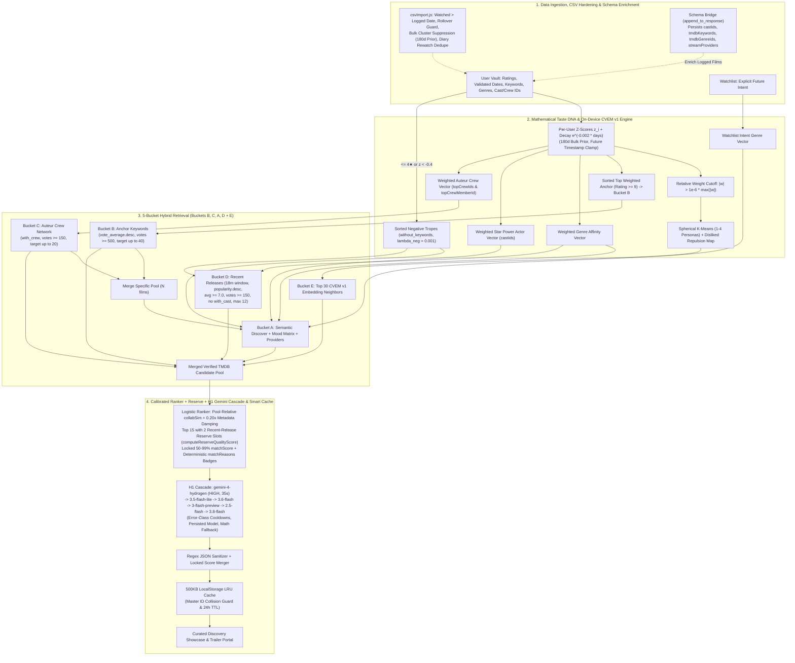

# 🏛️ CinemaVault — Comprehensive Architecture & Mathematics Specification (v4.2)

**CinemaVault** is an open-source, client-side cinema logging, analytics, and hybrid recommendation platform. This document serves as the **definitive technical specification** for CinemaVault v4.2 (`main`), preserving the full system design from v3.x/v4.0 while incorporating every production upgrade through v4.2: per-user z-scored mathematical taste formulations, IEEE-754 float16 collaborative & content embedding retrieval (`CVEM v1`, 25,000 films × 64-D), vault-relative weight cutoffs (`1e-6 * maxAbsWeight`), Spherical K-Means multi-persona clustering with negative repulsion, calibrated 11-feature logistic ranking with pool-relative normalization and `0.20x` metadata damping, offline IR evaluation harness (`Recall@20`, `NDCG@10`, `ILD`, `Novelty`), 5-bucket TMDB + Embedding retrieval (`A/B/C/D/E`) with a 2-slot recent-release reserve lane, hardened Letterboxd CSV ingestion (`csvImport.js`), structured LLM diversity & explanation passes via the H1 `gemini-4-hydrogen` resilient cascade (`35,000 ms` timeout & error-class cooldowns), UI active-model diagnostic badges (`ModelUsageBadge`, `.chat-model-bar`), client-side LRU caching, UI component interactions, and the 99-test `node --test` verification matrix.

> For a plain-English walkthrough of the local model, provenance audits, verified benchmarks, errors resolved, and copy-paste health checks, see **[LOCAL_MODEL_GUIDE.md](./LOCAL_MODEL_GUIDE.md)**. Historical point-in-time design specs and implementation plans remain preserved under [docs/superpowers/](./docs/superpowers).

---

## Implementation Status (Updated Nov 13, 2026)

| Area | Implemented Behavior on `main` (`1336dcc`) | Primary Modules |
| :--- | :--- | :--- |
| **Stage 1 Collaborative Embeddings** | `25,000`-film, `64`-D float16 binary (`/models/item_embeddings_f16.bin`, `3,300,016` B, `CVEM v1`) trained on MovieLens 32M with verified zero holdout leakage (`clean_ranker` `0.0826` vs `leaky_ranker` `0.0828`, null) & SPA `text/html` fallback rejection | [embeddingService.js](./src/services/embeddingService.js), [colab_train_embeddings.py](./scripts/colab_train_embeddings.py) |
| **Stage 2 Content Embeddings** | `contentSim` held at `0` at runtime (weight `1.4`) to avoid collinear double-counting until dedicated plot/visual text embeddings exist; `blendEmbeddings` codec is ready | [embeddingService.js](./src/services/embeddingService.js) |
| **Multi-Persona & Relative Cutoff** | Spherical K-Means (`computeUserPersonas`, `K` in `[1, 4]`), disliked repulsion (`repulsion: -1.5`), and vault-relative weight cutoff (`1e-6 * maxAbsWeight`) supporting multi-decade vaults (`ml-user-263`, `ml-user-409`) | [embeddingService.js](./src/services/embeddingService.js), [scoringUtils.js](./src/services/scoringUtils.js) |
| **5-Bucket Retrieval + Recent Lane** | Buckets `B` (Anchor Keywords), `C` (Auteur Crew), `A` (Semantic/Mood Discover), `D` (Recent Releases `18m`, `popularity.desc`, `avg >= 7.0`, `votes >= 150`, max `12`), and `E` (up to `30` embedding neighbors) | [tmdbService.js](./src/services/tmdbService.js) |
| **Calibrated Ranker & Reserve Slots** | 11-feature logistic ranker (`collabSim: 4.8`, softened `negativeKeywordPenalty: -0.5`), pool-relative normalization, `0.20x` metadata damping, and `RECENT_RELEASE_RESERVE_COUNT = 2` via `computeReserveQualityScore` (`noveltyBonus = 0`) | [rankerService.js](./src/services/rankerService.js) |
| **H1 Gemini Cascade** | `CURATION_MODEL_CASCADE` (`gemini-4-hydrogen` HIGH -> `3.5-flash-lite` -> `3.6-flash` -> `3-flash-preview` -> `2.5-flash` -> `3.8-flash`) & `FAST_INTERACTIVE_CASCADE` (`3.5-flash-lite` -> `gemini-4-hydrogen` MEDIUM -> `3.6-flash` -> `3-flash-preview` MINIMAL -> `2.5-flash` -> `3.8-flash`), per-model timeouts (`35s` Hydrogen, `15s` `3-flash-preview`, `10s` `3.6-flash`), error-class cooldowns, `localStorage` persistence, math fallback & UI model telemetry badges | [geminiService.js](./src/services/geminiService.js), [geminiChatService.js](./src/services/geminiChatService.js), [geminiExplanationService.js](./src/services/geminiExplanationService.js), [MovieRecommendations.jsx](./src/components/MovieRecommendations.jsx), [AIChat.jsx](./src/components/AIChat.jsx) |
| **Letterboxd CSV Hardening** | Pure testable pipeline prioritizing `Watched Date` (`"watched"`) over `Date` (`"logged"`), rejecting invalid calendar rollovers (`2026-02-30`) & future dates (`> now + 24h`), suppressing clustered bulk dates, and deduplicating diary rewatches | [csvImport.js](./src/services/csvImport.js) |
| **Evaluation & Verification** | Rolling temporal cross-validation (`evaluateRankerRolling`), CLI harness `scripts/run_eval.mjs`, and **99 / 99** unit tests across 12 test suites (`npm test`) | [evalHarness.js](./src/services/evalHarness.js), [tests/](./tests) |

---

## Table of Contents

1. [Executive Summary & Core Philosophy](#1-executive-summary--core-philosophy)
2. [Why Pure LLM Recommenders Fail (The 5+ Fatal Flaws)](#2-why-pure-llm-recommenders-fail-the-5-fatal-flaws)
3. [Mathematical Taste Vector & Local Model Formulation](#3-mathematical-taste-vector--local-model-formulation)
   - [3.1 Per-User Z-Scored Rating Normalization ($z_i$)](#31-per-user-z-scored-rating-normalization-z_i)
   - [3.2 Bulk-Import-Safe Exponential Recency Time-Decay ($w_i$)](#32-bulk-import-safe-exponential-recency-time-decay-w_i)
   - [3.3 Float16 Embeddings (`CVEM` v1), Relative Weight Cutoff, Personas & Repulsion](#33-float16-embeddings-cvem-v1-relative-weight-cutoff-personas--repulsion)
   - [3.4 Temporally-Weighted Anchor Film Selection](#34-temporally-weighted-anchor-film-selection)
   - [3.5 Granular Negative Trope Extraction (`without_keywords`) & Ranker Softening](#35-granular-negative-trope-extraction-without_keywords--ranker-softening)
   - [3.6 Star-Power, Auteur Crew & Watchlist Intent Vectoring](#36-star-power-auteur-crew--watchlist-intent-vectoring)
   - [3.7 Calibrated Logistic Ranker, Normalization, Metadata Damping & Match Badges](#37-calibrated-logistic-ranker-normalization-metadata-damping--match-badges)
   - [3.8 Verified Benchmark Milestones, Leakage Audit & Tuning Results](#38-verified-benchmark-milestones-leakage-audit--tuning-results)
4. [The 5-Bucket Hybrid Retrieval & Recent-Release Reserve Pipeline](#4-the-5-bucket-hybrid-retrieval--recent-release-reserve-pipeline)
   - [4.1 Bucket B: Keyword Spiritual Successors (`fetchBucketB`)](#41-bucket-b-keyword-spiritual-successors-fetchbucketb)
   - [4.2 Bucket C: Auteur & Star Power Network (`fetchBucketC`)](#42-bucket-c-auteur--star-power-network-fetchbucketc)
   - [4.3 Bucket A: Semantic Discover Engine & Mood Calibration Matrix (`fetchBucketA`)](#43-bucket-a-semantic-discover-engine--mood-calibration-matrix-fetchbucketa)
   - [4.4 Bucket D: Recent-Release Lane (`fetchBucketD`)](#44-bucket-d-recent-release-lane-fetchbucketd)
   - [4.5 Bucket E: Collaborative Embedding Neighbor Injection (`fetchEmbeddingCandidates`)](#45-bucket-e-collaborative-embedding-neighbor-injection-fetchembeddingcandidates)
   - [4.6 Dynamic Waterfall Sizing, Cold-Start Bypass & Recent-Release Reserve Selection](#46-dynamic-waterfall-sizing-cold-start-bypass--recent-release-reserve-selection)
5. [TMDB API Query Grammar & Syntax Rules](#5-tmdb-api-query-grammar--syntax-rules)
6. [Schema Bridge & Enriched Cinema Extraction (`bridgeTmdbToOmdb` & `fetchTmdbMovieDetails`)](#6-schema-bridge--enriched-cinema-extraction-bridgetmdbtoomdb--fetchtmdbmoviedetails)
7. [Stage 3 Calibrated Ranker, Gemini Top-15 Diversity Pass & H1 Resilient Cascade](#7-stage-3-calibrated-ranker-gemini-top-15-diversity-pass--h1-resilient-cascade)
   - [7.1 Top-15 Diversity Selection & Explanation Schema (`reRankCandidatesWithGemini`)](#71-top-15-diversity-selection--explanation-schema-rerankcandidateswithgemini)
   - [7.2 Calibrated Score Locking (`mergeGeminiExplanationsWithRanker`) & `normalizeMatchScore`](#72-calibrated-score-locking-mergegeminiexplanationswithranker--normalizematchscore)
   - [7.3 Regex Code-Fence Sanitizer (`sanitizeAndParseJSON`)](#73-regex-code-fence-sanitizer-sanitizeandparsejson)
   - [7.4 H1 Resilient Cascade Architecture, Thinking Config, Timeouts, Cooldowns & Fallbacks](#74-h1-resilient-cascade-architecture-thinking-config-timeouts-cooldowns--fallbacks)
8. [Smart LRU Cache, Collision Guard & Tiered Quota Recovery](#8-smart-lru-cache-collision-guard--tiered-quota-recovery)
   - [8.1 Profile-Based Sliding Window Hash (`generateProfileHash`)](#81-profile-based-sliding-window-hash-generateprofilehash)
   - [8.2 Master ID Cross-Referencing Collision Guard (`getSmartCache`)](#82-master-id-cross-referencing-collision-guard-getsmartcache)
   - [8.3 500KB LRU Eviction Policy & Tiered LocalStorage Quota Protection](#83-500kb-lru-eviction-policy--tiered-localstorage-quota-protection)
9. [Universal Streaming Access & Multi-Region Matrix](#9-universal-streaming-access--multi-region-matrix)
10. [Official Trailer Resolution & Playback Architecture](#10-official-trailer-resolution--playback-architecture)
11. [Telemetry Analytics & Statistical Algorithms](#11-telemetry-analytics--statistical-algorithms)
12. [Hardened Letterboxd Portability & Pure CSV Import Engine (`csvImport.js`)](#12-hardened-letterboxd-portability--pure-csv-import-engine-csvimportjs)
13. [Dual-Engine Spotlight Search & Strict Env Enforcement](#13-dual-engine-spotlight-search--strict-env-enforcement)
14. [Complete Reference Implementations & Verification Test Matrix](#14-complete-reference-implementations--verification-test-matrix)
15. [Luxury Rating Deck & Interaction Architecture](#15-luxury-rating-deck--interaction-architecture)

---

## 1. Executive Summary & Core Philosophy

Most AI movie tools operate as **unconstrained text generators**: they prompt an LLM with a list of favorite movies and ask it to invent 10 recommendations. This leads to catalog hallucinations (invented release years, false cast members, nonexistent films), stale echo chambers (recommending the same 10 mainstream titles like *Inception* or *Interstellar*), arbitrary uncalibrated match percentages, and broken UI states.

CinemaVault fundamentally separates **local mathematical taste modeling + multi-bucket verified catalog harvesting + calibrated logistic ranking** from **bounded contextual LLM diversity selection & natural-language explanations**:



---

## 2. Why Pure LLM Recommenders Fail (The 5+ Fatal Flaws)

1. **The Hallucination Trap**: Pure LLMs hallucinate release years, sequels that never existed, and mismatched directors. CinemaVault guarantees **0% hallucination** in its primary pipeline because Gemini is strictly forbidden from inventing titles — it only selects 6 diverse winners from 15 real candidates pre-verified by TMDB and scored locally.
2. **The Echo Chamber Trap**: Simple prompts repeat ubiquitous blockbusters (*The Dark Knight*, *Pulp Fiction*). CinemaVault breaks the echo chamber across five distinct retrieval channels (keyword successors, auteur crew networks, mood-calibrated discovery, 18-month recent acclaim, and 64-D MovieLens 32M nearest neighbors).
3. **The TMDB `/recommendations` Endpoint Trap**: TMDB's native `/movie/{id}/recommendations` endpoint is a simplistic heuristic based on generic user list overlap. CinemaVault instead uses deep keyword graph discovery (`with_keywords`) sorted by critical acclaim (`vote_average.desc`) with an acclaim floor (`vote_count.gte=500`), producing genuine spiritual successors.
4. **The Broad Genre Blacklist Trap**: Banning an entire genre like "Action" because a user hated a superhero movie blocks masterpieces like *Seven Samurai* or *Heat*. CinemaVault instead extracts sorted micro-keywords (*"superhero"*, *"slapstick"*, *"parody"*) from disliked films (`<= 4★` or `zScore < -0.4`), applies surgical `without_keywords` filters, softens keyword penalty weights to `-0.5`, and applies localized collaborative repulsion around disliked neighborhoods.
5. **The Temporal & Cold-Start Blindspots**:
   - **Temporal Drift & Decade Decay**: A favorite movie rated 10/10 four years ago shouldn't outweigh recent obsessions ($\lambda = 0.002$ half-life decay), *yet* users whose entire logs span 1999–2005 must not have all weights dropped to zero by a fixed `1e-6` threshold (solved by vault-relative cutoff `1e-6 * maxAbsWeight`).
   - **Historical Embedding Cutoff**: Collaborative matrices trained on MovieLens 32M cut off around late 2023, giving every 2024–2026 movie `collabSim = 0`. Without **Bucket D** and **Reserve Slot Selection**, high-scoring classics push every new release out of the Top 15.
   - **Free-Tier Quota Fragility**: Relying on a single unguarded Gemini model (such as `gemini-4-argon` with `0` free-tier limit or hanging `gemini-3.8-flash` calls) causes hard UI failures. Our H1 error-classified cascade with `35s` timeouts, cooldown backoff, and deterministic math fallback keeps discovery resilient offline or under quota exhaustion.

---

## 3. Mathematical Taste Vector & Local Model Formulation

To convert static `1–10` star logs into meaningful preference signals across both harsh critics and generous viewers, `extractTasteProfile` (`src/services/tmdbService.js`) delegates rating weight computation to `computeZScoredWeights` (`src/services/scoringUtils.js`) and feeds `embeddingService.js` + `rankerService.js`.

### 3.1 Per-User Z-Scored Rating Normalization ($z_i$)
To eliminate harsh-vs-generous rater bias and ensure mediocre ratings ($4-5\star$) exert appropriate negative pull when a user's personal mean is $\approx 7.0$, CinemaVault normalizes every rating against the user's personal distribution (`src/services/scoringUtils.js`):

$$\mu = \frac{1}{N}\sum_{i=1}^{N} r_i, \quad \sigma_{\text{eff}} = \max\left(\sqrt{\frac{1}{N}\sum_{i=1}^{N}(r_i - \mu)^2},\; 0.5\right), \quad z_i = \frac{r_i - \mu}{\sigma_{\text{eff}}}$$

- **Zero-Variance Guard:** If all rated films have identical scores ($\sigma_{\text{raw}} = 0$), $z_i$ defaults safely to $+0.5$ (when $r_i \ge 7$), $-0.5$ (when $r_i \le 4$), or $0.0$ without division by zero.
- **Cold-Start Fallback ($N < 3$):** Uses centered linear scaling $z_i = (r_i - 5.5) / 2.0$.

### 3.2 Bulk-Import-Safe Exponential Recency Time-Decay ($w_i$)
Every film's z-score is modulated by exponential time-decay (`src/services/scoringUtils.js`):

$$w_i = z_i \cdot e^{-\lambda \cdot \Delta_i}, \quad \lambda = 0.002 \text{ days}^{-1}$$

Where:
- $\Delta_i = \max\left(0, \frac{t_{\text{now}} - t_i}{86,400,000}\right)$ (elapsed time in days, clamped to $\ge 0$ so clock skew never yields decay $> 1.0$).
- $\lambda = 0.002$ ($\text{Half-life} = \frac{\ln(2)}{0.002} \approx 346.5\text{ days} \approx 11.5\text{ months}$).
- **Bulk-Import & Undated Prior ($\Delta_{\text{prior}} = 180\text{ days}$):** Films imported in bulk (`isBulkImported: true`, including clustered Letterboxd `Date` dumps detected by `csvImport.js`) or logged without `dateWatched` are assigned $\Delta_i = 180$ days instead of `Date.now()` ($\Delta_i = 0$), preventing undated backlog imports from overpowering genuinely recent watches.

#### Recency Decay Table ($\lambda = 0.002$):
- **Day 0 (Today)**: $e^{0} = 1.000$ (100% of z-score weight)
- **Day 60 (2 Months)**: $e^{-0.12} \approx 0.887$ (88.7% of z-score weight)
- **Day 180 (6 Months / Bulk Prior)**: $e^{-0.36} \approx 0.698$ (69.8% of z-score weight)
- **Day 346 (~Half-Life / 11.5 Months)**: $e^{-0.693} \approx 0.500$ (50.0% of z-score weight)
- **Day 730 (2 Years)**: $e^{-1.46} \approx 0.232$ (23.2% of z-score weight)

### 3.3 Float16 Embeddings (`CVEM` v1), Relative Weight Cutoff, Personas & Repulsion
CinemaVault ships a zero-dependency IEEE-754 half-precision (`float16`) binary codec (`src/services/embeddingService.js`) backed by an offline MovieLens 32M Truncated SVD trainer (`scripts/colab_train_embeddings.py`, `25,000` items × `64` dimensions, shrinkage `0.5`).

#### Binary File Layout (`/models/item_embeddings_f16.bin`, `3,300,016` Bytes)
- **16-byte Little-Endian Header:** `magic = "CVEM"` (4 B), `version = 1` (`uint32`), `count = 25000` (`uint32`), `dim = 64` (`uint32`).
- **Packed Item Records ($25,000 \times 132 = 3,300,000$ B):** `[uint32 tmdbId][64 × uint16 IEEE-754 float16]`.
- **SPA Fallback & Structural Validation (`parseEmbeddingBinary` / `loadDefaultEmbeddingIndex`):** Rejects `text/html` MIME responses (e.g., Vite/SPA 404 fallback), validates `"CVEM"` magic header, dimension bounds (`1..1024`), and exact `byteLength === 16 + count * (4 + dim * 2)`. Returns `null` gracefully if absent.

#### Vault-Relative Weight Cutoff (`getRelativeWeightCutoff`)
Previously, a fixed threshold `|w| <= 1e-6` silently dropped every film for users whose watches occurred in 1999–2005 (`e^{-0.002 * ~9000} \approx 10^{-8}`). Now (`src/services/embeddingService.js:181-238`), both `computeUserEmbedding` and `computeUserPersonas` compute:

$$\text{maxAbsW} = \max_{i} |w_i|, \qquad \text{cutoff} = 10^{-6} \cdot \text{maxAbsW}$$

Items are skipped only when $|w_i| \le \text{cutoff}$ (returning empty/`null` when $\text{maxAbsW} = 0$). Scaling every weight uniformly by $10^{-8}$ produces identical personas and cosine rankings.

#### Single-Vector Baseline, Multi-Persona Spherical K-Means & Disliked Repulsion
- **Single-Vector Weighted Mean (`computeUserEmbedding`):**
  $$u = \frac{\sum_{i: |w_i| > \text{cutoff}} w_i e_i}{\sum_{i: |w_i| > \text{cutoff}} |w_i|}$$
  L2-normalized before retrieval.
- **Multi-Persona Clustering (`computeUserPersonas`):** Clusters positively weighted liked films into $K \in [1, 4]$ L2-normalized centroids via deterministic Spherical K-Means (`maxIterations = 12`, `splitThreshold = 0.05`) so distinct taste modes (e.g., grim neo-noir *and* animated family classics) stay sharp rather than blurring into a midpoint.
- **Candidate Similarity Blend (`buildCollabSimMapFromIndex`):** Computes `0.70 * maxPersonaSim + 0.30 * top3LovedItemMean`.
- **Negative Repulsion (`buildRepulsionMapFromIndex` / `computeRepulsion`):** Tracks negatively weighted films ($w_i < 0$) and emits quadratic repulsion when candidate similarity to disliked centroids exceeds `0.35`, multiplied by `repulsion: -1.5` in the ranker.
- **Stage 2 Content Blending (`blendEmbeddings`):** Supports Bayesian $\alpha = \frac{n}{n + 50}$ blending between collaborative and content vectors (currently held at `contentSim = 0` at runtime to prevent collinear double-counting).

### 3.4 Temporally-Weighted Anchor Film Selection
Bucket B requires a high-affinity anchor film to extract thematic keywords. CinemaVault sorts all rated films by $w_i$ (`finalWeight`) descending and filters for elite masterpieces ($\text{Rating} \ge 9$, configurable `anchorCutoff`) (`src/services/tmdbService.js:256-260`):

$$\text{AnchorMovie} = \arg\max_{m \in \text{Rated}, \text{Rating}(m) \ge 9} w_i(m)$$

If the anchor movie only has an `imdbID` (e.g., logged before TMDB schema enrichment), `findTmdbByImdbId` resolves its canonical `tmdbId` on the fly. If no film is rated $\ge 9$, `anchorTmdbId` resolves to `null` and Bucket B's candidate slots are dynamically reallocated to Bucket A.

### 3.5 Granular Negative Trope Extraction (`without_keywords`) & Ranker Softening
Instead of excluding broad genres, the profiler iterates over movies with $\text{Rating} \le 4$ or $z_i < -0.4$ and accumulates z-magnitude time-decayed trope penalties at half the decay rate ($\lambda_{\text{neg}} = \frac{\lambda}{2} = 0.001$, recognizing that dislikes decay more slowly than passing interests) (`src/services/tmdbService.js:185-191, 249-253`):

$$\text{HatedKeywords}[k] = \sum_{m \in \text{Rated},\; r_m \le 4 \text{ or } z_m < -0.4,\; k \in m.\text{tmdbKeywords}} \max(1, |z_m|) \cdot e^{-\frac{\lambda}{2} \cdot \Delta t_m}$$

Keywords are **sorted descending by accumulated penalty** (fixing an earlier insertion-order bug in `236e0f8`), and the top 5 keyword IDs are passed to TMDB using pipe OR syntax (`without_keywords=9715|10402`), surgically excluding candidates containing *either* hated trope without banning entire genres. In `DEFAULT_RANKER_WEIGHTS`, `negativeKeywordPenalty` was tuned from `-2.0` to **`-0.5`** (`332c21c`) because common tags like *"independent film"* frequently appear across both loved and disliked watches.

### 3.6 Star-Power, Auteur Crew & Watchlist Intent Vectoring
High-rated films ($\text{Rating} \ge 8$ with $w_i > 0$) contribute their creative personnel and keywords to weighted affinity maps (`src/services/tmdbService.js:194-248`):
- **Star-Power Actors (`topCastIds`):** The top 3 billed cast IDs (`castIds[0..2]`) accumulate $w_i$; the top 2 actors (`topCastIds`) are injected into Bucket A discover queries.
- **Auteur Directors & Crew (`topCrewIds` / `topCrewMemberId`):** Directors, Cinematographers, Original Music Composers, and Screenwriters accumulate $w_i$ (prioritizing Director during Schema Bridge extraction). The top 3 crew IDs are tracked for ranker `crewMatch`, and `topCrewMemberId` (`topCrewIds[0]`) is queried in Bucket C.
- **Loved Micro-Keywords (`lovedKeywordIds`):** Top 5 positive keyword IDs (plus normalized `keywordAffinities`) feed the ranker's `keywordOverlap` feature even for Bucket E/A/D candidates.
- **Watchlist Intent Vectoring (`watchlistGenreIds`):** Unwatched films saved in the user's `watchlist` contribute their top 3 recurring TMDB genre IDs (`watchlistGenreIds`), blending the top 2 with `lovedGenreIds` inside Bucket A.

### 3.7 Calibrated Logistic Ranker, Normalization, Metadata Damping & Match Badges
Rather than allowing the LLM to invent uncalibrated percentages, `rankCandidatePool` (`src/services/rankerService.js`) extracts **11 normalized features** across all merged candidates (default `topK` to Gemini = `15` for curation, `30` general default) and computes calibrated match probabilities:

#### Active `DEFAULT_RANKER_WEIGHTS` (`src/services/rankerService.js:6-19`)
| Feature | Live Weight | Range / Extraction Rule |
| :--- | :---: | :--- |
| `bias` | **`-1.1`** | Logistic intercept |
| `collabSim` | **`+4.8`** | Positive similarities scaled by pool maximum (`> 0.05`) -> `[0, 1]` |
| `contentSim` | **`+1.4`** | Held at `0` at runtime until dedicated plot/visual vectors exist |
| `genreOverlap` | **`+1.1`** | Fraction of top 3 loved genres matched *(damped `0.20x` when collab present)* |
| `keywordOverlap` | **`+0.8`** | Overlap with `anchorKeywords` / `lovedKeywordIds` (`0.6` proxy for Bucket B) |
| `crewMatch` | **`+0.7`** | `1` if `crewPersonId` in `topCrewIds` / `topCrewMemberId` or Bucket C |
| `castMatch` | **`+0.5`** | `1` if any `castIds` matches `topCastIds` |
| `bayesianRatingNorm` | **`+1.2`** | Normalized TMDB Bayesian score `(B - 5.0)/4.5` with `m=500, C=7.0` *(damped `0.20x`)* |
| `noveltyBonus` | **`+0.35`** | `0.5` if `100 <= vote_count <= 4000`, else `0.1` *(zeroed in `computeReserveQualityScore`)* |
| `negativeKeywordPenalty` | **`-0.5`** | Clamped `[0, 1]` hit indicator against `hatedKeywordIds` *(tuned from `-2.0`)* |
| `repulsion` | **`-1.5`** | Quadratic repulsion penalty from disliked embedding neighbors (`cos > 0.35`) |
| `providerMatch` | **`+0.25`** | `1.0` if `providerMatchedByQuery` or provider intersection, `0.5` if no filter, else `0` |

#### Pool-Relative Collaborative Normalization
Because Bayesian shrinkage ($\frac{\vec{v}}{\|\vec{v}\| + 0.5}$) compresses latent vector norms to prevent low-support items from causing false cosine spikes, raw dot products typically span $[0.05, 0.35]$. `rankCandidatePool` scales positive similarity relative to the pool's maximum (preserving unscaled similarity in `features.rawCollabSim`):

$$\text{collabScale} = \max\left(\max_{c \in \text{pool}} \text{collabSim}(c),\; 0.05\right), \quad \text{collabSim}_{\text{norm}} = \begin{cases} \min\left(1.0, \frac{\text{collabSim}}{\text{collabScale}}\right) & \text{if } \text{collabSim} > 0 \text{ and } \max_{c} \text{collabSim}(c) > 0.05 \\ \text{collabSim} & \text{otherwise} \end{cases}$$

#### Metadata Gating & `0.20x` Damping
In a standard linear combination, coarse discrete features like `genreOverlap` ($[0, 1]$ in steps of $0.33$) and global popularity `bayesianRatingNorm` overpower subtle collaborative signals, pushing niche 9/10 taste-twins into ranks `#11–#20`. When collaborative signal is present ($\text{hasCollabSignal} = |\text{collabSim}| > 0.001$), `scoreCandidate` damps `genreOverlap` and `bayesianRatingNorm` by a factor of `0.20x`:

$$\text{logit}_{\text{genre}} = w_{\text{genre}} \cdot x_{\text{genre}} \cdot (\text{hasCollabSignal} ? 0.20 : 1.0)$$
$$\text{logit}_{\text{rating}} = w_{\text{rating}} \cdot x_{\text{rating}} \cdot (\text{hasCollabSignal} ? 0.20 : 1.0)$$

For cold-start or 2024–2026 unindexed releases ($\text{hasCollabSignal} = \text{false}$), metadata operates at full $1.0\times$ strength.

#### Calibrated Output & Deterministic Match Reason Badges
$$p_i = \frac{1}{1 + e^{-\text{logit}_i}}, \quad \text{matchScore}_i = \min\left(99,\; \max\left(50,\; \text{round}(50 + 49 \cdot p_i)\right)\right) \in [50, 99]$$

`generateMatchReasons(features)` emits up to 3 human-readable badges in priority order:
- `collabSim >= 0.28`: `🧬 High Taste-Twin Match` *(else if `>= 0.15`: `🤝 Collaborative Taste Pick`)*
- `crewMatch > 0`: `🎬 Favorite Filmmaker` *(else if `castMatch > 0`: `🎭 Top Cast Match`)*
- `keywordOverlap >= 0.33`: `🎯 Core Theme Match`
- `collabSim >= 0.16 && noveltyBonus >= 0.35`: `💎 Personal Cult Pick`
- `genreOverlap >= 0.66`: `🎪 Genre Bullseye`
- `bayesianRatingNorm >= 0.72`: `⭐ Critical Acclaim`
- Fallback if empty: `🔍 Hidden Discovery` (`novelty >= 0.35`) or `✨ Curated Selection`

*(Offline pairwise L2-regularized prior-shrunk weight updates remain available via `fitRankerWeights` in `rankerService.js`.)*

### 3.8 Verified Benchmark Milestones, Leakage Audit & Tuning Results

Evaluated via `evaluateRankerRolling` (`src/services/evalHarness.js`) and paired-bootstrap scripts over 4 human MovieLens vaults (556-film TMDB catalog) plus 328 & 300 user MovieLens Small cohorts enriched with 9,620 real TMDB records:

| Milestone / Audit | Scope | Key Verified Outcome |
| :--- | :--- | :--- |
| **1. Original Baseline (`ml-latest-small`)** | 4 human vaults, 9.6k films (2018 cutoff) | `NDCG@10 = 0.062`, `Recall@20 = 0.083`, `Novelty = 1.48` |
| **2. Initial 32M (Unnormalized)** | 4 human vaults, 25k × 64 index | `NDCG@10 = 0.078`, `Recall@20 = 0.171`, `Novelty = 1.82` |
| **3. Pool-Normalized + `0.20x` Damped 32M** | 4 human vaults (`Nov 11` → `main`) | Nov 11: `NDCG@10 = 0.143 (+131%)`, `Recall@20 = 0.242 (+192%)`, `Novelty = 2.24 (+51%)`; current `main` 4-vault mean: **`NDCG@10 = 0.158`**, **`Recall@20 = 0.246`**, **`Novelty = 2.312`** |
| **4. Zero-Leakage Colab Verification** | 328 MovieLens users comparing Colab binary vs scrubbed 32M retrain | `clean_ranker` `NDCG@10 = 0.0826` vs `leaky_ranker = 0.0828` (`Δ = +0.00023`, 95% CI `[-0.00197, +0.00236]`, `isSignificant: false`, `ΔRecall@20 = 0`) |
| **5. `negativeKeywordPenalty = -0.5` vs `-2.0`** | Real `rankCandidatePool` on Orig `328` & Fresh `300` users | **Orig 328:** `NDCG +0.0103 [+0.0042, +0.0169]`, `Recall +0.0110 [+0.0052, +0.0177]` (both sig); **Fresh 300:** `Recall +0.0143 [+0.0077, +0.0207]` (sig), `NDCG +0.0058 [-0.000011, +0.0124]` |
| **6. Relative Cutoff Parity & Rescue** | `328` user top-20 parity + 4 benchmark vaults | `0 / 328` mismatches on normal vaults; rescued `ml-user-263` (`0 -> 4` personas, `0 -> 25,000` scored films) & `ml-user-409` (`0 -> 2` personas, `0 -> 25,000` scored films) |

---

## 4. The 5-Bucket Hybrid Retrieval & Recent-Release Reserve Pipeline

`fetchCandidatePool` (`src/services/tmdbService.js`) coordinates TMDB Buckets `B`, `C`, `A`, and `D`, while `getMovieRecommendations` (`src/services/geminiService.js`) appends `Bucket E` (`fetchEmbeddingCandidates`):

### 4.1 Bucket B: Keyword Spiritual Successors (`fetchBucketB`)
- **Objective**: Discover high-acclaim films that share core micro-keywords with the user's top $w_i$ anchor film.
- **Methodology**: Calls `fetchMovieKeywordsAndCrew(anchorTmdbId)` to retrieve the top 3 keyword IDs (`keywords.slice(0, 3).join("|")`) and queries TMDB `/discover/movie` with `sort_by=vote_average.desc`, `vote_average.gte=7.0`, and an acclaim floor of `vote_count.gte=500` across up to 4 pages.
- **Target Harvest**: Scales dynamically (`min(40, max(8, floor(targetPoolSize * 0.35)))`).

### 4.2 Bucket C: Auteur & Star Power Network (`fetchBucketC`)
- **Objective**: Harvest films from the user's top-weighted director, cinematographer, composer, or screenwriter.
- **Methodology**: Queries TMDB with `with_crew={topCrewMemberId}`, `sort_by=vote_average.desc`, and `vote_count.gte=150` across up to 3 pages (executed concurrently with Bucket B via `Promise.all`).
- **Target Harvest**: Scales dynamically (`min(20, max(4, floor(targetPoolSize * 0.20)))`).

### 4.3 Bucket A: Semantic Discover Engine & Mood Calibration Matrix (`fetchBucketA`)
- **Objective**: Broad discovery combining weighted genre affinities (`lovedGenreIds`), watchlist intent (`watchlistGenreIds`), active mood vectors, star-power cast (`with_cast`), surgical trope exclusions (`without_keywords`), and regional streaming filters (`with_watch_providers`).
- **Mood Calibration Matrix (`src/services/tmdbService.js`)**:

| Mood ID | TMDB `sort_by` | `vote_count.gte` | `vote_average.gte` | Injected Genre Boost IDs |
| :--- | :--- | :---: | :---: | :--- |
| **`mind-bending`** | `vote_average.desc` | `250` | `7.5` | `9648` (Mystery), `878` (Sci-Fi) |
| **`dark-thriller`** | `popularity.desc` | `120` | `6.8` | `80` (Crime), `53` (Thriller) |
| **`hidden-gem`** | `vote_average.desc` | `50` | `7.3` | *(Relies on user taste vector)* |
| **`comfort-watch`** | `vote_average.desc` | `180` | `7.2` | `35` (Comedy), `18` (Drama), `10751` (Family) |
| **`fun-popcorn`** | `popularity.desc` | `250` | `6.5` | `28` (Action), `12` (Adventure) |
| **`any` (Default)** | `popularity.desc` | `150` | `6.8` | *(Relies on user taste vector)* |

### 4.4 Bucket D: Recent-Release Lane (`fetchBucketD`)
- **Objective**: Solve the late-2023 MovieLens training cutoff by guaranteeing fresh acclaimed releases from the last 18 months enter the candidate pool without shrinking Buckets A, B, or C.
- **Query Construction (`buildBucketDParams`, `src/services/tmdbService.js:664-684`)**:
  - `primary_release_date.gte`: `getRecentReleaseDateFloor(18, now)` (18 months before `now`)
  - `sort_by`: `"popularity.desc"`
  - `vote_average.gte`: `"7.0"` (raised quality floor)
  - `vote_count.gte`: `"150"` (raised acclaim floor)
  - `with_genres`: `profile.lovedGenreIds.slice(0, 3).join("|")`
  - `without_keywords`: `profile.hatedKeywordIds.join("|")`
  - **NO `with_cast` lock-in**, honors regional `with_watch_providers` / `watch_region`.
- **Budget & Isolation**: Fetches up to **2 pages**, capped at **`12` unique candidates** tagged `sourceBucket: "D"` after collision filtering, and appends *after* `basePool` (Buckets B + C + A).

### 4.5 Bucket E: Collaborative Embedding Neighbor Injection (`fetchEmbeddingCandidates`)
- **Objective**: Retrieve deep collaborative taste-twins directly from the on-device 25k `CVEM v1` matrix regardless of TMDB discover popularity ordering.
- **Methodology**: Calls `computeUserPersonas(profile.weightedRatings, embeddingIndex)` -> `retrieveByEmbedding(personas, embeddingIndex, excludeIds, 30)` -> fetches live TMDB `/movie/{id}` details for unseen top neighbors (up to `30`), appending them as `sourceBucket: "Bucket E (Embedding)"` into the merged candidate pool.

### 4.6 Dynamic Waterfall Sizing, Cold-Start Bypass & Recent-Release Reserve Selection
1. **Dynamic Slot Calculation**: `fetchCandidatePool` defaults to `targetPoolSize = 60` (clamped `[20, 500]`). If Buckets B & C return $N$ combined unique candidates (`specificPool.length`), Bucket A scales to `max(8, targetPoolSize - N)`.
2. **Cinephile Critical Fallback**: If a veteran user has already logged most popular titles in a genre (`candidates.length < min(targetCount, 5)` while `sort_by === "popularity.desc"`), Bucket A automatically pivots to `sort_by=vote_average.desc` and `vote_count.gte=500`, scanning additional pages of critically acclaimed cinema.
3. **Cold-Start Bypass Engine**: For accounts with $< 3$ rated films (`(watchedMovies || []).length < 3`), specific keyword and crew graphs lack statistical significance. CinemaVault bypasses Buckets B & C and routes to Bucket A (`basePool`) + Bucket D recent releases.
4. **Recent-Release Reserve Selection (`selectWithReserve` & `computeReserveQualityScore`, `src/services/rankerService.js:227-312`)**:
   - Invoked by `geminiService.js` when ranking `topK = 15` candidates for Gemini (`RECENT_RELEASE_RESERVE_COUNT = 2`, `RECENT_RELEASE_RESERVE_MONTHS = 18`, `RECENT_RELEASE_MIN_PROB_PERCENTILE = 0.5`):
   - **Step 1 (Head Selection):** Takes the top `headCount = topK - count` (`13`) candidates strictly by `rankerProbability`.
   - **Step 2 (Eligibility Gate):** Evaluates remaining recent candidates (`release_date >= minReleaseDate`) that clear `probFloor = max(percentile50(nonCollab), 0.54)`. If the user has `lovedGenreIds`, restricts to `genreOverlap > 0` candidates whenever any exist.
   - **Step 3 (Aligned Reserve Quality Scorer):** Ranks qualifying recent candidates using `computeReserveQualityScore`:
     ```javascript
     export function computeReserveQualityScore(candidate, weights = DEFAULT_RANKER_WEIGHTS, options = {}) {
       const f = candidate?.features || {};
       return scoreCandidate({ ...f, noveltyBonus: 0 }, weights || DEFAULT_RANKER_WEIGHTS, options).logit;
     }
     ```
     Zeroing only `noveltyBonus` keeps all feature weights (`crewMatch`, `keywordOverlap`, `genreOverlap`, `bayesianRatingNorm`, `negativeKeywordPenalty`) identical to the main ranker while preventing `> 4,000`-vote acclaimed releases from losing to obscure titles, and `count = 2` prevents displacing `98%` classics for lower-ranked reserves.
   - **Step 4 (Final Sort):** Fills up to `2` reserve slots (or falls back by ranker order if `< 2` qualify) and sorts the combined Top 15 descending by `rankerProbability`.

---

## 5. TMDB API Query Grammar & Syntax Rules

The TMDB `/discover/movie` API enforces specific boolean logic conventions across parameter types:

| Parameter Type | Parameter Name | Delimiter | Boolean Logic | TMDB Example |
| :--- | :--- | :---: | :---: | :--- |
| **Genres** | `with_genres` | `\|` (Pipe) | **OR** | `with_genres=28\|878` (Action OR Sci-Fi) |
| **Keywords** | `with_keywords` | `\|` (Pipe) | **OR** | `with_keywords=9715\|10402` |
| **Excluded Keywords** | `without_keywords`| `\|` (Pipe) | **OR** | `without_keywords=9715\|10402` |
| **Cast / Actors** | `with_cast` | `\|` (Pipe) | **OR** | `with_cast=67890\|11122` (Actor A OR Actor B) |
| **Crew Members** | `with_crew` | N/A | Single ID | `with_crew=12345` (Christopher Nolan) |
| **Watch Providers** | `with_watch_providers` | `\|` (Pipe) | **OR** | `with_watch_providers=8\|9\|337` (Netflix OR Prime OR Disney+) |

> [!IMPORTANT]
> - **Conditional Genre Guard**: `with_genres` is only appended when `combinedLoved.length > 0` to prevent malformed empty parameters.
> - **Excluded Keywords (`without_keywords`)** uses pipe `|` to exclude films containing ANY of the specified trope tags.
> - **People (`with_cast`)** in TMDB treat comma `,` as **AND** and pipe `|` as **OR** (just like Genres & Keywords). CinemaVault uses `with_cast=A|B` so Bucket A never starves, and omits `with_cast` from Bucket D so recent releases aren't locked to legacy cast lists.
> - **Watch Providers** take integer provider IDs (`8|9`), NOT monetization strings like `flatrate`. Any discover item returned under an active `with_watch_providers` query is stamped `providerMatchedByQuery: true` so `rankerService.js` awards `providerMatch = 1`.
> - When `with_watch_providers` is passed, TMDB requires a valid 2-letter ISO `watch_region` code. If `userRegion === "GLOBAL"`, it defaults `watch_region` to `US` when provider filters are active.

---

## 6. Schema Bridge & Enriched Cinema Extraction (`bridgeTmdbToOmdb` & `fetchTmdbMovieDetails`)

CinemaVault enriches every saved or inspected movie record by executing a single-roundtrip TMDB request with `append_to_response=external_ids,credits,videos,keywords,watch/providers` (`src/services/tmdbService.js`), extracting high-resolution assets and structured graph IDs:

```javascript
/**
 * Resolves the optimal official trailer YouTube key using hierarchical ranking:
 * 1. Official English Trailer
 * 2. Main / Theatrical Trailer by title match
 * 3. General Trailer
 * 4. Teaser Clip
 * 5. First available YouTube video
 */
export function extractOfficialTrailerKey(videos = []) {
  if (!videos || !Array.isArray(videos) || videos.length === 0) return null;
  const youtubeVideos = videos.filter((v) => v.site === "YouTube" && v.key);
  if (youtubeVideos.length === 0) return null;

  const officialTrailer = youtubeVideos.find(
    (v) => v.type === "Trailer" && v.official === true && (v.iso_639_1 === "en" || !v.iso_639_1)
  );
  if (officialTrailer) return officialTrailer.key;

  const mainTrailer = youtubeVideos.find((v) => {
    const name = (v.name || "").toLowerCase();
    return v.type === "Trailer" && (name.includes("official") || name.includes("main") || name.includes("theatrical"));
  });
  if (mainTrailer) return mainTrailer.key;

  const anyTrailer = youtubeVideos.find((v) => v.type === "Trailer");
  if (anyTrailer) return anyTrailer.key;

  const anyTeaser = youtubeVideos.find((v) => v.type === "Teaser");
  if (anyTeaser) return anyTeaser.key;

  return youtubeVideos[0].key;
}
```

### Persisted Schema Fields (`bridgeTmdbToOmdb`)
When a user adds a film from recommendations or details to their Vault or Watchlist, `bridgeTmdbToOmdb` persists:
- `imdbID`: Canonical IMDb ID (`tt...`) or `tmdb_${id}` fallback
- `tmdbId`: Integer TMDB ID
- `tmdbGenreIds`: Array of TMDB genre integers (`[28, 878]`)
- `tmdbKeywords`: Top 10 keyword integer IDs (`data.keywords.keywords.slice(0, 10)`)
- `castIds`: Top 5 billed actor integer IDs (`data.credits.cast.slice(0, 5)`)
- `crewPersonId`: Primary Director ID (or fallback Cinematographer / Composer / Screenwriter ID)
- `streamProviders`: Regional flatrate streaming provider objects (`{ id, name, logo }`)
- `trailerKey`: Ranked YouTube video key

---

## 7. Stage 3 Calibrated Ranker, Gemini Top-15 Diversity Pass & H1 Resilient Cascade

### 7.1 Top-15 Diversity Selection & Explanation Schema (`reRankCandidatesWithGemini`)
Before invoking Gemini, `rankCandidatePool` (`src/services/rankerService.js`) scores the merged candidate pool (with Bucket D recent-release reserve slots enabled: `count = 2`) and passes only the locked **Top 15** candidates to Gemini (`src/services/geminiService.js`) constrained via `responseMimeType: "application/json"` and `responseSchema` to select 6 diverse winners and generate personal explanations:

```json
{
  "tasteProfile": {
    "favoriteGenres": ["Crime", "Thriller", "Drama"],
    "preferredEra": "1990s - Present",
    "ratingStyle": "High appreciation for character-driven dialogue and visual pacing."
  },
  "recommendations": [
    {
      "tmdbId": 680,
      "title": "Pulp Fiction",
      "year": "1994",
      "reason": "Directly matches your affinity for non-linear neo-noir crime sagas and sharp auteur dialogue."
    }
  ]
}
```

### 7.2 Calibrated Score Locking (`mergeGeminiExplanationsWithRanker`) & `normalizeMatchScore`
In v4.0–v4.2, `mergeGeminiExplanationsWithRanker` locks each recommendation's `matchScore` and `matchReasons` to the deterministic calibrated ranker outputs (`candidate.matchScore` in `[50, 99]`, `candidate.matchReasons`), preventing LLM score invention. `normalizeMatchScore` is retained strictly as a fallback for the OMDb-only generative pipeline when TMDB is unconfigured:

```javascript
export const normalizeMatchScore = (val) => {
  let n = typeof val === "number" ? val : parseFloat(val);
  if (isNaN(n) || n <= 0) return 88;
  if (n <= 1.0) {
    if (n <= 0.1) return Math.min(99, Math.max(75, Math.round(n * 1000)));
    return Math.min(99, Math.max(75, Math.round(n * 100)));
  }
  if (n <= 5) return 88;
  return Math.min(99, Math.max(70, Math.round(n)));
};
```

### 7.3 Regex Code-Fence Sanitizer (`sanitizeAndParseJSON`)
Strips optional markdown code fences (` ```json ... ``` `) before `JSON.parse` (`src/services/geminiService.js:481-489`):

```javascript
export function sanitizeAndParseJSON(rawText) {
  if (!rawText) throw new Error("Empty response from AI engine");
  let cleaned = String(rawText).trim();
  const jsonMatch = cleaned.match(/```(?:json)?\s*([\s\S]*?)\s*```/);
  if (jsonMatch) {
    cleaned = jsonMatch[1].trim();
  }
  return JSON.parse(cleaned);
}
```

### 7.4 H1 Resilient Cascade Architecture, Thinking Config, Timeouts, Cooldowns & Fallbacks
Following empirical free-tier testing (where `gemini-4-argon` returned `HTTP 429` with `limit: 0` and `gemini-3.8-flash` timed out after `8000ms`), CinemaVault v4.2 runs an **H1 Resilient Cascade** in `executeCascade` (`src/services/geminiService.js`, shared by `geminiChatService.js` and `geminiExplanationService.js`):

1. **Dual-Intent Cascades (`src/services/geminiService.js:20-34`)**:
   - **`CURATION_MODEL_CASCADE`** (re-ranking & deep explanations):
     `["gemini-4-hydrogen", "gemini-3.5-flash-lite", "gemini-3.6-flash", "gemini-3-flash-preview", "gemini-2.5-flash", "gemini-3.8-flash"]`
   - **`FAST_INTERACTIVE_CASCADE`** (concierge chat & mood query parsing):
     `["gemini-3.5-flash-lite", "gemini-4-hydrogen", "gemini-3.6-flash", "gemini-3-flash-preview", "gemini-2.5-flash", "gemini-3.8-flash"]`

2. **Model-Aware `thinkingConfig` & Request Sanitization (`getModelThinkingConfig`)**:
   - `gemini-4-hydrogen`: `{ thinkingLevel: "HIGH" }` in curation mode and `{ thinkingLevel: "MEDIUM" }` in fast mode (**never `LOW`**), and deletes `temperature`, `frequencyPenalty`, `presencePenalty`, and multi-candidate fields that cause HTTP 400 errors.
   - `gemini-3-flash-preview`: `{ thinkingLevel: "LOW" }` in curation mode (`8,532 ms` observed on 15-movie JSON schema) and `{ thinkingLevel: "MINIMAL" }` in fast mode (`2,116 ms` observed).
   - `gemini-3.6-flash` / `gemini-3.8-flash` / `gemini-3.5-flash-lite` / `gemini-3.5-flash`: `{ thinkingLevel: "LOW" }` (`3.5-flash-lite` rejects `thinkingBudget: 0`; `3.6-flash` completed 15-movie schema in `3,057 ms`).
   - `gemini-2.5-flash`: `{ thinkingBudget: 0 }`.

3. **AbortController Timeouts & Client Timeout Alignment (`HYDROGEN_TIMEOUT_MS = 35000`)**:
   - SDK client initialized with `httpOptions: { timeout: 35000 }` across `geminiService.js`, `geminiChatService.js`, and `geminiExplanationService.js`.
   - Per-attempt `AbortController` timers enforce **`35,000 ms`** for `gemini-4-hydrogen`, **`15,000 ms`** for `gemini-3-flash-preview`, **`10,000 ms`** for `gemini-3.6-flash`, **`5,000 ms`** for `gemini-3.8-flash`, and **`8,000 ms`** for remaining flash models.

4. **H1 Error Taxonomy & Cooldown Backoff (`classifyGeminiError` + `modelCooldowns`)**:
   Instead of permanently banning a model for an entire session on one error, failures enter temporary cooldown windows:

   | Error Class (`classifyGeminiError`) | Matching Signals | Cooldown Duration |
   | :--- | :--- | :---: |
   | `"quota"` | HTTP `429`, `RESOURCE_EXHAUSTED`, `"quota"` | Parsed server `retryDelay` if present, else **`600,000 ms`** (10m daily RPD / `limit: 0`) or **`120,000 ms`** (2m RPM) |
   | `"transient"` | HTTP `503` / `504`, `timeout`, `AbortError`, network failures | **`30,000 ms`** (30s) |
   | `"invalid_config"` | HTTP `400`, `INVALID_ARGUMENT` | **`1,800,000 ms`** (30m) |
   | `"auth_fatal"` | HTTP `401` / `403` / `404`, `UNAUTHENTICATED`, `NOT_FOUND` | **`1,800,000 ms`** (30m) |

5. **Working-Model Persistence & Soonest-Expiry Fallback**:
   - Successful responses clear any cooldown and persist the winning model in `localStorage` (`cinemavault_working_model_curation_v1` / `cinemavault_working_model_fast_v1`) with a `30 min` TTL (`WORKING_MODEL_TTL_MS = 1800000`).
   - If *every* model in the cascade is inside a cooldown window, `executeCascade` attempts only the single model whose cooldown expires soonest.

6. **Deterministic Ranker Fallback & Secondary OMDb Pipeline**:
   - If every cloud model in `executeCascade` fails during TMDB curation (`response === null`), `reRankCandidatesWithGemini` automatically returns the **top 6 calibrated mathematical ranker candidates** (`rankedTop15.slice(0, 6)`) with locked `matchScore` and `matchReasons` badges (cleanly handling `1336dcc`'s `lastError` scoping fix so no uncaught `ReferenceError` can fire).
   - If `VITE_TMDB_KEY` is missing or TMDB network requests fail, `getMovieRecommendations` falls back to `generateWithOmdbFallback`, verifying Gemini picks against OMDb (`fetchRealOMDBData`) with an in-memory session cache (`omdbMemoryCache`).

7. **UI Active-Model Telemetry (`buildCascadeModelInfo` / `ModelUsageBadge`)**:
   - `executeCascade`, `reRankCandidatesWithGemini`, and `generateWithOmdbFallback` attach structured `modelInfo` (`model`, `displayName`, `pipeline`, `isFallback`, `cooldownModels`, `seq`, `usageMetadata`), persisted cleanly alongside cached picks (`cinemavault_recs_model_v1` in `AppContext.jsx`).
   - `MovieRecommendations.jsx` renders `ModelUsageBadge` next to `.cache-status-badge` (`Model:` vs `Fallback:` vs `Local Ranker (Offline Fallback)` plus cached origin and cooldown hover trace), while `AIChat.jsx` displays `.chat-model-bar` and per-reply `.bubble-model-tag` pills.

---

## 8. Smart LRU Cache, Collision Guard & Tiered Quota Recovery

### 8.1 Profile-Based Sliding Window Hash (`generateProfileHash`)
Cache keys are deterministically generated without mutating profile arrays in place, and include `anchorTmdbId`, `topCrewMemberId`, and `topCastIds` so logging a new $10/10$ masterpiece immediately invalidates stale cache entries (`src/services/geminiService.js`):

```javascript
export const generateProfileHash = (profile, watchlistGenres = [], mood = "any", providers = []) => {
  const lovedStr = [...(profile?.lovedGenreIds || [])].sort((a, b) => a - b).join("-");
  const hatedStr = [...(profile?.hatedKeywordIds || [])].sort((a, b) => a - b).join("-");
  const watchStr = [...(watchlistGenres || [])].slice(0, 3).sort((a, b) => a - b).join("-");
  const provStr = [...(providers || [])].sort((a, b) => String(a).localeCompare(String(b))).join("-");
  const anchorStr = String(profile?.anchorTmdbId || "none");
  const crewStr = String(profile?.topCrewMemberId || "none");
  const castStr = [...(profile?.topCastIds || [])].sort((a, b) => a - b).join("-");
  const cleanMood = (typeof mood === "string" ? mood : mood?.id || "any").toLowerCase().trim() || "any";
  return `v4_${lovedStr}_${hatedStr}_${watchStr}_${provStr}_${anchorStr}_${crewStr}_${castStr}_${cleanMood}`;
};
```

### 8.2 Master ID Cross-Referencing Collision Guard (`getSmartCache`)
`getSmartCache` validates cached recommendations (24-hour TTL) against all known identifiers (`imdbID`, `tmdbId`, `id`) across both `watched` and `watchlist` arrays. If at least 4 valid, uncollided recommendations remain, the cached payload is served (`src/services/geminiService.js:494-537`):

```javascript
export function getSmartCache(hash, watched = [], watchlist = []) {
  try {
    const cache = JSON.parse(localStorage.getItem(SMART_CACHE_KEY) || '{}');
    const entry = cache[hash];
    if (!entry || !entry.data || (Date.now() - (entry.ts || 0) > 24 * 60 * 60 * 1000)) {
      return null;
    }

    const currentIds = new Set([
      ...watched.flatMap(m => [
        m.imdbID ? String(m.imdbID).toLowerCase() : null,
        m.tmdbId ? String(m.tmdbId).toLowerCase() : null,
        m.id ? String(m.id).toLowerCase() : null
      ]).filter(Boolean),
      ...watchlist.flatMap(m => [
        m.imdbID ? String(m.imdbID).toLowerCase() : null,
        m.tmdbId ? String(m.tmdbId).toLowerCase() : null,
        m.id ? String(m.id).toLowerCase() : null
      ]).filter(Boolean)
    ]);

    const validRecs = (entry.data.recommendations || []).map(rec => ({
      ...rec,
      matchScore: normalizeMatchScore(rec.matchScore)
    })).filter(rec => {
      const recIds = [
        rec.imdbID ? String(rec.imdbID).toLowerCase() : null,
        rec.tmdbId ? String(rec.tmdbId).toLowerCase() : null,
        rec.id ? String(rec.id).toLowerCase() : null
      ].filter(Boolean);

      return !recIds.some(id => currentIds.has(id));
    });

    if (validRecs.length >= 4) {
      return { ...entry.data, recommendations: validRecs };
    }
  } catch (e) {
    console.warn("SmartCache read failed:", e);
  }
  return null;
}
```

### 8.3 500KB LRU Eviction Policy & Tiered LocalStorage Quota Protection
1. **500KB Cache Cap (`setSmartCache`)**: Sorts cache keys by timestamp (`ts`) ascending and evicts the oldest entries in a single pass whenever `serialized.length * 2 > 500 * 1024`.
2. **Tiered Quota Recovery (`safeSetItem` in `src/context/AppContext.jsx`)**: Wraps all `localStorage` writes. If `QuotaExceededError` (code `22` / `1014`) is thrown, `safeSetItem` automatically purges non-critical derivative caches in priority order to protect user vault data:
   1. `cinemavault_smart_cache_v3`
   2. `cinemavault_explanations_v1`
   3. `cinemavault_recs_v1`
   4. `cinemavault_recs_hash_v1`
   5. `cinemavault_feedback_v1`
3. **Working-Model Cache Keys**: `cinemavault_working_model_curation_v1` & `cinemavault_working_model_fast_v1` (`30 min` TTL, invalidated automatically on model failure).

---

## 9. Universal Streaming Access & Multi-Region Matrix

### Supported Streaming Providers (`POPULAR_WATCH_PROVIDERS`)
| Provider | TMDB ID | Key | Icon |
| :--- | :---: | :---: | :---: |
| **Netflix** | `8` | `netflix` | 🔴 |
| **Amazon Prime Video** | `9` | `prime` | 📦 |
| **Disney+** | `337` | `disney` | ✨ |
| **Max (HBO)** | `1899` | `max` | 🟣 |
| **Apple TV+** | `350` | `apple` | 🍏 |
| **Hulu** | `15` | `hulu` | 🟢 |
| **Paramount+** | `531` | `paramount` | 🏔️ |
| **Peacock** | `386` | `peacock` | 🦚 |
| **Criterion Channel** | `258` | `criterion` | 🏛️ |
| **Tubi (Free)** | `73` | `tubi` | 📺 |
| **Pluto TV (Free)** | `300` | `pluto` | ⚡ |
| **Freevee (Free)** | `573` | `freevee` | 🎬 |

### Supported Regions (`AVAILABLE_REGIONS`)
`GLOBAL` (Worldwide), `US`, `GB`, `CA`, `AU`, `JP`, `KR`, `FR`, `DE`, `ES`, `IT`, `IN`, `BR`, `MX`, `SE`.

---

## 10. Official Trailer Resolution & Playback Architecture

Major movie studios frequently enforce origin-embedding restrictions on official trailers (resulting in iframe `Error 153: Video unavailable`). CinemaVault combines **hierarchical official trailer ranking** with both modal and direct playback options:

1. **Hierarchy Strategy (`extractOfficialTrailerKey`)**:
   - `type === "Trailer" && official === true && (iso_639_1 === "en" || !iso_639_1)`
   - `type === "Trailer" && name matches ("official" | "main" | "theatrical")`
   - `type === "Trailer"`
   - `type === "Teaser"`
   - First available YouTube clip (`youtubeVideos[0].key`)
2. **Playback & Fallback**:
   - Launches either in `TrailerModal.jsx` (portaled to `document.body`) or directly via canonical YouTube watch URL (`https://www.youtube.com/watch?v=${trailerKey}`).
   - If a film has no TMDB video records, falls back to a pre-encoded YouTube search query: `https://www.youtube.com/results?search_query=${encodeURIComponent(title + ' ' + year + ' official trailer')}`.

---

## 11. Telemetry Analytics & Statistical Algorithms

### 1. Rating Delta Histogram (`VaultBanner.jsx` / `MovieDetails.jsx`)
Calculates the user's deviation from global IMDb baselines:

$$\Delta(m) = \text{UserRating}(m) - \text{ImdbRating}(m)$$

Categorized into 5 behavioral tiers:
- **Critical Contrariness** ($\Delta \le -2.0$)
- **Mild Skepticism** ($-1.5 \le \Delta \le -0.5$)
- **Consensus Neutral** ($-0.5 < \Delta < +0.5$)
- **Generous Affinity** ($+0.5 \le \Delta \le +1.5$)
- **Passionate Champion** ($\Delta \ge +2.0$)

### 2. Watch Time Aggregator
$$\text{TotalMinutes} = \sum_{m \in \text{Watched}} \text{parseRuntimeMinutes}(m.\text{runtime})$$

Converted into Days, Hours, and Minutes telemetry counters.

---

## 12. Hardened Letterboxd Portability & Pure CSV Import Engine (`csvImport.js`)

To eliminate browser/UI coupling and fix timestamp distortion on large vault migrations, all CSV parsing, date validation, bulk cluster suppression, and diary rewatch deduplication were extracted into [src/services/csvImport.js](./src/services/csvImport.js) (tested directly via `node --test`) and wired into `BackupManagerModal.jsx`, `MovieCard.jsx`, and `VaultPage.jsx`:

- **Export Formats (`BackupManagerModal.jsx`)**:
  - **Full JSON Archive**: Complete `{ watched, watchlist }` state snapshot (`cinemavault_backup.json`).
  - **Standardized Letterboxd CSV**: `Title,Year,Rating10,WatchedDate`.
  - **General Vault CSV**: `Title,Year,IMDb ID,IMDb Rating,Runtime,My Rating,Notes,Genres,Director,Type`.
- **Import Engine (`parseCSVImport`, `parseRating`, `BATCH_SIZE = 4`)**:
  - Automatically parses both numeric ratings (`1–5` scaled to `2–10`, or native `1–10`) and Unicode star strings (`★★★★½` $\rightarrow$ `9`).
  - Chunks CSV imports into asynchronous batches (`BATCH_SIZE = 4`) to prevent browser and API rate-limit throttling while enriching records with OMDb/TMDB metadata and posters.
  - **Header-Aware Column Resolution:** Reads Letterboxd headers cleanly so column 3 (`Letterboxd URI`) never leaks into `note` when a `Description`/`Review`/`Notes` header is absent (while preserving positional fallback for headerless CSVs).
- **Date Source Priority & Strict Calendar Validation (`parseImportDate`)**:
  - Prioritizes **`Watched Date`** (`dateSource: "watched"`) over **`Date`** (`dateSource: "logged"`), leaving `dateWatched` and `dateSource` unset when missing, empty, or invalid.
  - Validates calendar dates strictly (`isValidCalendarYMD`), rejecting impossible rollovers like `2026-02-30` (rather than rolling into March) and rejecting timestamps past `now + 86,400,000 ms` (24-hour timezone tolerance). Accepts injected `now` for deterministic unit testing.
- **Clustered Logged-Date Suppression Heuristic (`suppressBulkClusteredLoggedDates`)**:
  - Named heuristic constants exported from `csvImport.js`: `MIN_CLUSTER_CHECK_ROWS = 10`, `CLUSTER_TOP3_SHARE = 0.30`, `MIN_ORGANIC_SPAN_DAYS = 14`.
  - When a CSV contains `>= 10` parseable `Date` (`"logged"`) rows, if either the top 3 calendar dates cover `>= 30%` of those rows OR the newest-to-oldest span is `< 14` days, treats the `Date` column as an artificial bulk backlog export: deletes `dateWatched` & `dateSource` and sets `isBulkImported: true` (propagated onto the final record via `buildWatchedRecordFromImport`) so `bulkPriorDays = 180` applies in `scoringUtils.js`. Genuine `"Watched Date"` values are always trusted.
- **Diary Rewatch Deduplication (`deduplicateDiaryRows`)**:
  - Collapses duplicate rows matching normalized `title + year` down to one entry per film using the newest valid `Watched Date` (falling back to later row order when undated).
  - If the newest rewatch row has no rating (`blank`), retains the **most recent non-empty rating** among that film's earlier diary entries instead of erasing the user's score.
- **Quick-Add & Bulk-Move Stamping (`buildQuickAddWatchedMovie` & `buildBulkMoveWatchedItem`)**:
  - Ensures direct quick-add ratings (`userRating > 0`) and watchlist-to-watched bulk moves receive valid ISO `dateWatched` timestamps when absent.
- **Modes**:
  - **Merge Mode**: Preserves existing custom reviews and ratings while appending new titles.
  - **Overwrite Mode**: Replaces vault state with the imported archive.

---

## 13. Dual-Engine Spotlight Search & Strict Env Enforcement

### 13.1 Strict Environment Variable Enforcement
All services (`tmdbService.js`, `geminiService.js`, `geminiChatService.js`, `geminiExplanationService.js`, `MovieDetails.jsx`, `SearchModal.jsx`, `BackupManagerModal.jsx`) read credentials exclusively from Vite environment variables (`import.meta.env.VITE_OMDB_KEY`, `VITE_TMDB_KEY`, `VITE_GEMINI_KEY`) with zero hardcoded fallback keys.

### 13.2 Dual-Engine Search Waterfall (`SearchModal.jsx`)
Triggered via `Cmd + K` / `Ctrl + K` with a `300ms` debounce (`useDebounce`):
1. **Primary Search**: Queries OMDb (`https://www.omdbapi.com/?apikey=${omdbKey}&s=${query}`) when `VITE_OMDB_KEY` is configured.
2. **Automatic TMDB Fallback**: If OMDb is unconfigured or returns zero matches, `SearchModal` transparently falls back to TMDB (`/3/search/movie`), mapping results into a unified schema (`imdbID: "tmdb_${id}"`, `Title`, `Year`, `Poster`) so search works seamlessly with either key.

---

## 14. Complete Reference Implementations & Verification Test Matrix

### `extractTasteProfile` (v4.2 Signature & Z-Score Flow, `src/services/tmdbService.js`)
In v4.2, `extractTasteProfile(watched = [], watchlist = [], options = {})` delegates normalization & decay to `computeZScoredWeights` (`src/services/scoringUtils.js`) and sorts `hatedKeywordIds` descending:
```javascript
export async function extractTasteProfile(watched = [], watchlist = [], options = {}) {
  const {
    now = Date.now(),
    decayRate = 0.002,
    anchorCutoff = 9,
    minRating = 1
  } = options;
  const DECAY_RATE = decayRate;
  // 1. computeZScoredWeights(watched, { now, decayRate, bulkPriorDays: options.bulkPriorDays ?? 180 })
  //    produces { movie, rating, zScore, daysSince, timeDecay, weight }
  // 2. positiveWeight = Math.max(0, weight) accumulates genreScores, and (rating >= 8 && positiveWeight > 0)
  //    accumulates castScores (top 3 billed -> topCastIds), crewScores (topCrewIds, topCrewMemberId),
  //    and lovedKeywordScores (top 5 -> lovedKeywordIds)
  // 3. (rating <= 4 || zScore < -0.4) accumulates max(1, |zScore|) * exp(-(DECAY_RATE/2) * daysSince)
  //    into hatedKeywordCounts, sorted descending by score -> top 5 hatedKeywordIds
  // 4. weightedRated sorted descending by finalWeight -> eliteAnchors (rating >= anchorCutoff) -> anchorTmdbId
  // 5. Return { lovedGenreIds, lovedGenreNames, topDirectors, topCastIds, topCrewMemberId, topCrewIds,
  //             lovedKeywordIds, genreAffinities, keywordAffinities, anchorTmdbId, hatedKeywordIds,
  //             watchlistGenreIds, weightedRatings, ratingStats, totalRated }
}
```

### `executeCascade` Resiliency Core (`src/services/geminiService.js`)
Key v4.2 guarantees inside `executeCascade(ai, cascade, requestParams, options)`:
- Filters out cooling-down models (`isModelInCooldown`), prioritizing `sessionCurationModel` / `sessionFastModel` -> persisted `localStorage` model (`30 min` TTL) -> remaining healthy models; if all are cooling down, probes only the soonest-expiring model.
- Applies `getModelThinkingConfig` (`HIGH`/`MEDIUM` on Hydrogen, `MINIMAL`/`LOW` on 3-flash, `LOW` on 3.8/3.6/3.5, `thinkingBudget: 0` on 2.5) and strips `temperature` / `frequencyPenalty` / `presencePenalty` safely.
- Races `ai.models.generateContent` against an `AbortController` timeout (`35,000 ms` Hydrogen, `15,000 ms` `3-flash-preview`, `10,000 ms` `3.6-flash`, `5,000 ms` `3.8-flash`, `8,000 ms` flash), records token telemetry via `spendTracker.record`, and logs H1 error-class cooldowns on failure before returning `null` for clean deterministic fallback.

### Unit & Integration Test Verification Matrix (`npm test` -> `99 / 99` Passing)
| Test Suite (`tests/*.test.js`) | Verified Coverage |
| :--- | :--- |
| `tests/aiSpendTracker.test.js` | Gemini token & spend accounting |
| `tests/csvImport.test.js` | `Watched Date` > `Date`, calendar rollover rejection, `+24h` clamp, bulk cluster suppression, diary rewatch rating preservation |
| `tests/dnaService.test.js` | Cinematic DNA feature extraction |
| `tests/embeddingService.test.js` | `float16` codec roundtrip, SPA HTML rejection, `getRelativeWeightCutoff` `1e-6 * maxW` invariance, Spherical K-Means personas, repulsion |
| `tests/evalHarness.test.js` | Temporal holdout splits (`temporalHoldoutSplit`), `Recall@20`, `NDCG@10`, `ILD`, `Novelty` |
| `tests/evalRanker.test.js` | End-to-end ranker vs baseline evaluation |
| `tests/feedbackLogging.test.js` | Preference feedback logging & quota-safe persistence |
| `tests/geminiDualEngine.test.js` | `CURATION_MODEL_CASCADE` & `FAST_INTERACTIVE_CASCADE`, thinking config, `35s` Hydrogen timeout, H1 error classification, cooldown backoff, soonest retry, `lastError` safe fallback, `formatModelDisplayName` & `getLastModelInfo` model telemetry |
| `tests/pipelineBugs.test.js` | Sorted `hatedKeywordIds`, `with_cast` pipe syntax, `generateProfileHash` immutability, provider matching |
| `tests/rankerService.test.js` | 11-feature logistic scoring, pool-relative collab normalization, `0.20x` metadata damping, `-0.5` neg keyword penalty, `generateMatchReasons`, `fitRankerWeights` |
| `tests/recentReleaseSlots.test.js` | `buildBucketDParams`, `fetchBucketD` quality/vote floors & `<= 12` cap, `selectWithReserve` (`count = 2`), `computeReserveQualityScore` (`noveltyBonus = 0`) |
| `tests/scoringUtils.test.js` | Z-score zero-variance & cold-start guards, `bulkPriorDays = 180`, future timestamp clamp, Bayesian acclaim score |

---

## 15. Luxury Rating Deck & Interaction Architecture

### 15.1 Dynamic Taste Anchor Tiers (`MovieDetails.jsx`)
Ratings trigger reactive metadata banners that articulate the film's mathematical role in the user's taste engine:

| Rating | Tier Title | Icon | Taste Engine Mechanism | Visual Accent |
| :---: | :--- | :---: | :--- | :--- |
| **10** | **Masterpiece (Anchor Film)** | 🏆 | Sets primary anchor for Bucket B keyword harvest | Brass Gold (`#e2b13c`) |
| **9** | **Exceptional Cinema** | ✨ | Eligible elite anchor; strong positive genre boost | Amber Gold (`#f59e0b`) |
| **8** | **Great Film** | 🍿 | Accumulates actor (`castIds`) & crew vectors | Emerald (`#10b981`) |
| **7** | **Good Watch** | 👍 | Solid craft, baseline enjoyment & director count | Cyan (`#06b6d4`) |
| **6** | **Decent Baseline** | 😐 | Watchable with balanced qualities | Purple (`#8b5cf6`) |
| **5** | **Mediocre** | 📉 | Neutral boundary (`0.00` base z-score pull when at user mean) | Slate (`#94a3b8`) |
| **4** | **Flawed** | ⚠️ | Below average; enters negative trope extraction | Orange (`#f97316`) |
| **3** | **Disliked** | 🚫 | Trope penalty applied to negative keyword vector & repulsion map | Crimson (`#ef4444`) |
| **2** | **Poor Experience** | ⛔ | AI engine suppresses matching motifs | Dark Red (`#dc2626`) |
| **1** | **Severe Dislike** | 💀 | Strict negative weight applied to keywords & repulsion map | Deep Ruby (`#b91c1c`) |

### 15.2 Synchronized Flex Distribution & Layout Guardrails
- **Dual Column Alignment**: `.glowing-stars-bar` and `.rating-numeric-dial` share identical CSS flex layouts (`width: 100%`, `gap: 0.4rem`), where each child `.star-touch-btn` and `.dial-pill` utilizes `flex: 1; min-width: 0;`.
- **Zero-Layout Shift**: The `.rating-tier-banner` enforces a fixed min-height (`5.8rem`) with smooth CSS transitions (`background`, `border-color`, `box-shadow`) so text changes never displace the interactive star buttons or dial.
- **Hitbox Boundary Isolation**: Star scaling on hover (`transform: scale(1.18)`) is isolated to the non-interactive inner SVG icon (`pointer-events: none`), preventing pointer-boundary flicker.
- **Floating Cinema Toast Pill (`ToastNotification.jsx`)**: Top-center luxury floating pill notification with quick `Undo` recovery for vault and watchlist deletions.

---

*Authored by **[Khuzaima](https://github.com/khuzaima175)** for the CinemaVault Project.*
