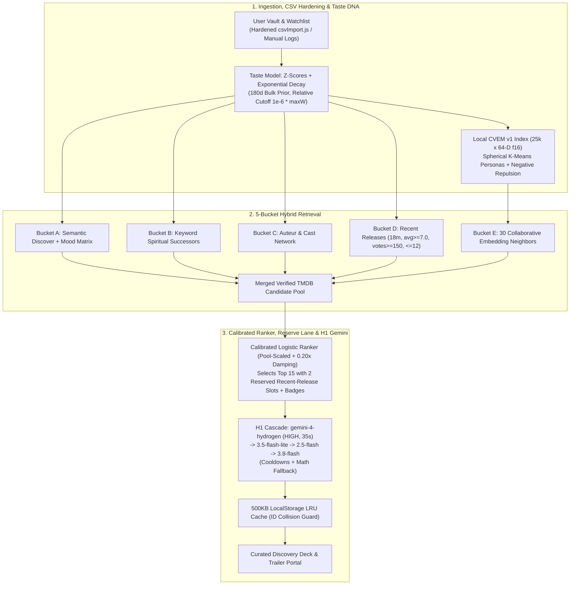

# CinemaVault

<div align="center">


### Personal Film Vault, On-Device Hybrid Recommendation Engine & Cinema Analytics

[](https://react.dev/)
[](https://vitejs.dev/)
[](./LOCAL_MODEL_GUIDE.md)
[](https://ai.google.dev/)
[](https://developer.themoviedb.org/)
[](http://www.omdbapi.com/)
[](https://tailwindcss.com/)
[](./LOCAL_MODEL_GUIDE.md#6-how-to-check-everything-yourself-ez-verification-commands)
[](#license)

</div>

---

## Overview

**CinemaVault** is a 100% client-side film logging, discovery, and analytics application built with React, Vite, and Tailwind CSS. It features a **4-stage local-first hybrid recommendation pipeline**:
1. Per-user z-scored rating normalization, exponential recency decay with an 180-day undated backlog prior, and a vault-relative weight cutoff (`scoringUtils.js` + `tmdbService.js`).
2. An on-device **64-D float16 collaborative embedding index** (`CVEM v1`, 25,000 MovieLens 32M films at `/models/item_embeddings_f16.bin`, `3,300,016` bytes) with Spherical K-Means taste personas and disliked-film quadratic repulsion (`embeddingService.js`).
3. **5-bucket candidate retrieval** combining TMDB keyword matching (`Bucket B`), auteur networks (`Bucket C`), mood-calibrated genre discovery (`Bucket A`), an 18-month recent-release lane (`Bucket D`), and local embedding nearest neighbors (`Bucket E`), scored by a **calibrated 11-feature logistic ranker** (`rankerService.js`) with **2 reserved recent-release slots**, locked `50–99%` match percentages, and deterministic match reason badges.
4. A **resilient H1 Gemini cascade** (`gemini-4-hydrogen` → `gemini-3.5-flash-lite` → `gemini-2.5-flash` → `gemini-3.8-flash`) constrained via strict JSON schemas to selecting a diverse top 6 out of 15 and writing personalized explanations, backed by error-class cooldowns and deterministic ranker fallback (`geminiService.js`).

> 📖 **Technical & Local Model Documentation**: Check out the complete **[Architecture Specification (ARCHITECTURE.md)](./ARCHITECTURE.md)** for mathematical formulations, H1 cascade rules, reserve scoring, and TMDB query grammar, and the plain-English **[Local Model & Troubleshooting Guide (LOCAL_MODEL_GUIDE.md)](./LOCAL_MODEL_GUIDE.md)** for provenance audits, bug resolutions, and one-line health checks.

---

## Key Features

- **4-Stage Hybrid Recommendation Pipeline**: On-device `CVEM v1` collaborative embeddings (zero verified holdout leakage), Spherical K-Means multi-persona clustering, quadratic repulsion (`-1.5`), 5-bucket TMDB retrieval (`A/B/C/D/E`), and calibrated logistic ranking (`collabSim: 4.8`, `negativeKeywordPenalty: -0.5`, pool-relative normalization, `0.20x` metadata damping, and 2 recent-release reserve slots).
- **Resilient H1 Gemini Cascade & Concierge**: Dual cascades (`CURATION_MODEL_CASCADE` led by `gemini-4-hydrogen` with `HIGH` thinking and `35s` timeout; `FAST_INTERACTIVE_CASCADE` led by `gemini-3.5-flash-lite`), `modelCooldowns` backoff (`quota`, `transient`, `invalid_config`, `auth_fatal`), `30 min` `localStorage` working-model persistence, soonest-expiring cooldown probe, deterministic math fallback, and live UI active-model badges (`ModelUsageBadge` + Film Companion model pills).
- **Taste Profile Weighting**: Per-user z-scored weights ($z_i$), exponential recency time-decay ($e^{-0.002 \cdot \Delta t}$), `180`-day bulk backlog prior, relative cutoff (`1e-6 * maxAbsWeight`), sorted negative keyword exclusions (`without_keywords`), anchor selection (`>= 9★`), star-power actors, and auteur crew graphing.
- **Movie Details & Multi-Source Ratings**: High-resolution backdrops, taglines, unified score cards (IMDb, Rotten Tomatoes, Metacritic, TMDB Community), and crew credits.
- **Rating Deck & Review Editor**: Synchronized 10-star rating bar and 1–10 numeric dial, dynamic taste anchor tiers (`1★–10★`), custom review tags, and notes.
- **Streaming Availability & Region Support**: Watch provider integration across **12 streaming platforms** and **15 localized regions** (`GLOBAL`, `US`, `GB`, `CA`, etc.).
- **Official Trailer Playback**: Hierarchical trailer ranking algorithm (`extractOfficialTrailerKey`) selecting official studio trailers with modal & direct YouTube launch options.
- **Rating Analytics**: Rating Delta Histograms comparing your scores to IMDb baselines (Contrarian Index), total watch time metrics, and score distributions.
- **Hardened Data Portability ([src/services/csvImport.js](./src/services/csvImport.js))**: Full JSON database backup and bidirectional Letterboxd CSV import/export featuring `Watched Date` > `Date` priority, strict calendar rollover rejection (`2026-02-30`), `+24h` future timestamp clamp, clustered bulk-import suppression (`isBulkImported: true` → 180-day prior), and diary rewatch deduplication preserving the newest rating & date.
- **Command Palette (`Cmd + K` / `Ctrl + K`)**: Debounced dual-engine search querying OMDb with transparent TMDB fallback and keyboard navigation.
- **Offline Test & Evaluation Suite**: **99 / 99** unit tests across 12 suites (`node --test`) plus rolling-origin temporal cross-validation (`scripts/run_eval.mjs`).

---

## Architecture at a Glance



---

## Project Layout

```text
movie-ratings/
├── public/models/
│   ├── item_embeddings_f16.bin       # Active 25,000 × 64 float16 MovieLens 32M index (3,300,016 B, CVEM v1)
│   └── ranker_weights.json           # Synchronized offline reference ranker weights (-0.5 neg penalty)
├── scripts/
│   ├── colab_train_embeddings.py     # Python SVD trainer with holdout stripping & popularity gate
│   ├── build_benchmark_vaults.mjs    # Benchmark vault & catalog builder
│   └── run_eval.mjs                  # CLI rolling temporal CV harness (--synthetic / --benchmark)
├── src/
│   ├── components/                   # UI primitives (ui/*), NavBar, HeroBillboard, MovieDetails, BackupManagerModal, etc.
│   ├── context/                      # AppContext.jsx (vault persistence & safeSetItem quota recovery)
│   ├── pages/                        # DashboardPage, VaultPage, AIPage, MoviePage
│   └── services/
│       ├── scoringUtils.js           # Per-user z-scores, bulkPriorDays=180 decay, Bayesian acclaim
│       ├── embeddingService.js       # CVEM v1 float16 codec, relative weight cutoff, personas & repulsion
│       ├── tmdbService.js            # 5-bucket retrieval (Buckets A/B/C/D/E), taste profile, trailers
│       ├── rankerService.js          # 11-feature logistic ranker, match badges, reserve lane, weight fitting
│       ├── csvImport.js              # Pure CSV parser, calendar validator, cluster suppression & diary dedupe
│       ├── geminiService.js          # H1 resilient cascade, cooldowns, smart cache & ranker fallback
│       ├── geminiChatService.js      # FAST_INTERACTIVE_CASCADE concierge service
│       ├── geminiExplanationService.js # Deep film breakdowns sharing curation cascade
│       ├── evalHarness.js            # Temporal CV evaluator (NDCG@10, Recall@20, ILD, Novelty)
│       ├── feedbackLogging.js        # Preference feedback logging
│       └── aiSpendTracker.js         # Client spend & token usage telemetry
└── tests/                            # 12 node:test suites (99 / 99 passing)
```

---

## Getting Started

### 1. Prerequisites
- **Node.js** (v18.0.0 or higher; tested on Node v22.14.0)
- **API Keys**:
  - [OMDb API Key](http://www.omdbapi.com/apikey.aspx) (Metadata and search)
  - [Google Gemini API Key](https://aistudio.google.com/) (LLM diversity, explanations & concierge)
  - [TMDB API Key](https://www.themoviedb.org/documentation/api) (Candidate harvesting, trailers & watch providers)

### 2. Installation
```bash
git clone https://github.com/khuzaima175/React-Movie-Original.git
cd movie-ratings
npm install
```

### 3. Environment Setup
Create a `.env` file in the root directory:
```env
VITE_OMDB_KEY=your_omdb_key_here
VITE_GEMINI_KEY=your_gemini_key_here
VITE_TMDB_KEY=your_tmdb_key_here
```

### 4. Development, Testing, Evaluation & Build
```bash
# Start local development server
npm start

# Run all 99 unit tests offline (node --test)
npm test

# Run built-in offline recommender benchmark
node scripts/run_eval.mjs --synthetic

# Build production bundle
npm run build

# Preview production build locally
npm run serve
```

---

## Technology Stack

| Layer | Technology | Purpose |
| :--- | :--- | :--- |
| **Frontend Framework** | [React 18.3](https://react.dev/) | Component architecture, state hooks & context |
| **Build & Tooling** | [Vite 5.4](https://vitejs.dev/) | Fast HMR and Rollup bundling (`2232` modules) |
| **Routing** | [React Router v6](https://reactrouter.com/) | Client-side routing and deep-linking |
| **Styling** | [Tailwind CSS v4](https://tailwindcss.com/) / CSS | Design tokens and utility architecture |
| **Motion Engine** | [Framer Motion 12](https://www.framer.com/motion/) | Spring physics and accessible modal transitions |
| **On-Device ML Engine** | `CVEM v1` Float16 + Logistic Ranker | `25k × 64` collaborative index, Spherical K-Means personas, calibrated `50–99%` scoring & reserve lane |
| **Primary AI Cascade** | [Google Gemini 4 Hydrogen + Flash Cascade](https://ai.google.dev/) | Diversity pass (`15 → 6`) & explanations with `35s` Hydrogen timeout and H1 cooldowns |
| **Catalog Retrieval** | [TMDB API v3](https://developer.themoviedb.org/) | 5-bucket retrieval (`A/B/C/D/E`), trailers & watch providers across 15 regions |
| **Metadata API** | [OMDb API](http://www.omdbapi.com/) | IMDb ratings, Metascores & movie metadata |
| **CSV & Data Engine** | `src/services/csvImport.js` | Pure Letterboxd CSV importer, calendar rollover guard, bulk cluster suppression & rewatch dedupe |
| **Icons & Testing** | [Lucide React](https://lucide.dev/) + `node --test` | UI vector icons + **99** unit & integration tests across **12** test suites |

---

## Architecture & Security Notes

- **Client-Side Storage**: All user data (ratings, reviews, watchlists, timestamps) and non-sensitive working-model cache hints (`cinemavault_working_model_*_v1`) are stored locally in the browser's `localStorage`. No remote tracking or database setup is required.
- **API Key Security**: In this standalone frontend application, `VITE_*` keys are read strictly from environment variables (`import.meta.env`) and inlined into the client bundle at build time (zero hardcoded fallback keys remain in source). For a multi-user public production deployment with private quotas, API calls should be proxied through a lightweight backend (e.g. Cloudflare Workers, Next.js API routes, or Express).
- **Cache Management**: Recommendations are cached in `localStorage` under a 500KB cap with timestamp-based LRU eviction, real-time ID collision filtering against newly logged vault titles, and tiered `QuotaExceededError` recovery (`safeSetItem`).

---

## Documentation

- **[Local Model & Troubleshooting Guide (LOCAL_MODEL_GUIDE.md)](./LOCAL_MODEL_GUIDE.md)** — Complete plain-English walkthrough of the local 25k ML model, provenance & zero-leakage proof, Phase A–I experiment history, 10 bugs resolved, and EZ check commands.
- **[Detailed Architecture & Technical Specification (ARCHITECTURE.md)](./ARCHITECTURE.md)** — Comprehensive v4.2 specification covering math formulas, relative cutoffs, reserve scoring, H1 Gemini cascade, CSV heuristics, streaming matrix, and module/test matrix.
- **[Component & Feature Specification (SPEC.md)](./SPEC.md)** — Streaming-grade Frontend Overhaul UI/UX specification (v1.2 + v4.x extensions).
- **[Project Summary & Showcase (summary.md)](./summary.md)** — Complete feature showcase, typical user journey, and under-the-hood walkthrough.

---

## License

This project is licensed under the **MIT License**.

Developed with precision by **[Khuzaima](https://github.com/khuzaima175)**.
