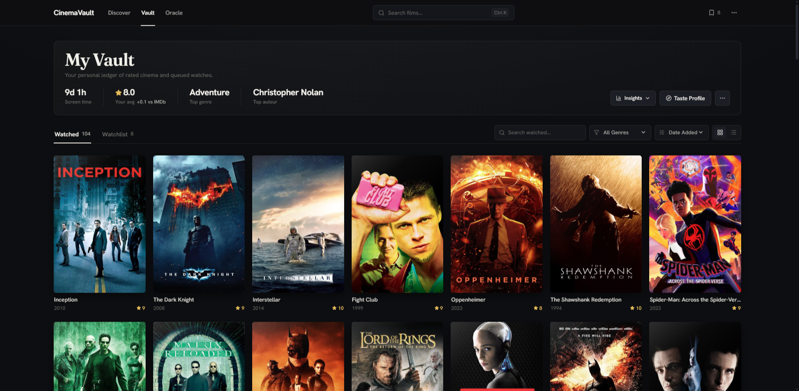
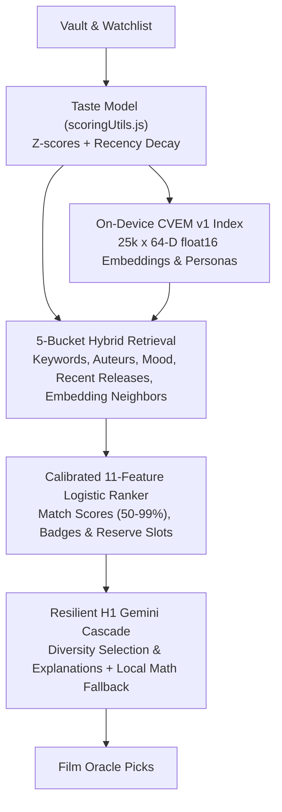

# CinemaVault

<div align="center">



### Editorial Personal Film Vault, On-Device Hybrid Recommender & Cinema Companion

[](https://react.dev/)
[](https://vitejs.dev/)
[](https://tailwindcss.com/)
[](./LOCAL_MODEL_GUIDE.md)
[](https://ai.google.dev/)
[](./supabase/migrations/20261114000000_init_cinemavault_schema.sql)
[](#development--testing)
[](#license)

[Features](#features) · [Recommendation Pipeline](#recommendation-pipeline) · [Project Structure](#project-structure) · [Getting Started](#getting-started) · [Tech Stack](#tech-stack)

</div>

---

## Overview

**CinemaVault** is a film tracking, discovery, and recommendation workspace built with React, Vite, and an editorial dark-mode UI. It pairs instant browser persistence (with optional Supabase cloud sync) and serverless API proxies (`/api/*`) with a local-first recommendation engine powered by a **25,000-film on-device float16 embedding index (`CVEM v1`)**, a calibrated logistic ranker, and a resilient multi-model Gemini cascade.

---

## Features

- **Discover (`/`):** Compact unwatched spotlight hero, live cross-row deduplicated TMDB carousels, vault highlights, quick-rate dialogs, and a filterable catalog poster wall.
- **My Vault (`/vault`):** Searchable Watched and Watchlist ledger with genre/sort filters, grid & list layouts, bulk actions, Rating Delta `Insights` (Contrarian Index & score distributions), and `Taste Profile` analytics.
- **Rapid Taste Deck Onboarding:** 1-click Flashcard and 20-poster multi-genre grid flows to calibrate cold-start vaults cleanly without fabricated ratings.
- **Film Oracle & Companion (`/ai`):**
  - **Picks:** 3x2 Mood Matrix, free-text vibe matching, and collapsed region/streaming availability filters across **12 platforms** and **15 regions** — ranked locally (`50–99%` match scores + deterministic match badges) and curated by Gemini with offline ranker fallback.
  - **Film Companion:** Conversational cinema assistant with inline clickable movie cards parsed directly from recommendations.
- **Movie Details (`/movie/:id`):** Backdrop hero banner, synchronized 10-star & 1–10 numeric Rating Deck, dynamic taste anchor tiers, unified IMDb / Rotten Tomatoes / Metacritic / TMDB ratings, cast & crew credits, regional watch providers, and official trailer launcher.
- **Command Search & Night Picker:** Instant `Cmd/Ctrl + K` (or `/`) dual-engine TMDB + OMDb split search modal plus a Night Picker for fast queue decisions.
- **Hardened Portability & Opt-In Cloud Sync:** Full JSON v2 backups, bidirectional Letterboxd CSV and IMDb import/export (calendar validation, clustered bulk-import suppression, and diary rewatch deduplication), plus optional passwordless Email OTP sync via Supabase Auth & Postgres Row-Level Security.

---

## Recommendation Pipeline



1. **Per-User Taste Normalization:** Converts explicit 1–10 ratings into per-user z-scores with recency time-decay and bulk-backlog handling (`scoringUtils.js`).
2. **On-Device Embeddings (`CVEM v1`):** Loads `/models/item_embeddings_f16.bin` (25,000 MovieLens 32M films mapped to TMDB IDs in 64-D half precision), computing multi-persona taste centroids and disliked-film repulsion (`embeddingService.js`).
3. **5-Bucket Retrieval & Logistic Ranker:** Merges TMDB keyword, crew/cast, mood/genre, recent-release, and local embedding neighbors, then ranks candidates across 11 features with reserved recent-release slots (`tmdbService.js`, `rankerService.js`).
4. **Resilient Multi-Model Gemini Cascade:** Routes final top-6 diversity selection and conversational chat through ordered Gemini cascades with timeout/error-class cooldowns and deterministic local fallback (`geminiService.js`, `geminiChatService.js`).

> For mathematical formulations, leakage audits, evaluation benchmarks, and troubleshooting, see [ARCHITECTURE.md](./ARCHITECTURE.md) and [LOCAL_MODEL_GUIDE.md](./LOCAL_MODEL_GUIDE.md).

---

## Project Structure

```text
movie-ratings/
├── api/                         # Vercel serverless API proxies (gemini.js, tmdb.js, omdb.js)
├── assets/                      # README preview screenshot (movie_vault.png)
├── public/models/               # On-device CVEM v1 float16 embeddings & reference ranker weights
├── scripts/                     # Embedding trainer, content builder & offline eval CLI (run_eval.mjs)
├── supabase/migrations/         # Optional Postgres schema & RLS policies for Cloud Vault Sync
├── src/
│   ├── components/              # Feature components, modals (Search, CloudSync, TasteDeck, Backup) & ui/ primitives
│   ├── context/                 # AppContext vault state, local persistence & cloud sync orchestration
│   ├── hooks/                   # Custom React hooks (scroll reveal, debouncing)
│   ├── pages/                   # DashboardPage (/), VaultPage (/vault), AIPage (/ai), MoviePage (/movie/:id)
│   ├── services/                # Scoring, CVEM embeddings, TMDB 5-bucket retrieval, ranker, CSV import & Gemini cascades
│   └── styles/                  # Editorial design tokens, primitives, discover, vault & oracle stylesheets
└── tests/                       # 24 automated suites using Node built-in test runner (177/177 passing)
```

---

## Getting Started

### Prerequisites

- **Node.js** 18+ (tested on Node 22)
- API credentials from [TMDB](https://www.themoviedb.org/documentation/api), [OMDb](http://www.omdbapi.com/apikey.aspx), and [Google AI Studio](https://aistudio.google.com/)

### Installation

```bash
git clone https://github.com/khuzaima175/React-Movie-Original.git
cd movie-ratings
npm install
```

### Configuration

Copy `.env.example` and configure environment variables for your workflow:

```env
# Recommended for Vercel deployments & `vercel dev` (kept off the browser bundle)
GEMINI_API_KEY=your_gemini_api_key_here
TMDB_API_KEY=your_tmdb_api_key_here
OMDB_API_KEY=your_omdb_api_key_here

# Optional local-dev fallback when running `npm start` without serverless `/api/*` routes
# Do NOT expose private VITE_* keys in public client builds
# VITE_GEMINI_KEY=your_local_dev_gemini_key_here
# VITE_TMDB_KEY=your_local_dev_tmdb_key_here
# VITE_OMDB_KEY=your_local_dev_omdb_key_here

# Optional Supabase Cloud Vault Sync (run supabase/migrations/20261114000000_init_cinemavault_schema.sql first)
# VITE_SUPABASE_URL=https://your-project-ref.supabase.co
# VITE_SUPABASE_PUBLISHABLE_KEY=sb_publishable_your_key_here
```

### Development & Testing

```bash
# Start local Vite dev server (http://localhost:3000)
npm start

# Run all 177 offline unit & integration tests (24 files)
npm test

# Run built-in offline recommender benchmark
node scripts/run_eval.mjs --synthetic

# Build production bundle to build/
npm run build

# Preview production bundle locally
npm run serve
```

---

## Tech Stack

| Layer | Technology |
| :--- | :--- |
| **Frontend & UI** | React 18.3, React Router v6, Tailwind CSS v4, Editorial CSS Tokens, Framer Motion 12, Lucide Icons |
| **Build & Hosting** | Vite 5.4, Vercel Serverless Functions (`/api/gemini`, `/api/tmdb`, `/api/omdb`) |
| **On-Device ML** | Custom `CVEM v1` 25k × 64 float16 collaborative embeddings + 11-feature logistic ranker |
| **AI & Catalog APIs** | `@google/genai` (Gemini cascade), TMDB API v3, OMDb API |
| **Optional Cloud Sync** | `@supabase/supabase-js` v2 with Email OTP auth and Postgres Row-Level Security |
| **Testing** | Node built-in test runner (`node --test`) across 24 test suites |

---

## Security & Storage Notes

- **API Proxy Isolation:** In production, TMDB, OMDb, and Gemini keys live exclusively in server-side environment variables consumed by `/api/*` serverless handlers with explicit Gemini model allowlisting (`api/gemini.js`).
- **Local-First & Opt-In Cloud Sync:** Library state, preferences, and bounded LRU recommendation caches work immediately in browser `localStorage` with zero account required. Cross-device persistence is opt-in via Supabase RLS policies scoped strictly to `auth.uid()`.

---

## Documentation

- [ARCHITECTURE.md](./ARCHITECTURE.md) — Technical architecture & mathematical specification
- [LOCAL_MODEL_GUIDE.md](./LOCAL_MODEL_GUIDE.md) — On-device ML guide, provenance audit & CLI health checks

---

## License

MIT License — built by [Khuzaima](https://github.com/khuzaima175).
