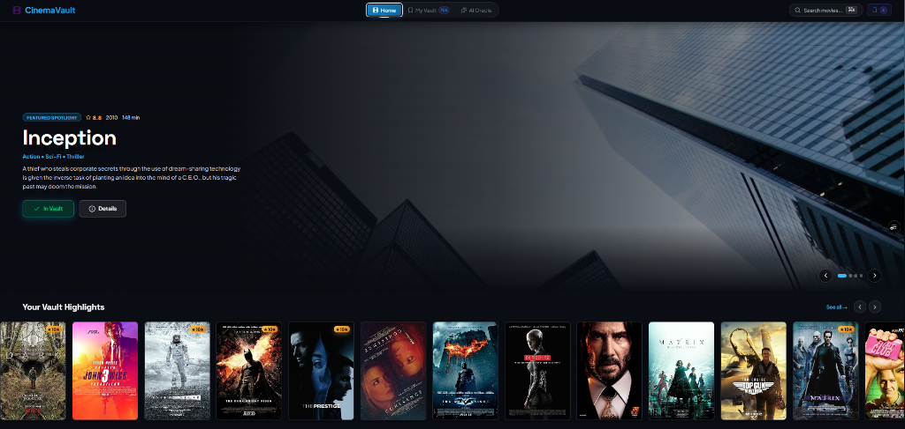
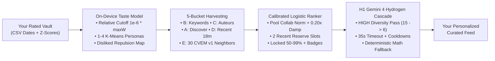

# 🎬 CinemaVault — The Ultimate Personal Film Vault, On-Device ML Recommender & Cinema Companion

<div align="center">



### *Stop scrolling. Start watching. A private, streaming-grade film tracker powered by an on-device 25,000-film taste model and resilient Gemini AI curation.*

[](https://react.dev/)
[](https://vitejs.dev/)
[](./LOCAL_MODEL_GUIDE.md)
[](https://ai.google.dev/)
[](https://tailwindcss.com/)
[](https://www.framer.com/motion/)
[](./LOCAL_MODEL_GUIDE.md#6-how-to-check-everything-yourself-ez-verification-commands)

[Explore Features](#-standout-features-showcase) • [Why CinemaVault?](#-the-problem-why-cinemavault) • [How It Works](#-the-magic-under-the-hood) • [Local ML & Bugs Fixed](#-on-device-local-ml--provenance-highlights) • [Quick Start](#-quickstart-guide)

</div>

---

## 💡 The Problem: Why CinemaVault?

We’ve all been there:
- You spend **45 minutes scrolling** through Netflix, Prime, and Disney+ trying to pick something to watch, only to end up watching re-runs of a comfort show.
- You ask ChatGPT or an AI chatbot for movie recommendations, and it gives you either the **same 5 generic movies everyone has seen** (*Inception*, *Interstellar*, *The Dark Knight*) or **completely hallucinates** fake movies and release years.
- Even good mathematical recommenders choke on **10–25 year old decayed film logs**, **clustered Letterboxd CSV backlog imports** that masquerade as "watched today", or **blindspots for great movies released in the last 18 months** after historical collaborative datasets end.
- When you do find a movie you like, you have no idea **which streaming service actually has it in your country**.
- Your film ratings are scattered across IMDb, Letterboxd, and notes on your phone with zero actionable insights.

### Enter **CinemaVault**.
CinemaVault is a modern, privacy-focused, streaming-grade web application designed to be your **definitive personal film vault, on-device 25,000-film mathematical curator, and cinema concierge** — combining verified TMDB catalog retrieval, local `CVEM v1` half-precision collaborative embeddings, a calibrated 11-feature logistic ranker, and a resilient `gemini-4-hydrogen` multi-model cascade.

---

## 🌟 What Makes CinemaVault Special? (CinemaVault at a Glance)

```
┌─────────────────────────────────────────────────────────────────────────────┐
│                             CINEMAVAULT AT A GLANCE                         │
├──────────────────────┬───────────────────────┬──────────────────────────────┤
│  🧠 On-Device ML     │  🆕 Recent-Release    │  🛡️ Resilient H1 Cascade     │
│  3.15 MB float16     │  Lane (Bucket D)      │  gemini-4-hydrogen (HIGH) +  │
│  index (25k films)   │  2 reserved 18-mo     │  3.5-flash-lite + error-     │
│  for $0 / 5ms taste. │  picks in every deck. │  specific cooldowns.         │
├──────────────────────┼───────────────────────┼──────────────────────────────┤
│  🎯 0% Hallucination │  📺 Real Streaming    │  🎲 Cinema Roulette          │
│  Verified TMDB IDs + │  Availability: 12     │  Beat decision paralysis in  │
│  locked 50-99% +     │  platforms, 15        │  one click from your own     │
│  reason badges.      │  localized regions.   │  personal watchlist.         │
├──────────────────────┼───────────────────────┼──────────────────────────────┤
│  💬 Contextual AI    │  📊 Cinema Taste      │  📥 Smart Letterboxd CSV     │
│  Chat concierge aware│  Analytics:           │  Watched vs Logged dates,    │
│  of 8★+ history &    │  Contrarian index &   │  bulk cluster suppression &  │
│  personal reviews.   │  total screen time.   │  rewatch rating preservation.│
├──────────────────────┼───────────────────────┼──────────────────────────────┤
│  ✨ Luxury Design    │  🔒 100% Client-Side  │  ⚡ Fast Command Palette     │
│  Neutral charcoal +  │  Zero cloud login or  │  `Cmd + K` dual-engine sync  │
│  Ken Burns billboard.│  tracking; in-browser.│  & official trailer portal.  │
└──────────────────────┴───────────────────────┴──────────────────────────────┘
```

---

## 🚀 Standout Features Showcase

### 1. 🎯 4-Stage On-Device ML & Hybrid AI Recommendation Engine
> *"Recommendations built on real math first — with zero hallucinated scores or invented titles."*

Most AI movie tools prompt an LLM to invent titles from thin air. CinemaVault runs a **4-stage hybrid architecture** where **85–90% of the intelligence happens locally on your device**:
1. **Per-User Z-Scored Taste DNA & Relative Weighting ([scoringUtils.js](./src/services/scoringUtils.js) + [embeddingService.js](./src/services/embeddingService.js))**:
   - Normalizes harsh vs. generous rating habits via personal z-scores ($z_i = (r_i - \mu) / \max(\sigma, 0.5)$).
   - Applies exponential recency decay ($\lambda = 0.002\text{ days}^{-1}$, ~11.5-month half-life) with an **180-day undated backlog prior** and a **vault-relative weight cutoff** (`1e-6 * maxAbsWeight`) so even 1999–2005 film vaults keep full collaborative personas.
   - Clusters positive affinities into **1–4 Spherical K-Means Personas** (`computeUserPersonas`) so eclectic favorites (e.g., *Oldboy* + *Toy Story*) never collapse into a blurry midpoint, while `buildRepulsionMapFromIndex` actively pushes away neighborhoods of movies you disliked.
2. **5-Bucket Verified Candidate Harvesting ([tmdbService.js](./src/services/tmdbService.js))**:
   - **Bucket B (Spiritual Successors):** Thematic micro-keywords matched from your highest-weighted `9★+` anchor film (`vote_count >= 500`, `vote_average >= 7.0`).
   - **Bucket C (Auteur & Crew Network):** Unwatched acclaimed films from your favorite directors, cinematographers, composers, and screenwriters.
   - **Bucket A (Semantic Discovery):** Broad discovery filtered by loved genres, watchlist intent, top actors, selected mood, surgical negative keyword exclusions (`without_keywords`), and regional streaming subscriptions.
   - **Bucket D (Recent-Release Lane):** Dedicated harvesting of popular acclaimed films from the **last 18 months** (`vote_average >= 7.0`, `vote_count >= 150`, top 3 loved genres, up to 12 items) appended after Buckets A/B/C without shrinking them.
   - **Bucket E (64-D Embedding Neighbors):** Up to **30 unseen nearest-neighbor films** pulled locally from `/models/item_embeddings_f16.bin` across your taste personas and enriched live via TMDB.
3. **Calibrated Logistic Ranker & Reserved Recent Slots ([rankerService.js](./src/services/rankerService.js))**:
   - Scores the merged pool across **11 features** with pool-relative `collabSim` scaling, **0.20x metadata damping** (so coarse genre/popularity ties never drown true collaborative twins), and tuned `-0.5` negative keyword penalty.
   - Guarantees **`RECENT_RELEASE_RESERVE_COUNT = 2`** qualifying recent-release slots in Gemini's **Top 15** via `computeReserveQualityScore` (identical ranker weights with `noveltyBonus = 0`) so acclaimed new cinema breaks through MovieLens's late-2023 cutoff without displacing `98%` classics.
   - Locks deterministic **50–99% Match Scores** and emits up to **3 human-readable Match Reason Badges** (`🧬 High Taste-Twin Match`, `🎬 Favorite Filmmaker`, `🎯 Core Theme Match`, `💎 Personal Cult Pick`, `🎪 Genre Bullseye`, `⭐ Critical Acclaim`).
4. **Resilient H1 Gemini Cascade ([geminiService.js](./src/services/geminiService.js))**:
   - Sends only the locked Top 15 candidates to **`CURATION_MODEL_CASCADE`** (`gemini-4-hydrogen` at `HIGH` thinking with `35,000 ms` timeout → `gemini-3.5-flash-lite` → `gemini-2.5-flash` → `gemini-3.8-flash`) strictly for choosing a diverse **6** and writing engaging 1-sentence taste reasons:
     > *"Because you loved **Blade Runner 2049**, you will appreciate the atmospheric neon cinematography and existential neo-noir pacing in **Drive**."*
   - **Deterministic Math Fallback & Visible Model Telemetry:** If every cloud model hits quota or fails offline, CinemaVault seamlessly serves the top 6 mathematical ranker picks with locked scores and badges intact — zero blank error screens. Both **AI Picks** (`ModelUsageBadge` in the results toolbar, persisted via `cinemavault_recs_model_v1`) and **Film Companion Chat** (`.chat-model-bar` + per-reply model tags) show exactly which Gemini model (`gemini-4-hydrogen`, `gemini-3.5-flash-lite`, `gemini-2.5-flash`, `gemini-3.8-flash`) or fallback/cache served each response, with tooltips showing any skipped cooldown models.

- **Choose Your Vibe**: Filter recommendations by mood on the fly:
  - 🧠 *Mind-Bending* (plot twists & cerebral puzzles)
  - 🌑 *Dark Thriller* (gritty neo-noir & high tension)
  - 🍿 *Fun Popcorn* (high-energy crowd pleasers)
  - 🛋️ *Comfort Watch* (heartwarming & rewatchable)
  - 💎 *Hidden Gem* (underrated masterworks)
  - ✨ *Any Vibe* (all-time peak cinema)

---

### 2. 💬 AI Cinema Concierge & Deep Breakdowns
> *"An intelligent conversational partner that actually remembers what you've watched."*

CinemaVault features a dedicated, context-aware AI chat assistant and deep explanation engine built right into the app:
- **Dual-Speed Routing:** [geminiChatService.js](./src/services/geminiChatService.js) uses **`FAST_INTERACTIVE_CASCADE`** (`gemini-3.5-flash-lite` first for 500 RPD speed, backed by `gemini-4-hydrogen` `MEDIUM` thinking, `2.5-flash`, and `3.8-flash`), while [geminiExplanationService.js](./src/services/geminiExplanationService.js) shares the `HIGH`-thinking curation cascade and `35s` client timeout.
- **Tailored to You**: Automatically references movies you’ve rated `8★+` and incorporates your notes and reviews.
- **Strictly Cinema-Focused**: Polite guardrails keep the conversation locked on cinema history, filmmaking styles, and film theory.
- **Interactive Title Cards**: When the AI suggests a film, it formats it as an interactive card so you can view details, watch trailers, or add it to your Watchlist with a single tap.

---

### 3. 📺 "Where Can I Watch It?" — Universal Streaming Availability
> *"Never find a great movie recommendation only to realize it isn't streaming anywhere."*

- Integrates with TMDB Watch Providers across **12 top streaming services**:
  - **Netflix**, **Amazon Prime Video**, **Disney+**, **Max (HBO)**, **Apple TV+**, **Hulu**, **Paramount+**, **Peacock**, **Criterion Channel**, **Tubi**, **Pluto TV**, and **Freevee**.
- **15 Localized Regions Supported**: Switch between `GLOBAL`, `US`, `GB` (UK), `CA` (Canada), `AU` (Australia), `JP` (Japan), `KR` (South Korea), `FR`, `DE`, `ES`, `IT`, `IN` (India), `BR`, `MX`, and `SE`.
- Recommendations and movie pages show provider icons directly, with options to filter recommendations to *only* what you can watch right now (awarding `providerMatch = 1` across Buckets `A/B/C/D`).

---

### 4. 🎲 Cinema Roulette (Random Picker)
> *"Eliminate the 30-minute 'what should we watch' argument."*

Can't decide what to watch tonight? Open the **Cinema Roulette** ([RandomPicker.jsx](./src/components/RandomPicker.jsx)):
- Choose your pool: Pick from your **Watchlist** or re-discover a favorite from your **Watched** library.
- Features a casino-style animated spinning reveal that settles on your film for the evening.
- Direct quick links to start the trailer or read the synopsis.

---

### 5. 📊 Cinema Taste Analytics & The Contrarian Meter
> *"Discover what kind of movie watcher you really are."*

Your vault isn't just a list; CinemaVault continuously turns your logged movies into personalized cinema analytics ([VaultBanner.jsx](./src/components/VaultBanner.jsx) & [VaultPage.jsx](./src/pages/VaultPage.jsx)):
- **The Rating Delta Histogram (Contrarian Index)**:
  - Compares your personal 1–10 ratings to the global IMDb consensus.
  - Shows whether you are a **Critical Contrarian** (harsh on mainstream hits), a **Consensus Neutral**, or a **Passionate Champion** (defending misunderstood cult classics).
- **Total Screen Time Aggregator**: Calculates your life watch time into total **Days, Hours, and Minutes**.
- **Rating Distribution**: Visual breakdown of your score habits (Are you too generous with 10s? Do you rarely give below a 6?).

---

### 6. ⭐ Luxury 10-Star Rating Studio & Dynamic Anchor Tiers
> *"Rating a movie should feel as rewarding as watching it."*

CinemaVault replaces clunky dropdowns with a **synchronized dual rating interface** ([MovieDetails.jsx](./src/components/MovieDetails.jsx)):
- A sleek, 10-star glowing rating bar coupled with an instant 1–10 numeric dial.
- **Dynamic Taste Feedback**: Every star rating triggers reactive metadata explaining how this score influences your recommendation engine:
  - **10★ Masterpiece**: Sets the primary anchor for spiritual successor keyword matching (Brass Gold).
  - **9★ Exceptional Cinema**: Eligible elite anchor; boosts loved genre and director vectors (Amber).
  - **8★ Great Film**: Accumulates actor (`castIds`) and auteur crew affinities (Emerald).
  - **7★ Good Watch**: Solid craft baseline & director tally (Cyan).
  - **$\le$ 3★ Disliked/Flawed**: Extracts negative micro-keywords (e.g. *"slapstick"*, *"found-footage"*) and triggers embedding repulsion to steer away from similar disappointments.
- **Review Notes & Custom Tags**: Write your personal critique, memorable quotes, and tag films for quick recall.

---

### 7. 🔄 Hardened Letterboxd & CSV Data Portability ([csvImport.js](./src/services/csvImport.js))
> *"Your data belongs to you. Zero vendor lock-in — and zero corrupted timestamps."*

Already have years of movie ratings logged on Letterboxd or a spreadsheet?
- **Letterboxd CSV Import**: One-click import converting star glyphs (`★★★★½` → `9`) or 1–5 scales to CinemaVault's 10-point scale, with header-aware column mapping (stopping Letterboxd URLs from leaking into `note`).
- **Priority & Strict Calendar Date Validation**: Prioritizes **`Watched Date`** (`dateSource: "watched"`) over **`Date`** (`dateSource: "logged"`), rejects impossible calendar rollovers (e.g. `2026-02-30`), and enforces a `+24h` timezone guard against future timestamps.
- **Clustered Backlog Suppression**: Automatically detects bulk Letterboxd `Date` exports (`>= 10` logged rows with `>= 30%` on 3 days OR `< 14`-day span) and flags them `isBulkImported: true` so the **180-day undated prior** applies instead of skewing recent tastes.
- **Diary Rewatch Deduplication**: Merges duplicate `title + year` diary rows keeping the newest valid `Watched Date` while retaining the most recent non-empty rating if the latest rewatch row was blank.
- **Batch Processing, Merge/Overwrite & Backups**: Smart background batching (`4 films/batch`) enriches metadata without throttling your browser; supports full JSON backups & CSV exports anytime.

---

### 8. ⚡ Global Command Palette (`Cmd + K` / `Ctrl + K`) & Official Trailers
> *"Keyboard-first navigation for power users."*

- Press `Cmd + K` (Mac) or `Ctrl + K` (Windows/Linux) anywhere to summon the spotlight search ([SearchModal.jsx](./src/components/SearchModal.jsx)) with OMDb primary search and automatic TMDB fallback.
- Powered by debounced (`300ms`) real-time search with keyboard arrow navigation (`↑` / `↓` / `Enter`).
- **Official Studio Trailer Resolution (`extractOfficialTrailerKey`)**:
  - Automatically identifies official studio theatrical trailers (skipping fan edits and low-quality re-uploads).
  - Opens in an immersive modal ([TrailerModal.jsx](./src/components/TrailerModal.jsx)) or launches directly to YouTube to avoid annoying embed restrictions or playback errors.

---

### 9. 🎨 Streaming-Grade "Content-First" Interface
> *"Built like an app you’d pay a monthly subscription for."*

CinemaVault was redesigned to eliminate the loud, neon "AI-demo" look in favor of an **ultra-clean, streaming-grade aesthetic**:
- **Neutral Dark Palette**: Luxurious charcoal surfaces (`#0b0b0c`, `#141416`), delicate hairline borders, and subtle Vault Brass (`#e2b13c`) accents.
- **Portal Hover Previews**: Hovering over carousel cards smoothly expands detailed preview actions without clipping carousel scroll containers.
- **Ken Burns Hero Billboard ([HeroBillboard.jsx](./src/components/HeroBillboard.jsx))**: Full-bleed backdrop carousel with gentle panning, pause-on-hover, and synchronized slide progression.
- **Full Accessibility & Reduced Motion**: Automatically respects `prefers-reduced-motion` for smooth, comfortable browsing, paired with a floating Undo toast pill ([ToastNotification.jsx](./src/components/ToastNotification.jsx)).

---

## 🧠 The Magic Under the Hood

How does CinemaVault deliver accurate, zero-hallucination recommendations *mostly on your own machine* without a backend server?



1. **Per-User Z-Scores & Relative Weight Cutoff**: Normalizes harsh vs. generous raters ($z_i$), applies an `180`-day undated backlog prior with $\lambda = 0.002$ exponential decay, and scales the embedding cutoff relative to your vault's peak weight (`1e-6 * maxAbsWeight`) so even 20-year-old vaults retain full 64-D taste vectors.
2. **Surgical Negative Tropes & Embedding Repulsion**: Combines sorted top-5 `without_keywords` filters + softened `-0.5` ranker keyword penalties + quadratic cosine repulsion above `0.35` similarity around disliked films.
3. **25,000-Film `CVEM v1` Float16 Binary + Recent Reserve Lane**: Your browser loads [item_embeddings_f16.bin](./public/models/item_embeddings_f16.bin) (`3,300,016 B`) once, scores both collaborative taste-twins (`Bucket E`) and acclaimed recent releases from the last 18 months (`Bucket D`, 2 reserved Top-15 slots via `computeReserveQualityScore` with `noveltyBonus = 0`).
4. **Smart LRU Collision Cache & H1 Resilience**: Caches recommendations for 24h under a `500KB` cap, filters out newly watched/watchlisted titles in real time, persists working Gemini models for 30 minutes across `localStorage`, and cools down failing models by error class (`quota`, `transient`, `invalid_config`, `auth_fatal`).

---

## 🔬 On-Device Local ML & Provenance Highlights

Everything about the local machine learning stack and engineering fixes is documented in plain English in **[LOCAL_MODEL_GUIDE.md](./LOCAL_MODEL_GUIDE.md)**. Key verified facts on `main`:
- **Active Model Integrity:** `/models/item_embeddings_f16.bin` (`25,000` MovieLens 32M items × `64`-D float16, `3,300,016` bytes) is confirmed genuine Google Colab output with **zero statistically significant holdout leakage** (`clean_ranker` `NDCG@10 = 0.0826` vs `leaky_ranker = 0.0828`, `Δ = +0.00023`, 95% CI `[-0.00197, +0.00236]`, `ΔRecall@20 = 0`).
- **Validated Benchmark Performance:** On the 4-vault MovieLens benchmark suite (`node scripts/run_eval.mjs --benchmark .data/benchmark_vaults.json --embeddings public/models/item_embeddings_f16.bin`), current `main` achieves a **4-vault mean of `NDCG@10 = 0.158`, `Recall@20 = 0.246`, `Novelty = 2.312`**, clearing both the `9.6k` small baseline (`0.062 / 0.083 / 1.48`) and the Nov 11 32M milestone (`0.143 / 0.242 / 2.24`), and lifting real 328-user and fresh 300-user benchmarks via `negativeKeywordPenalty = -0.5` (`+0.0103` NDCG on 328; `+0.0143` Recall on 300).
- **100% Test Coverage of Critical Pipelines:** **99 / 99 unit tests pass** across all 12 test suites (`npm test`), covering float16 codec, relative cutoff, reserve slot math, CSV rollover/cluster/rewatch logic, H1 Gemini error classification/cooldowns, active model UI tracking, feedback logging, and rolling evaluation.

---

## 🛠️ Technology Stack

| Layer | Technology | Why It Was Chosen |
| :--- | :--- | :--- |
| **Framework** | **React 18.3** | Declarative UI, Context API state management (`safeSetItem`), and modern component hooks. |
| **Build & Tooling** | **Vite 5.4** | Instant Hot Module Replacement (HMR) and optimized Rollup production builds (`2232` modules). |
| **On-Device ML** | **`CVEM v1` Float16 + Logistic Ranker** | `3.15 MB` 25k-film collaborative index, Spherical K-Means personas, calibrated `50–99%` scoring & 2 reserve slots. |
| **AI Engine** | **Gemini 4 Hydrogen & Flash H1 Cascade** | `HIGH`-thinking diversity pass & explanations, `FAST` interactive chat, `35s` timeouts & error-specific cooldowns. |
| **Styling** | **Tailwind CSS v4** | Next-generation `@theme` tokens, pure CSS custom properties, zero runtime overhead. |
| **Motion** | **Framer Motion 12** | Spring physics, portal-based hover expansions, and `prefers-reduced-motion` accessibility. |
| **Movie Data** | **TMDB API v3 & OMDb API** | 5-bucket retrieval (`A/B/C/D/E`), trailers, watch providers across 15 regions, IMDb/RT/Metacritic scores. |
| **Storage & Import** | **LocalStorage + Pure `csvImport.js`** | 100% private client-side persistence with `500KB` LRU cache eviction & hardened Letterboxd CSV importer. |
| **Verification** | **`node --test` + `scripts/run_eval.mjs`** | **99 offline unit tests** across 12 suites + rolling temporal cross-validation CLI harness. |

---

## 💻 Quickstart Guide

Want to run CinemaVault on your local machine? It takes less than 3 minutes:

### 1. Clone & Install
```bash
git clone https://github.com/khuzaima175/React-Movie-Original.git
cd movie-ratings
npm install
```

### 2. Configure API Keys
CinemaVault uses standard free-tier developer keys from OMDb, TMDB, and Google AI Studio.

Create a `.env` file in the root directory:
```env
VITE_OMDB_KEY=your_omdb_key_here
VITE_GEMINI_KEY=your_gemini_key_here
VITE_TMDB_KEY=your_tmdb_key_here
```
> **Where to get free keys:**
> - [Google Gemini API Key](https://aistudio.google.com/) (Free)
> - [TMDB API Key](https://www.themoviedb.org/documentation/api) (Free)
> - [OMDb API Key](http://www.omdbapi.com/apikey.aspx) (Free)

### 3. Launch, Test, Evaluate & Build
```bash
npm start                                 # Dev server at http://localhost:5173
npm test                                  # Run all 99 offline unit tests across 12 suites (~0.5s)
node scripts/run_eval.mjs --synthetic     # Run built-in offline recommender benchmark
npm run build                             # Production bundle into build/
npm run serve                             # Preview production build locally
```

---

## 🎯 Typical User Journey: An Evening with CinemaVault

1. **Zero-Friction Vault Migration (`BackupManagerModal`):** You drop in your Letterboxd CSV export; `csvImport.js` automatically prioritizes real `Watched Date` entries over bulk-logged export dates, deduplicates rewatches without losing your earlier star rating, and preserves 15 years of movie history via relative cutoff scaling.
2. **Quick Search (`Cmd + K`):** You search for *Dune: Part Two* (with automatic TMDB fallback if OMDb misses), read Rotten Tomatoes / IMDb / Metacritic scores, watch the official studio trailer, and add it to your Watchlist.
3. **Log & Rate:** After watching, you slide the synchronized dial to **9★ (Exceptional Cinema)**, jot down a note about sound design, and watch it elevate Denis Villeneuve in your auteur graph.
4. **Check the Contrarian Index:** You jump to **My Vault** and see your screen time rise to *14 Days, 6 Hours*, while the Delta Histogram reveals you rate sci-fi films `+1.2` higher than IMDb consensus.
5. **Discover Your Next Watch (Old Classics & New 2025–2026 Hits):** You switch over to **Recommendations** on the *Mind-Bending* mood tab. Your local `CVEM v1` 25k embedding map + 5-bucket retriever surfaces both an underrated 1990s taste-twin (*97% Match*, `🧬 High Taste-Twin Match`) AND a critically acclaimed film from the last 18 months via Bucket D's reserve lane — then `gemini-4-hydrogen` curates the top 6 with personalized 1-sentence explanations and local streaming badges.
6. **Can't Pick? Spin the Wheel:** Torn between three titles on your watchlist? You open **Cinema Roulette**, hit spin, and let CinemaVault decide your movie for the night!

---

## 📄 Documentation & License

- **[LOCAL_MODEL_GUIDE.md](./LOCAL_MODEL_GUIDE.md)** — Complete plain-English walkthrough of the local 25k `CVEM v1` model, provenance & zero-leakage proof, Phases A–I experiments, all 10 errors & fixes, and EZ verification commands.
- **[ARCHITECTURE.md](./ARCHITECTURE.md)** — Full technical & mathematical specification (v4.2): z-scores, relative cutoff, Spherical K-Means, 5-bucket retrieval + Reserve Lane, H1 `gemini-4-hydrogen` cascade, CSV heuristics, streaming matrix, and 12-suite test map.
- **[SPEC.md](./SPEC.md)** — Streaming-grade Frontend Overhaul UI/UX design tokens & component specification (v1.2 + v4.x extensions).
- **[README.md](./README.md)** — Quickstart repository README & overview.
- Built and designed with precision by **[Khuzaima](https://github.com/khuzaima175)**.
- Licensed under the **MIT License** — free to use, modify, and build upon.
- Movie data provided by [The Movie Database (TMDB)](https://www.themoviedb.org/) and [OMDb API](http://www.omdbapi.com/).
- AI powered by [Google Gemini](https://ai.google.dev/).

---

<div align="center">

**CinemaVault** — *Your taste. Your cinema. Curated on-device with mathematical precision.*

</div>
