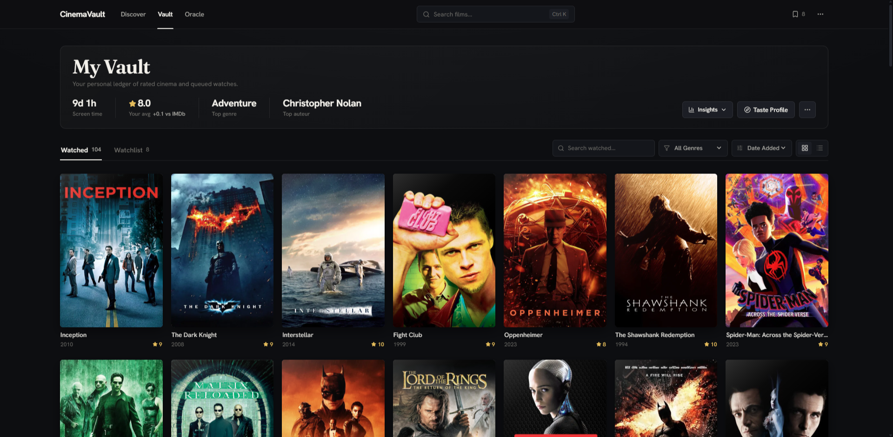
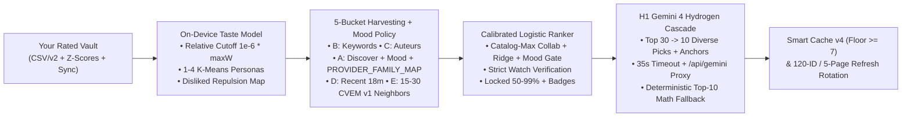

# 🎬 CinemaVault — The Ultimate Personal Film Vault, On-Device ML Recommender & Cinema Companion

<div align="center">



### *Stop scrolling. Start watching. A private, streaming-grade film tracker powered by an on-device 25,000-film taste model and resilient Gemini AI curation.*

[](https://react.dev/)
[](https://vitejs.dev/)
[](./LOCAL_MODEL_GUIDE.md)
[](https://ai.google.dev/)
[](https://tailwindcss.com/)
[](https://www.framer.com/motion/)
[](./LOCAL_MODEL_GUIDE.md#6-how-to-check-everything-yourself-ez-verification-commands)
[](./ARCHITECTURE.md#20-opt-in-multi-user-supabase-cloud-sync-postgres-rls-schema--merge-engine)

[Explore Features](#-standout-features-showcase) • [Why CinemaVault?](#-the-problem-why-cinemavault) • [How It Works](#-the-magic-under-the-hood) • [Local ML & Bugs Fixed](#-on-device-local-ml--provenance-highlights) • [Quick Start](#-quickstart-guide)

</div>

---

## 💡 The Problem: Why CinemaVault?

We’ve all been there:
- You spend **45 minutes scrolling** through Netflix, Prime, and Disney+ trying to pick something to watch, only to end up watching re-runs of a comfort show.
- You ask ChatGPT or an AI chatbot for movie recommendations, and it gives you either the **same 5 generic movies everyone has seen** (*Inception*, *Interstellar*, *The Dark Knight*) or **completely hallucinates** fake movies and release years.
- Even good mathematical recommenders choke on **10–25 year old decayed film logs**, **clustered Letterboxd CSV backlog imports** that masquerade as "watched today", or **blindspots for great movies released in the last 18 months** after historical collaborative datasets end.
- When you do find a movie you like, you have no idea **which streaming service actually has it in your country**.
- Your film ratings are scattered across IMDb, Letterboxd, and notes on your phone with zero actionable insights.

### Enter **CinemaVault**.
CinemaVault is a modern, privacy-focused, streaming-grade web application designed to be your **definitive personal film vault, on-device 25,000-film mathematical curator, live discovery hub, and cinema concierge** — combining multi-page TMDB Discover carousels, a first-open 30-film Rapid Taste Deck, verified 5-bucket retrieval + `moodPolicy.js` vibe gating, local `CVEM v1` half-precision collaborative embeddings, a calibrated 12-feature logistic ranker (`10` curated picks with refresh rotation), a resilient `gemini-4-hydrogen` multi-model cascade served via key-isolated `/api/*` serverless proxies, and optional multi-user Supabase Cloud Sync with Postgres RLS.

---

## 🌟 What Makes CinemaVault Special? (CinemaVault at a Glance)

```
┌─────────────────────────────────────────────────────────────────────────────┐
│                             CINEMAVAULT AT A GLANCE                         │
├──────────────────────┬───────────────────────┬──────────────────────────────┤
│  🧠 On-Device ML     │  🎭 Canonical Moods   │  🛡️ Resilient H1 Cascade     │
│  3.15 MB float16     │  6 moods + free-text  │  gemini-4-hydrogen (HIGH) +  │
│  index (25k films)   │  "Match Vibe" parser  │  3.5-flash-lite + /api/*     │
│  for $0 / 5ms taste. │  & 10-pick rotation.  │  proxies + error cooldowns.  │
├──────────────────────┼───────────────────────┼──────────────────────────────┤
│  🎯 0% Hallucination │  📺 Real Streaming    │  🃏 Rapid Taste Deck         │
│  Verified TMDB IDs + │  12 platforms + 13    │  30-film multi-genre deck +  │
│  locked 50-99% +     │  TMDB alias families, │  10-tier Quick Rate without  │
│  vault anchor links. │  15 regions localized.│  ever faking 5★/7★ ratings.  │
├──────────────────────┼───────────────────────┼──────────────────────────────┤
│  💬 Contextual AI    │  📊 Cinema Taste      │  📥 Schema v2 & CSV Import   │
│  Chat concierge aware│  Analytics: True 1-10 │  Diff preview, Watched >     │
│  of 8★+ history &    │  bins, contrarian &   │  Logged date, bulk cluster   │
│  personal reviews.   │  total screen time.   │  guard & rewatch dedupe.     │
├──────────────────────┼───────────────────────┼──────────────────────────────┤
│  ✨ Editorial Discover│ ☁️ Local + Supabase   │  ⚡ Fast Command Palette     │
│  Zero-seen carousels │  Guest-first storage  │  `Cmd + K` / `/` race-safe   │
│  + "All Films" grid. │  + opt-in Auth/RLS.   │  search & official trailers. │
└──────────────────────┴───────────────────────┴──────────────────────────────┘
```

---

## 🚀 Standout Features Showcase

### 1. 🎯 4-Stage On-Device ML & Hybrid AI Recommendation Engine
> *"Recommendations built on real math first — with zero hallucinated scores or invented titles."*

Most AI movie tools prompt an LLM to invent titles from thin air. CinemaVault runs a **4-stage hybrid architecture** where **85–90% of the intelligence happens locally on your device**:
1. **Per-User Z-Scored Taste DNA & Relative Weighting ([scoringUtils.js](./src/services/scoringUtils.js) + [embeddingService.js](./src/services/embeddingService.js))**:
   - Normalizes harsh vs. generous rating habits via personal z-scores ($z_i = (r_i - \mu) / \max(\sigma, 0.5)$).
   - Applies exponential recency decay ($\lambda = 0.002\text{ days}^{-1}$, ~11.5-month half-life) with an **180-day undated backlog prior** and a **vault-relative weight cutoff** (`1e-6 * maxAbsWeight`) so even 1999–2005 film vaults keep full collaborative personas.
   - Clusters positive affinities into **1–4 mass-weighted Spherical K-Means Personas** (`computePersonaDetails`) aggregated via log-sum-exp mixture ($\beta = 20$), blended (`0.75 / 0.25`) with an on-device **64×64 L2-regularized Ridge fold-in vector** (`computeUserRidgeEmbedding`, $\lambda = 20$, `ridgeMinItems = 10`, scale-invariant `normW`) so eclectic favorites never blur into a midpoint while global liked/neutral/disliked ratings shape sharp preference boundaries, and `buildRepulsionMapFromIndex` actively pushes away neighborhoods of movies you disliked.
2. **5-Bucket Verified Candidate Harvesting ([tmdbService.js](./src/services/tmdbService.js))**:
   - **Bucket B (Spiritual Successors):** Thematic micro-keywords matched from your highest-weighted `9★+` anchor film (`vote_count >= 500`, `vote_average >= 7.0`).
   - **Bucket C (Auteur & Crew Network):** Unwatched acclaimed films from your favorite directors, cinematographers, composers, and screenwriters.
   - **Bucket A (Semantic Discovery):** Broad discovery filtered by loved genres, watchlist intent, top actors, selected mood, surgical negative keyword exclusions (`without_keywords`), and regional streaming subscriptions.
   - **Bucket D (Recent-Release Lane):** Dedicated harvesting of popular acclaimed films from the **last 18 months** (`vote_average >= 7.0`, `vote_count >= 150`, top 3 loved genres, up to 12 items) appended after Buckets A/B/C without shrinking them (and skipped cleanly under `hidden-gem` or pre-era custom filters).
   - **Bucket E (64-D Embedding Neighbors):** Up to **30 unseen nearest-neighbor films** (or **15 mood-gated neighbors** when an explicit mood/vibe filter is active) pulled locally from `/models/item_embeddings_f16.bin` across your taste personas with full-pool batch metadata hydration via `/api/tmdb-batch` + 30-day IndexedDB caching (`enrichCandidatePoolMetadata`).
3. **Calibrated Logistic Ranker, Mood Rebalancing & Strict Streaming Gates ([rankerService.js](./src/services/rankerService.js) + [moodPolicy.js](./src/services/moodPolicy.js))**:
   - Scores the merged pool across **12 features** (with online feedback tuning via `onlineLearningService.js` skipping `already_seen`, and optional Stage 2 `/models/content_embeddings_f16.bin` + `CDNA` vectors) using pool-independent **`catalog-max` `collabSim` scaling**, **smoothstep `[0, 0.02]` → `0.35x` metadata damping** in `"any"` vibe, generous-rater `>= 7★` negative-suppression guards, and tuned `-0.5` negative keyword penalty.
   - Under explicit moods or custom **"Match Vibe"** queries, switches seamlessly to `collabSim * 0.35`, `1.0x` metadata strength, `computeMoodScoreAdjustment`, and strict `matchesMoodCandidateGate` filtering (emitting a `moodShortfall` banner when few candidates qualify) while leaving `"any"` vibe untouched.
   - Guarantees **`RECENT_RELEASE_RESERVE_COUNT = 2`** qualifying recent-release slots in `"any"` shortlists via `computeReserveQualityScore` (identical ranker weights with `noveltyBonus = 0`) so acclaimed new cinema breaks through MovieLens's late-2023 cutoff without displacing `98%` classics.
   - Locks deterministic **50–99% Match Scores** (with `null` fallback suppressing noisy scores rather than inventing `88%`) and emits up to **3 human-readable Match Reason Badges** (`🎭 <Mood> Fit`, `🧬 High Taste-Twin Match`, `🎬 Favorite Filmmaker`, `🎯 Core Theme Match`, `💎 Personal Cult Pick`, `🎪 Genre Bullseye`, `⭐ Critical Acclaim`).
4. **Resilient H1 Gemini Cascade, 10-Pick Backfill & Refresh Rotation ([geminiService.js](./src/services/geminiService.js) + [oracleViewHelpers.js](./src/services/oracleViewHelpers.js))**:
   - Sends up to **Top 30** candidates (plus mood-stratified anchors and `6–7★` `NEAR MISSES`) to **`CURATION_MODEL_CASCADE`** (`gemini-4-hydrogen` HIGH `35s` → `gemini-3.5-flash-lite` → `gemini-3.6-flash` → `gemini-3-flash-preview` → `gemini-2.5-flash` → `gemini-3.8-flash` `15s`) via `/api/gemini` or direct dev keys, strictly selecting **`10` (`DEFAULT_RECOMMENDATION_COUNT = 10`)** diverse winners with a two-pass soft max-2-per-director cap, deterministic ranker backfill, and clickable **"Because you rated"** vault anchor chips:
     > *"Non-linear neo-noir cinematography and deliberate nighttime atmosphere pairing cleanly with your 9★ rating for **Blade Runner 2049**."*
   - **Deterministic Math Fallback, Refresh Rotation & Cache v4:** If every cloud model hits quota or fails offline, CinemaVault seamlessly serves the **top `10`** mathematical ranker picks (`pipeline: "ranker-fallback"`) with zero blank screens. Cached sets live in `cinemavault_smart_cache_v4` (region- and filter-scoped hash, requiring `>= 7` unseen picks via `MIN_VALID_CACHE_COUNT = 7`), while Refresh rotates through `excludeIds` (120-ID cap) and TMDB pages `1..5` with automatic exhaustion padding.

- **Choose Your Vibe (Preset Matrix + Free-Text "Match Vibe")**: Filter recommendations on the fly by canonical preset or natural-language vibe (`"like Drive but quieter"`, `"pre-2000 cozy comedy, no horror"`):
  - 🧠 *Mind-Bending* (plot twists & cerebral puzzles)
  - 🌑 *Dark Thriller* (gritty neo-noir & high tension)
  - 🍿 *Fun Popcorn* (high-energy crowd pleasers)
  - 🛋️ *Comfort Watch* (heartwarming & rewatchable)
  - 💎 *Hidden Gem* (underrated masterworks `< 2,000` TMDB votes)
  - ✨ *Any Vibe* (all-time peak cinema)

---

### 2. 💬 AI Cinema Concierge & Deep Breakdowns
> *"An intelligent conversational partner that actually remembers what you've watched."*

CinemaVault features a dedicated, context-aware AI chat assistant and deep explanation engine built right into the app:
- **Dual-Speed Routing:** [geminiChatService.js](./src/services/geminiChatService.js) uses **`FAST_INTERACTIVE_CASCADE`** (`gemini-3.5-flash-lite` first for 500 RPD speed, backed by `gemini-4-hydrogen` `MEDIUM` thinking, `3.6-flash`, `3-flash-preview` `MINIMAL`, `2.5-flash`, and `3.8-flash`), while [geminiExplanationService.js](./src/services/geminiExplanationService.js) shares the `HIGH`-thinking curation cascade and `35s` client timeout.
- **Tailored to You**: Automatically references movies you’ve rated `8★+` and incorporates your notes and reviews.
- **Strictly Cinema-Focused**: Polite guardrails keep the conversation locked on cinema history, filmmaking styles, and film theory.
- **Interactive Title Cards**: When the AI suggests a film, it formats it as an interactive card so you can view details, watch trailers, or add it to your Watchlist with a single tap.

---

### 3. 📺 "Where Can I Watch It?" — Universal Streaming Availability
> *"Never find a great movie recommendation only to realize it isn't streaming anywhere."*

- Integrates with TMDB Watch Providers across **12 top streaming services** mapped cleanly through **`PROVIDER_FAMILY_MAP`** (expanding `13` TMDB alias families like Netflix ad/kids tiers, Max/HBO channels, and Paramount+/Showtime bundles so real streaming titles aren't missed):
  - **Netflix**, **Amazon Prime Video**, **Disney+**, **Max (HBO)**, **Apple TV+**, **Hulu**, **Paramount+**, **Peacock**, **Criterion Channel**, **Tubi**, **Pluto TV**, and **Freevee**.
- **15 Localized Regions Supported**: Switch between `GLOBAL`, `US`, `GB` (UK), `CA` (Canada), `AU` (Australia), `JP` (Japan), `KR` (South Korea), `FR`, `DE`, `ES`, `IT`, `IN` (India), `BR`, `MX`, and `SE`.
- Recommendations (`matchesWatchProviders`) and movie pages show provider icons directly, with region-scoped cache hashes (`_reg_<REGION>`) and strict provider verification in `rankCandidatePool`.

---

### 4. 🎲 Cinema Roulette (Random Picker)
> *"Eliminate the 30-minute 'what should we watch' argument."*

Can't decide what to watch tonight? Open the **Cinema Roulette** ([RandomPicker.jsx](./src/components/RandomPicker.jsx)):
- Choose your pool: Pick from your **Watchlist** or re-discover a favorite from your **Watched** library.
- Features a casino-style animated spinning reveal that settles on your film for the evening.
- Direct quick links to start the trailer or read the synopsis.

---

### 5. 📊 Cinema Taste Analytics & The Contrarian Meter
> *"Discover what kind of movie watcher you really are."*

Your vault isn't just a list; CinemaVault continuously turns your logged movies into personalized cinema analytics ([VaultBanner.jsx](./src/components/VaultBanner.jsx) & [VaultPage.jsx](./src/pages/VaultPage.jsx)):
- **The Rating Delta Histogram (Contrarian Index)**:
  - Compares your personal 1–10 ratings to the global IMDb consensus.
  - Shows whether you are a **Critical Contrarian** (harsh on mainstream hits), a **Consensus Neutral**, or a **Passionate Champion** (defending misunderstood cult classics).
- **Total Screen Time Aggregator**: Calculates your life watch time into total **Days, Hours, and Minutes**.
- **Rating Distribution (`vaultStats.js`)**: Exact **1★–10★** visual breakdown without hiding or clamping `< 6★` repulsion ratings.

---

### 6. ⭐ Luxury 10-Star Rating Studio & Dynamic Anchor Tiers
> *"Rating a movie should feel as rewarding as watching it."*

CinemaVault replaces clunky dropdowns with a **synchronized dual rating interface** ([MovieDetails.jsx](./src/components/MovieDetails.jsx)):
- A sleek, 10-star glowing rating bar coupled with an instant 1–10 numeric dial.
- **Dynamic Taste Feedback**: Every star rating triggers reactive metadata explaining how this score influences your recommendation engine:
  - **10★ Masterpiece**: Sets the primary anchor for spiritual successor keyword matching (Brass Gold).
  - **9★ Exceptional Cinema**: Eligible elite anchor; boosts loved genre and director vectors (Amber).
  - **8★ Great Film**: Accumulates actor (`castIds`) and auteur crew affinities (Emerald).
  - **7★ Good Watch**: Solid craft baseline & director tally (Cyan).
  - **$\le$ 3★ Disliked/Flawed**: Extracts negative micro-keywords (e.g. *"slapstick"*, *"found-footage"*) and triggers embedding repulsion to steer away from similar disappointments.
- **Review Notes & Custom Tags**: Write your personal critique, memorable quotes, and tag films for quick recall.

---

### 7. 🔄 Hardened Letterboxd & CSV Data Portability ([csvImport.js](./src/services/csvImport.js))
> *"Your data belongs to you. Zero vendor lock-in — and zero corrupted timestamps."*

Already have years of movie ratings logged on Letterboxd or a spreadsheet?
- **Letterboxd CSV Import**: One-click import converting star glyphs (`★★★★½` → `9`) or 1–5 scales to CinemaVault's 10-point scale, with header-aware column mapping (stopping Letterboxd URLs from leaking into `note`).
- **Priority & Strict Calendar Date Validation**: Prioritizes **`Watched Date`** (`dateSource: "watched"`) over **`Date`** (`dateSource: "logged"`), rejects impossible calendar rollovers (e.g. `2026-02-30`), and enforces a `+24h` timezone guard against future timestamps.
- **Clustered Backlog Suppression**: Automatically detects bulk Letterboxd `Date` exports (`>= 10` logged rows with `>= 30%` on 3 days OR `< 14`-day span) and flags them `isBulkImported: true` so the **180-day undated prior** applies instead of skewing recent tastes.
- **Diary Rewatch Deduplication**: Merges duplicate `title + year` diary rows keeping the newest valid `Watched Date` while retaining the most recent non-empty rating if the latest rewatch row was blank.
- **Batch Processing, Schema v2 Backups, Diff Preview & Safe TMDB Backfill ([vaultPortability.js](./src/services/vaultPortability.js), [tmdbService.js](./src/services/tmdbService.js))**: Smart background batching (`4 films/batch`) enriches metadata without throttling your browser; exports **Schema v2 JSON backups** (preserving regional & streaming preferences), full CinemaVault CSVs, and Letterboxd 10-scale CSVs (`Review` included), previews import diffs across **Merge & Update**, **Add New Only**, and **Replace Vault** modes while collapsing `tmdb_...`/`tt...` duplicates (`isSameMovie`) without losing dates or metadata, never fabricates silent `5★` or `7★` ratings (`resolveCsvRowFallbackRecord`), and lazily backfills missing TMDB movie IDs/keywords/cast in the background (`maxLookups: 15`, series-guarded).

---

### 8. ⚡ Global Command Palette (`Cmd + K` / `Ctrl + K`) & Official Trailers
> *"Keyboard-first navigation for power users."*

- Press `Cmd + K` (Mac) or `Ctrl + K` (Windows/Linux) anywhere to summon the spotlight search ([SearchModal.jsx](./src/components/SearchModal.jsx)) with OMDb primary search and automatic TMDB fallback.
- Powered by debounced (`300ms`) real-time search with keyboard arrow navigation (`↑` / `↓` / `Enter`).
- **Official Studio Trailer Resolution (`extractOfficialTrailerKey`)**:
  - Automatically identifies official studio theatrical trailers (skipping fan edits and low-quality re-uploads).
  - Opens in an immersive modal ([TrailerModal.jsx](./src/components/TrailerModal.jsx)) or launches directly to YouTube to avoid annoying embed restrictions or playback errors.

---

### 9. 🎨 Streaming-Grade "Content-First" Interface
> *"Built like an app you’d pay a monthly subscription for."*

CinemaVault was redesigned to eliminate the loud, neon "AI-demo" look in favor of an **ultra-clean, streaming-grade aesthetic**:
- **Neutral Dark Palette**: Luxurious charcoal surfaces (`#0b0b0c`, `#141416`), delicate hairline borders, and subtle Vault Brass (`#e2b13c`) accents.
- **Portal Hover Previews**: Hovering over carousel cards smoothly expands detailed preview actions without clipping carousel scroll containers.
- **Ken Burns Hero Billboard ([HeroBillboard.jsx](./src/components/HeroBillboard.jsx))**: Full-bleed backdrop carousel backed by live unwatched TMDB spotlights with gentle panning, pause-on-hover, and synchronized slide progression.
- **Full Accessibility & Reduced Motion**: Automatically respects `prefers-reduced-motion` for smooth, comfortable browsing, paired with a floating Undo toast pill ([ToastNotification.jsx](./src/components/ToastNotification.jsx)).

---

### 10. 🃏 Rapid 30-Film Taste Calibration Deck & Quick Rate ([TasteDeckModal.jsx](./src/components/TasteDeckModal.jsx), [QuickRateModal.jsx](./src/components/QuickRateModal.jsx))
> *"Go from an empty vault to sharp taste predictions in under 60 seconds."*

- **Smart Onboarding (`shouldAutoShowTasteOnboarding`):** Automatically opens once on first visit only when your vault has fewer than 3 rated films (and stays closed once dismissed or once `watched.length >= 3`), while remaining launchable anytime from `NavBar` or `Oracle` under **Taste Calibration (30)**.
- **Flashcard & Multi-Genre Grid Modes ([tasteDeckService.js](./src/services/tasteDeckService.js)):** Interleaves 30 iconic films across genres (`CORE_TASTE_DECK` + optional live TMDB pool) while hiding anything already watched, letting you rate `1★–10★` or save directly to Watchlist without ever fabricating placeholder scores.

---

### 11. 🎞️ Live Editorial Discover Hub & Cross-ID Identity ([DashboardPage.jsx](./src/pages/DashboardPage.jsx), [HomePosterGrid.jsx](./src/components/HomePosterGrid.jsx), [movieIdentity.js](./src/services/movieIdentity.js))
> *"Every poster on Discover is fresh — never crowded by films you've already logged."*

- **Zero-Collision Multi-Row Feeds ([dashboardService.js](./src/services/dashboardService.js)):** Filters out `watched` and `watchlist` collisions across IMDb (`tt...`), TMDB (`tmdb_<id>` / numeric), and normalized `title::year` keys (`isSameMovie`), deduplicates films across Hero slides and horizontal carousels, and degrades cleanly to curated `FALLBACK_ROWS` offline.
- **Filterable "All Films" Mosaic (`HomePosterGrid.jsx`):** Lets you browse the full discovery pool by genre pills (`24` posters per increment) with instant `QuickRateModal` shortcuts.

---

### 12. ☁️ Opt-In Supabase Cloud Sync & Zero-Leakage `/api/*` Proxies ([CloudSyncModal.jsx](./src/components/CloudSyncModal.jsx), [api/](./api))
> *"Private local storage by default — encrypted Postgres sync & secret-isolated proxies whenever you scale."*

- **Guest-First Local Storage + Opt-In Auth ([vaultSyncService.js](./src/services/vaultSyncService.js), [20261114000000_init_cinemavault_schema.sql](./supabase/migrations/20261114000000_init_cinemavault_schema.sql)):** Runs 100% locally in `localStorage` with zero sign-in walls. When configured with `VITE_SUPABASE_URL` + `VITE_SUPABASE_PUBLISHABLE_KEY`, users can sign in via Email Magic Link to sync across devices into Postgres (`public.profiles` & `public.user_vault_items` secured by `(select auth.uid())` RLS policies and `public`/`anon` revocations) via lossless `mergeLocalAndCloudVault` reconciliation (`watched` beats `watchlist`).
- **Vercel Serverless Proxies ([api/gemini.js](./api/gemini.js), [api/tmdb.js](./api/tmdb.js), [api/omdb.js](./api/omdb.js) + [apiTransport.js](./src/services/apiTransport.js)):** Isolates `GEMINI_API_KEY`, `TMDB_API_KEY`, and `OMDB_API_KEY` on the server behind strict model/path allowlists and upstream error secret redaction so production browser bundles ship zero API keys.

---

## 🧠 The Magic Under the Hood

How does CinemaVault deliver accurate, zero-hallucination recommendations *mostly on your own machine* (and securely via `/api/*` proxies in production)?



1. **Per-User Z-Scores & Relative Weight Cutoff**: Normalizes harsh vs. generous raters ($z_i$), applies an `180`-day undated backlog prior with $\lambda = 0.002$ exponential decay, and scales the embedding cutoff relative to your vault's peak weight (`1e-6 * maxAbsWeight`) so even 20-year-old vaults retain full 64-D taste vectors.
2. **Surgical Negative Tropes, Mood Rebalancing & Embedding Repulsion**: Combines sorted top-5 `without_keywords` filters + softened `-0.5` ranker keyword penalties + quadratic cosine repulsion above `0.35` similarity around disliked films; when an explicit mood or **"Match Vibe"** constraint is active, `moodPolicy.js` + `rankerService.js` rebalance collab vs. metadata weights (`collabSim * 0.35`, `1.0x` metadata) and enforce `matchesMoodCandidateGate` while keeping `"any"` vibe untouched.
3. **25,000-Film `CVEM v1` Float16 Binary + Recent Reserve Lane**: Your browser loads [item_embeddings_f16.bin](./public/models/item_embeddings_f16.bin) (`3,300,016 B`) once, scores collaborative taste-twins (`Bucket E`, optional Stage 2 `content_embeddings_f16.bin` & `CDNA`) alongside acclaimed recent releases from the last 18 months (`Bucket D`, 2 reserved `"any"` slots via `computeReserveQualityScore` with `noveltyBonus = 0`).
4. **Smart LRU Cache v4, Region/Vault Hashing & H1 Resilience**: Caches 10-pick sessions in `cinemavault_smart_cache_v4` for 24h under a `500KB` cap (requiring `>= 7` uncollided items and region-, filter-, & watched-vault-aware 7-arg hashes), rotates refreshes across up to 120 seen IDs and TMDB pages `1..5`, persists working Gemini models for 30 minutes across `localStorage`, and cools down failing models by error class (`quota`, `transient`, `invalid_config`, `auth_fatal`).

---

## 🔬 On-Device Local ML & Provenance Highlights

Everything about the local machine learning stack and engineering fixes is documented in plain English in **[LOCAL_MODEL_GUIDE.md](./LOCAL_MODEL_GUIDE.md)**. Key verified facts on `main`:
- **Active Model Integrity:** `/models/item_embeddings_f16.bin` (`25,000` MovieLens 32M items × `64`-D float16, `3,300,016` bytes) is confirmed genuine Google Colab output with **zero statistically significant holdout leakage** (`clean_ranker` `NDCG@10 = 0.0826` vs `leaky_ranker = 0.0828`, `Δ = +0.00023`, 95% CI `[-0.00197, +0.00236]`, `ΔRecall@20 = 0`).
- **Validated Benchmark Performance (`eval_final.json`, `clean2` Step 2 + Step 3B vs `post_fixes`):**
  - **4-Vault Human Benchmark (`--benchmark .data/benchmark_vaults.json`):** `>= 8★` rolling mean reaches **`NDCG@10 = 0.1776`**, `Recall@20 = 0.2500`, `Precision@10 = 0.1667`, `withinUserAuc(>=9v<=7) = 0.7265`, `withinUserAuc(>=8v<=7) = 0.6422` (`+0.0160` NDCG@10 vs `post_fixes`); `>= 9★` (`3` eligible vaults) reaches **`NDCG@10 = 0.2258` (`+0.0345`)**, `Recall@20 = 0.3333`, `Precision@10 = 0.2167`, `withinUserAuc(>=9v<=7) = 0.6817` (`+0.0938`).
  - **328-User MovieLens Tune Cohort (`clean2`):** `>= 8★` lifts **`NDCG@10 = 0.0909`** (`+0.0061`, 95% CI `[+0.0000, +0.0126]`, significant), `Recall@20 = 0.1256`, `Precision@10 = 0.0805`, `withinUserAuc(>=9v<=7) = 0.7335` (`+0.0285*`), `withinUserAuc(>=8v<=7) = 0.6994` (`+0.0240*`); `>= 9★` (`n=304`) lifts **`NDCG@10 = 0.1145` (`+0.0095*`)**, `Recall@20 = 0.1448` (`+0.0082*`), `Precision@10 = 0.0947` (`+0.0076*`), `withinUserAuc(>=9v<=7) = 0.7458` (`+0.0301*`).
  - **Strictly Held-Out `fresh_300` Cohort (`clean2`):** `>= 8★` cuts `NegHit@20` to **`0.0032` (`-0.0018*`)** and lifts `withinUserAuc(>=9v<=7) = 0.7218` (`+0.0338*`) & `withinUserAuc(>=8v<=7) = 0.6788` (`+0.0256*`); `>= 9★` (`n=284`) lifts **`NDCG@10 = 0.1227` (`+0.0067*`)**, `Recall@20 = 0.1581`, **`Precision@10 = 0.0986` (`+0.0077*`)**, `withinUserAuc(>=9v<=7) = 0.7407` (`+0.0302*`), `withinUserAuc(>=8v<=7) = 0.6926` (`+0.0230*`).
- **100% Test Coverage of Critical Pipelines:** **`234 / 234` unit tests pass** across all **28** test suites (`npm test`), covering float16 codec, relative cutoff, smooth `[0, 0.02]` damping & `catalog-max` invariance, mass-weighted persona mixture (`beta=20`) + `64×64` Ridge fold-in (`lambda=20`), reserve slot math, CSV rollover/cluster/rewatch logic, Schema v2 duplicate-safe portability, series-guarded lazy TMDB vault backfill + HTTP `429` abort handling, cross-ID `movieIdentity`, Discover collision filtering, Rapid Taste Deck, canonical mood policy + strict mood ranker rebalancing, generous-rater `>= 7★` negative-suppression guards, 10-pick soft director cap + backfill & refresh rotation, serverless `/api/*` proxies (including `/api/tmdb-batch`, `PROXY_RATE_LIMIT`, and `Sec-Fetch-Site` checks), H1 Gemini error classification/cooldowns + `45s` cascade deadline, online feedback weight updates, Supabase lossless keyset-paginated cloud sync, session `.bin` negative-caching + documented `coldOnly` fallback, and rolling evaluation.

---

## 🛠️ Technology Stack

| Layer | Technology | Why It Was Chosen |
| :--- | :--- | :--- |
| **Framework** | **React 18.3** | Declarative UI, Context API state management (`safeSetItem`), and modern component hooks. |
| **Build & Tooling** | **Vite 5.4** | Instant Hot Module Replacement (HMR) and optimized Rollup production builds (**`2302`** modules). |
| **On-Device ML** | **`CVEM v1` Float16 + Ridge & Logistic Ranker** | `3.15 MB` 25k-film collaborative index, mass-weighted K-Means mixture (`beta=20`) + `0.25` Ridge fold-in (`lambda=20`), `catalog-max` scaling, smoothstep damping, `moodPolicy.js` & 2 reserve slots. |
| **AI Engine** | **Gemini 4 Hydrogen & Flash H1 Cascade** | `HIGH`-thinking 10-pick diversity pass, anchor pairing & explanations, `FAST` interactive chat/vibe parsing, `35s` timeouts & error-specific cooldowns. |
| **Serverless Security** | **Vercel Functions (`api/*.js`) + `apiTransport.js`** | Isolates `GEMINI_API_KEY`, `TMDB_API_KEY`, and `OMDB_API_KEY` server-side behind strict allowlists with zero secret leakage in `build/`. |
| **Cloud Sync (Opt-In)** | **Supabase Auth + Postgres 17 RLS** | Optional Email Magic Link auth (`@supabase/supabase-js`) syncing `profiles` & `user_vault_items` with lossless `mergeLocalAndCloudVault`. |
| **Styling** | **Tailwind CSS v4** | Next-generation `@theme` tokens, pure CSS custom properties, zero runtime overhead. |
| **Motion** | **Framer Motion 12** | Spring physics, portal-based hover expansions, and `prefers-reduced-motion` accessibility. |
| **Movie Data** | **TMDB API v3 & OMDb API** | 5-bucket retrieval (`A/B/C/D/E`), trailers, `13` watch-provider alias families across 15 regions, IMDb/RT/Metacritic scores. |
| **Storage & Import** | **LocalStorage + `csvImport.js` + `vaultPortability.js`** | 100% guest-first persistence with `500KB` LRU cache (`v4`), deduplicated Schema v2 JSON export, hardened Letterboxd CSV importer, & lazy TMDB vault backfill. |
| **Verification** | **`node --test` + `scripts/run_eval.mjs`** | **`234` offline unit tests** across **28** suites + rolling temporal cross-validation CLI harness. |

---

## 💻 Quickstart Guide

Want to run CinemaVault on your local machine? It takes less than 3 minutes:

### 1. Clone & Install
```bash
git clone https://github.com/khuzaima175/React-Movie-Original.git
cd movie-ratings
npm install
```

### 2. Configure API Keys (Server Proxies Recommended; Optional Local Dev Fallback & Opt-In Supabase)
CinemaVault uses standard free-tier developer keys from OMDb, TMDB, and Google AI Studio. For Vercel deployments (or `vercel dev`), keep upstream secrets purely server-side; for plain `npm start`, set local `VITE_*` dev fallbacks (see `.env.example`):

Create `.env.local` in the root directory:
```env
# Recommended server-side secrets for Vercel `/api/*` proxies (`vercel dev` / production)
GEMINI_API_KEY=your_gemini_api_key_here
TMDB_API_KEY=your_tmdb_api_key_here
OMDB_API_KEY=your_omdb_api_key_here

# Optional local-dev client fallback when running `npm start` without `vercel dev`
# VITE_GEMINI_KEY=your_local_dev_gemini_key_here
# VITE_TMDB_KEY=your_local_dev_tmdb_key_here
# VITE_OMDB_KEY=your_local_dev_omdb_key_here

# Optional opt-in Supabase Cloud Sync (publishable key only — protected by Postgres RLS)
# VITE_SUPABASE_URL=https://your-project-ref.supabase.co
# VITE_SUPABASE_PUBLISHABLE_KEY=sb_publishable_your_key_here
```
> **Where to get free keys:**
> - [Google Gemini API Key](https://aistudio.google.com/) (Free)
> - [TMDB API Key](https://www.themoviedb.org/documentation/api) (Free)
> - [OMDb API Key](http://www.omdbapi.com/apikey.aspx) (Free)
> - [Supabase](https://supabase.com/) (Optional Free Tier for Cloud Vault Sync)

### 3. Launch, Test, Evaluate & Build
```bash
npm start                                 # Dev server at http://localhost:3000
npm test                                  # Run all 234 offline unit tests across 28 suites (~0.8s)
node scripts/run_eval.mjs --synthetic     # Run built-in offline recommender benchmark
npm run build                             # Production bundle into build/
npm run serve                             # Preview production build locally
```

---

## 🎯 Typical User Journey: An Evening with CinemaVault

1. **Instant Onboarding or Zero-Friction Migration:** New visitors can calibrate taste in under a minute using the **30-film Rapid Taste Deck (`TasteDeckModal`)** — or open **Import / Export Ratings (`BackupManagerModal`)** to preview diffs and drop in a Letterboxd CSV or Schema v2 JSON archive with `Watched Date` priority and zero fake `5★`/`7★` scores.
2. **Browse Fresh Discover Rows & Quick Search (`Cmd + K` / `/`):** Browse unwatched Hero spotlights and `"All Films"` genre mosaics on **Discover**, or summon race-safe dual-engine search to inspect *Dune: Part Two*, watch the official studio trailer, and add or quick-rate in one tap.
3. **Log, Rate & Optionally Sync (`MovieDetails` + `CloudSyncModal`):** Slide the synchronized dial to **9★ (Exceptional Cinema)**, jot down a note about sound design, watch Denis Villeneuve rise in your auteur graph — and optionally sign into Supabase Magic Link Sync to carry your entire Vault across desktop and mobile cleanly.
4. **Check True `1★–10★` Stats & Contrarian Index:** Jump to **Vault** and see screen time rise to *14 Days, 6 Hours*, inspect full `1★–10★` histogram bins (`vaultStats.js`), and see how your sci-fi ratings compare to IMDb consensus.
5. **Discover Your Next 10 Watches (`Oracle` + `"Match Vibe"`):** Switch over to **Oracle**, pick *Mind-Bending* or type `"like Drive but quieter"`, filter by *Netflix* or *Max* (matching all ad-tier/channel aliases via `PROVIDER_FAMILY_MAP`), and inspect **10 curated picks** paired with `"Because you rated"` anchor chips and jargon-free reasons — hitting **Refresh** to rotate fresh candidates without duplicates.
6. **Can't Pick? Spin the Wheel:** Torn between three titles on your watchlist? Open **Pick Random Film**, hit spin, and let CinemaVault decide your movie for the night!

---

## 📄 Documentation & License

- **[LOCAL_MODEL_GUIDE.md](./LOCAL_MODEL_GUIDE.md)** — Complete plain-English walkthrough of the local 25k `CVEM v1` model, provenance & zero-leakage proof, Phases A–J + Step 2/3B ablations, all 15 errors & fixes, and EZ verification commands (`234 / 234` across 28 suites).
- **[ARCHITECTURE.md](./ARCHITECTURE.md)** — Full technical & mathematical specification (v5.0): z-scores, relative cutoff, mass-weighted persona mixture + 64×64 Ridge fold-in, `catalog-max` + smooth damping, 5-bucket retrieval + `moodPolicy.js` + Reserve Lane, `PROVIDER_FAMILY_MAP`, H1 `gemini-4-hydrogen` cascade, Smart Cache v4 & refresh rotation, serverless `/api/*` proxies, CSV & v2 portability, Supabase RLS schema, and 28-suite test map.
- **[SPEC.md](./SPEC.md)** — Streaming-grade Frontend Overhaul UI/UX design tokens & component specification (v1.2 + v4.x + v5.0 Section 7 extensions).
- **[README.md](./README.md)** — Quickstart repository README & overview.
- Built and designed with precision by **[Khuzaima](https://github.com/khuzaima175)**.
- Licensed under the **MIT License** — free to use, modify, and build upon.
- Movie data provided by [The Movie Database (TMDB)](https://www.themoviedb.org/) and [OMDb API](http://www.omdbapi.com/).
- AI powered by [Google Gemini](https://ai.google.dev/).

---

<div align="center">

**CinemaVault** — *Your taste. Your cinema. Curated on-device with mathematical precision.*

</div>
